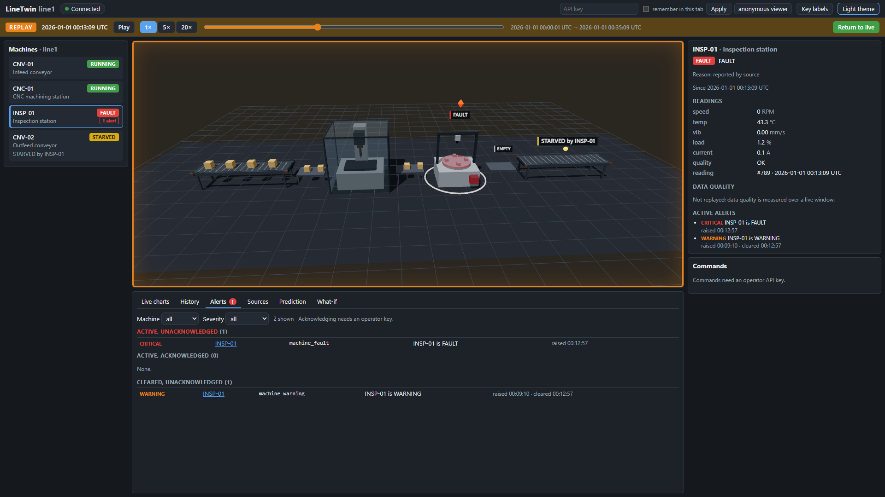
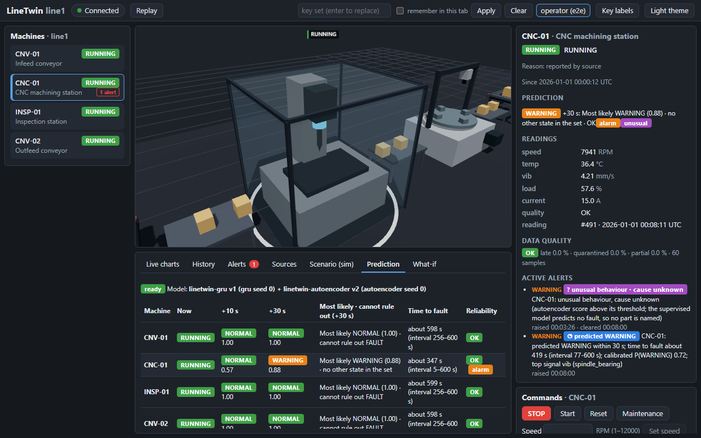
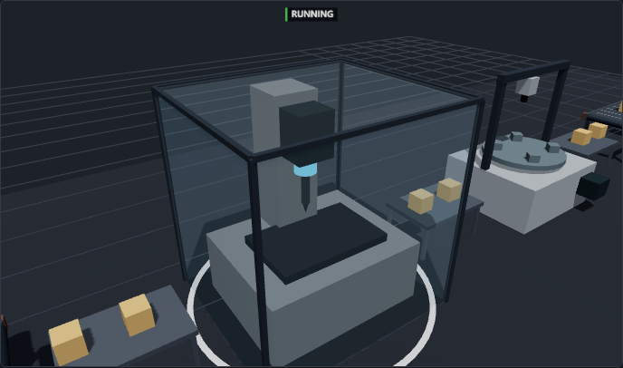
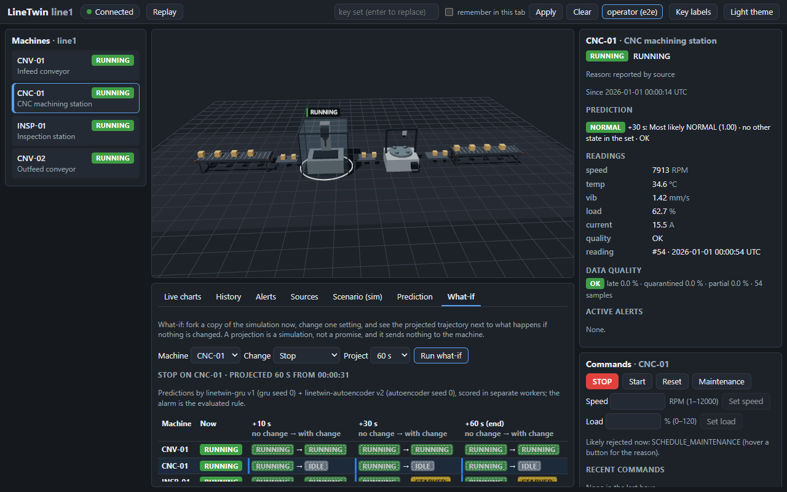

# LineTwin

LineTwin is a desktop 3D digital twin of a small production line: conveyor → CNC → inspection station → output conveyor, with buffers between them. A physics-based simulator produces the machine data. The twin ingests it from interchangeable sources (JSON/CSV file replay, a mock REST/WebSocket server, MQTT, OPC UA), validates and stores it as events, and shows every machine's state (running, idle, warning, fault, starved, blocked, ...) in a Three.js scene and a React dashboard. Operators can send commands back to the machines and run what-if projections. Trained models predict faults early, with calibrated confidence, conformal prediction sets, an anomaly detector for unseen faults, part-level explanations and drift detection. The project asks how reliable such warnings are under noise, missing data, changed operating conditions and unseen fault types, and whether the reported confidence still holds. **All models are trained and validated on simulator data.** Phase 10 found no early warning on the real MetroPT-3 data (see [Results](#results-and-limitations)).



| Predicted alarm with explanation | Bearing highlighted in 3D | What-if projection |
|---|---|---|
|  |  |  |

All screenshots are generated by `uv run poe screenshots` against a running backend (`experiments/results/frontend_screenshots/`).

## Tech stack

- **Backend:** Python 3.11 (managed with uv), FastAPI, Uvicorn, Pydantic v2, asyncio, structlog
- **Messaging and protocols:** Mosquitto 2 + aiomqtt (MQTT), asyncua (OPC UA), REST + WebSocket
- **Storage:** TimescaleDB (PostgreSQL 16) via asyncpg/SQLAlchemy 2; SQLite for minimal mode and tests; Parquet (pyarrow) for datasets
- **ML:** PyTorch (CPU), scikit-learn, XGBoost, SHAP, Captum, river (ADWIN), MLflow (local file store)
- **Frontend:** TypeScript (strict), React, Three.js (used directly), Chart.js, Vite
- **Quality and ops:** ruff, mypy, pytest, Vitest, ESLint, Playwright, pre-commit, GitHub Actions (manual), Prometheus `/metrics`, Locust
- **Services:** Docker Compose (TimescaleDB + Mosquitto, bound to 127.0.0.1 only). Developer tasks are [poethepoet](https://poethepoet.natn.io/) tasks: `uv run poe <task>`, and `uv run poe` lists them all.

## Quick start on Windows

Run every command in **PowerShell, from the repository root**.

### Prerequisites (once)

```powershell
winget install --id astral-sh.uv -e
winget install --id OpenJS.NodeJS.LTS -e
winget install --id Git.Git -e
winget install --id Docker.DockerDesktop -e    # only for the full demo (b)
```

Open a new PowerShell window afterwards so that `uv`, `node` and `git` are on the PATH. You don't need to install Python: uv downloads the pinned Python 3.11.

```powershell
git clone https://github.com/k-vruttika/3d-digital-twin-fault-detection.git linetwin
cd linetwin
uv sync --all-packages
uv run poe install
```

### (a) Minimal mode: no Docker, no broker, no ML

The twin replays a simulated CSV file into a SQLite event store.

```powershell
uv run poe sim-quick        # once: writes data/sim_quick/run_0000.csv (and more runs)
uv run poe minimal          # terminal 1: backend on http://127.0.0.1:8000
```

```powershell
uv run poe frontend         # terminal 2: dashboard on http://127.0.0.1:5173/
```

Open http://127.0.0.1:5173/ and select a machine in the list or the 3D view to see its state, readings, live charts and history. **Replay** scrubs back through the stored run. Minimal mode is read-only: the file source rejects commands, and the Prediction tab says "Live inference is off". Stop each terminal with Ctrl+C.

### (b) Full demo: Docker services, live simulator, live predictions, dashboard

**1. Start Docker Desktop** and wait until it says the engine is running.

**2. Set an operator API key** (needed to send commands, inject faults and apply what-ifs):

```powershell
Copy-Item .env.example .env
uv run python -c "import secrets; print(secrets.token_urlsafe(32))"
notepad .env
```

In `.env`, set the operator line to a name and the generated key, then save:

```text
LINETWIN_API_KEYS_OPERATOR=demo:<the generated key>
```

**3. Build the model bundles** (once per checkout, see [Rebuilding the model bundles](#rebuilding-the-model-bundles-on-a-fresh-checkout)). With trained runs already in `mlruns/`, this is:

```powershell
uv run poe up               # TimescaleDB + Mosquitto
uv run poe deploy-models    # GRU, XGBoost and autoencoder bundles, about 13 min on a laptop CPU
```

**4. Start the demo** with one command:

```powershell
uv run poe demo
```

`poe demo` starts the services (`up`), then runs the mock-machine simulator with the backend and live inference, plus the Vite dev server, in the same terminal. Ctrl+C stops both. The same thing in separate terminals:

```powershell
uv run poe up
uv run poe dev --source mock --inference     # terminal 1: simulator + backend, live inference on
```

```powershell
uv run poe frontend                          # terminal 2: dashboard
```

**5. Open http://127.0.0.1:5173/** and paste the operator key into the API key field in the header. Each machine gets a prediction after 30 s of running data (Prediction tab). Then follow [docs/demo_script.md](docs/demo_script.md): inject `bearing_wear` on CNC-01 in the **Scenario (sim)** tab, watch unusual behaviour, then the predicted warning, then the simulator's own WARNING, and try a what-if.

The simulator runs in real time, so a fault takes several minutes to develop. Stop with Ctrl+C, then `uv run poe down` (the data volumes are kept).

### Rebuilding the model bundles on a fresh checkout

`mlruns/` (the MLflow store holding the trained models and the reference runs) and `data/` are not committed. `deploy-models` reuses trained runs and checks every bundle against its logged reference run (Phase 8 calibration, Phase 9 autoencoder thresholds), so a fresh clone has to regenerate those first. Everything is seeded, so the same commands give the same models:

```powershell
uv run poe dataset                                                   # 200 simulated runs + windowed ML dataset -> data/sim, data/ml
uv run poe sim-sensor-faults                                         # sensor-fault test sets (Phase 8)
uv run poe sim-e5                                                    # held-out lubrication_loss runs (Phase 9)
uv run poe train --model gru --seeds 0,1,2                           # E1 training runs of the two deployed models
uv run poe train --model xgb --seeds 0,1,2
uv run poe robustness --study e1models --models gru,xgb --skip-existing   # calibration / conformal reference runs
uv run poe e5 --study e5_anomaly --models autoencoder --skip-existing     # autoencoder reference run
uv run poe deploy-models
```

Expect a few hours on a laptop CPU. On the reference laptop the full studies took: all E1 training (`train-all`, 5 models × 3 seeds) 74 min, the full `e1models` robustness study 73 min, `e5_anomaly` 4 min, `deploy-models` about 13 min. The `--models` subsets above only cut that time. **This sequence has not been re-run on a clean clone.** If a step reports a missing run, use the full commands instead: `uv run poe train-all`, `uv run poe robustness --study e1models --skip-existing` and `uv run poe e5 --study e5_anomaly --skip-existing`. The full reproduction of every experiment is in [docs/experiments.md](docs/experiments.md).

## Results and limitations

The research results are generated reports in [`experiments/results/`](experiments/results/): [E1_clean.md](experiments/results/E1_clean.md), [robustness.md](experiments/results/robustness.md), [e5_explain.md](experiments/results/e5_explain.md), [real_data.md](experiments/results/real_data.md), [drift.md](experiments/results/drift.md), [live_inference.md](experiments/results/live_inference.md). A summary of what was built, the key results and the known limitations is at the end of [docs/PROGRESS.md](docs/PROGRESS.md#final-summary-hand-in).

## Documentation

- [docs/setup.md](docs/setup.md): tools, Docker services, native fallback, configuration
- [docs/architecture.md](docs/architecture.md), [docs/api.md](docs/api.md), [docs/frontend.md](docs/frontend.md), [docs/simulator.md](docs/simulator.md), [docs/experiments.md](docs/experiments.md)
- [docs/demo_script.md](docs/demo_script.md): the 5–7 minute demo and the full scenarios
- [docs/adr/](docs/adr/): architecture decision records
- [docs/PROGRESS.md](docs/PROGRESS.md): phase-by-phase log

## For contributors

```powershell
git clone https://github.com/k-vruttika/3d-digital-twin-fault-detection.git linetwin
cd linetwin
uv sync --all-packages
npm --prefix frontend install
git switch -c my-change          # work on a branch, never directly on main
```

Before every commit, run both checks:

```powershell
uv run poe lint                  # ruff, ruff format --check, mypy, ESLint, tsc
uv run poe test                  # pytest + Vitest
```

- **Tests that need services:** tests that need Docker services skip with a message unless `uv run poe up` is running.
- **Browser tests:** these need Chromium (`uv run poe browsers` once).
- **Demo scenarios:** the real-time scenarios are opt-in: `uv run poe demo-tests`, about 40 min.
- **Formatting:** `uv run poe fmt` applies formatting.
- **CI:** CI runs only when started by hand (Actions tab → CI → Run workflow).
- **Project rules:** read [CLAUDE.md](CLAUDE.md). The main rules are: config instead of magic constants, seeded randomness, no hand-typed results, and minimal mode must keep working without Docker.
