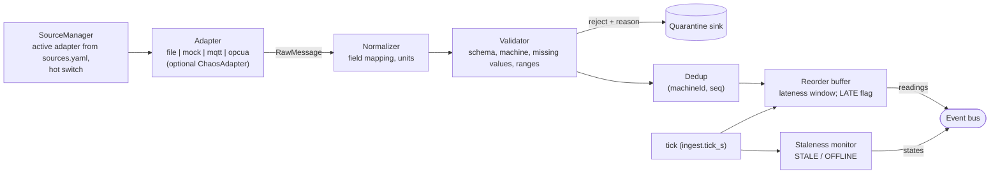
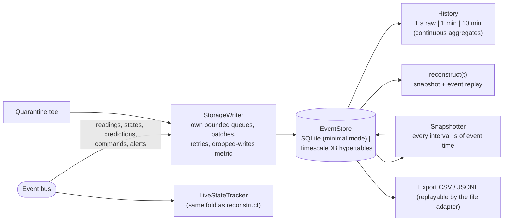
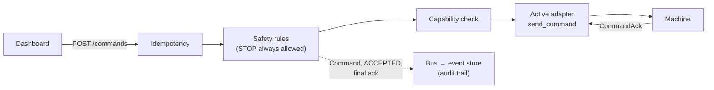
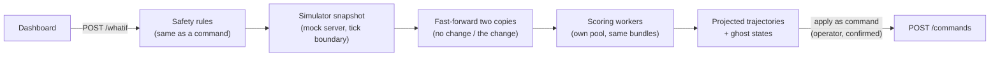

# LineTwin architecture

This is the Mermaid version of the diagram in `CLAUDE.md` section 3. The services (TimescaleDB, Mosquitto) run via Docker Compose (`uv run poe up`), with native installs as a fallback (see [ADR 0005](adr/0005-docker-compose-services.md) and [setup.md](setup.md)). Minimal mode never needs them.

## Data path

## Ingest (Phase 2)

Implemented in `backend/twin_backend/adapters/`, `ingest/` and `bus/`. The semantics are described in [ADR 0007](adr/0007-adapters-and-ingest.md), the bus in [ADR 0006](adr/0006-event-bus-interface.md), and the wire formats in [api.md](api.md).

- **Adapters** reconnect with exponential backoff. Every stage is driven by an injectable clock, so tests advance a fake clock instead of sleeping.
- **Metrics** are Prometheus counters and an end-to-end latency histogram, kept per pipeline registry. They will be served at `/metrics` from Phase 4.
- **Commands:** `SourceManager.send_command` forwards a command to the active adapter if that adapter has the `commands` capability. Commands and acks are also published on the `commands` topic.
- **Event loop:** all async entry points run on `twin_common.aio.run`, which uses a selector loop on Windows ([ADR 0008](adr/0008-windows-selector-event-loop.md)).

## Storage and event sourcing (Phase 3)

Implemented in `backend/twin_backend/storage/` and `engine/line_state.py`. The decisions are in [ADR 0009](adr/0009-event-store-and-migrations.md) (store, TimescaleDB features, migrations) and [ADR 0010](adr/0010-event-time-replay-and-snapshots.md) (event-time axis, line-state fold, snapshots, reconstruct).

- **Backend selection:** `config/storage.yaml`, `backend: sqlite` (the default, needs no service) or `timescale`. `twin_backend.runtime.build_runtime()` loads `line.yaml`, `sources.yaml` and `storage.yaml` and wires the bus, storage and `SourceManager`. With storage present, live ingestion persists automatically.
- **Never blocking:** the writer reads from its own bus subscriptions. When it falls behind, the oldest rows are dropped and counted (`linetwin_storage_dropped_writes_total`). Ingestion never waits for the database.
- **One time axis:** every stored event carries its event time `ts`. Staleness state changes are stamped on the same axis (scaled by the replay speed). `ingested_at` (wall clock) is metadata only.
- **Time travel:** `reconstruct(t)` folds snapshot + events with the same order-independent reducer the live tracker uses, so it equals the live state for the same data. LATE readings are stored but never applied.
- **Metrics:** the storage metrics share the ingest metrics registry, served at `/metrics`.
- **Measured write throughput:** see `experiments/results/storage_bench.md` (`uv run poe storage-bench`).

## Twin engine (Phase 4)

`TwinEngine` observes the line-state fold and never changes it, so live state still equals `reconstruct(t)` ([ADR 0012](adr/0012-twin-engine.md)):

- **State machine:** allowed transitions from `config/engine.yaml`; invalid ones are logged and counted, never rejected.
- **Propagation:** the root cause of every STARVED/BLOCKED machine, from the line topology (buffers, or machine order for `line_single.yaml`). It is the simulator's rule, checked sample by sample against generated runs.
- **Data quality:** OK / DEGRADED per machine, from late %, quarantine %, partial-reading % and link state.
- **Alerts:** an ISA-18.2 lifecycle (raise, clear, acknowledge), stored as append-only events ([ADR 0011](adr/0011-alert-lifecycle.md)).
- **Engine StateChanges:** when a reading changes a machine's state, the engine publishes a StateChange with a reason (`"BLOCKED by CNC-01"`).

## API (Phase 4)

FastAPI, started with `uvicorn.Server.serve()` inside `twin_common.aio.run()` ([ADR 0013](adr/0013-api-auth-websocket.md)):

- **REST:** machine state, history, replay, export, alerts, sources, commands, scenario, health and metrics.
- **WebSocket `/stream`:** a first-message auth, subscriptions by machine and channel, and per-client bounded outboxes with coalescing and drop-oldest, so a slow client never slows ingestion or other clients.
- **Auth:** API keys from `.env`, mapped to roles viewer and operator. Without keys the API is read-only and binds to loopback only.

Reference: [api.md](api.md) (generated from OpenAPI, plus the WebSocket protocol).

## 3D twin engine (Phase 5)

- **`TwinEngine`** (`frontend/src/engine/`): a framework-agnostic Three.js renderer ([ADR 0016](adr/0016-3d-twin-engine.md)). It lays the line out from `GET /line`, builds procedural machines with addressable parts, and maps states to visuals through one pure function. It infers buffer states from neighbours (the line reports no buffer levels) and frees every resource on `dispose()`.
- **API client** (`frontend/src/api/`): a typed REST client and a WebSocket client (auth first, re-subscribe and fresh snapshot after every reconnect, backoff also after 4408). `bindStream` feeds the engine.
- **Types:** generated from the backend's OpenAPI schema, which also carries the WebSocket frame models ([ADR 0017](adr/0017-generated-api-types.md)).
- **Dashboard** (`frontend/src/dashboard/`, `index.html`, Phase 6): a React app around the engine.
  - One `DashboardModel` is the `EngineSink` for the stream and replay. It feeds small stores for the panels and forwards everything to the engine ([ADR 0018](adr/0018-dashboard-state-auth-replay.md)).
  - Panels: machine list, details, live and history charts (Chart.js), ISA-18.2 alerts, commands, scenario injection (simulation only), sources, replay, and Phase 11 placeholders.
  - The engine and three.js load as their own chunks.
- **Dev page:** `frontend/dev.html` (`uv run poe frontend`), with synthetic modes for performance checks and screenshots. See [frontend.md](frontend.md).
- **End-to-end tests:** pytest starts the backend and Vite (`twin_backend/e2e_stack.py`) and drives the dashboard with Playwright, in minimal mode and in dev mode with the mock source.

## Command path

See [ADR 0014](adr/0014-command-path.md). Scenario injection (simulation only, [ADR 0015](adr/0015-scenario-injection.md)) takes the same route, with `POST /scenario` → active adapter `send_scenario` → simulator, and has its own audit table `scenario_requests`.

## What-if path

`POST /whatif` needs the source capability `whatif` (the mock server; a simulation-only feature like scenario injection), and answers 409 otherwise. The mock server copies the simulator state at a tick boundary, then runs an unchanged copy and a changed copy for `horizonS` seconds in a thread, so the live simulation keeps its pace. The simulator restores its random-number streams too, so the unchanged copy is exactly what the live simulation would do next. With live inference on, a separate worker pool (same bundles and gate, no attributions) scores both projections from empty buffers over the recent readings plus the projection, with the evaluated alarm rule; the live inference, its alerts and the event store are not touched. Without inference the projection shows the simulator only. Running a what-if sends nothing to a machine and stores nothing; applying the change for real goes through `POST /commands` ([ADR 0031](adr/0031-whatif-drift-demo.md)).

## Minimal mode

The minimal path is `File export` or `Mock server` → adapter → ingest → bus → twin engine → API / WS gateway → frontend, with the SQLite event store (`config/storage.yaml` ships with `backend: sqlite`) and no broker, TimescaleDB, Docker or ML. `uv run poe minimal` runs it (`serve --mode minimal`). It must keep working in every phase (CLAUDE.md section 1); `tests/test_phase4_minimal.py` starts the server in a fresh process and checks that no broker, database driver or ML module is loaded.

## Shared contracts

All wire formats are defined once in `common/twin_common/contracts.py`:

- `Reading` (schemaVersion 2; sensor values nullable, `null` = missing)
- `StateChange` (bus topic `states`; `ts` on the event-time axis)
- `Prediction`
- `Attribution`
- `Command`
- `CommandAck`
- `Alert` (bus topic `alerts`; one event per lifecycle transition: `active`, `acknowledged`, `rev`, ADR 0011)
- `ScenarioRequest` / `ScenarioAck` (bus topic `scenarios`; simulation only, ADR 0015)

JSON is camelCase and Python attributes are snake_case. Timestamps must be timezone-aware and are normalized to UTC. Unknown fields are rejected.

Line layout, data sources, storage, the engine, the API and commands come from `config/line.yaml` (or `line_single.yaml`, via `LINETWIN_LINE_FILE` / `--line`), `sources.yaml`, `storage.yaml`, `engine.yaml`, `api.yaml` and `commands.yaml`, all validated by `twin_common.config`.
