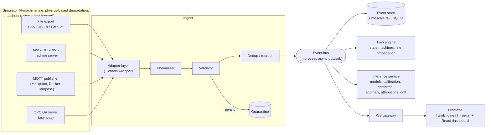
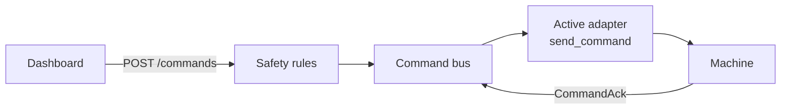
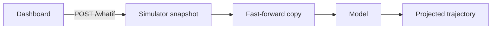

# LineTwin architecture

This is the Mermaid version of the diagram in `CLAUDE.md` section 3. The services (TimescaleDB, Mosquitto) run via Docker Compose (`uv run poe up`), with native installs as a fallback (see [ADR 0005](adr/0005-docker-compose-services.md) and [setup.md](setup.md)). Minimal mode never needs them.

## Data path

## Ingest (Phase 2)

Implemented in `backend/twin_backend/adapters/`, `ingest/` and `bus/`. The semantics are described in [ADR 0007](adr/0007-adapters-and-ingest.md), the bus in [ADR 0006](adr/0006-event-bus-interface.md), and the wire formats in [api.md](api.md).

- **Adapters** reconnect with exponential backoff. Every stage is driven by an injectable clock, so tests advance a fake clock instead of sleeping.
- **Metrics** are Prometheus counters and an end-to-end latency histogram, kept per pipeline registry. They will be served at `/metrics` from Phase 4.
- **Commands:** `SourceManager.send_command` forwards a command to the active adapter if that adapter has the `commands` capability. Commands and acks are also published on the `commands` topic.
- **Event loop:** all async entry points run on `twin_common.aio.run`, which uses a selector loop on Windows ([ADR 0008](adr/0008-windows-selector-event-loop.md)).

## Command path

## What-if path

## Minimal mode

The minimal path is `File export` or `Mock server` → adapter → ingest → bus → twin engine → WS gateway → frontend, with the SQLite (or no) event store and no broker, TimescaleDB, Docker or ML. It must keep working in every phase (CLAUDE.md section 1).

## Shared contracts

All wire formats are defined once in `common/twin_common/contracts.py`:

- `Reading` (schemaVersion 2; sensor values nullable, `null` = missing)
- `StateChange` (bus topic `states`)
- `Prediction`
- `Attribution`
- `Command`
- `CommandAck`

JSON is camelCase and Python attributes are snake_case. Timestamps must be timezone-aware and are normalized to UTC. Unknown fields are rejected.

Line layout and data sources come from `config/line.yaml` and `config/sources.yaml`, which are validated by `twin_common.config`.
