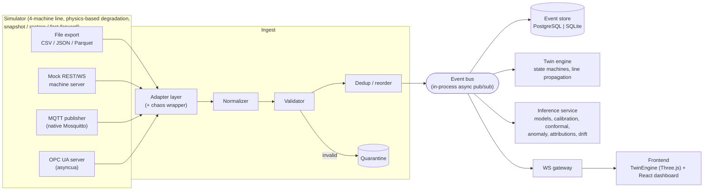
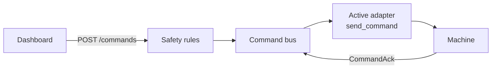
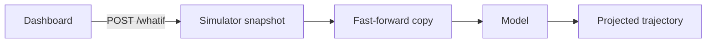

# LineTwin architecture

This is the Mermaid version of the diagram in `CLAUDE.md` section 3. All services run natively on Windows; there is no Docker (see [ADR 0002](adr/0002-native-services-no-docker.md)).

## Data path

## Command path

## What-if path

## Minimal mode

The minimal path is `File export` or `Mock server` → adapter → ingest → bus → twin engine → WS gateway → frontend, with the SQLite (or no) event store and no broker, PostgreSQL or ML. It must keep working in every phase (CLAUDE.md section 1).

## Shared contracts

All wire formats are defined once in `common/twin_common/contracts.py`:

- `Reading` (schemaVersion 2)
- `Prediction`
- `Attribution`
- `Command`
- `CommandAck`

JSON is camelCase and Python attributes are snake_case. Timestamps must be timezone-aware and are normalized to UTC. Unknown fields are rejected.

Line layout and data sources come from `config/line.yaml` and `config/sources.yaml`, which are validated by `twin_common.config`.
