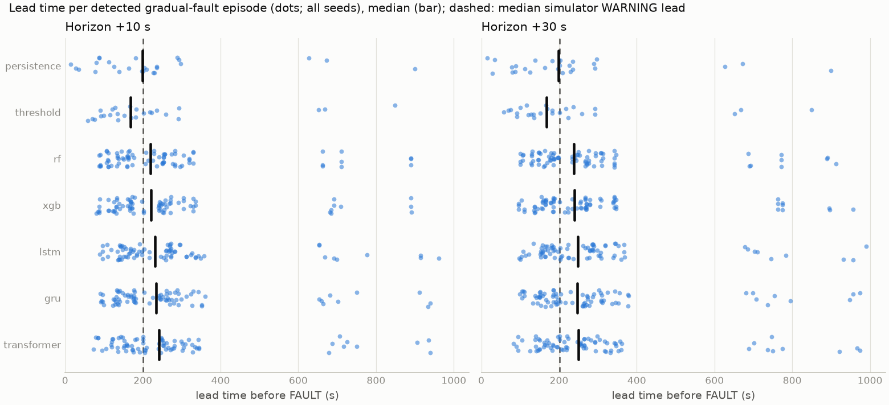
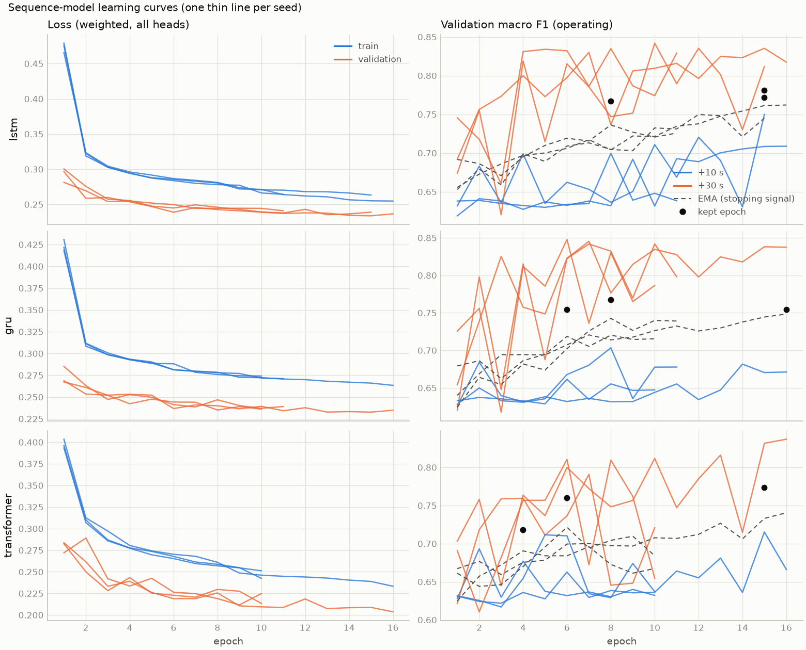

# E1: early fault warning on clean data

Generated by `uv run poe report-e1` from the MLflow experiment `E1_clean` on 2026-11-15 07:01 UTC (git `d540f26`). Do not edit by hand; definitions are in [docs/experiments.md](../../docs/experiments.md).

## Data

| Item | Value |
|---|---|
| Dataset key | `944580196604b618` |
| Simulator manifest sha256 (file bytes) | `edc074a28be579f2fd81df63adfdd9f8fbbd689c49a4c052296ca77875733e4b` |
| Simulator content sha256 | `c0e100c0373bc8d6279d6574e0b4065bd5c63e2d360abc43fa5192d3b5963065` |
| Source | `data/sim`: scenario `default`, 200 runs × 3600 s, base seed 42 |
| Held-out fault types (not in the data) | lubrication_loss |
| Split (runs: train / val / test) | 140 / 30 / 30 |
| Windows (train / val / test) | 132044 / 85080 / 424920 |
| Strides s (train / val / test) | 5 / 5 / 1 |
| Window, horizons, ttf cap | 30 s; +10 s, +30 s; 600 s |
| Training subsample of far-normal windows | keep 0.25, kept windows weighted 1 / keep |
| Gradual-fault episodes in test runs | 26 |
| Bootstrap | 1000 resamples of test runs, seed 11, 95 % percentile CI |

Values are mean ± std over seeds (baselines are deterministic: one run). Brackets: 95 % bootstrap CI over test runs (mean of the per-seed bounds).

## How to read this report

- **Primary result: episode-level early warning.** The research question is whether the twin warns before a fault. Per-window WARNING precision penalises a model that warns earlier than the simulator's WARNING label (those windows count as false positives), so the episode metrics below (lead time, lead relative to the threshold WARNING, miss rate, false alarms per hour) are the primary result and per-window macro F1 is secondary.
- **Low FAULT recall at +10 s** means the models warn early as WARNING rather than timing the exact FAULT transition; the early-warning metrics count a WARNING or FAULT prediction as an alarm, so such a model still warns.
- **Subset (b), machines already stopped:** a stopped machine reads zero on every sensor, so sensor-only models cannot tell IDLE, FAULT and MAINTENANCE apart. This follows from the input restriction (no state input); persistence wins there by construction. The live system (Phase 11) should not predict for stopped machines.
- **Belt jams** have no precursors in the signals; no model can anticipate them.

## Primary result: early warning on gradual faults

**Horizon +10 s** - 26 gradual-fault episodes in the test runs (CNC 12, CONVEYOR 9, INSPECTION 5); sustained alarm = 3 s of WARNING/FAULT predictions.

| Model | Miss rate | Lead mean s | Lead median s | vs threshold WARNING, mean s | vs threshold WARNING, median s | False alarms / h |
|---|---|---|---|---|---|---|
| persistence | 0.000 [0.000, 0.000] | 229 [140, 309] | 199 | -2 [-2, -2] | -2 | 0.00 [0.00, 0.00] |
| threshold | 0.000 [0.000, 0.000] | 226 [144, 303] | 168 | -5 [-17, 9] | -5 | 0.00 [0.00, 0.00] |
| rf | 0.000 ± 0.000 [0.000, 0.000] | 261 ± 1 [178, 340] | 220 ± 2 | 31 ± 1 [16, 48] | 25 ± 0 | 0.00 ± 0.00 [0.00, 0.00] |
| xgb | 0.000 ± 0.000 [0.000, 0.000] | 265 ± 1 [183, 342] | 221 ± 2 | 34 ± 1 [18, 53] | 35 ± 4 | 0.00 ± 0.00 [0.00, 0.00] |
| lstm | 0.000 ± 0.000 [0.000, 0.000] | 277 ± 5 [195, 354] | 232 ± 9 | 46 ± 5 [31, 65] | 39 ± 3 | 0.00 ± 0.00 [0.00, 0.00] |
| gru | 0.000 ± 0.000 [0.000, 0.000] | 273 ± 5 [190, 351] | 230 ± 7 | 42 ± 5 [27, 61] | 36 ± 2 | 0.00 ± 0.00 [0.00, 0.00] |
| transformer | 0.000 ± 0.000 [0.000, 0.000] | 278 ± 12 [194, 356] | 232 ± 10 | 47 ± 12 [28, 70] | 41 ± 15 | 0.01 ± 0.01 [0.00, 0.02] |

**Horizon +30 s** - 26 gradual-fault episodes in the test runs (CNC 12, CONVEYOR 9, INSPECTION 5); sustained alarm = 3 s of WARNING/FAULT predictions.

| Model | Miss rate | Lead mean s | Lead median s | vs threshold WARNING, mean s | vs threshold WARNING, median s | False alarms / h |
|---|---|---|---|---|---|---|
| persistence | 0.000 [0.000, 0.000] | 229 [140, 309] | 199 | -2 [-2, -2] | -2 | 0.00 [0.00, 0.00] |
| threshold | 0.000 [0.000, 0.000] | 226 [144, 303] | 168 | -5 [-17, 9] | -5 | 0.00 [0.00, 0.00] |
| rf | 0.000 ± 0.000 [0.000, 0.000] | 283 ± 1 [198, 361] | 240 ± 2 | 52 ± 1 [34, 71] | 48 ± 1 | 0.00 ± 0.00 [0.00, 0.00] |
| xgb | 0.000 ± 0.000 [0.000, 0.000] | 289 ± 2 [203, 370] | 240 ± 4 | 58 ± 2 [38, 81] | 54 ± 2 | 0.00 ± 0.00 [0.00, 0.00] |
| lstm | 0.000 ± 0.000 [0.000, 0.000] | 296 ± 5 [212, 373] | 248 ± 9 | 65 ± 5 [49, 85] | 60 ± 6 | 0.00 ± 0.00 [0.00, 0.00] |
| gru | 0.000 ± 0.000 [0.000, 0.000] | 293 ± 7 [207, 374] | 243 ± 4 | 62 ± 7 [45, 82] | 56 ± 9 | 0.00 ± 0.00 [0.00, 0.00] |
| transformer | 0.000 ± 0.000 [0.000, 0.000] | 294 ± 10 [209, 374] | 243 ± 7 | 63 ± 10 [43, 86] | 61 ± 14 | 0.01 ± 0.01 [0.00, 0.02] |

Lead = fault onset - first sustained alarm after the degradation started. "vs threshold WARNING" = simulator WARNING onset - alarm (positive = earlier than the simulator's own warning). False alarms are counted in operating windows with no active fault and a NORMAL target.

## Paired comparisons

Differences on the same resampled test runs (paired bootstrap, 1000 resamples, 95 % CI). Each cell: mean difference over seeds [mean CI bounds] (does the CI exclude zero; in how many seeds the per-seed CI excludes zero). Lead differences compare mean leads of the detected episodes.

**Model - threshold baseline, horizon +10 s**

| Model | Lead mean s | Lead vs threshold WARNING s | Macro F1 (operating) | False alarms / h |
|---|---|---|---|---|
| persistence | 3 [-11, 15] (no) | 3 [-11, 15] (no) | -0.106 [-0.133, -0.063] (yes) | 0.00 [0.00, 0.00] (no) |
| rf | 36 [27, 46] (yes, 3/3 seeds) | 36 [27, 46] (yes, 3/3 seeds) | -0.043 [-0.079, -0.010] (yes, 3/3 seeds) | 0.00 [0.00, 0.00] (no, 0/3 seeds) |
| xgb | 39 [30, 50] (yes, 3/3 seeds) | 39 [30, 50] (yes, 3/3 seeds) | -0.103 [-0.131, -0.070] (yes, 3/3 seeds) | 0.00 [0.00, 0.00] (no, 0/3 seeds) |
| lstm | 51 [41, 63] (yes, 3/3 seeds) | 51 [41, 63] (yes, 3/3 seeds) | -0.093 [-0.130, -0.057] (yes, 3/3 seeds) | 0.00 [0.00, 0.00] (no, 0/3 seeds) |
| gru | 47 [37, 59] (yes, 3/3 seeds) | 47 [37, 59] (yes, 3/3 seeds) | -0.093 [-0.124, -0.056] (yes, 3/3 seeds) | 0.00 [0.00, 0.00] (no, 0/3 seeds) |
| transformer | 52 [39, 67] (yes, 3/3 seeds) | 52 [39, 67] (yes, 3/3 seeds) | -0.097 [-0.140, -0.059] (yes, 3/3 seeds) | 0.01 [0.00, 0.02] (no, 0/3 seeds) |

**Model - threshold baseline, horizon +30 s**

| Model | Lead mean s | Lead vs threshold WARNING s | Macro F1 (operating) | False alarms / h |
|---|---|---|---|---|
| persistence | 3 [-11, 15] (no) | 3 [-11, 15] (no) | -0.126 [-0.176, -0.066] (yes) | 0.00 [0.00, 0.00] (no) |
| rf | 57 [46, 68] (yes, 3/3 seeds) | 57 [46, 68] (yes, 3/3 seeds) | 0.042 [0.005, 0.086] (yes, 3/3 seeds) | 0.00 [0.00, 0.00] (no, 0/3 seeds) |
| xgb | 63 [50, 77] (yes, 3/3 seeds) | 63 [50, 77] (yes, 3/3 seeds) | 0.027 [-0.015, 0.080] (no, 0/3 seeds) | 0.00 [0.00, 0.00] (no, 0/3 seeds) |
| lstm | 70 [59, 83] (yes, 3/3 seeds) | 70 [59, 83] (yes, 3/3 seeds) | 0.035 [-0.002, 0.073] (no, 1/3 seeds) | 0.00 [0.00, 0.00] (no, 0/3 seeds) |
| gru | 67 [55, 80] (yes, 3/3 seeds) | 67 [55, 80] (yes, 3/3 seeds) | 0.046 [0.014, 0.082] (yes, 2/3 seeds) | 0.00 [0.00, 0.00] (no, 0/3 seeds) |
| transformer | 68 [53, 84] (yes, 3/3 seeds) | 68 [53, 84] (yes, 3/3 seeds) | 0.041 [-0.002, 0.084] (no, 2/3 seeds) | 0.01 [0.00, 0.02] (no, 0/3 seeds) |

**Best sequence model - best tree model** (best = highest mean lead time at that horizon, or operating macro F1 if no model of a family detected an episode; the metric used is in the JSON summary; seed i paired with seed i)

| Horizon: models | Lead mean s | Lead vs threshold WARNING s | Macro F1 (operating) | False alarms / h |
|---|---|---|---|---|
| +10 s: transformer - xgb | 13 [4, 22] (yes, 2/3 seeds) | 13 [4, 22] (yes, 2/3 seeds) | 0.005 [-0.027, 0.035] (no, 0/3 seeds) | 0.01 [0.00, 0.02] (no, 0/3 seeds) |
| +30 s: lstm - xgb | 7 [-4, 17] (no, 1/3 seeds) | 7 [-4, 17] (no, 1/3 seeds) | 0.008 [-0.038, 0.042] (no, 0/3 seeds) | 0.00 [0.00, 0.00] (no, 0/3 seeds) |

## Secondary: per-window classification

### Operating windows, horizon +10 s

| Model | Seeds | Macro F1 | Fault recall | Accuracy | PR-AUC (W, F) |
|---|---|---|---|---|---|
| persistence | 1 | 0.653 [0.645, 0.657] | 0.000 [0.000, 0.000] | 0.998 | 0.461 |
| threshold | 1 | 0.759 [0.714, 0.786] | 0.339 [0.182, 0.503] | 0.997 | 0.485 |
| rf | 3 | 0.716 ± 0.003 [0.667, 0.759] | 0.141 ± 0.006 [0.053, 0.242] | 0.996 ± 0.000 | 0.640 ± 0.003 |
| xgb | 3 | 0.656 ± 0.006 [0.630, 0.679] | 0.031 ± 0.011 [0.004, 0.073] | 0.996 ± 0.000 | 0.585 ± 0.008 |
| lstm | 3 | 0.666 ± 0.016 [0.625, 0.702] | 0.058 ± 0.024 [0.003, 0.130] | 0.996 ± 0.000 | 0.604 ± 0.020 |
| gru | 3 | 0.666 ± 0.026 [0.631, 0.695] | 0.059 ± 0.049 [0.009, 0.124] | 0.996 ± 0.000 | 0.597 ± 0.013 |
| transformer | 3 | 0.662 ± 0.030 [0.617, 0.694] | 0.060 ± 0.050 [0.009, 0.129] | 0.995 ± 0.001 | 0.598 ± 0.039 |

Per class (+10 s, operating):

| Model | N P | N R | N F1 | W P | W R | W F1 | F P | F R | F F1 |
|---|---|---|---|---|---|---|---|---|---|
| persistence | 0.999 | 1.000 | 0.999 | 0.959 | 0.959 | 0.959 | 0.000 | 0.000 | 0.000 |
| threshold | 0.998 | 0.999 | 0.999 | 0.944 | 0.880 | 0.911 | 0.403 | 0.339 | 0.368 |
| rf | 0.999 ± 0.000 | 0.998 ± 0.000 | 0.999 ± 0.000 | 0.866 ± 0.000 | 0.973 ± 0.002 | 0.916 ± 0.001 | 0.685 ± 0.019 | 0.141 ± 0.006 | 0.233 ± 0.009 |
| xgb | 0.999 ± 0.000 | 0.998 ± 0.000 | 0.998 ± 0.000 | 0.861 ± 0.003 | 0.971 ± 0.002 | 0.913 ± 0.001 | 0.357 ± 0.125 | 0.031 ± 0.011 | 0.058 ± 0.019 |
| lstm | 0.999 ± 0.000 | 0.997 ± 0.000 | 0.998 ± 0.000 | 0.831 ± 0.009 | 0.983 ± 0.002 | 0.901 ± 0.004 | 0.359 ± 0.190 | 0.058 ± 0.024 | 0.100 ± 0.043 |
| gru | 0.999 ± 0.000 | 0.997 ± 0.000 | 0.998 ± 0.000 | 0.837 ± 0.014 | 0.982 ± 0.006 | 0.904 ± 0.006 | 0.285 ± 0.129 | 0.059 ± 0.049 | 0.096 ± 0.074 |
| transformer | 0.999 ± 0.000 | 0.997 ± 0.001 | 0.998 ± 0.000 | 0.822 ± 0.036 | 0.976 ± 0.010 | 0.892 ± 0.018 | 0.297 ± 0.192 | 0.060 ± 0.050 | 0.095 ± 0.071 |

### Operating windows, horizon +30 s

| Model | Seeds | Macro F1 | Fault recall | Accuracy | PR-AUC (W, F) |
|---|---|---|---|---|---|
| persistence | 1 | 0.626 [0.601, 0.636] | 0.000 [0.000, 0.000] | 0.995 | 0.389 |
| threshold | 1 | 0.751 [0.680, 0.803] | 0.247 [0.128, 0.382] | 0.994 | 0.491 |
| rf | 3 | 0.794 ± 0.003 [0.745, 0.829] | 0.385 ± 0.015 [0.240, 0.534] | 0.995 ± 0.000 | 0.733 ± 0.002 |
| xgb | 3 | 0.779 ± 0.005 [0.734, 0.811] | 0.352 ± 0.009 [0.228, 0.483] | 0.994 ± 0.000 | 0.720 ± 0.005 |
| lstm | 3 | 0.786 ± 0.010 [0.723, 0.833] | 0.344 ± 0.034 [0.200, 0.495] | 0.994 ± 0.000 | 0.751 ± 0.018 |
| gru | 3 | 0.798 ± 0.017 [0.741, 0.837] | 0.399 ± 0.091 [0.250, 0.545] | 0.994 ± 0.000 | 0.746 ± 0.001 |
| transformer | 3 | 0.793 ± 0.015 [0.733, 0.832] | 0.406 ± 0.033 [0.254, 0.556] | 0.994 ± 0.001 | 0.721 ± 0.034 |

Per class (+30 s, operating):

| Model | N P | N R | N F1 | W P | W R | W F1 | F P | F R | F F1 |
|---|---|---|---|---|---|---|---|---|---|
| persistence | 0.997 | 1.000 | 0.998 | 0.880 | 0.877 | 0.878 | 0.000 | 0.000 | 0.000 |
| threshold | 0.996 | 1.000 | 0.998 | 0.903 | 0.840 | 0.870 | 0.881 | 0.247 | 0.386 |
| rf | 0.999 ± 0.000 | 0.998 ± 0.000 | 0.998 ± 0.000 | 0.841 ± 0.002 | 0.945 ± 0.005 | 0.890 ± 0.001 | 0.687 ± 0.014 | 0.385 ± 0.015 | 0.493 ± 0.009 |
| xgb | 0.999 ± 0.000 | 0.997 ± 0.000 | 0.998 ± 0.000 | 0.828 ± 0.001 | 0.940 ± 0.004 | 0.881 ± 0.002 | 0.653 ± 0.025 | 0.352 ± 0.009 | 0.458 ± 0.013 |
| lstm | 0.999 ± 0.000 | 0.997 ± 0.000 | 0.998 ± 0.000 | 0.811 ± 0.010 | 0.969 ± 0.004 | 0.883 ± 0.007 | 0.792 ± 0.063 | 0.344 ± 0.034 | 0.478 ± 0.027 |
| gru | 0.999 ± 0.000 | 0.997 ± 0.001 | 0.998 ± 0.000 | 0.821 ± 0.010 | 0.961 ± 0.009 | 0.886 ± 0.008 | 0.731 ± 0.055 | 0.399 ± 0.091 | 0.509 ± 0.060 |
| transformer | 0.999 ± 0.000 | 0.997 ± 0.001 | 0.998 ± 0.001 | 0.809 ± 0.034 | 0.943 ± 0.025 | 0.871 ± 0.029 | 0.712 ± 0.158 | 0.406 ± 0.033 | 0.510 ± 0.020 |

### Other subsets

**(b) already in FAULT or MAINTENANCE**

| Model | Macro F1 +10 s | Fault recall +10 s | Macro F1 +30 s | Fault recall +30 s |
|---|---|---|---|---|
| persistence | 0.985 | 1.000 | 0.956 | 1.000 |
| threshold | 0.412 | 0.027 | 0.425 | 0.029 |
| rf | 0.642 ± 0.001 | 0.913 ± 0.002 | 0.641 ± 0.001 | 0.897 ± 0.001 |
| xgb | 0.636 ± 0.001 | 0.936 ± 0.001 | 0.630 ± 0.002 | 0.924 ± 0.002 |
| lstm | 0.404 ± 0.053 | 0.967 ± 0.026 | 0.408 ± 0.042 | 0.963 ± 0.022 |
| gru | 0.412 ± 0.048 | 0.953 ± 0.016 | 0.432 ± 0.039 | 0.948 ± 0.016 |
| transformer | 0.543 ± 0.054 | 0.948 ± 0.010 | 0.551 ± 0.050 | 0.940 ± 0.010 |

**(c) operating windows before a gradual fault (onset within the ttf cap)**

| Model | Macro F1 +10 s | Fault recall +10 s | Macro F1 +30 s | Fault recall +30 s |
|---|---|---|---|---|
| persistence | 0.648 | 0.000 | 0.611 | 0.000 |
| threshold | 0.772 | 0.469 | 0.773 | 0.342 |
| rf | 0.724 ± 0.005 | 0.195 ± 0.008 | 0.811 ± 0.003 | 0.533 ± 0.020 |
| xgb | 0.646 ± 0.008 | 0.044 ± 0.015 | 0.791 ± 0.006 | 0.488 ± 0.013 |
| lstm | 0.660 ± 0.019 | 0.081 ± 0.034 | 0.807 ± 0.012 | 0.476 ± 0.046 |
| gru | 0.661 ± 0.037 | 0.082 ± 0.068 | 0.819 ± 0.016 | 0.553 ± 0.126 |
| transformer | 0.651 ± 0.044 | 0.083 ± 0.069 | 0.809 ± 0.027 | 0.562 ± 0.046 |

**(c) operating windows before a belt jam (onset within the ttf cap; no precursors)**

| Model | Macro F1 +10 s | Fault recall +10 s | Macro F1 +30 s | Fault recall +30 s |
|---|---|---|---|---|
| persistence | 0.496 | 0.000 | 0.487 | 0.000 |
| threshold | 0.496 | 0.000 | 0.487 | 0.000 |
| rf | 0.496 ± 0.000 | 0.000 ± 0.000 | 0.487 ± 0.000 | 0.000 ± 0.000 |
| xgb | 0.496 ± 0.000 | 0.000 ± 0.000 | 0.487 ± 0.000 | 0.000 ± 0.000 |
| lstm | 0.496 ± 0.000 | 0.000 ± 0.000 | 0.487 ± 0.000 | 0.000 ± 0.000 |
| gru | 0.496 ± 0.000 | 0.000 ± 0.000 | 0.487 ± 0.000 | 0.000 ± 0.000 |
| transformer | 0.496 ± 0.000 | 0.000 ± 0.000 | 0.487 ± 0.000 | 0.000 ± 0.000 |

**all test windows**

| Model | Macro F1 +10 s | Fault recall +10 s | Macro F1 +30 s | Fault recall +30 s |
|---|---|---|---|---|
| persistence | 0.974 | 0.963 | 0.922 | 0.890 |
| threshold | 0.626 | 0.038 | 0.622 | 0.052 |
| rf | 0.859 ± 0.000 | 0.884 ± 0.002 | 0.841 ± 0.000 | 0.838 ± 0.002 |
| xgb | 0.858 ± 0.000 | 0.903 ± 0.001 | 0.837 ± 0.001 | 0.859 ± 0.003 |
| lstm | 0.824 ± 0.004 | 0.934 ± 0.024 | 0.812 ± 0.005 | 0.893 ± 0.022 |
| gru | 0.825 ± 0.001 | 0.919 ± 0.017 | 0.814 ± 0.001 | 0.885 ± 0.011 |
| transformer | 0.836 ± 0.014 | 0.915 ± 0.011 | 0.822 ± 0.019 | 0.879 ± 0.009 |

## Time to fault, fault type, cost

| Model | TTF MAE s (operating) | TTF MAE s (all) | Fault type macro F1 (operating) | Latency p50 ms | Latency p95 ms | Train time s |
|---|---|---|---|---|---|---|
| persistence | – | – | – | 0.00 | 0.00 | 0.0 |
| threshold | – | – | – | 0.02 | 0.02 | 0.0 |
| rf | 113.2 ± 0.1 | 139.3 ± 0.1 | 0.822 ± 0.004 | 35.88 ± 1.09 | 38.53 ± 0.97 | 123.1 ± 3.0 |
| xgb | 125.0 ± 0.9 | 177.0 ± 3.8 | 0.820 ± 0.012 | 1.41 ± 0.02 | 1.79 ± 0.06 | 18.9 ± 0.8 |
| lstm | 144.9 ± 5.2 | 200.2 ± 5.3 | 0.821 ± 0.006 | 0.47 ± 0.12 | 0.64 ± 0.32 | 396.9 ± 191.1 |
| gru | 148.1 ± 3.8 | 204.5 ± 3.7 | 0.808 ± 0.047 | 1.30 ± 0.00 | 1.43 ± 0.08 | 503.1 ± 142.1 |
| transformer | 160.1 ± 14.0 | 208.3 ± 19.8 | 0.869 ± 0.015 | 0.73 ± 0.27 | 1.47 ± 1.38 | 922.6 ± 255.6 |

TTF MAE uses rows with a known time to fault below the cap (censored rows excluded). Latency: batch size 1 on CPU, one thread, features included.

## Sequence-model training

Early stopping watches an exponential moving average of the validation macro F1 (operating windows, mean of the horizons) with a minimum number of epochs, a patience and a maximum; the checkpoint kept is the epoch with the best raw validation macro F1. Settings: `config/models/<model>.yaml`.

| Model | Epochs | Best epoch | Stopped by | Train time s |
|---|---|---|---|---|
| lstm | 14.0 ± 2.6 | 12.7 ± 4.0 | max_epochs, patience | 397 ± 191 |
| gru | 12.3 ± 3.2 | 10.0 ± 5.3 | max_epochs, patience | 503 ± 142 |
| transformer | 12.0 ± 3.5 | 8.3 ± 5.9 | max_epochs, patience | 923 ± 256 |

## Changes since the previous configuration

Models whose config changed since their previous runs on this dataset (grouped by `model_config_sha`). Both rows come from MLflow.

| Model | Epochs | Macro F1 +10 s | Macro F1 +30 s | Fault recall +30 s | Lead mean +30 s | vs threshold WARNING +30 s | False alarms / h +30 s | Train time s |
|---|---|---|---|---|---|---|---|---|
| lstm (previous) | 9.3 ± 2.1 | 0.646 ± 0.011 | 0.784 ± 0.005 | 0.359 ± 0.022 | 294 ± 8 | 63 ± 8 | 0.00 ± 0.00 | 228 ± 52 |
| lstm (current) | 14.0 ± 2.6 | 0.666 ± 0.016 | 0.786 ± 0.010 | 0.344 ± 0.034 | 296 ± 5 | 65 ± 5 | 0.00 ± 0.00 | 397 ± 191 |
| gru (previous) | 6.7 ± 2.1 | 0.636 ± 0.006 | 0.797 ± 0.016 | 0.422 ± 0.074 | 296 ± 18 | 65 ± 18 | 0.00 ± 0.00 | 328 ± 26 |
| gru (current) | 12.3 ± 3.2 | 0.666 ± 0.026 | 0.798 ± 0.017 | 0.399 ± 0.091 | 293 ± 7 | 62 ± 7 | 0.00 ± 0.00 | 503 ± 142 |
| transformer (previous) | 8.3 ± 1.2 | 0.652 ± 0.032 | 0.784 ± 0.011 | 0.391 ± 0.054 | 296 ± 10 | 65 ± 10 | 0.01 ± 0.01 | 674 ± 106 |
| transformer (current) | 12.0 ± 3.5 | 0.662 ± 0.030 | 0.793 ± 0.015 | 0.406 ± 0.033 | 294 ± 10 | 63 ± 10 | 0.01 ± 0.01 | 923 ± 256 |
