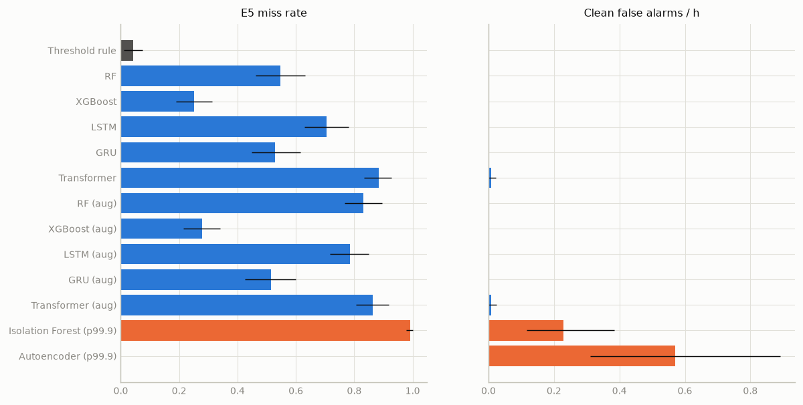
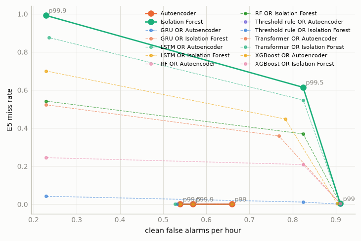
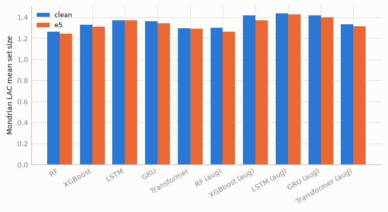
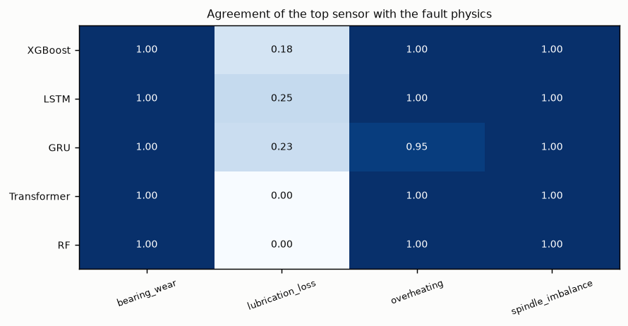
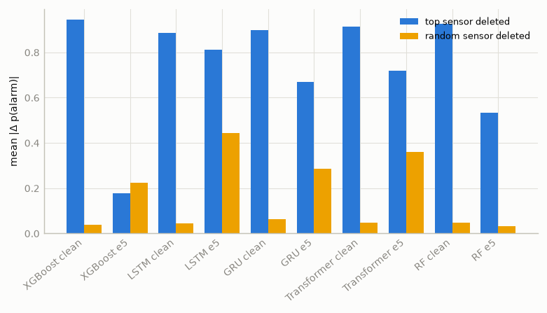

# E5: unseen fault, anomaly detection and explanations

Generated 2026-11-17 07:23 UTC from MLflow experiment `P9_e5` (commit 10f1995) by `python -m twin_ml.experiments.report_e5`. Every number comes from the logged runs; nothing is typed by hand.

Protocol and pre-registration: [ADR 0024](../../docs/adr/0024-e5-unseen-fault-protocol.md). Detectors: [ADR 0025](../../docs/adr/0025-anomaly-detection.md). Explanations: [ADR 0026](../../docs/adr/0026-explainability.md).

## Data

- **E5** (held-out `lubrication_loss` only): 100 runs, 120 gradual-fault episodes (CNC 33, CONVEYOR 58, INSPECTION 29), 283.4 h negative windows.
- **Clean test** (false alarms, set size reference): 30 runs, 26 gradual-fault episodes (CNC 12, CONVEYOR 9, INSPECTION 5), 89.0 h negative windows.
- **`sf_drift`**: 30 runs, 26 gradual-fault episodes (CNC 12, CONVEYOR 9, INSPECTION 5), 89.0 h negative windows.
- **E4** `e4_high`: 62 runs, 62 gradual-fault episodes (CNC 19, CONVEYOR 30, INSPECTION 13), 187.3 h negative windows; `e4_in`: 23 runs, 20 gradual-fault episodes (CNC 9, CONVEYOR 7, INSPECTION 4), 67.6 h negative windows.

Cells: mean over seeds of the per-seed point estimate [mean of the per-seed 95 % run-level bootstrap CI]. Differences: `+x [lo, hi] * (k/n)`, where `*` marks a seed-averaged CI that excludes zero and k/n the seeds whose own CI excludes zero. Horizon +30 s.

**Interpretation note (fixed in ADR 0024 before any result).** The threshold baseline checks the observed current against the nominal overcurrent limit, exactly the channel `lubrication_loss` trips on by design, while no supervised model was trained on a current-led fault. Any advantage of the threshold rule on E5 must be read with this in mind.

## PRIMARY: pre-registered outcomes

### Early warning: E5 miss rate and lead, clean false alarms (detectors at p99.9)

| Policy | E5 miss rate | Δ vs threshold | E5 lead vs sim WARNING (s) | Δ vs threshold | Clean FA / h | Δ vs threshold |
|---|---|---|---|---|---|---|
| Threshold rule | 0.042 [0.010, 0.075] | – | 23 [2, 47] | – | 0.00 [0.00, 0.00] | – |
| RF | 0.547 [0.462, 0.632] | +0.506 [0.420, 0.595] * (3/3) | 394 [331, 459] | +372 [313, 433] * (3/3) | 0.00 [0.00, 0.00] | 0.00 [0.00, 0.00] (0/3) |
| XGBoost | 0.250 [0.188, 0.314] | +0.208 [0.144, 0.275] * (3/3) | 620 [571, 668] | +597 [556, 640] * (3/3) | 0.00 [0.00, 0.00] | 0.00 [0.00, 0.00] (0/3) |
| LSTM | 0.706 [0.629, 0.780] | +0.664 [0.583, 0.747] * (3/3) | -4 [-25, 19] | -27 [-58, 6] (1/3) | 0.00 [0.00, 0.00] | 0.00 [0.00, 0.00] (0/3) |
| GRU | 0.528 [0.449, 0.616] | +0.486 [0.401, 0.579] * (3/3) | 32 [3, 62] | +10 [-22, 42] (2/3) | 0.00 [0.00, 0.00] | 0.00 [0.00, 0.00] (0/3) |
| Transformer | 0.883 [0.834, 0.928] | +0.842 [0.777, 0.901] * (3/3) | 106 [44, 171] | +83 [15, 154] * (1/3) | 0.01 [0.00, 0.02] | +0.01 [0.00, 0.02] (0/3) |
| RF (aug) | 0.831 [0.767, 0.896] | +0.789 [0.722, 0.863] * (3/3) | 156 [84, 234] | +134 [75, 201] * (3/3) | 0.00 [0.00, 0.00] | 0.00 [0.00, 0.00] (0/3) |
| XGBoost (aug) | 0.278 [0.214, 0.341] | +0.236 [0.168, 0.307] * (3/3) | 496 [446, 545] | +474 [428, 523] * (3/3) | 0.00 [0.00, 0.00] | 0.00 [0.00, 0.00] (0/3) |
| LSTM (aug) | 0.786 [0.717, 0.851] | +0.744 [0.666, 0.821] * (3/3) | -16 [-46, 18] | -39 [-76, -2] * (2/3) | 0.00 [0.00, 0.00] | 0.00 [0.00, 0.00] (0/3) |
| GRU (aug) | 0.514 [0.426, 0.601] | +0.472 [0.383, 0.567] * (3/3) | 26 [-2, 58] | +4 [-27, 38] (1/3) | 0.00 [0.00, 0.00] | 0.00 [0.00, 0.00] (0/3) |
| Transformer (aug) | 0.864 [0.806, 0.918] | +0.822 [0.755, 0.888] * (3/3) | 117 [23, 224] | +94 [1, 200] * (3/3) | 0.01 [0.00, 0.02] | +0.01 [0.00, 0.02] (0/3) |
| Isolation Forest (p99.9) | 0.992 [0.978, 1.000] | +0.950 [0.910, 0.986] * (3/3) | 324 [196, 453] | +302 [153, 446] * (1/3) | 0.23 [0.12, 0.38] | +0.23 [0.12, 0.38] * (3/3) |
| Autoencoder (p99.9) | 0.000 [0.000, 0.000] | -0.042 [-0.075, -0.010] * (3/3) | 656 [617, 693] | +633 [603, 663] * (3/3) | 0.57 [0.31, 0.89] | +0.57 [0.31, 0.89] * (3/3) |
| Threshold rule OR Autoencoder | 0.000 [0.000, 0.000] | -0.042 [-0.075, -0.010] * (3/3) | 656 [617, 693] | +633 [603, 663] * (3/3) | 0.57 [0.31, 0.89] | +0.57 [0.31, 0.89] * (3/3) |
| Threshold rule OR Isolation Forest | 0.042 [0.010, 0.075] | 0.000 [0.000, 0.000] (0/3) | 25 [3, 50] | +3 [0, 9] (0/3) | 0.23 [0.12, 0.38] | +0.23 [0.12, 0.38] * (3/3) |
| RF OR Autoencoder | 0.000 [0.000, 0.000] | -0.042 [-0.075, -0.010] * (3/3) | 656 [617, 693] | +633 [603, 663] * (3/3) | 0.57 [0.31, 0.89] | +0.57 [0.31, 0.89] * (3/3) |
| RF OR Isolation Forest | 0.542 [0.457, 0.626] | +0.500 [0.414, 0.590] * (3/3) | 395 [333, 459] | +373 [316, 433] * (3/3) | 0.23 [0.12, 0.38] | +0.23 [0.12, 0.38] * (3/3) |
| XGBoost OR Autoencoder | 0.000 [0.000, 0.000] | -0.042 [-0.075, -0.010] * (3/3) | 656 [617, 693] | +633 [603, 663] * (3/3) | 0.57 [0.31, 0.89] | +0.57 [0.31, 0.89] * (3/3) |
| XGBoost OR Isolation Forest | 0.244 [0.183, 0.310] | +0.203 [0.138, 0.272] * (3/3) | 617 [568, 666] | +595 [552, 638] * (3/3) | 0.23 [0.12, 0.38] | +0.23 [0.12, 0.38] * (3/3) |
| LSTM OR Autoencoder | 0.000 [0.000, 0.000] | -0.042 [-0.075, -0.010] * (3/3) | 656 [617, 693] | +633 [603, 663] * (3/3) | 0.57 [0.31, 0.89] | +0.57 [0.31, 0.89] * (3/3) |
| LSTM OR Isolation Forest | 0.700 [0.624, 0.776] | +0.658 [0.576, 0.742] * (3/3) | 1 [-22, 28] | -21 [-54, 14] (1/3) | 0.23 [0.12, 0.38] | +0.23 [0.12, 0.38] * (3/3) |
| GRU OR Autoencoder | 0.000 [0.000, 0.000] | -0.042 [-0.075, -0.010] * (3/3) | 656 [617, 693] | +633 [603, 663] * (3/3) | 0.57 [0.31, 0.89] | +0.57 [0.31, 0.89] * (3/3) |
| GRU OR Isolation Forest | 0.522 [0.444, 0.610] | +0.481 [0.395, 0.574] * (3/3) | 42 [7, 82] | +20 [-17, 62] (1/3) | 0.23 [0.12, 0.38] | +0.23 [0.12, 0.38] * (3/3) |
| Transformer OR Autoencoder | 0.000 [0.000, 0.000] | -0.042 [-0.075, -0.010] * (3/3) | 656 [617, 693] | +633 [603, 663] * (3/3) | 0.57 [0.31, 0.89] | +0.57 [0.31, 0.89] * (3/3) |
| Transformer OR Isolation Forest | 0.875 [0.823, 0.922] | +0.833 [0.767, 0.898] * (3/3) | 115 [44, 184] | +92 [15, 164] * (1/3) | 0.24 [0.12, 0.39] | +0.24 [0.12, 0.39] * (3/3) |
| RF (aug) OR Autoencoder | 0.000 [0.000, 0.000] | -0.042 [-0.075, -0.010] * (3/3) | 656 [617, 693] | +633 [603, 663] * (3/3) | 0.57 [0.31, 0.89] | +0.57 [0.31, 0.89] * (3/3) |
| RF (aug) OR Isolation Forest | 0.825 [0.761, 0.892] | +0.783 [0.715, 0.858] * (3/3) | 166 [89, 246] | +143 [79, 214] * (3/3) | 0.23 [0.12, 0.38] | +0.23 [0.12, 0.38] * (3/3) |
| XGBoost (aug) OR Autoencoder | 0.000 [0.000, 0.000] | -0.042 [-0.075, -0.010] * (3/3) | 656 [617, 693] | +633 [603, 663] * (3/3) | 0.57 [0.31, 0.89] | +0.57 [0.31, 0.89] * (3/3) |
| XGBoost (aug) OR Isolation Forest | 0.272 [0.209, 0.337] | +0.231 [0.160, 0.302] * (3/3) | 495 [445, 542] | +472 [425, 520] * (3/3) | 0.23 [0.12, 0.38] | +0.23 [0.12, 0.38] * (3/3) |
| LSTM (aug) OR Autoencoder | 0.000 [0.000, 0.000] | -0.042 [-0.075, -0.010] * (3/3) | 656 [617, 693] | +633 [603, 663] * (3/3) | 0.57 [0.31, 0.89] | +0.57 [0.31, 0.89] * (3/3) |
| LSTM (aug) OR Isolation Forest | 0.781 [0.707, 0.846] | +0.739 [0.659, 0.817] * (3/3) | -4 [-43, 41] | -27 [-71, 21] (1/3) | 0.23 [0.12, 0.38] | +0.23 [0.12, 0.38] * (3/3) |
| GRU (aug) OR Autoencoder | 0.000 [0.000, 0.000] | -0.042 [-0.075, -0.010] * (3/3) | 656 [617, 693] | +633 [603, 663] * (3/3) | 0.57 [0.31, 0.89] | +0.57 [0.31, 0.89] * (3/3) |
| GRU (aug) OR Isolation Forest | 0.508 [0.421, 0.596] | +0.467 [0.378, 0.563] * (3/3) | 32 [0, 65] | +9 [-24, 46] (1/3) | 0.23 [0.12, 0.38] | +0.23 [0.12, 0.38] * (3/3) |
| Transformer (aug) OR Autoencoder | 0.000 [0.000, 0.000] | -0.042 [-0.075, -0.010] * (3/3) | 656 [617, 693] | +633 [603, 663] * (3/3) | 0.57 [0.31, 0.89] | +0.57 [0.31, 0.89] * (3/3) |
| Transformer (aug) OR Isolation Forest | 0.856 [0.797, 0.912] | +0.814 [0.745, 0.885] * (3/3) | 122 [28, 229] | +100 [6, 206] * (3/3) | 0.24 [0.12, 0.39] | +0.24 [0.12, 0.39] * (3/3) |

#### Combined policy vs its supervised model alone (paired)

| Combined policy | Δ E5 miss rate | Δ E5 lead (s) | Δ clean FA / h |
|---|---|---|---|
| Threshold rule OR Autoencoder | -0.042 [-0.075, -0.010] * (3/3) | +633 [603, 663] * (3/3) | +0.57 [0.31, 0.89] * (3/3) |
| Threshold rule OR Isolation Forest | 0.000 [0.000, 0.000] (0/3) | +3 [0, 9] (0/3) | +0.23 [0.12, 0.38] * (3/3) |
| RF OR Autoencoder | -0.547 [-0.632, -0.462] * (3/3) | +262 [200, 316] * (3/3) | +0.57 [0.31, 0.89] * (3/3) |
| RF OR Isolation Forest | -0.006 [-0.014, 0.000] (0/3) | +1 [-8, 12] (0/3) | +0.23 [0.12, 0.38] * (3/3) |
| XGBoost OR Autoencoder | -0.250 [-0.314, -0.188] * (3/3) | +36 [8, 65] * (3/3) | +0.57 [0.31, 0.89] * (3/3) |
| XGBoost OR Isolation Forest | -0.006 [-0.014, 0.000] (0/3) | -3 [-8, 0] (0/3) | +0.23 [0.12, 0.38] * (3/3) |
| LSTM OR Autoencoder | -0.706 [-0.780, -0.629] * (3/3) | +660 [616, 703] * (3/3) | +0.57 [0.31, 0.89] * (3/3) |
| LSTM OR Isolation Forest | -0.006 [-0.014, 0.000] (0/3) | +6 [-1, 18] (0/3) | +0.23 [0.12, 0.38] * (3/3) |
| GRU OR Autoencoder | -0.528 [-0.616, -0.449] * (3/3) | +623 [583, 664] * (3/3) | +0.57 [0.31, 0.89] * (3/3) |
| GRU OR Isolation Forest | -0.006 [-0.014, 0.000] (0/3) | +10 [-0, 35] (0/3) | +0.23 [0.12, 0.38] * (3/3) |
| Transformer OR Autoencoder | -0.883 [-0.928, -0.834] * (3/3) | +550 [472, 623] * (3/3) | +0.56 [0.31, 0.89] * (3/3) |
| Transformer OR Isolation Forest | -0.008 [-0.022, 0.000] (0/3) | +9 [-20, 36] (0/3) | +0.23 [0.12, 0.38] * (3/3) |
| RF (aug) OR Autoencoder | -0.831 [-0.896, -0.767] * (3/3) | +500 [427, 564] * (3/3) | +0.57 [0.31, 0.89] * (3/3) |
| RF (aug) OR Isolation Forest | -0.006 [-0.014, 0.000] (0/3) | +9 [-4, 35] (0/3) | +0.23 [0.12, 0.38] * (3/3) |
| XGBoost (aug) OR Autoencoder | -0.278 [-0.341, -0.214] * (3/3) | +159 [125, 193] * (3/3) | +0.57 [0.31, 0.89] * (3/3) |
| XGBoost (aug) OR Isolation Forest | -0.006 [-0.014, 0.000] (0/3) | -2 [-6, 0] (0/3) | +0.23 [0.12, 0.38] * (3/3) |
| LSTM (aug) OR Autoencoder | -0.786 [-0.851, -0.717] * (3/3) | +672 [624, 716] * (3/3) | +0.57 [0.31, 0.89] * (3/3) |
| LSTM (aug) OR Isolation Forest | -0.006 [-0.014, 0.000] (0/3) | +12 [-0, 38] (0/3) | +0.23 [0.12, 0.38] * (3/3) |
| GRU (aug) OR Autoencoder | -0.514 [-0.601, -0.426] * (3/3) | +629 [590, 666] * (3/3) | +0.57 [0.31, 0.89] * (3/3) |
| GRU (aug) OR Isolation Forest | -0.006 [-0.014, 0.000] (0/3) | +5 [-0, 16] (0/3) | +0.23 [0.12, 0.38] * (3/3) |
| Transformer (aug) OR Autoencoder | -0.864 [-0.918, -0.806] * (3/3) | +539 [435, 634] * (3/3) | +0.56 [0.31, 0.88] * (3/3) |
| Transformer (aug) OR Isolation Forest | -0.008 [-0.022, 0.000] (0/3) | +6 [-7, 26] (0/3) | +0.23 [0.12, 0.38] * (3/3) |

### Uncertainty under the unseen fault: Mondrian LAC mean set size, E5 vs clean (operating windows, unpaired)

| Model | Clean | E5 | Δ E5 - clean |
|---|---|---|---|
| RF | 1.263 [1.214, 1.308] | 1.244 [1.216, 1.270] | -0.019 [-0.070, 0.037] (0/3) |
| XGBoost | 1.330 [1.297, 1.363] | 1.308 [1.288, 1.326] | -0.022 [-0.060, 0.016] (0/3) |
| LSTM | 1.371 [1.314, 1.426] | 1.372 [1.345, 1.400] | +0.002 [-0.060, 0.065] (0/3) |
| GRU | 1.360 [1.309, 1.414] | 1.344 [1.318, 1.369] | -0.017 [-0.076, 0.046] (0/3) |
| Transformer | 1.296 [1.253, 1.340] | 1.293 [1.270, 1.315] | -0.003 [-0.049, 0.047] (0/3) |
| RF (aug) | 1.300 [1.244, 1.354] | 1.264 [1.233, 1.293] | -0.036 [-0.095, 0.026] (0/3) |
| XGBoost (aug) | 1.417 [1.372, 1.459] | 1.370 [1.344, 1.394] | -0.046 [-0.096, 0.004] (0/3) |
| LSTM (aug) | 1.435 [1.364, 1.505] | 1.428 [1.396, 1.459] | -0.007 [-0.082, 0.073] (0/3) |
| GRU (aug) | 1.416 [1.357, 1.476] | 1.397 [1.369, 1.425] | -0.019 [-0.081, 0.046] (0/3) |
| Transformer (aug) | 1.331 [1.280, 1.385] | 1.316 [1.291, 1.341] | -0.016 [-0.074, 0.041] (0/3) |

Split-conformal guarantees assume exchangeable data and do not hold on E5; set size is read as a measure of uncertainty, not as coverage.

### Explanation agreement with the fault physics

| Model (method) | Pooled | Clean (seen types) | E5 (lubrication_loss) | Episodes explained clean / E5 |
|---|---|---|---|---|
| XGBoost (treeshap) | 0.363 [0.266, 0.465] | 1.000 [1.000, 1.000] | 0.178 [0.107, 0.257] | 26/26, 90/120 |
| LSTM (integrated_gradients) | 0.650 [0.506, 0.780] | 1.000 [1.000, 1.000] | 0.251 [0.166, 0.339] | 26/26, 45/120 |
| GRU (integrated_gradients) | 0.512 [0.379, 0.643] | 0.974 [0.931, 1.000] | 0.228 [0.155, 0.328] | 26/26, 22/120 |
| Transformer (integrated_gradients) | 0.719 [0.566, 0.838] | 1.000 [1.000, 1.000] | 0.000 [0.000, 0.000] | 26/26, 7/120 |

Expected sensor: bearing_wear → vib, overheating → temp, spindle_imbalance → vib, lubrication_loss → current. Episodes the model never alarms on are not explained. Episode counts are from seed 0.

| Model | bearing_wear | lubrication_loss | overheating | spindle_imbalance |
|---|---|---|---|---|
| XGBoost | 1.000 [1.000, 1.000] | 0.178 [0.107, 0.257] | 1.000 [1.000, 1.000] | 1.000 [1.000, 1.000] |
| LSTM | 1.000 [1.000, 1.000] | 0.251 [0.166, 0.339] | 1.000 [1.000, 1.000] | 1.000 [1.000, 1.000] |
| GRU | 1.000 [1.000, 1.000] | 0.228 [0.155, 0.328] | 0.949 [0.872, 1.000] | 1.000 [1.000, 1.000] |
| Transformer | 1.000 [1.000, 1.000] | 0.000 [0.000, 0.000] | 1.000 [1.000, 1.000] | 1.000 [1.000, 1.000] |

## EXPLORATORY

### Threshold percentile trade-off (detectors)

| Detector | Percentile | E5 miss rate | E5 lead (s) | Clean FA / h | Clean miss rate |
|---|---|---|---|---|---|
| Isolation Forest | 99 | 0.003 [0.000, 0.009] | 545 [492, 598] | 0.91 [0.57, 1.34] | 0.179 [0.056, 0.342] |
| Isolation Forest | 99.5 | 0.614 [0.541, 0.696] | 324 [240, 411] | 0.82 [0.49, 1.27] | 0.692 [0.508, 0.881] |
| Isolation Forest | 99.9 | 0.992 [0.978, 1.000] | 324 [196, 453] | 0.23 [0.12, 0.38] | 0.974 [0.920, 1.000] |
| Autoencoder | 99 | 0.000 [0.000, 0.000] | 688 [650, 724] | 0.66 [0.45, 0.88] | 0.000 [0.000, 0.000] |
| Autoencoder | 99.5 | 0.000 [0.000, 0.000] | 677 [636, 714] | 0.54 [0.27, 0.89] | 0.026 [0.000, 0.073] |
| Autoencoder | 99.9 | 0.000 [0.000, 0.000] | 656 [617, 693] | 0.57 [0.31, 0.89] | 0.077 [0.011, 0.184] |

### Combined policy across percentiles (E1 models)

| Combined policy | Percentile | E5 miss rate | Clean FA / h |
|---|---|---|---|
| Transformer OR Autoencoder | 99 | 0.000 [0.000, 0.000] | 0.66 [0.45, 0.88] |
| Transformer OR Autoencoder | 99.5 | 0.000 [0.000, 0.000] | 0.54 [0.27, 0.89] |
| Transformer OR Autoencoder | 99.9 | 0.000 [0.000, 0.000] | 0.57 [0.31, 0.89] |
| Transformer OR Isolation Forest | 99 | 0.003 [0.000, 0.009] | 0.91 [0.57, 1.34] |
| Transformer OR Isolation Forest | 99.5 | 0.547 [0.473, 0.629] | 0.82 [0.49, 1.27] |
| Transformer OR Isolation Forest | 99.9 | 0.875 [0.823, 0.922] | 0.24 [0.12, 0.39] |
| GRU OR Autoencoder | 99 | 0.000 [0.000, 0.000] | 0.66 [0.45, 0.88] |
| GRU OR Autoencoder | 99.5 | 0.000 [0.000, 0.000] | 0.53 [0.26, 0.88] |
| GRU OR Autoencoder | 99.9 | 0.000 [0.000, 0.000] | 0.57 [0.31, 0.89] |
| GRU OR Isolation Forest | 99 | 0.003 [0.000, 0.009] | 0.91 [0.57, 1.34] |
| GRU OR Isolation Forest | 99.5 | 0.358 [0.283, 0.442] | 0.77 [0.45, 1.19] |
| GRU OR Isolation Forest | 99.9 | 0.522 [0.444, 0.610] | 0.23 [0.12, 0.38] |
| LSTM OR Autoencoder | 99 | 0.000 [0.000, 0.000] | 0.66 [0.45, 0.88] |
| LSTM OR Autoencoder | 99.5 | 0.000 [0.000, 0.000] | 0.53 [0.26, 0.88] |
| LSTM OR Autoencoder | 99.9 | 0.000 [0.000, 0.000] | 0.57 [0.31, 0.89] |
| LSTM OR Isolation Forest | 99 | 0.003 [0.000, 0.009] | 0.90 [0.57, 1.33] |
| LSTM OR Isolation Forest | 99.5 | 0.447 [0.366, 0.534] | 0.78 [0.47, 1.20] |
| LSTM OR Isolation Forest | 99.9 | 0.700 [0.624, 0.776] | 0.23 [0.12, 0.38] |
| XGBoost OR Autoencoder | 99 | 0.000 [0.000, 0.000] | 0.66 [0.45, 0.88] |
| XGBoost OR Autoencoder | 99.5 | 0.000 [0.000, 0.000] | 0.54 [0.27, 0.89] |
| XGBoost OR Autoencoder | 99.9 | 0.000 [0.000, 0.000] | 0.57 [0.31, 0.89] |
| XGBoost OR Isolation Forest | 99 | 0.003 [0.000, 0.009] | 0.91 [0.57, 1.34] |
| XGBoost OR Isolation Forest | 99.5 | 0.208 [0.147, 0.275] | 0.82 [0.49, 1.27] |
| XGBoost OR Isolation Forest | 99.9 | 0.244 [0.183, 0.310] | 0.23 [0.12, 0.38] |
| RF OR Autoencoder | 99 | 0.000 [0.000, 0.000] | 0.66 [0.45, 0.88] |
| RF OR Autoencoder | 99.5 | 0.000 [0.000, 0.000] | 0.54 [0.27, 0.89] |
| RF OR Autoencoder | 99.9 | 0.000 [0.000, 0.000] | 0.57 [0.31, 0.89] |
| RF OR Isolation Forest | 99 | 0.003 [0.000, 0.009] | 0.91 [0.57, 1.34] |
| RF OR Isolation Forest | 99.5 | 0.369 [0.294, 0.453] | 0.82 [0.49, 1.27] |
| RF OR Isolation Forest | 99.9 | 0.542 [0.457, 0.626] | 0.23 [0.12, 0.38] |
| Threshold rule OR Autoencoder | 99 | 0.000 [0.000, 0.000] | 0.66 [0.45, 0.88] |
| Threshold rule OR Autoencoder | 99.5 | 0.000 [0.000, 0.000] | 0.54 [0.27, 0.89] |
| Threshold rule OR Autoencoder | 99.9 | 0.000 [0.000, 0.000] | 0.57 [0.31, 0.89] |
| Threshold rule OR Isolation Forest | 99 | 0.000 [0.000, 0.000] | 0.91 [0.57, 1.34] |
| Threshold rule OR Isolation Forest | 99.5 | 0.011 [0.000, 0.034] | 0.82 [0.49, 1.27] |
| Threshold rule OR Isolation Forest | 99.9 | 0.042 [0.010, 0.075] | 0.23 [0.12, 0.38] |

### Confidence of calibrated predictions (operating windows)

Wrong = calibrated argmax differs from the true class at +30 s; missed = a WARNING or FAULT target predicted NORMAL; high = calibrated confidence ≥ 0.9.

| Model | Wrong rate clean / E5 | Wrong with conf ≥ 0.9 clean / E5 | Missed rate clean / E5 | Missed: mean conf clean / E5 | Missed with conf ≥ 0.9 clean / E5 | Precursor set size clean / E5 |
|---|---|---|---|---|---|---|
| RF | 0.005 [0.003, 0.007] / 0.011 [0.009, 0.014] | 0.300 [0.185, 0.449] / 0.053 [0.035, 0.076] | 0.002 [0.001, 0.003] / 0.010 [0.009, 0.013] | 0.830 [0.761, 0.907] / 0.724 [0.709, 0.739] | 0.540 [0.342, 0.755] / 0.057 [0.038, 0.083] | 1.073 [0.998, 1.151] / 1.026 [1.017, 1.035] |
| XGBoost | 0.005 [0.004, 0.007] / 0.030 [0.025, 0.035] | 0.325 [0.220, 0.462] / 0.082 [0.057, 0.112] | 0.002 [0.001, 0.003] / 0.004 [0.003, 0.005] | 0.853 [0.798, 0.917] / 0.830 [0.792, 0.863] | 0.548 [0.373, 0.751] / 0.585 [0.489, 0.667] | 1.241 [1.195, 1.280] / 1.069 [1.061, 1.077] |
| LSTM | 0.005 [0.003, 0.007] / 0.010 [0.008, 0.012] | 0.490 [0.380, 0.605] / 0.922 [0.894, 0.946] | 0.001 [0.001, 0.002] / 0.010 [0.008, 0.012] | 0.944 [0.905, 0.975] / 0.982 [0.976, 0.987] | 0.830 [0.699, 0.931] / 0.947 [0.927, 0.964] | 1.113 [1.070, 1.156] / 1.197 [1.165, 1.232] |
| GRU | 0.005 [0.003, 0.008] / 0.010 [0.008, 0.013] | 0.466 [0.356, 0.580] / 0.789 [0.737, 0.838] | 0.001 [0.001, 0.002] / 0.009 [0.007, 0.011] | 0.937 [0.884, 0.975] / 0.959 [0.949, 0.968] | 0.809 [0.644, 0.928] / 0.881 [0.848, 0.910] | 1.088 [1.052, 1.120] / 1.178 [1.150, 1.206] |
| Transformer | 0.005 [0.003, 0.007] / 0.011 [0.009, 0.013] | 0.487 [0.376, 0.602] / 0.954 [0.934, 0.971] | 0.001 [0.001, 0.002] / 0.010 [0.008, 0.013] | 0.926 [0.881, 0.964] / 0.990 [0.985, 0.993] | 0.766 [0.612, 0.890] / 0.974 [0.960, 0.986] | 1.088 [1.051, 1.119] / 1.127 [1.099, 1.157] |
| RF (aug) | 0.005 [0.003, 0.007] / 0.011 [0.009, 0.013] | 0.309 [0.205, 0.447] / 0.106 [0.076, 0.142] | 0.002 [0.001, 0.002] / 0.011 [0.009, 0.013] | 0.832 [0.766, 0.905] / 0.795 [0.784, 0.806] | 0.534 [0.332, 0.751] / 0.107 [0.077, 0.144] | 1.141 [1.069, 1.219] / 1.007 [0.999, 1.015] |
| XGBoost (aug) | 0.006 [0.004, 0.008] / 0.012 [0.010, 0.015] | 0.291 [0.198, 0.408] / 0.240 [0.183, 0.304] | 0.002 [0.001, 0.003] / 0.010 [0.008, 0.012] | 0.853 [0.793, 0.918] / 0.719 [0.691, 0.749] | 0.572 [0.391, 0.762] / 0.304 [0.235, 0.380] | 1.335 [1.282, 1.402] / 1.057 [1.044, 1.072] |
| LSTM (aug) | 0.005 [0.003, 0.007] / 0.010 [0.008, 0.013] | 0.565 [0.476, 0.646] / 0.939 [0.919, 0.957] | 0.001 [0.001, 0.002] / 0.010 [0.008, 0.012] | 0.954 [0.924, 0.979] / 0.980 [0.975, 0.985] | 0.864 [0.771, 0.943] / 0.949 [0.932, 0.964] | 1.143 [1.097, 1.197] / 1.395 [1.339, 1.452] |
| GRU (aug) | 0.006 [0.004, 0.008] / 0.010 [0.008, 0.012] | 0.572 [0.471, 0.667] / 0.731 [0.685, 0.777] | 0.001 [0.001, 0.002] / 0.009 [0.007, 0.011] | 0.957 [0.921, 0.984] / 0.934 [0.924, 0.944] | 0.878 [0.765, 0.961] / 0.797 [0.761, 0.831] | 1.179 [1.128, 1.236] / 1.253 [1.218, 1.289] |
| Transformer (aug) | 0.006 [0.004, 0.008] / 0.011 [0.009, 0.013] | 0.533 [0.440, 0.628] / 0.896 [0.854, 0.934] | 0.001 [0.001, 0.002] / 0.010 [0.008, 0.012] | 0.935 [0.889, 0.970] / 0.978 [0.970, 0.985] | 0.812 [0.667, 0.921] / 0.936 [0.911, 0.961] | 1.098 [1.057, 1.141] / 1.088 [1.057, 1.120] |

### Fault-type head on E5 precursor windows (share of windows per predicted type, pooled over seeds)

| Model | bearing_wear | belt_jam | none | overheating | spindle_imbalance |
|---|---|---|---|---|---|
| RF | 0.825 | 0.000 | 0.133 | 0.001 | 0.041 |
| XGBoost | 0.716 | 0.000 | 0.188 | 0.047 | 0.048 |
| LSTM | 0.615 | 0.015 | 0.222 | 0.049 | 0.099 |
| GRU | 0.539 | 0.020 | 0.233 | 0.155 | 0.053 |
| Transformer | 0.621 | 0.003 | 0.266 | 0.024 | 0.085 |
| RF (aug) | 0.805 | 0.000 | 0.175 | 0.000 | 0.020 |
| XGBoost (aug) | 0.785 | 0.000 | 0.137 | 0.017 | 0.061 |
| LSTM (aug) | 0.421 | 0.005 | 0.502 | 0.032 | 0.040 |
| GRU (aug) | 0.462 | 0.061 | 0.428 | 0.021 | 0.029 |
| Transformer (aug) | 0.705 | 0.010 | 0.218 | 0.021 | 0.046 |

### Sensor drift (`sf_drift`)

Flag rate: share of drift segments with a sustained alarm on a normal-operation window inside the segment. For a detector a flag is the desired outcome; for a fault-warning policy the same alarm is a false fault warning (FA / h inside drift segments).

| Policy | Kind | Segments flagged | Time to flag (s) | FA / h inside drift |
|---|---|---|---|---|
| Threshold rule | supervised | 0.011 [0.000, 0.034] | 589 [589, 589] | 0.97 [0.00, 3.26] |
| RF | supervised | 0.021 [0.000, 0.055] | 834 [818, 851] | 0.22 [0.00, 0.52] |
| XGBoost | supervised | 0.021 [0.000, 0.055] | 824 [817, 830] | 0.47 [0.00, 1.20] |
| LSTM | supervised | 0.053 [0.016, 0.097] | 443 [166, 750] | 0.25 [0.00, 0.66] |
| GRU | supervised | 0.074 [0.030, 0.122] | 497 [248, 734] | 0.47 [0.07, 0.93] |
| Transformer | supervised | 0.042 [0.010, 0.087] | 721 [482, 825] | 0.58 [0.04, 1.22] |
| RF (aug) | supervised | 0.032 [0.000, 0.071] | 789 [698, 854] | 0.47 [0.00, 1.04] |
| XGBoost (aug) | supervised | 0.042 [0.009, 0.087] | 775 [698, 817] | 0.94 [0.11, 1.87] |
| LSTM (aug) | supervised | 0.060 [0.018, 0.104] | 394 [137, 682] | 0.22 [0.00, 0.54] |
| GRU (aug) | supervised | 0.081 [0.037, 0.128] | 463 [219, 698] | 0.51 [0.07, 1.01] |
| Transformer (aug) | supervised | 0.056 [0.016, 0.104] | 721 [572, 808] | 0.65 [0.18, 1.20] |
| Isolation Forest | detector | 0.046 [0.013, 0.088] | 204 [91, 346] | 0.47 [0.12, 0.89] |
| Autoencoder | detector | 0.239 [0.150, 0.334] | 241 [209, 272] | 2.63 [1.72, 3.55] |
| Transformer OR Autoencoder | combined | 0.239 [0.150, 0.334] | 241 [209, 272] | 2.63 [1.72, 3.55] |
| Transformer OR Isolation Forest | combined | 0.081 [0.035, 0.131] | 457 [222, 687] | 1.05 [0.46, 1.63] |
| GRU OR Autoencoder | combined | 0.249 [0.161, 0.343] | 237 [205, 269] | 2.63 [1.72, 3.55] |
| GRU OR Isolation Forest | combined | 0.098 [0.050, 0.151] | 413 [211, 618] | 0.94 [0.44, 1.45] |
| LSTM OR Autoencoder | combined | 0.249 [0.161, 0.343] | 237 [206, 269] | 2.63 [1.72, 3.55] |
| LSTM OR Isolation Forest | combined | 0.077 [0.032, 0.128] | 348 [159, 579] | 0.72 [0.26, 1.24] |
| XGBoost OR Autoencoder | combined | 0.239 [0.150, 0.334] | 241 [209, 272] | 2.63 [1.72, 3.55] |
| XGBoost OR Isolation Forest | combined | 0.067 [0.024, 0.116] | 400 [161, 667] | 0.94 [0.31, 1.70] |
| RF OR Autoencoder | combined | 0.239 [0.150, 0.334] | 241 [209, 272] | 2.63 [1.72, 3.55] |
| RF OR Isolation Forest | combined | 0.067 [0.024, 0.116] | 404 [161, 676] | 0.69 [0.25, 1.13] |
| Threshold rule OR Autoencoder | combined | 0.249 [0.156, 0.345] | 256 [212, 308] | 3.61 [2.06, 5.63] |
| Threshold rule OR Isolation Forest | combined | 0.056 [0.013, 0.111] | 276 [91, 446] | 1.44 [0.13, 3.88] |

### Load shift (E4: trained on low + medium load; `e4_high` vs `e4_in`, unpaired)

| Policy | Kind | FA / h e4_in | FA / h e4_high | Δ high - in | Miss rate in / high |
|---|---|---|---|---|---|
| Threshold rule | supervised | 0.00 [0.00, 0.00] | 0.00 [0.00, 0.00] | 0.00 [0.00, 0.00] (0/1) | 0.000 [0.000, 0.000] / 0.000 [0.000, 0.000] |
| RF | supervised | 0.00 [0.00, 0.00] | 0.00 [0.00, 0.00] | 0.00 [0.00, 0.00] (0/3) | 0.000 [0.000, 0.000] / 0.000 [0.000, 0.000] |
| XGBoost | supervised | 0.00 [0.00, 0.00] | 0.00 [0.00, 0.00] | 0.00 [0.00, 0.00] (0/3) | 0.000 [0.000, 0.000] / 0.000 [0.000, 0.000] |
| LSTM | supervised | 0.00 [0.00, 0.00] | 0.01 [0.00, 0.03] | +0.01 [0.00, 0.03] (0/3) | 0.000 [0.000, 0.000] / 0.000 [0.000, 0.000] |
| GRU | supervised | 0.00 [0.00, 0.00] | 0.00 [0.00, 0.00] | 0.00 [0.00, 0.00] (0/3) | 0.000 [0.000, 0.000] / 0.000 [0.000, 0.000] |
| Transformer | supervised | 0.00 [0.00, 0.02] | 0.03 [0.01, 0.07] | +0.03 [-0.00, 0.06] (1/3) | 0.000 [0.000, 0.000] / 0.000 [0.000, 0.000] |
| Isolation Forest | detector | 0.23 [0.10, 0.40] | 0.51 [0.39, 0.65] | +0.29 [0.08, 0.47] * (2/3) | 1.000 [1.000, 1.000] / 0.952 [0.891, 1.000] |
| Autoencoder | detector | 0.43 [0.17, 0.81] | 1.10 [0.82, 1.40] | +0.67 [0.20, 1.07] * (3/3) | 0.000 [0.000, 0.000] / 0.000 [0.000, 0.000] |
| Transformer OR Autoencoder | combined | 0.43 [0.17, 0.81] | 1.10 [0.82, 1.40] | +0.67 [0.19, 1.06] * (3/3) | 0.000 [0.000, 0.000] / 0.000 [0.000, 0.000] |
| Transformer OR Isolation Forest | combined | 0.23 [0.10, 0.41] | 0.50 [0.38, 0.64] | +0.27 [0.06, 0.46] * (2/3) | 0.000 [0.000, 0.000] / 0.000 [0.000, 0.000] |
| GRU OR Autoencoder | combined | 0.42 [0.16, 0.79] | 1.09 [0.82, 1.40] | +0.68 [0.20, 1.07] * (3/3) | 0.000 [0.000, 0.000] / 0.000 [0.000, 0.000] |
| GRU OR Isolation Forest | combined | 0.23 [0.10, 0.40] | 0.50 [0.38, 0.63] | +0.27 [0.07, 0.45] * (2/3) | 0.000 [0.000, 0.000] / 0.000 [0.000, 0.000] |
| LSTM OR Autoencoder | combined | 0.42 [0.17, 0.80] | 1.11 [0.82, 1.41] | +0.68 [0.21, 1.08] * (3/3) | 0.000 [0.000, 0.000] / 0.000 [0.000, 0.000] |
| LSTM OR Isolation Forest | combined | 0.22 [0.09, 0.38] | 0.49 [0.37, 0.63] | +0.28 [0.07, 0.46] * (3/3) | 0.000 [0.000, 0.000] / 0.000 [0.000, 0.000] |
| XGBoost OR Autoencoder | combined | 0.43 [0.17, 0.81] | 1.10 [0.82, 1.40] | +0.67 [0.20, 1.07] * (3/3) | 0.000 [0.000, 0.000] / 0.000 [0.000, 0.000] |
| XGBoost OR Isolation Forest | combined | 0.23 [0.10, 0.40] | 0.51 [0.39, 0.65] | +0.29 [0.08, 0.47] * (2/3) | 0.000 [0.000, 0.000] / 0.000 [0.000, 0.000] |
| RF OR Autoencoder | combined | 0.43 [0.17, 0.81] | 1.10 [0.82, 1.40] | +0.67 [0.20, 1.07] * (3/3) | 0.000 [0.000, 0.000] / 0.000 [0.000, 0.000] |
| RF OR Isolation Forest | combined | 0.23 [0.10, 0.40] | 0.51 [0.39, 0.65] | +0.29 [0.08, 0.47] * (2/3) | 0.000 [0.000, 0.000] / 0.000 [0.000, 0.000] |
| Threshold rule OR Autoencoder | combined | 0.43 [0.17, 0.81] | 1.10 [0.82, 1.40] | +0.67 [0.20, 1.07] * (3/3) | 0.000 [0.000, 0.000] / 0.000 [0.000, 0.000] |
| Threshold rule OR Isolation Forest | combined | 0.23 [0.10, 0.40] | 0.51 [0.39, 0.65] | +0.29 [0.08, 0.47] * (2/3) | 0.000 [0.000, 0.000] / 0.000 [0.000, 0.000] |

### Detector score AUPRC (operating windows; positive = WARNING / FAULT at +30 s; mean over seeds)

| Detector | Condition | AUPRC |
|---|---|---|
| Isolation Forest | clean | 0.272 |
| Isolation Forest | e5 | 0.149 |
| Isolation Forest | sf_drift | 0.262 |
| Autoencoder | clean | 0.835 |
| Autoencoder | e5 | 0.357 |
| Autoencoder | sf_drift | 0.799 |

### Deletion test and IG completeness

Mean |Δ p(WARNING) + p(FAULT)| when the top-attributed sensor vs one random other sensor is replaced by the baseline; difference with a run-level CI.

| Model | Condition | Top | Random | Top - random | Windows top > random | IG relative completeness error |
|---|---|---|---|---|---|---|
| XGBoost | clean | 0.944 [0.926, 0.957] | 0.037 [0.028, 0.050] | 0.907 [0.878, 0.927] | 1.000 [1.000, 1.000] | – |
| XGBoost | e5 | 0.177 [0.166, 0.188] | 0.223 [0.212, 0.233] | -0.046 [-0.062, -0.028] | 0.530 [0.507, 0.554] | – |
| LSTM | clean | 0.885 [0.811, 0.936] | 0.045 [0.030, 0.067] | 0.839 [0.754, 0.901] | 0.985 [0.970, 0.998] | 0.0609 [0.0311, 0.0911] |
| LSTM | e5 | 0.812 [0.769, 0.846] | 0.443 [0.388, 0.498] | 0.369 [0.300, 0.434] | 0.943 [0.838, 0.992] | 0.0101 [0.0040, 0.0196] |
| GRU | clean | 0.898 [0.843, 0.940] | 0.063 [0.039, 0.099] | 0.836 [0.755, 0.889] | 0.981 [0.942, 0.999] | 0.0484 [0.0260, 0.0723] |
| GRU | e5 | 0.668 [0.640, 0.688] | 0.285 [0.236, 0.333] | 0.383 [0.331, 0.432] | 0.928 [0.883, 0.971] | 0.0122 [0.0058, 0.0177] |
| Transformer | clean | 0.914 [0.842, 0.953] | 0.049 [0.033, 0.068] | 0.866 [0.786, 0.912] | 0.992 [0.974, 1.000] | 0.0119 [0.0087, 0.0151] |
| Transformer | e5 | 0.718 [0.631, 0.773] | 0.360 [0.259, 0.453] | 0.358 [0.229, 0.464] | 0.993 [0.982, 1.000] | 0.0021 [0.0011, 0.0032] |
| RF | clean | 0.924 [0.910, 0.936] | 0.046 [0.032, 0.068] | 0.878 [0.845, 0.901] | 0.998 [0.995, 1.000] | – |
| RF | e5 | 0.533 [0.521, 0.548] | 0.033 [0.028, 0.037] | 0.500 [0.486, 0.517] | 0.989 [0.986, 0.993] | – |

**Random Forest (Saabas path attributions; exploratory, not comparable with the other models: path attributions over-credit features split near the root).**

| Model | Pooled | Clean | E5 |
|---|---|---|---|
| RF | 0.336 [0.201, 0.478] | 1.000 [1.000, 1.000] | 0.000 [0.000, 0.000] |

## Plots

