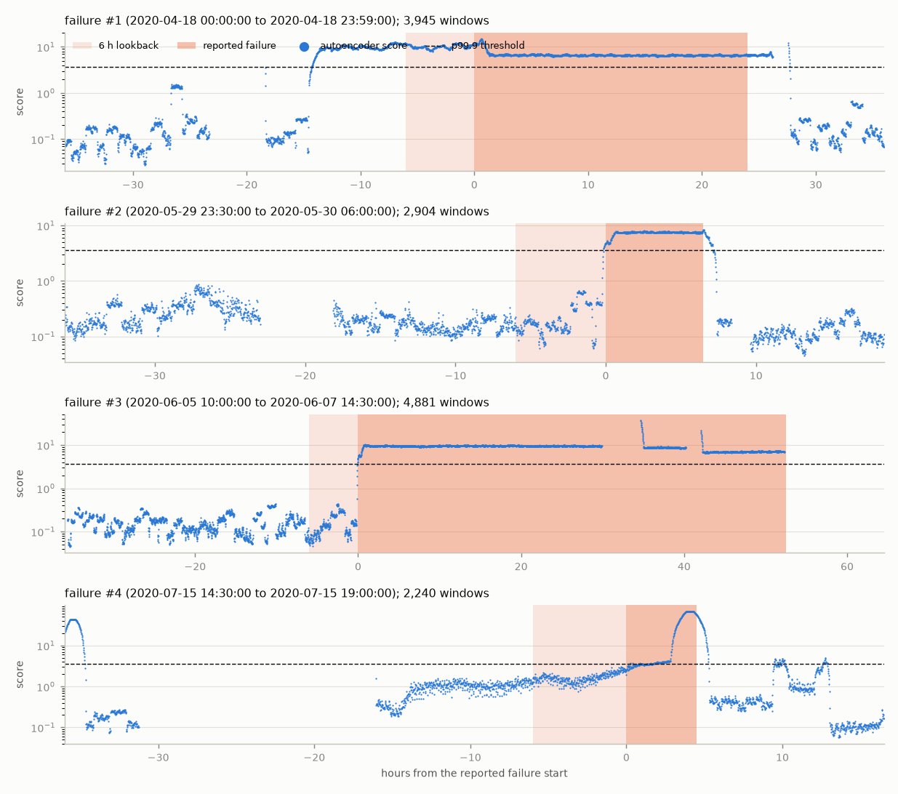
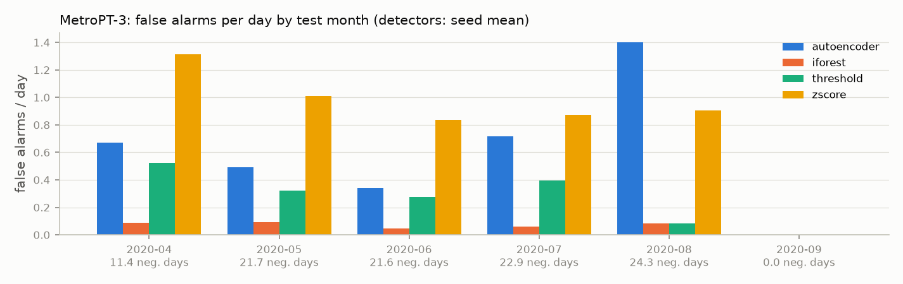
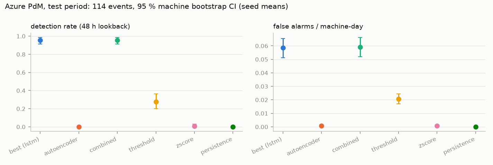
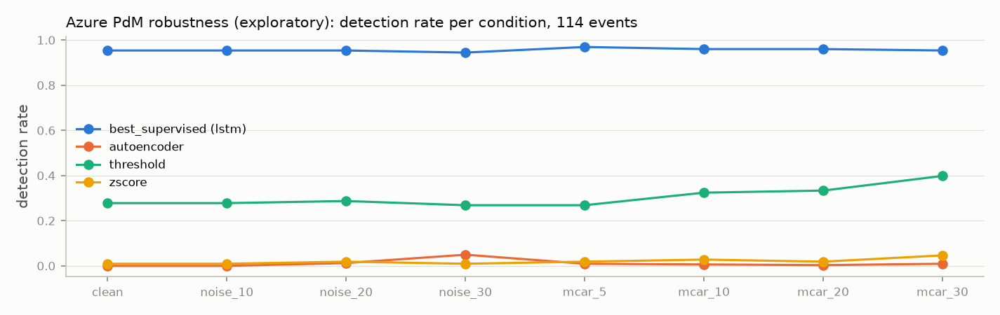
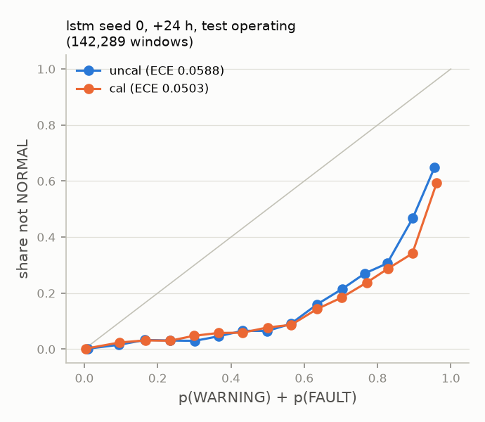
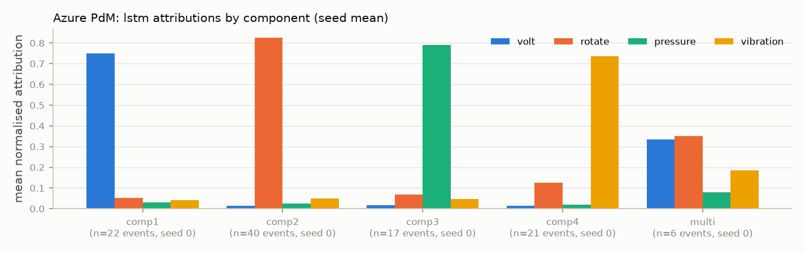
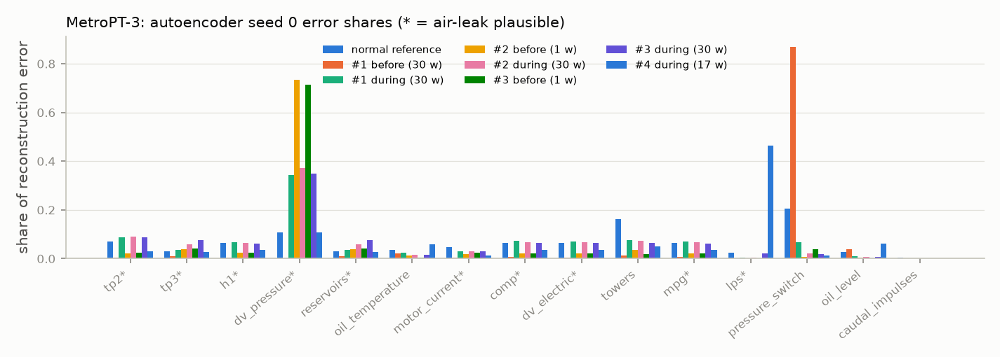

# Phase 10: validation on real public data

Generated by `uv run poe report-real` on 2026-11-19 09:43 UTC from the MLflow experiment `P10_real` (runs: metropt3 audit `a634dfe3`, azure_pdm audit `aa6c7954`). Nothing here is typed by hand. Protocol and pre-registered outcomes: ADR 0027.

> **Primary vs exploratory.** Only the outcomes pre-registered in ADR 0027 are primary (marked as such below). Everything else is exploratory and never a conclusion on its own.

## Data audit

### MetroPT-3

- **Origin:** real data. UCI Machine Learning Repository, "MetroPT-3 Dataset" (Davari, Veloso, Ribeiro, Gama; INESC TEC); licence CC BY 4.0. Time zone: unstated (timestamps and failure times are read as one naive clock).
- **File:** `MetroPT3(AirCompressor).csv`, 1,516,948 rows, 2020-02-01 00:00:00 to 2020-09-01 03:59:50 (213.2 days), 0 duplicate timestamps, sorted: yes.
- **Sampling (measured):** median interval 10 s; 10 s: 88.2 %, 9 s: 8.5 %, 12 s: 2.5 %, 13 s: 0.5 %, 11 s: 0.3 %; min 8 s, max 172,918 s.
- **The PDF's 1 Hz claim:** it states 15,169,480 instances logged at 1 Hz; the CSV has 10.00x fewer rows at a ~10 s interval, so the file is a ~0.1 Hz version of the logged data. The models use the CSV as it is.
- **Gaps over 60 s:** 331, 909.5 h in total. Longest: 2020-04-25 01:10:51 (48.0 h); 2020-06-27 10:53:07 (36.2 h); 2020-02-28 23:57:08 (28.1 h); 2020-08-04 07:42:28 (24.7 h); 2020-05-24 00:39:23 (24.6 h).
- **Grid used by the models:** 60 s rows (bin means; digital signals become duty fractions), 306,960 rows of which 252,720 hold data; a run of more than 10 empty rows starts a new series: 224 series (median 956 rows).

**Sensor ranges** (raw file, all rows):

| Signal | Type | Unit | Missing | Min | Median | Max | Digital |
|---|---|---|---|---|---|---|---|
| `tp2` (TP2) | analog | bar | 0 | -0.032 | -0.012 | 10.676 | – |
| `tp3` (TP3) | analog | bar | 0 | 0.730 | 8.960 | 10.302 | – |
| `h1` (H1) | analog | bar | 0 | -0.036 | 8.784 | 10.288 | – |
| `dv_pressure` (DV_pressure) | analog | bar | 0 | -0.032 | -0.020 | 9.844 | – |
| `reservoirs` (Reservoirs) | analog | bar | 0 | 0.712 | 8.960 | 10.300 | – |
| `oil_temperature` (Oil_temperature) | analog | degC | 0 | 15.400 | 62.700 | 89.050 | – |
| `motor_current` (Motor_current) | analog | A | 0 | 0.020 | 0.045 | 9.295 | – |
| `comp` (COMP) | digital | – | 0 | 0.000 | 1.000 | 1.000 | active 83.7 % |
| `dv_electric` (DV_eletric) | digital | – | 0 | 0.000 | 0.000 | 1.000 | active 16.1 % |
| `towers` (Towers) | digital | – | 0 | 0.000 | 1.000 | 1.000 | active 92.0 % |
| `mpg` (MPG) | digital | – | 0 | 0.000 | 1.000 | 1.000 | active 83.3 % |
| `lps` (LPS) | digital | – | 0 | 0.000 | 0.000 | 1.000 | active 0.3 % |
| `pressure_switch` (Pressure_switch) | digital | – | 0 | 0.000 | 1.000 | 1.000 | active 99.1 % |
| `oil_level` (Oil_level) | digital | – | 0 | 0.000 | 1.000 | 1.000 | active 90.4 % |
| `caudal_impulses` (Caudal_impulses) | digital | – | 0 | 0.000 | 1.000 | 1.000 | active 93.7 % |

**Failures** (4, all air leaks). Failure intervals are company maintenance reports (air leaks), not sensor labels; the dataset itself is unlabeled. Source: UCI MetroPT-3 dataset page and "Data Description_Metro.pdf", table "Failure Information" (company failure reports). Times as printed there (M/D/YYYY H:MM).

| # | Start | End | Hours | Raw samples inside | Data in interval | Data in 2 h before | Data in 6 h before | Data in 24 h before |
|---|---|---|---|---|---|---|---|---|
| 1 | 2020-04-18 00:00:00 | 2020-04-18 23:59:00 | 24.0 | 8,657 | 99.7 % | 100.0 % | 100.0 % | 83.2 % |
| 2 | 2020-05-29 23:30:00 | 2020-05-30 06:00:00 | 6.5 | 2,360 | 100.0 % | 100.0 % | 100.0 % | 85.9 % |
| 3 | 2020-06-05 10:00:00 | 2020-06-07 14:30:00 | 52.5 | 17,315 | 90.9 % | 100.0 % | 100.0 % | 100.0 % |
| 4 | 2020-07-15 14:30:00 | 2020-07-15 19:00:00 | 4.5 | 1,622 | 99.6 % | 100.0 % | 100.0 % | 71.0 % |

- **Check against the PDF** (manual reading of Data Description_Metro.pdf, page 3, "Failure Information", 2026-11-17): the four start and end times above match the PDF table exactly.
  - Inconsistency: the PDF numbers the first two failures both #1 (then #3, #4); ids 1-4 here are by date
  - Inconsistency: failure 2 (2020-05-29/30) reports maintenance on 30 April at 12:00, a month before the failure; kept verbatim, not corrected and not used
  - Inconsistency: the PDF states 15,169,480 instances logged at 1 Hz from February to August 2020; the rows, sampling and span of the CSV are measured by the audit instead of assumed

*Share of 1-min rows with data per day; 4 failure intervals shaded; split boundaries as vertical lines.*

### Azure PdM

- **Origin:** public benchmark, likely synthetic. Kaggle, "Microsoft Azure Predictive Maintenance" (from a Microsoft Azure AI predictive-maintenance tutorial). It is a public benchmark and is described here as such, not as real plant data.
- **Telemetry:** 876,100 rows, 100 machines, 2015-01-01 06:00:00 to 2016-01-01 06:00:00 (365 days). Intervals: 3600 s x 876,000; 0 gaps; 0 duplicates; 0 missing values.
- **Machines:** 100, by model model1: 16, model2: 17, model3: 35, model4: 32 (the model is the machine kind); age 0 to 20 years.
- **Failures:** 761 failure rows form **719 events** (machine, hour); comp1: 192, comp2: 259, comp3: 131, comp4: 179 rows; events with 1 / 2 failed components: 677 / 42; 98 machines with a failure; first 2015-01-02 03:00:00, last 2015-12-31 06:00:00. A failure row is the hour a component was recorded as failed (and replaced); failures have no duration. Several rows at the same machine and hour form one event.
- **Signs of synthetic origin (measured):** every failure is stamped at hour 3:00 (18) or 6:00 (743); 743 of 761 failure rows have a maintenance row at the same machine, hour and component; the telemetry has no gaps and no missing values.
- **Errors:** 3,919 rows, error1: 1010, error2: 988, error3: 838, error4: 727, error5: 356. 98.1 % of failure events have at least one error on the same machine in the 24 h before (98.1 % in 48 h). Errors are not model inputs in the primary models (ADR 0027).
- **Maintenance records** start 2014-06-01 06:00:00, before the telemetry.

**Sensor ranges:**

| Sensor | Missing | Min | p1 | Median | p99 | Max |
|---|---|---|---|---|---|---|
| `volt` | 0 | 97.33 | 135.40 | 170.61 | 208.13 | 255.12 |
| `rotate` | 0 | 138.43 | 316.77 | 447.56 | 565.51 | 695.02 |
| `pressure` | 0 | 51.24 | 76.85 | 100.43 | 131.70 | 185.95 |
| `vibration` | 0 | 14.88 | 28.45 | 40.24 | 54.24 | 76.79 |

## Mapping to the common window format

Every length is in rows of the dataset's own grid. Decisions and limitations: `docs/experiments.md` § Phase 10; protocol: ADR 0027.

| Dataset | Row | Window | Horizons | WARNING band | Lookbacks | Sustain | Train / val / test |
|---|---|---|---|---|---|---|---|
| metropt3 | 60 s | 1 h | none (no supervised model) | 6 h | 2 h, 6 h, 24 h (primary 6 h) | 3 min | 2020-02-01 00:00:00 to 2020-03-22 00:00:00 / 2020-03-22 00:00:00 to 2020-04-11 00:00:00 / 2020-04-11 00:00:00 to 2020-09-02 00:00:00 |
| azure_pdm | 3600 s | 24 h | 12 h, 24 h | 24 h | 48 h (primary 48 h) | 3 h | 2015-01-01 00:00:00 to 2015-09-01 00:00:00 / 2015-09-01 00:00:00 to 2015-11-01 00:00:00 / 2015-11-01 00:00:00 to 2016-01-02 00:00:00 |

**Events per split** (failure start inside the split; evaluable = the primary lookback lies inside the split and at least 50 % of it has data):

| Dataset | Split | Machines | Series | Rows | Events | Evaluable | By type |
|---|---|---|---|---|---|---|---|
| metropt3 | train | 1 | 47 | 61,106 | 0 | 0 | – |
| metropt3 | val | 1 | 13 | 24,352 | 0 | 0 | – |
| metropt3 | test | 1 | 166 | 167,721 | 4 | 4 | air_leak: 4 |
| azure_pdm | train | 100 | 100 | 582,600 | 493 | 473 | comp1: 127, comp2: 149, comp3: 82, comp4: 106, multi: 29 |
| azure_pdm | val | 100 | 100 | 146,400 | 112 | 106 | comp1: 19, comp2: 43, comp3: 17, comp4: 27, multi: 6 |
| azure_pdm | test | 100 | 100 | 147,100 | 114 | 108 | comp1: 26, comp2: 40, comp3: 19, comp4: 22, multi: 7 |

## MetroPT-3 results (case study, 4 failures)

**Pre-registered primary outcomes** (ADR 0027): lookback 6 h, detectors at the 99.9th percentile, test period (160,105 windows, 4 failures). No supervised model and no combined policy (no failure lies in the training period). No confidence intervals: four events allow no statistical claim. *Warned* = a sustained alarm in the 6 h before the reported start; *chance expected* = the evaluable failures that alarms at the measured false-alarm rate would hit by chance alone (ADR 0027 § Chance check).

| Method | Warned / evaluable | Per failure (lead) | False alarms / day | Alarm on (neg.) | Chance expected |
|---|---|---|---|---|---|
| autoencoder (seed 0) | 3 / 4 | #1: yes (360 min), #2: yes (7 min), #3: yes (2 min), #4: no | 0.805 | 8.72 % | 1.01 |
| autoencoder (seed 1) | 1 / 4 | #1: yes (360 min), #2: no, #3: no, #4: no | 0.864 | 8.71 % | 1.06 |
| autoencoder (seed 2) | 3 / 4 | #1: yes (360 min), #2: yes (8 min), #3: yes (2 min), #4: no | 0.569 | 8.97 % | 0.84 |
| iforest (seed 0) | 0 / 4 | #1: no, #2: no, #3: no, #4: no | 0.098 | 0.06 % | 0.10 |
| iforest (seed 1) | 0 / 4 | #1: no, #2: no, #3: no, #4: no | 0.059 | 0.05 % | 0.06 |
| iforest (seed 2) | 0 / 4 | #1: no, #2: no, #3: no, #4: no | 0.059 | 0.07 % | 0.06 |
| threshold | 2 / 4 | #1: yes (360 min), #2: no, #3: no, #4: yes (49 min) | 0.295 | 8.66 % | 0.61 |
| zscore | 2 / 4 | #1: no, #2: yes (8 min), #3: yes (3 min), #4: no | 0.952 | 4.12 % | 0.98 |

**Chance check.** A method's warnings carry evidence only where *warned* clearly exceeds *chance expected*. With four failures, even a perfect count is weak evidence; read every row as a case description.

**Detected during the failure** (exploratory, reported separately, never counted as a warning): a sustained alarm on a window ending inside the reported failure interval.

| Method | Per failure (delay after the reported start) |
|---|---|
| autoencoder (seed 0) | #1: yes (0 min), #2: yes (0 min), #3: yes (0 min), #4: yes (110 min) |
| autoencoder (seed 1) | #1: yes (0 min), #2: yes (1 min), #3: yes (2 min), #4: yes (172 min) |
| autoencoder (seed 2) | #1: yes (0 min), #2: yes (0 min), #3: yes (0 min), #4: yes (172 min) |
| iforest (seed 0) | #1: yes (25 min), #2: no, #3: yes (2083 min), #4: no |
| iforest (seed 1) | #1: yes (27 min), #2: no, #3: no, #4: no |
| iforest (seed 2) | #1: yes (24 min), #2: no, #3: yes (2083 min), #4: no |
| threshold | #1: yes (0 min), #2: yes (8 min), #3: yes (12 min), #4: yes (0 min) |
| zscore | #1: yes (28 min), #2: yes (0 min), #3: yes (0 min), #4: yes (25 min) |

### MetroPT-3, exploratory: other lookbacks and percentiles

Seed mean (min to max over seeds for the detectors).

| Method | Group | Lookback | Warned / evaluable | Lead (min) | FA / day | Chance expected | Detected during (rate) |
|---|---|---|---|---|---|---|---|
| autoencoder | p99 | 2 h | 4.00 (4–4) / 4 | 62 | 6.332 | 1.86 | 1.00 |
| autoencoder | p99 | 6 h | 4.00 (4–4) / 4 | 182 | 6.332 | 3.14 | 1.00 |
| autoencoder | p99 | 24 h | 4.00 (4–4) / 4 | 361 | 6.332 | 3.97 | 1.00 |
| autoencoder | p99.5 | 2 h | 4.00 (4–4) / 4 | 61 | 2.487 | 1.07 | 1.00 |
| autoencoder | p99.5 | 6 h | 4.00 (4–4) / 4 | 174 | 2.487 | 2.04 | 1.00 |
| autoencoder | p99.5 | 24 h | 4.00 (4–4) / 4 | 302 | 2.487 | 3.62 | 1.00 |
| autoencoder | p99.9 | 2 h | 2.33 (1–3) / 4 | 69 | 0.746 | 0.57 | 1.00 |
| autoencoder | p99.9 | 6 h | 2.33 (1–3) / 4 | 202 | 0.746 | 0.97 | 1.00 |
| autoencoder | p99.9 | 24 h | 2.33 (1–3) / 4 | 476 | 0.746 | 2.26 | 1.00 |
| iforest | p99 | 2 h | 0.00 (0–0) / 4 | – | 0.265 | 0.09 | 0.67 |
| iforest | p99 | 6 h | 0.00 (0–0) / 4 | – | 0.265 | 0.26 | 0.67 |
| iforest | p99 | 24 h | 0.00 (0–0) / 4 | – | 0.265 | 0.92 | 0.67 |
| iforest | p99.5 | 2 h | 0.00 (0–0) / 4 | – | 0.137 | 0.05 | 0.58 |
| iforest | p99.5 | 6 h | 0.00 (0–0) / 4 | – | 0.137 | 0.14 | 0.58 |
| iforest | p99.5 | 24 h | 0.00 (0–0) / 4 | – | 0.137 | 0.51 | 0.58 |
| iforest | p99.9 | 2 h | 0.00 (0–0) / 4 | – | 0.072 | 0.03 | 0.42 |
| iforest | p99.9 | 6 h | 0.00 (0–0) / 4 | – | 0.072 | 0.07 | 0.42 |
| iforest | p99.9 | 24 h | 0.00 (0–0) / 4 | – | 0.072 | 0.28 | 0.42 |
| threshold | rule | 2 h | 2.00 / 4 | 84 | 0.295 | 0.44 | 1.00 |
| threshold | rule | 6 h | 2.00 / 4 | 204 | 0.295 | 0.61 | 1.00 |
| threshold | rule | 24 h | 2.00 / 4 | 457 | 0.295 | 1.28 | 1.00 |
| zscore | rule | 2 h | 2.00 / 4 | 6 | 0.952 | 0.46 | 1.00 |
| zscore | rule | 6 h | 2.00 / 4 | 6 | 0.952 | 0.98 | 1.00 |
| zscore | rule | 24 h | 3.00 / 4 | 338 | 0.952 | 2.52 | 1.00 |

**False alarms per day by test month** (exploratory; seed mean for the detectors; negative days in brackets):

| Method | 2020-04 | 2020-05 | 2020-06 | 2020-07 | 2020-08 | 2020-09 |
|---|---|---|---|---|---|---|
| autoencoder | 0.67 (11.4 d) | 0.49 (21.7 d) | 0.34 (21.6 d) | 0.71 (22.9 d) | 1.40 (24.3 d) | 0.00 (0.0 d) |
| iforest | 0.09 (11.4 d) | 0.09 (21.7 d) | 0.05 (21.6 d) | 0.06 (22.9 d) | 0.08 (24.3 d) | 0.00 (0.0 d) |
| threshold | 0.53 (11.4 d) | 0.32 (21.7 d) | 0.28 (21.6 d) | 0.39 (22.9 d) | 0.08 (24.3 d) | 0.00 (0.0 d) |
| zscore | 1.31 (11.4 d) | 1.01 (21.7 d) | 0.83 (21.6 d) | 0.87 (22.9 d) | 0.91 (24.3 d) | 0.00 (0.0 d) |

## Azure PdM results (public benchmark, likely synthetic)

**Pre-registered primary outcomes** (ADR 0027): horizon +24 h, lookback 48 h, test period (142,400 windows, 114 failure events, 100 machines). Point estimate [95 % machine bootstrap CI, 1000 resamples]; for models with three seeds, the seed means of the point estimate and of both bounds. Same machines in training and test (temporal split): the results show forecasting for known machines, not new ones.

**Best supervised model (validation only):** `lstm`, the highest seed-mean validation PR-AUC (mean of WARNING and FAULT, operating windows, +24 h):

| Model | Validation PR-AUC per seed | Seed mean |
|---|---|---|
| rf | 0.145, 0.145, 0.148 | 0.146 |
| xgb | 0.150, 0.150, 0.153 | 0.151 |
| lstm | 0.164, 0.150, 0.167 | 0.160 |
| gru | 0.163, 0.144, 0.155 | 0.154 |
| transformer | 0.155, 0.154, 0.146 | 0.152 |

**Primary outcomes:**

| Group | Seeds | Detection rate | Lead (h) | False alarms / day | Warned / evaluable | Chance expected |
|---|---|---|---|---|---|---|
| best_supervised (`lstm`) | 3 | 0.954 [0.913, 0.987] | 41.2 [40.3, 41.9] | 0.0585 [0.0512, 0.0655] | 103.0 / 108 | 14.3 |
| autoencoder | 3 | 0.000 [0.000, 0.000] | – | 0.0007 [0.0001, 0.0015] | 0.0 / 108 | 0.2 |
| combined (`lstm` OR autoencoder p99.9) | 3 | 0.954 [0.913, 0.987] | 41.2 [40.3, 41.9] | 0.0592 [0.0519, 0.0663] | 103.0 / 108 | 14.4 |
| threshold | 1 | 0.278 [0.200, 0.363] | 20.3 [15.6, 24.9] | 0.0207 [0.0170, 0.0246] | 30.0 / 108 | 5.0 |
| zscore | 1 | 0.009 [0.000, 0.031] | 33.0 [33.0, 33.0] | 0.0007 [0.0002, 0.0014] | 1.0 / 108 | 0.2 |
| persistence | 1 | 0.000 [0.000, 0.000] | – | 0.0000 [0.0000, 0.0000] | 0.0 / 108 | 0.0 |

**Paired comparisons** (same bootstrap resamples of machines on both sides; difference a − b, seed means of point and bounds; `*` = the averaged CI excludes 0; in brackets the seeds whose own CI excludes 0):

| Comparison | Detection rate | Lead (h) | False alarms / day |
|---|---|---|---|
| best_supervised − threshold | +0.676 [+0.584, +0.760] * (3/3) | +20.9 [+16.3, +25.5] * (3/3) | +0.0378 [+0.0305, +0.0448] * (3/3) |
| autoencoder − threshold | -0.278 [-0.363, -0.200] * (3/3) | – | -0.0200 [-0.0239, -0.0165] * (3/3) |
| combined − threshold | +0.676 [+0.584, +0.760] * (3/3) | +20.9 [+16.3, +25.5] * (3/3) | +0.0385 [+0.0312, +0.0456] * (3/3) |
| zscore − threshold | -0.269 [-0.351, -0.189] * (1/1) | +12.7 [+7.8, +16.7] * (1/1) | -0.0200 [-0.0240, -0.0165] * (1/1) |
| persistence − threshold | -0.278 [-0.363, -0.200] * (1/1) | – | -0.0207 [-0.0246, -0.0170] * (1/1) |
| combined − best_supervised | +0.000 [+0.000, +0.000] (0/3) | +0.0 [+0.0, +0.0] (0/3) | +0.0007 [+0.0001, +0.0015] * (2/3) |

### Azure PdM, exploratory

**Every method** (seed means of the point estimates; supervised groups `h12` / `h24` = the head's alarm; detector groups = threshold percentile):

| Method | Group | Detection rate | Lead (h) | FA / day | Chance expected | Detected in failure hour |
|---|---|---|---|---|---|---|
| rf | h12 | 0.917 | 30.8 | 0.0783 | 17.5 | 0.41 |
| rf | h24 | 0.914 | 39.7 | 0.0487 | 11.6 | 0.03 |
| xgb | h12 | 0.966 | 32.7 | 0.0875 | 20.0 | 0.50 |
| xgb | h24 | 0.978 | 39.6 | 0.0512 | 12.3 | 0.05 |
| lstm | h12 | 0.969 | 33.4 | 0.0792 | 19.4 | 0.65 |
| lstm | h24 | 0.954 | 41.2 | 0.0585 | 14.3 | 0.16 |
| gru | h12 | 0.960 | 31.5 | 0.0748 | 17.9 | 0.54 |
| gru | h24 | 0.889 | 40.0 | 0.0524 | 12.6 | 0.12 |
| transformer | h12 | 0.969 | 33.8 | 0.0783 | 19.0 | 0.57 |
| transformer | h24 | 0.932 | 41.1 | 0.0679 | 15.8 | 0.11 |
| iforest | p99 | 0.281 | 30.5 | 0.0208 | 5.0 | 0.14 |
| iforest | p99.5 | 0.216 | 28.4 | 0.0106 | 2.7 | 0.11 |
| iforest | p99.9 | 0.139 | 26.2 | 0.0050 | 1.2 | 0.05 |
| autoencoder | p99 | 0.090 | 30.8 | 0.0250 | 5.6 | 0.01 |
| autoencoder | p99.5 | 0.049 | 30.6 | 0.0115 | 2.6 | 0.00 |
| autoencoder | p99.9 | 0.000 | – | 0.0007 | 0.2 | 0.00 |
| threshold | rule | 0.278 | 20.3 | 0.0207 | 5.0 | 0.13 |
| zscore | rule | 0.009 | 33.0 | 0.0007 | 0.2 | 0.00 |
| persistence | rule | 0.000 | – | 0.0000 | 0.0 | 0.00 |
| combined gru+autoencoder | p99 | 0.898 | 40.1 | 0.0754 | 17.2 | 0.12 |
| combined gru+autoencoder | p99.5 | 0.892 | 40.0 | 0.0632 | 14.8 | 0.12 |
| combined gru+autoencoder | p99.9 | 0.889 | 40.0 | 0.0531 | 12.8 | 0.12 |
| combined gru+iforest | p99 | 0.907 | 40.4 | 0.0674 | 15.9 | 0.18 |
| combined gru+iforest | p99.5 | 0.904 | 40.2 | 0.0595 | 14.3 | 0.17 |
| combined gru+iforest | p99.9 | 0.901 | 40.0 | 0.0556 | 13.3 | 0.13 |
| combined lstm+autoencoder | p99 | 0.954 | 41.2 | 0.0813 | 18.8 | 0.17 |
| combined lstm+autoencoder | p99.5 | 0.954 | 41.2 | 0.0693 | 16.4 | 0.16 |
| combined lstm+autoencoder | p99.9 | 0.954 | 41.2 | 0.0592 | 14.4 | 0.16 |
| combined lstm+iforest | p99 | 0.975 | 41.2 | 0.0723 | 17.3 | 0.21 |
| combined lstm+iforest | p99.5 | 0.969 | 41.2 | 0.0653 | 15.8 | 0.20 |
| combined lstm+iforest | p99.9 | 0.969 | 41.1 | 0.0613 | 14.9 | 0.17 |
| combined rf+autoencoder | p99 | 0.926 | 39.8 | 0.0719 | 16.3 | 0.03 |
| combined rf+autoencoder | p99.5 | 0.923 | 39.7 | 0.0597 | 13.9 | 0.03 |
| combined rf+autoencoder | p99.9 | 0.914 | 39.7 | 0.0494 | 11.8 | 0.03 |
| combined rf+iforest | p99 | 0.948 | 39.8 | 0.0644 | 15.1 | 0.15 |
| combined rf+iforest | p99.5 | 0.941 | 39.7 | 0.0568 | 13.5 | 0.13 |
| combined rf+iforest | p99.9 | 0.938 | 39.4 | 0.0525 | 12.5 | 0.08 |
| combined transformer+autoencoder | p99 | 0.932 | 41.1 | 0.0906 | 20.2 | 0.11 |
| combined transformer+autoencoder | p99.5 | 0.932 | 41.1 | 0.0787 | 17.9 | 0.11 |
| combined transformer+autoencoder | p99.9 | 0.932 | 41.1 | 0.0686 | 16.0 | 0.11 |
| combined transformer+iforest | p99 | 0.954 | 41.1 | 0.0817 | 18.8 | 0.18 |
| combined transformer+iforest | p99.5 | 0.948 | 41.2 | 0.0749 | 17.4 | 0.16 |
| combined transformer+iforest | p99.9 | 0.948 | 41.0 | 0.0708 | 16.5 | 0.13 |
| combined xgb+autoencoder | p99 | 0.978 | 39.7 | 0.0743 | 16.9 | 0.05 |
| combined xgb+autoencoder | p99.5 | 0.978 | 39.6 | 0.0621 | 14.5 | 0.05 |
| combined xgb+autoencoder | p99.9 | 0.978 | 39.6 | 0.0519 | 12.4 | 0.05 |
| combined xgb+iforest | p99 | 0.978 | 39.7 | 0.0665 | 15.7 | 0.17 |
| combined xgb+iforest | p99.5 | 0.978 | 39.7 | 0.0591 | 14.1 | 0.15 |
| combined xgb+iforest | p99.9 | 0.978 | 39.6 | 0.0548 | 13.1 | 0.10 |

**Best supervised model by failure component** (detection rate, seed mean; evaluable events):

| Component | Events | Detection rate |
|---|---|---|
| comp1 | 24 | 0.889 |
| comp2 | 40 | 0.983 |
| comp3 | 17 | 1.000 |
| comp4 | 21 | 0.921 |
| multi | 6 | 1.000 |

**Error log** (exploratory): the error-log rule (alarm if an error occurred in the 24 h window) and XGBoost with per-hour error counts as extra inputs, against the telemetry-only XGBoost of the main study.

| Method | Detection rate | Lead (h) | FA / day | Chance expected | Val PR-AUC |
|---|---|---|---|---|---|
| error rule `any` | 1.000 | 25.2 | 0.0698 | 20.4 | – |
| error rule `error1` | 0.296 | 26.6 | 0.0198 | 6.1 | – |
| error rule `error2` | 0.454 | 22.9 | 0.0198 | 6.1 | – |
| error rule `error3` | 0.435 | 23.0 | 0.0140 | 4.3 | – |
| error rule `error4` | 0.231 | 22.2 | 0.0184 | 5.7 | – |
| error rule `error5` | 0.231 | 22.0 | 0.0035 | 1.1 | – |
| xgb, telemetry only | 0.978 | 39.6 | 0.0512 | 12.3 | 0.151 |
| xgb, telemetry + error counts | 0.951 | 39.5 | 0.0541 | 12.9 | 0.644 |

Paired:

| Comparison | Detection rate | Lead (h) | False alarms / day |
|---|---|---|---|
| xgb + errors − xgb telemetry | -0.028 [-0.066, +0.004] (1/3) | -0.0 [-0.4, +0.4] (0/3) | +0.0030 [-0.0000, +0.0061] (1/3) |
| error rule (any) − xgb telemetry | +0.022 [+0.000, +0.053] (0/3) | -14.3 [-16.1, -12.5] * (3/3) | +0.0187 [+0.0094, +0.0281] * (3/3) |
| error rule (any) − threshold | +0.722 [+0.637, +0.800] * (1/1) | +4.9 [+0.1, +9.8] * (1/1) | +0.0492 [+0.0411, +0.0569] * (1/1) |

**Machine holdout** (exploratory): 20 machines held out entirely (seed 2027); models retrained on the other machines; best model within the variant by validation: `lstm`. Side by side with the temporal-split result restricted to the same machines (seed means of the point estimates):

| Group | Model | Split | Detection rate | Lead (h) | FA / day | Evaluable |
|---|---|---|---|---|---|---|
| best_supervised | `lstm` | holdout (new machines) | 0.942 | 41.7 | 0.0670 | 23 |
| best_supervised | `lstm` | temporal (same machines) | 0.971 | 42.2 | 0.0617 | 23 |
| autoencoder | `autoencoder` | holdout (new machines) | 0.000 | – | 0.0003 | 23 |
| autoencoder | `autoencoder` | temporal (same machines) | 0.000 | – | 0.0006 | 23 |

**Robustness** (exploratory, test data, Phase 8 perturbations applied to the raw hourly series before forward fill and normalisation): detection rate and false alarms per day (seed means), with the paired difference to clean (seeds whose CI excludes 0):

| Method | Condition | Detection rate | FA / day | Δ detection vs clean | Δ FA / day vs clean |
|---|---|---|---|---|---|
| best_supervised (`lstm`) | clean | 0.954 | 0.0585 | – | – |
| best_supervised (`lstm`) | noise_10 | 0.954 | 0.0585 | +0.000 (0/3) | +0.0001 (0/3) |
| best_supervised (`lstm`) | noise_20 | 0.954 | 0.0610 | -0.000 (0/3) | +0.0026 (1/3) |
| best_supervised (`lstm`) | noise_30 | 0.944 | 0.0673 | -0.009 (0/3) | +0.0089 (3/3) |
| best_supervised (`lstm`) | mcar_5 | 0.969 | 0.0682 | +0.015 (1/3) | +0.0097 (3/3) |
| best_supervised (`lstm`) | mcar_10 | 0.960 | 0.0817 | +0.006 (0/3) | +0.0232 (3/3) |
| best_supervised (`lstm`) | mcar_20 | 0.960 | 0.1182 | +0.006 (0/3) | +0.0597 (3/3) |
| best_supervised (`lstm`) | mcar_30 | 0.954 | 0.1661 | +0.000 (0/3) | +0.1076 (3/3) |
| autoencoder | clean | 0.000 | 0.0007 | – | – |
| autoencoder | noise_10 | 0.000 | 0.0017 | +0.000 (0/3) | +0.0010 (3/3) |
| autoencoder | noise_20 | 0.012 | 0.0041 | +0.012 (0/3) | +0.0034 (3/3) |
| autoencoder | noise_30 | 0.049 | 0.0120 | +0.049 (3/3) | +0.0113 (3/3) |
| autoencoder | mcar_5 | 0.009 | 0.0020 | +0.009 (0/3) | +0.0013 (2/3) |
| autoencoder | mcar_10 | 0.006 | 0.0019 | +0.006 (0/3) | +0.0012 (1/3) |
| autoencoder | mcar_20 | 0.003 | 0.0047 | +0.003 (0/3) | +0.0040 (3/3) |
| autoencoder | mcar_30 | 0.009 | 0.0054 | +0.009 (0/3) | +0.0047 (3/3) |
| threshold | clean | 0.278 | 0.0207 | – | – |
| threshold | noise_10 | 0.278 | 0.0214 | +0.000 (0/1) | +0.0007 (0/1) |
| threshold | noise_20 | 0.287 | 0.0256 | +0.009 (0/1) | +0.0049 (1/1) |
| threshold | noise_30 | 0.269 | 0.0292 | -0.009 (0/1) | +0.0086 (1/1) |
| threshold | mcar_5 | 0.269 | 0.0284 | -0.009 (0/1) | +0.0077 (1/1) |
| threshold | mcar_10 | 0.324 | 0.0357 | +0.046 (0/1) | +0.0151 (1/1) |
| threshold | mcar_20 | 0.333 | 0.0452 | +0.056 (1/1) | +0.0245 (1/1) |
| threshold | mcar_30 | 0.398 | 0.0765 | +0.120 (1/1) | +0.0558 (1/1) |
| zscore | clean | 0.009 | 0.0007 | – | – |
| zscore | noise_10 | 0.009 | 0.0007 | +0.000 (0/1) | +0.0000 (0/1) |
| zscore | noise_20 | 0.019 | 0.0009 | +0.009 (0/1) | +0.0002 (0/1) |
| zscore | noise_30 | 0.009 | 0.0004 | +0.000 (0/1) | -0.0004 (0/1) |
| zscore | mcar_5 | 0.019 | 0.0007 | +0.009 (0/1) | +0.0000 (0/1) |
| zscore | mcar_10 | 0.028 | 0.0009 | +0.019 (0/1) | +0.0002 (0/1) |
| zscore | mcar_20 | 0.019 | 0.0012 | +0.009 (0/1) | +0.0005 (0/1) |
| zscore | mcar_30 | 0.046 | 0.0007 | +0.037 (1/1) | +0.0000 (0/1) |

**Calibration and conformal sets** (exploratory, best supervised model `lstm`, +24 h head, calibration fitted on validation, evaluated on test operating windows). Positive-class ECE = p(WARNING) + p(FAULT) against "not NORMAL" (FAULT is a single hour per event). Mondrian LAC at α = 0.1:

| Seed | Windows | ECE top-label | ECE FAULT | ECE positive | Mondrian coverage N / W / F | Set size N / W / F |
|---|---|---|---|---|---|---|
| 2 | 142,289 | 0.0192 → 0.0100 | 0.0174 → 0.0146 | 0.0599 → 0.0489 | N 0.899 (n 139,623) / W 0.910 (n 2,558) / F 0.898 (n 108) | N 1.12 / W 1.22 / F 1.97 |
| 1 | 142,289 | 0.0130 → 0.0028 | 0.0120 → 0.0092 | 0.0472 → 0.0368 | N 0.898 (n 139,623) / W 0.910 (n 2,558) / F 0.935 (n 108) | N 1.15 / W 1.23 / F 2.00 |
| 0 | 142,289 | 0.0220 → 0.0159 | 0.0154 → 0.0133 | 0.0588 → 0.0503 | N 0.900 (n 139,623) / W 0.916 (n 2,558) / F 0.889 (n 108) | N 1.13 / W 1.20 / F 1.96 |

## Explanations (exploratory)

### Azure PdM: attributions by failure component

Expected sensor per component, derived from the **training split only**: the sensor whose mean normalised value over the 24 h before the component's training failures deviates most from the same machines' normal rows (two-component events excluded). No external claim is used.

| Component | Training events | Δ volt | Δ rotate | Δ pressure | Δ vibration | Expected |
|---|---|---|---|---|---|---|
| comp1 | 127 | 1.29 | -0.02 | -0.03 | -0.03 | `volt` |
| comp2 | 149 | 0.00 | -1.48 | 0.02 | 0.01 | `rotate` |
| comp3 | 82 | -0.00 | -0.01 | 2.24 | -0.01 | `pressure` |
| comp4 | 106 | -0.03 | 0.03 | -0.01 | 1.86 | `vibration` |

Agreement: the event's top sensor (mean normalised attribution over its alarmed lookback windows) is the expected sensor; chance level = 1 / sensors (two-component events: 2 / sensors).

| Model | Seed | Events explained / warned | Agreement | Chance | By component (agree / events) |
|---|---|---|---|---|---|
| `lstm` (integrated_gradients) | 0 | 106 / 106 | 0.962 | 0.264 | comp1 19/22; comp2 39/40; comp3 17/17; comp4 21/21; multi 6/6 |
| `lstm` (integrated_gradients) | 1 | 98 / 98 | 0.939 | 0.265 | comp1 18/20; comp2 38/39; comp3 17/17; comp4 13/16; multi 6/6 |
| `lstm` (integrated_gradients) | 2 | 105 / 105 | 0.943 | 0.264 | comp1 20/22; comp2 37/39; comp3 17/17; comp4 19/21; multi 6/6 |
| `xgb` (treeshap) | 0 | 106 / 106 | 0.925 | 0.264 | comp1 19/22; comp2 39/40; comp3 17/17; comp4 18/21; multi 5/6 |
| `xgb` (treeshap) | 1 | 105 / 105 | 0.924 | 0.264 | comp1 20/23; comp2 39/40; comp3 17/17; comp4 16/19; multi 5/6 |
| `xgb` (treeshap) | 2 | 106 / 106 | 0.934 | 0.264 | comp1 21/23; comp2 39/40; comp3 17/17; comp4 17/20; multi 5/6 |

### MetroPT-3: autoencoder error shares around each failure

Per-sensor shares of the reconstruction error on alarmed windows in the 6 h before the reported start (*before*) and inside the reported interval (*during*), against the air-leak-plausible signals from the PDF semantics (tp2, tp3, h1, dv_pressure, reservoirs, motor_current, comp, mpg, dv_electric, lps; 10 of 15 signals). Reference: the same shares on 2,000 evenly spaced normal test windows (seed 0: plausible mass 0.564, top sensor plausible in 0.218 of windows). Error shares are not attributions in a strict sense.

| Seed | Failure | Windows | Alarmed windows | Top sensor | Top plausible | Plausible mass |
|---|---|---|---|---|---|---|
| 0 | #1 | before | 30 | `pressure_switch` | no | 0.055 |
| 0 | #1 | during | 30 | `dv_pressure` | yes | 0.818 |
| 0 | #2 | before | 1 | `dv_pressure` | yes | 0.943 |
| 0 | #2 | during | 30 | `dv_pressure` | yes | 0.884 |
| 0 | #3 | before | 1 | `dv_pressure` | yes | 0.935 |
| 0 | #3 | during | 30 | `dv_pressure` | yes | 0.893 |
| 0 | #4 | before | 0 | – | – | – |
| 0 | #4 | during | 17 | `lps` | yes | 0.815 |
| 1 | #1 | before | 30 | `pressure_switch` | no | 0.047 |
| 1 | #1 | during | 30 | `dv_pressure` | yes | 0.789 |
| 1 | #2 | before | 0 | – | – | – |
| 1 | #2 | during | 30 | `dv_pressure` | yes | 0.855 |
| 1 | #3 | before | 0 | – | – | – |
| 1 | #3 | during | 30 | `dv_pressure` | yes | 0.867 |
| 1 | #4 | before | 0 | – | – | – |
| 1 | #4 | during | 10 | `lps` | yes | 0.844 |
| 2 | #1 | before | 30 | `pressure_switch` | no | 0.066 |
| 2 | #1 | during | 30 | `dv_pressure` | yes | 0.827 |
| 2 | #2 | before | 1 | `dv_pressure` | yes | 0.937 |
| 2 | #2 | during | 30 | `dv_pressure` | yes | 0.888 |
| 2 | #3 | before | 1 | `dv_pressure` | yes | 0.912 |
| 2 | #3 | during | 30 | `dv_pressure` | yes | 0.898 |
| 2 | #4 | before | 0 | – | – | – |
| 2 | #4 | during | 10 | `lps` | yes | 0.813 |

## Simulator vs real data (exploratory)

Simulator columns come from the generated `E1_clean.json` (clean test runs, +30 s horizon) and `e5_explain.json` (the unseen `lubrication_loss` fault; detectors at the 99.9th percentile, clean false alarms from the same runs). Simulator false alarms per hour of simulated operation are multiplied by 24 to give per day. The scales differ by orders of magnitude (simulator episodes last minutes and leads are seconds; Azure leads are hours, MetroPT-3 leads minutes), the event definitions differ, and the simulator selected no single best model, so the supervised row uses the model chosen on Azure validation. Read the table as a comparison of method rankings, not of values. MetroPT-3: seed mean of warned / evaluable failures at the primary 6 h lookback.

| Method | Sim clean detection | Sim clean FA / day | Sim E5 detection | Azure detection | Azure FA / day | MetroPT-3 warned | MetroPT-3 FA / day |
|---|---|---|---|---|---|---|---|
| `lstm` (best supervised) | 1.000 | 0.00 | 0.294 | 0.954 | 0.058 | – | – |
| `autoencoder` | 0.923 | 13.67 | 1.000 | 0.000 | 0.001 | 2.33 / 4 (chance 0.97) | 0.746 |
| `iforest` | 0.026 | 5.48 | 0.008 | 0.139 | 0.005 | 0.00 / 4 (chance 0.07) | 0.072 |
| `threshold` | 1.000 | 0.00 | 0.958 | 0.278 | 0.021 | 2.00 / 4 (chance 0.61) | 0.295 |

