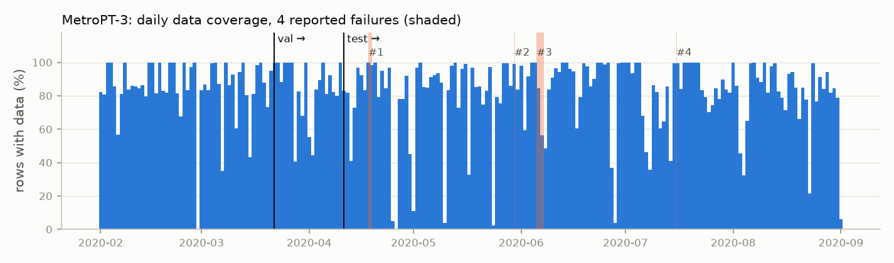

# Phase 10: validation on real public data

Generated by `uv run poe report-real` on 2026-11-17 13:23 UTC from the MLflow experiment `P10_real` (runs: metropt3 audit `a634dfe3`, azure_pdm audit `aa6c7954`). Nothing here is typed by hand. Protocol and pre-registered outcomes: ADR 0027.

> **Status:** data audit and mapping only (Part A). No model has been trained on real data yet; the study results follow in Parts B and C.

## Data audit

### MetroPT-3

- **Origin:** real data. UCI Machine Learning Repository, "MetroPT-3 Dataset" (Davari, Veloso, Ribeiro, Gama; INESC TEC); licence CC BY 4.0. Time zone: unstated (timestamps and failure times are read as one naive clock).
- **File:** `MetroPT3(AirCompressor).csv`, 1,516,948 rows, 2020-02-01 00:00:00 to 2020-09-01 03:59:50 (213.2 days), 0 duplicate timestamps, sorted: yes.
- **Sampling (measured):** median interval 10 s; 10 s: 88.2 %, 9 s: 8.5 %, 12 s: 2.5 %, 13 s: 0.5 %, 11 s: 0.3 %; min 8 s, max 172,918 s.
- **The PDF's 1 Hz claim:** it states 15,169,480 instances logged at 1 Hz; the CSV has 10.00x fewer rows at a ~10 s interval, so the file is a ~0.1 Hz version of the logged data. The models use the CSV as it is.
- **Gaps over 60 s:** 331, 909.5 h in total. Longest: 2020-04-25 01:10:51 (48.0 h); 2020-06-27 10:53:07 (36.2 h); 2020-02-28 23:57:08 (28.1 h); 2020-08-04 07:42:28 (24.7 h); 2020-05-24 00:39:23 (24.6 h).
- **Grid used by the models:** 60 s rows (bin means; digital signals become duty fractions), 306,960 rows of which 252,720 hold data; a run of more than 10 empty rows starts a new series: 224 series (median 956 rows).

**Sensor ranges** (raw file, all rows):

| Signal | Type | Unit | Missing | Min | Median | Max | Digital |
|---|---|---|---|---|---|---|---|
| `tp2` (TP2) | analog | bar | 0 | -0.032 | -0.012 | 10.676 | – |
| `tp3` (TP3) | analog | bar | 0 | 0.730 | 8.960 | 10.302 | – |
| `h1` (H1) | analog | bar | 0 | -0.036 | 8.784 | 10.288 | – |
| `dv_pressure` (DV_pressure) | analog | bar | 0 | -0.032 | -0.020 | 9.844 | – |
| `reservoirs` (Reservoirs) | analog | bar | 0 | 0.712 | 8.960 | 10.300 | – |
| `oil_temperature` (Oil_temperature) | analog | degC | 0 | 15.400 | 62.700 | 89.050 | – |
| `motor_current` (Motor_current) | analog | A | 0 | 0.020 | 0.045 | 9.295 | – |
| `comp` (COMP) | digital | – | 0 | 0.000 | 1.000 | 1.000 | active 83.7 % |
| `dv_electric` (DV_eletric) | digital | – | 0 | 0.000 | 0.000 | 1.000 | active 16.1 % |
| `towers` (Towers) | digital | – | 0 | 0.000 | 1.000 | 1.000 | active 92.0 % |
| `mpg` (MPG) | digital | – | 0 | 0.000 | 1.000 | 1.000 | active 83.3 % |
| `lps` (LPS) | digital | – | 0 | 0.000 | 0.000 | 1.000 | active 0.3 % |
| `pressure_switch` (Pressure_switch) | digital | – | 0 | 0.000 | 1.000 | 1.000 | active 99.1 % |
| `oil_level` (Oil_level) | digital | – | 0 | 0.000 | 1.000 | 1.000 | active 90.4 % |
| `caudal_impulses` (Caudal_impulses) | digital | – | 0 | 0.000 | 1.000 | 1.000 | active 93.7 % |

**Failures** (4, all air leaks). Failure intervals are company maintenance reports (air leaks), not sensor labels; the dataset itself is unlabeled. Source: UCI MetroPT-3 dataset page and "Data Description_Metro.pdf", table "Failure Information" (company failure reports). Times as printed there (M/D/YYYY H:MM).

| # | Start | End | Hours | Raw samples inside | Data in interval | Data in 2 h before | Data in 6 h before | Data in 24 h before |
|---|---|---|---|---|---|---|---|---|
| 1 | 2020-04-18 00:00:00 | 2020-04-18 23:59:00 | 24.0 | 8,657 | 99.7 % | 100.0 % | 100.0 % | 83.2 % |
| 2 | 2020-05-29 23:30:00 | 2020-05-30 06:00:00 | 6.5 | 2,360 | 100.0 % | 100.0 % | 100.0 % | 85.9 % |
| 3 | 2020-06-05 10:00:00 | 2020-06-07 14:30:00 | 52.5 | 17,315 | 90.9 % | 100.0 % | 100.0 % | 100.0 % |
| 4 | 2020-07-15 14:30:00 | 2020-07-15 19:00:00 | 4.5 | 1,622 | 99.6 % | 100.0 % | 100.0 % | 71.0 % |

- **Check against the PDF** (manual reading of Data Description_Metro.pdf, page 3, "Failure Information", 2026-11-17): the four start and end times above match the PDF table exactly.
  - Inconsistency: the PDF numbers the first two failures both #1 (then #3, #4); ids 1-4 here are by date
  - Inconsistency: failure 2 (2020-05-29/30) reports maintenance on 30 April at 12:00, a month before the failure; kept verbatim, not corrected and not used
  - Inconsistency: the PDF states 15,169,480 instances logged at 1 Hz from February to August 2020; the rows, sampling and span of the CSV are measured by the audit instead of assumed

*Share of 1-min rows with data per day; 4 failure intervals shaded; split boundaries as vertical lines.*

### Azure PdM

- **Origin:** public benchmark, likely synthetic. Kaggle, "Microsoft Azure Predictive Maintenance" (from a Microsoft Azure AI predictive-maintenance tutorial). It is a public benchmark and is described here as such, not as real plant data.
- **Telemetry:** 876,100 rows, 100 machines, 2015-01-01 06:00:00 to 2016-01-01 06:00:00 (365 days). Intervals: 3600 s x 876,000; 0 gaps; 0 duplicates; 0 missing values.
- **Machines:** 100, by model model1: 16, model2: 17, model3: 35, model4: 32 (the model is the machine kind); age 0 to 20 years.
- **Failures:** 761 failure rows form **719 events** (machine, hour); comp1: 192, comp2: 259, comp3: 131, comp4: 179 rows; events with 1 / 2 failed components: 677 / 42; 98 machines with a failure; first 2015-01-02 03:00:00, last 2015-12-31 06:00:00. A failure row is the hour a component was recorded as failed (and replaced); failures have no duration. Several rows at the same machine and hour form one event.
- **Signs of synthetic origin (measured):** every failure is stamped at hour 3:00 (18) or 6:00 (743); 743 of 761 failure rows have a maintenance row at the same machine, hour and component; the telemetry has no gaps and no missing values.
- **Errors:** 3,919 rows, error1: 1010, error2: 988, error3: 838, error4: 727, error5: 356. 98.1 % of failure events have at least one error on the same machine in the 24 h before (98.1 % in 48 h). Errors are not model inputs in the primary models (ADR 0027).
- **Maintenance records** start 2014-06-01 06:00:00, before the telemetry.

**Sensor ranges:**

| Sensor | Missing | Min | p1 | Median | p99 | Max |
|---|---|---|---|---|---|---|
| `volt` | 0 | 97.33 | 135.40 | 170.61 | 208.13 | 255.12 |
| `rotate` | 0 | 138.43 | 316.77 | 447.56 | 565.51 | 695.02 |
| `pressure` | 0 | 51.24 | 76.85 | 100.43 | 131.70 | 185.95 |
| `vibration` | 0 | 14.88 | 28.45 | 40.24 | 54.24 | 76.79 |

## Mapping to the common window format

Every length is in rows of the dataset's own grid. Decisions and limitations: `docs/experiments.md` § Phase 10; protocol: ADR 0027.

| Dataset | Row | Window | Horizons | WARNING band | Lookbacks | Sustain | Train / val / test |
|---|---|---|---|---|---|---|---|
| metropt3 | 60 s | 1 h | none (no supervised model) | 6 h | 2 h, 6 h, 24 h (primary 6 h) | 3 min | 2020-02-01 00:00:00 to 2020-03-22 00:00:00 / 2020-03-22 00:00:00 to 2020-04-11 00:00:00 / 2020-04-11 00:00:00 to 2020-09-02 00:00:00 |
| azure_pdm | 3600 s | 24 h | 12 h, 24 h | 24 h | 48 h (primary 48 h) | 3 h | 2015-01-01 00:00:00 to 2015-09-01 00:00:00 / 2015-09-01 00:00:00 to 2015-11-01 00:00:00 / 2015-11-01 00:00:00 to 2016-01-02 00:00:00 |

**Events per split** (failure start inside the split; evaluable = the primary lookback lies inside the split and at least 50 % of it has data):

| Dataset | Split | Machines | Series | Rows | Events | Evaluable | By type |
|---|---|---|---|---|---|---|---|
| metropt3 | train | 1 | 47 | 61,106 | 0 | 0 | – |
| metropt3 | val | 1 | 13 | 24,352 | 0 | 0 | – |
| metropt3 | test | 1 | 166 | 167,721 | 4 | 4 | air_leak: 4 |
| azure_pdm | train | 100 | 100 | 582,600 | 493 | 473 | comp1: 127, comp2: 149, comp3: 82, comp4: 106, multi: 29 |
| azure_pdm | val | 100 | 100 | 146,400 | 112 | 106 | comp1: 19, comp2: 43, comp3: 17, comp4: 27, multi: 6 |
| azure_pdm | test | 100 | 100 | 147,100 | 114 | 108 | comp1: 26, comp2: 40, comp3: 19, comp4: 22, multi: 7 |

