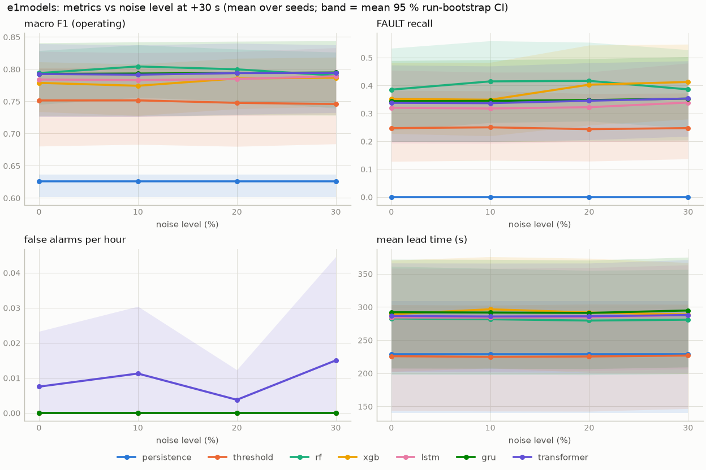
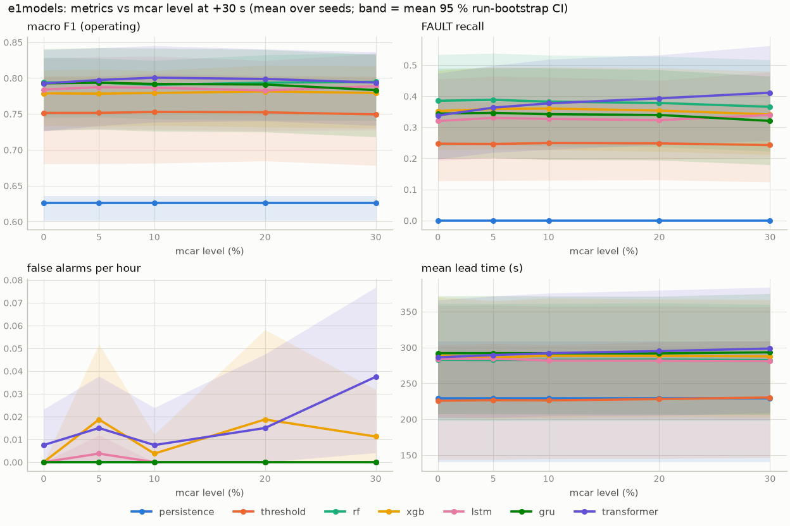
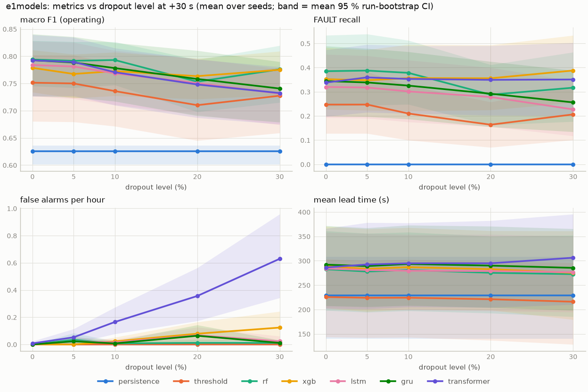
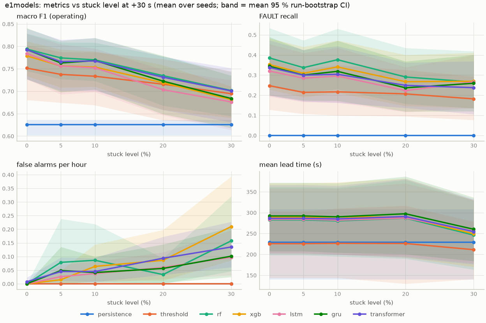
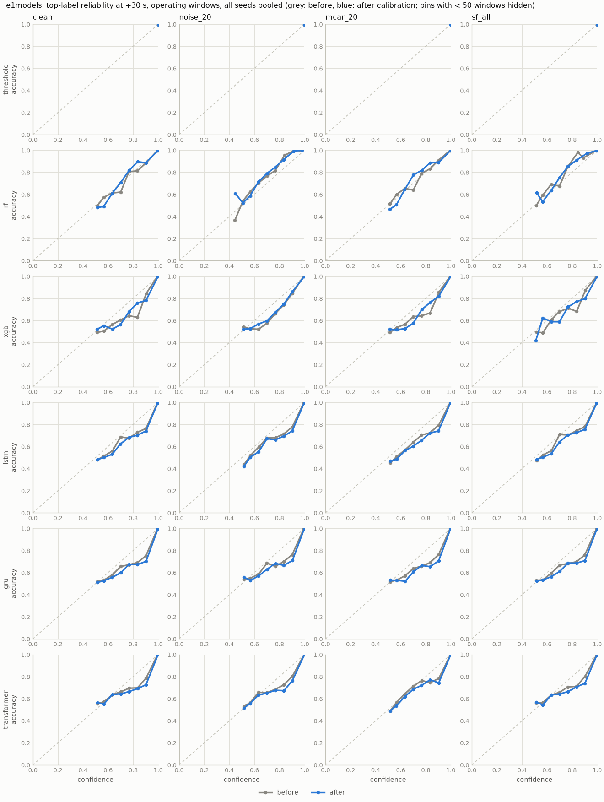
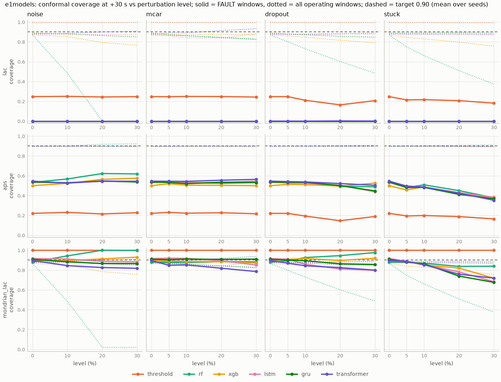
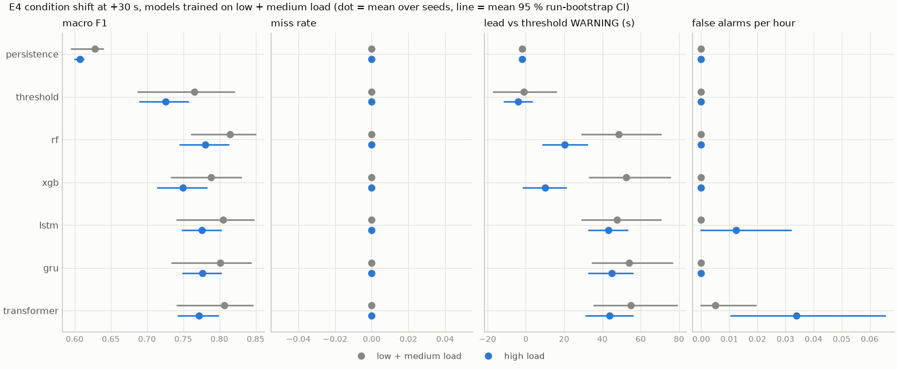
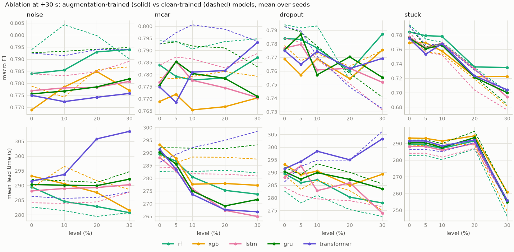
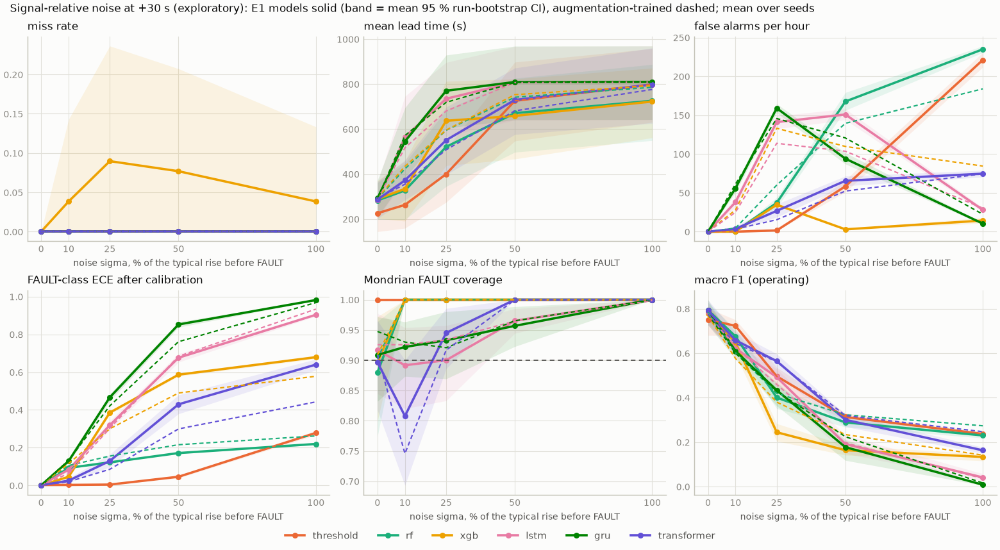
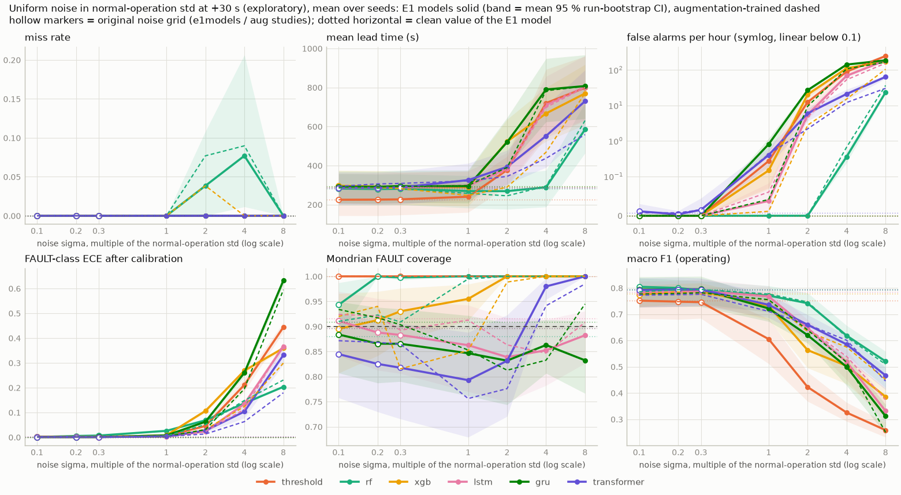

# Phase 8: robustness, calibration and conformal prediction

Generated by `uv run poe report-robustness` from the MLflow experiment `P8_robustness` on 2026-11-16 17:10 UTC (git `e60d316`). Do not edit by hand; definitions are in [docs/experiments.md](../../docs/experiments.md), the protocol in [ADR 0021](../../docs/adr/0021-robustness-protocol.md) and [ADR 0022](../../docs/adr/0022-calibration-conformal.md).

Studies run: `e1models`: persistence, threshold, rf, xgb, lstm, gru, transformer; `e4`: persistence, threshold, rf, xgb, lstm, gru, transformer; `aug`: persistence, threshold, rf, xgb, lstm, gru, transformer; `e1models_snoise`: persistence, threshold, rf, xgb, lstm, gru, transformer; `aug_snoise`: persistence, threshold, rf, xgb, lstm, gru, transformer; `e1models_stdnoise`: persistence, threshold, rf, xgb, lstm, gru, transformer; `aug_stdnoise`: persistence, threshold, rf, xgb, lstm, gru, transformer.

## How to read this report

- **Primary vs exploratory.** Sections marked **PRIMARY** report the pre-registered outcomes (ADR 0021, fixed before any study run). Everything marked **EXPLORATORY** is descriptive; with many comparisons some CIs exclude zero by chance.
- **Cells:** `point [lo, hi]` = mean over seeds of the point estimate and of the 95 % run bootstrap CI bounds (1000 resamples of whole test runs). Differences: `* ` = the averaged CI excludes zero; `(k/n)` = seeds whose own CI excludes zero.
- **Alarms** use the uncalibrated argmax (the E1 rule) sustained for the configured seconds; calibration changes only the probabilities used for ECE and conformal sets (ADR 0022).
- **Lead relative to the threshold WARNING** (`rel_lead_mean_s`) = simulator WARNING time minus alarm time; positive = earlier than the threshold rule's onset.
- **Persistence** reads the true current state by design, so sensor perturbations cannot change it; it is a reference line.
- **ECE** is top-label with 15 equal-width bins on operating windows, where most windows are confidently NORMAL, so it is small in absolute terms; the FAULT-class ECE and the reliability diagrams show the rare-class behaviour.
- **Conformal sets** at alpha 0.1, calibrated on clean validation operating windows. LAC and APS guarantee coverage only on average over classes (dominated by NORMAL); Mondrian LAC per class. Randomised APS may return empty sets (counted as not covered).
- **Baselines and conformal sets:** persistence and threshold output one-hot probabilities and are not calibrated. Their conformal sets degenerate (a Mondrian set contains almost every class, see the set sizes), so their coverage figures say nothing about confidence; they are listed for completeness.
- **Coverage needs the set size next to it:** a coverage of 1.0 with sets of size 3 is trivial, and a marginal coverage far below 0.9 under a perturbation means the calibrated probabilities moved (empty or too small sets).

## PRIMARY: pre-registered outcomes

Pre-registered in ADR 0021 and `robustness.yaml` before any study run: at +30 s, miss rate, lead relative to the threshold WARNING and false alarms per hour of each model vs the `threshold` baseline (paired); ECE after calibration; FAULT-class coverage of LAC, APS and Mondrian LAC; under `noise_20`, `mcar_20`, `sf_all`, `e4_high`.

### noise_20

Study `e1models`. 30 test runs, 26 gradual-fault episodes (CNC 12, CONVEYOR 9, INSPECTION 5), 89.0 h of negative (normal operating) windows; operating windows per true class: NORMAL 334,927, WARNING 6,384, FAULT 1,080.

**Early warning (+30 s)**

| Model | miss_rate | rel_lead_mean_s | false_alarms_per_h | Δ miss_rate vs threshold | Δ rel_lead_mean_s vs threshold | Δ false_alarms_per_h vs threshold |
|---|---|---|---|---|---|---|
| persistence | 0.000 [0.000, 0.000] | -2 [-2, -2] | 0.00 [0.00, 0.00] | 0.000 [0.000, 0.000] (0/1) | +4 [-10, 16] (0/1) | 0.00 [0.00, 0.00] (0/1) |
| threshold | 0.000 [0.000, 0.000] | -6 [-18, 8] | 0.00 [0.00, 0.00] | – | – | – |
| rf | 0.000 [0.000, 0.000] | 49 [33, 66] | 0.00 [0.00, 0.00] | 0.000 [0.000, 0.000] (0/3) | +54 [46, 64] * (3/3) | 0.00 [0.00, 0.00] (0/3) |
| xgb | 0.000 [0.000, 0.000] | 61 [38, 86] | 0.00 [0.00, 0.00] | 0.000 [0.000, 0.000] (0/3) | +66 [48, 87] * (3/3) | 0.00 [0.00, 0.00] (0/3) |
| lstm | 0.000 [0.000, 0.000] | 54 [40, 71] | 0.00 [0.00, 0.00] | 0.000 [0.000, 0.000] (0/3) | +59 [49, 72] * (3/3) | 0.00 [0.00, 0.00] (0/3) |
| gru | 0.000 [0.000, 0.000] | 60 [46, 78] | 0.00 [0.00, 0.00] | 0.000 [0.000, 0.000] (0/3) | +66 [56, 77] * (3/3) | 0.00 [0.00, 0.00] (0/3) |
| transformer | 0.000 [0.000, 0.000] | 55 [38, 75] | 0.00 [0.00, 0.01] | 0.000 [0.000, 0.000] (0/3) | +61 [49, 73] * (3/3) | +0.00 [0.00, 0.01] (0/3) |

**Calibration and FAULT-class coverage (+30 s, target coverage 0.90)**

| Model | ece_cal | ece_fault_cal (exploratory) | cov_lac_FAULT | cov_aps_FAULT | cov_mondrian_lac_FAULT |
|---|---|---|---|---|---|
| persistence | 0.0054 [0.0037, 0.0075] | 0.0032 [0.0023, 0.0043] | 0.000 [0.000, 0.000] | 0.000 [0.000, 0.000] | 1.000 [1.000, 1.000] |
| threshold | 0.0057 [0.0038, 0.0080] | 0.0025 [0.0018, 0.0035] | 0.244 [0.129, 0.371] | 0.215 [0.114, 0.324] | 1.000 [1.000, 1.000] |
| rf | 0.0213 [0.0202, 0.0227] | 0.0050 [0.0046, 0.0059] | 0.000 [0.000, 0.000] | 0.623 [0.469, 0.756] | 1.000 [0.999, 1.000] |
| xgb | 0.0011 [0.0006, 0.0019] | 0.0006 [0.0004, 0.0015] | 0.000 [0.000, 0.000] | 0.564 [0.407, 0.711] | 0.913 [0.842, 0.970] |
| lstm | 0.0012 [0.0006, 0.0026] | 0.0012 [0.0008, 0.0019] | 0.000 [0.000, 0.000] | 0.543 [0.395, 0.683] | 0.888 [0.813, 0.955] |
| gru | 0.0016 [0.0007, 0.0031] | 0.0008 [0.0005, 0.0015] | 0.000 [0.000, 0.000] | 0.548 [0.396, 0.692] | 0.866 [0.787, 0.938] |
| transformer | 0.0018 [0.0008, 0.0034] | 0.0006 [0.0004, 0.0013] | 0.000 [0.000, 0.000] | 0.546 [0.391, 0.688] | 0.825 [0.730, 0.911] |

Top-label ECE on operating windows is dominated by easy NORMAL windows (97.8% of the 342,391 operating windows here are NORMAL at this horizon, mostly predicted with confidence near 1). The FAULT-class ECE (`ece_fault_cal`, p(FAULT) against the event FAULT, after calibration) shows the rare class.

### mcar_20

Study `e1models`. 30 test runs, 26 gradual-fault episodes (CNC 12, CONVEYOR 9, INSPECTION 5), 89.0 h of negative (normal operating) windows; operating windows per true class: NORMAL 334,927, WARNING 6,384, FAULT 1,080.

**Early warning (+30 s)**

| Model | miss_rate | rel_lead_mean_s | false_alarms_per_h | Δ miss_rate vs threshold | Δ rel_lead_mean_s vs threshold | Δ false_alarms_per_h vs threshold |
|---|---|---|---|---|---|---|
| persistence | 0.000 [0.000, 0.000] | -2 [-2, -2] | 0.00 [0.00, 0.00] | 0.000 [0.000, 0.000] (0/1) | +1 [-13, 14] (0/1) | 0.00 [0.00, 0.00] (0/1) |
| threshold | 0.000 [0.000, 0.000] | -3 [-16, 11] | 0.00 [0.00, 0.00] | – | – | – |
| rf | 0.000 [0.000, 0.000] | 52 [35, 71] | 0.00 [0.00, 0.00] | 0.000 [0.000, 0.000] (0/3) | +55 [46, 65] * (3/3) | 0.00 [0.00, 0.00] (0/3) |
| xgb | 0.000 [0.000, 0.000] | 58 [41, 76] | 0.02 [0.00, 0.06] | 0.000 [0.000, 0.000] (0/3) | +60 [52, 70] * (3/3) | +0.02 [0.00, 0.06] (0/3) |
| lstm | 0.000 [0.000, 0.000] | 51 [37, 68] | 0.00 [0.00, 0.00] | 0.000 [0.000, 0.000] (0/3) | +54 [43, 66] * (3/3) | 0.00 [0.00, 0.00] (0/3) |
| gru | 0.000 [0.000, 0.000] | 61 [47, 78] | 0.00 [0.00, 0.00] | 0.000 [0.000, 0.000] (0/3) | +64 [54, 75] * (3/3) | 0.00 [0.00, 0.00] (0/3) |
| transformer | 0.000 [0.000, 0.000] | 64 [46, 84] | 0.01 [0.00, 0.05] | 0.000 [0.000, 0.000] (0/3) | +67 [54, 79] * (3/3) | +0.01 [0.00, 0.05] (0/3) |

**Calibration and FAULT-class coverage (+30 s, target coverage 0.90)**

| Model | ece_cal | ece_fault_cal (exploratory) | cov_lac_FAULT | cov_aps_FAULT | cov_mondrian_lac_FAULT |
|---|---|---|---|---|---|
| persistence | 0.0054 [0.0037, 0.0075] | 0.0032 [0.0023, 0.0043] | 0.000 [0.000, 0.000] | 0.000 [0.000, 0.000] | 1.000 [1.000, 1.000] |
| threshold | 0.0056 [0.0037, 0.0078] | 0.0025 [0.0017, 0.0034] | 0.248 [0.131, 0.377] | 0.227 [0.118, 0.343] | 1.000 [1.000, 1.000] |
| rf | 0.0008 [0.0005, 0.0019] | 0.0006 [0.0004, 0.0014] | 0.000 [0.000, 0.000] | 0.524 [0.365, 0.676] | 0.887 [0.787, 0.965] |
| xgb | 0.0011 [0.0006, 0.0021] | 0.0007 [0.0004, 0.0015] | 0.000 [0.000, 0.000] | 0.504 [0.350, 0.658] | 0.887 [0.783, 0.967] |
| lstm | 0.0016 [0.0009, 0.0029] | 0.0015 [0.0010, 0.0024] | 0.000 [0.000, 0.000] | 0.531 [0.389, 0.664] | 0.895 [0.818, 0.959] |
| gru | 0.0017 [0.0008, 0.0031] | 0.0010 [0.0006, 0.0017] | 0.000 [0.000, 0.000] | 0.534 [0.387, 0.673] | 0.908 [0.836, 0.967] |
| transformer | 0.0020 [0.0009, 0.0036] | 0.0006 [0.0004, 0.0014] | 0.000 [0.000, 0.000] | 0.555 [0.398, 0.697] | 0.819 [0.716, 0.909] |

Top-label ECE on operating windows is dominated by easy NORMAL windows (97.8% of the 342,391 operating windows here are NORMAL at this horizon, mostly predicted with confidence near 1). The FAULT-class ECE (`ece_fault_cal`, p(FAULT) against the event FAULT, after calibration) shows the rare class.

### sf_all

Study `e1models`. 30 test runs, 26 gradual-fault episodes (CNC 12, CONVEYOR 9, INSPECTION 5), 89.0 h of negative (normal operating) windows; operating windows per true class: NORMAL 334,927, WARNING 6,384, FAULT 1,080; windows in a sensor fault: 46,537.

**Early warning (+30 s)**

| Model | miss_rate | rel_lead_mean_s | false_alarms_per_h | Δ miss_rate vs threshold | Δ rel_lead_mean_s vs threshold | Δ false_alarms_per_h vs threshold |
|---|---|---|---|---|---|---|
| persistence | 0.000 [0.000, 0.000] | -2 [-2, -2] | 0.00 [0.00, 0.00] | -0.038 [-0.125, 0.000] (0/1) | +6 [-9, 21] (0/1) | -0.06 [-0.17, 0.00] (0/1) |
| threshold | 0.038 [0.000, 0.125] | -8 [-23, 7] | 0.06 [0.00, 0.17] | – | – | – |
| rf | 0.038 [0.000, 0.125] | 45 [26, 64] | 0.01 [0.00, 0.04] | 0.000 [0.000, 0.000] (0/3) | +54 [44, 65] * (3/3) | -0.04 [-0.17, 0.03] (0/3) |
| xgb | 0.038 [0.000, 0.125] | 50 [28, 74] | 0.02 [0.00, 0.06] | 0.000 [0.000, 0.000] (0/3) | +59 [45, 74] * (3/3) | -0.04 [-0.17, 0.05] (0/3) |
| lstm | 0.038 [0.000, 0.125] | 45 [29, 62] | 0.00 [0.00, 0.00] | 0.000 [0.000, 0.000] (0/3) | +53 [43, 66] * (3/3) | -0.06 [-0.17, 0.00] (0/3) |
| gru | 0.038 [0.000, 0.125] | 53 [36, 71] | 0.01 [0.00, 0.04] | 0.000 [0.000, 0.000] (0/3) | +61 [50, 72] * (3/3) | -0.04 [-0.17, 0.03] (0/3) |
| transformer | 0.038 [0.000, 0.125] | 48 [28, 68] | 0.03 [0.00, 0.08] | 0.000 [0.000, 0.000] (0/3) | +56 [44, 68] * (3/3) | -0.03 [-0.16, 0.07] (0/3) |

**Calibration and FAULT-class coverage (+30 s, target coverage 0.90)**

| Model | ece_cal | ece_fault_cal (exploratory) | cov_lac_FAULT | cov_aps_FAULT | cov_mondrian_lac_FAULT |
|---|---|---|---|---|---|
| persistence | 0.0054 [0.0037, 0.0075] | 0.0032 [0.0023, 0.0043] | 0.000 [0.000, 0.000] | 0.000 [0.000, 0.000] | 1.000 [1.000, 1.000] |
| threshold | 0.0067 [0.0041, 0.0102] | 0.0025 [0.0017, 0.0034] | 0.247 [0.128, 0.382] | 0.223 [0.116, 0.345] | 1.000 [1.000, 1.000] |
| rf | 0.0020 [0.0013, 0.0046] | 0.0022 [0.0012, 0.0036] | 0.000 [0.000, 0.000] | 0.524 [0.360, 0.673] | 0.927 [0.839, 0.989] |
| xgb | 0.0021 [0.0008, 0.0050] | 0.0007 [0.0004, 0.0015] | 0.000 [0.000, 0.000] | 0.496 [0.338, 0.646] | 0.879 [0.775, 0.962] |
| lstm | 0.0021 [0.0007, 0.0050] | 0.0010 [0.0005, 0.0017] | 0.000 [0.000, 0.000] | 0.524 [0.379, 0.661] | 0.815 [0.688, 0.921] |
| gru | 0.0024 [0.0009, 0.0055] | 0.0007 [0.0004, 0.0014] | 0.000 [0.000, 0.000] | 0.523 [0.374, 0.668] | 0.836 [0.727, 0.930] |
| transformer | 0.0026 [0.0009, 0.0056] | 0.0007 [0.0004, 0.0014] | 0.000 [0.000, 0.000] | 0.526 [0.373, 0.671] | 0.811 [0.692, 0.914] |

Top-label ECE on operating windows is dominated by easy NORMAL windows (97.8% of the 342,391 operating windows here are NORMAL at this horizon, mostly predicted with confidence near 1). The FAULT-class ECE (`ece_fault_cal`, p(FAULT) against the event FAULT, after calibration) shows the rare class.

### e4_high

Study `e4`. 62 test runs, 62 gradual-fault episodes (CNC 19, CONVEYOR 30, INSPECTION 13), 187.3 h of negative (normal operating) windows; operating windows per true class: NORMAL 701,836, WARNING 10,675, FAULT 2,370.

**Early warning (+30 s)**

| Model | miss_rate | rel_lead_mean_s | false_alarms_per_h | Δ miss_rate vs threshold | Δ rel_lead_mean_s vs threshold | Δ false_alarms_per_h vs threshold |
|---|---|---|---|---|---|---|
| persistence | 0.000 [0.000, 0.000] | -2 [-2, -2] | 0.00 [0.00, 0.00] | 0.000 [0.000, 0.000] (0/1) | +2 [-5, 9] (0/1) | 0.00 [0.00, 0.00] (0/1) |
| threshold | 0.000 [0.000, 0.000] | -4 [-11, 3] | 0.00 [0.00, 0.00] | – | – | – |
| rf | 0.000 [0.000, 0.000] | 20 [9, 32] | 0.00 [0.00, 0.00] | 0.000 [0.000, 0.000] (0/3) | +24 [14, 35] * (3/3) | 0.00 [0.00, 0.00] (0/3) |
| xgb | 0.000 [0.000, 0.000] | 10 [-1, 21] | 0.00 [0.00, 0.00] | 0.000 [0.000, 0.000] (0/3) | +14 [4, 23] * (3/3) | 0.00 [0.00, 0.00] (0/3) |
| lstm | 0.000 [0.000, 0.000] | 43 [33, 53] | 0.01 [0.00, 0.03] | 0.000 [0.000, 0.000] (0/3) | +47 [38, 56] * (3/3) | +0.01 [0.00, 0.03] (0/3) |
| gru | 0.000 [0.000, 0.000] | 45 [33, 56] | 0.00 [0.00, 0.00] | 0.000 [0.000, 0.000] (0/3) | +49 [38, 59] * (3/3) | 0.00 [0.00, 0.00] (0/3) |
| transformer | 0.000 [0.000, 0.000] | 44 [31, 56] | 0.03 [0.01, 0.07] | 0.000 [0.000, 0.000] (0/3) | +47 [37, 59] * (3/3) | +0.03 [0.01, 0.07] * (2/3) |

**Calibration and FAULT-class coverage (+30 s, target coverage 0.90)**

| Model | ece_cal | ece_fault_cal (exploratory) | cov_lac_FAULT | cov_aps_FAULT | cov_mondrian_lac_FAULT |
|---|---|---|---|---|---|
| persistence | 0.0060 [0.0048, 0.0073] | 0.0033 [0.0026, 0.0040] | 0.000 [0.000, 0.000] | 0.000 [0.000, 0.000] | 1.000 [1.000, 1.000] |
| threshold | 0.0060 [0.0047, 0.0074] | 0.0027 [0.0021, 0.0034] | 0.237 [0.156, 0.318] | 0.211 [0.140, 0.284] | 1.000 [1.000, 1.000] |
| rf | 0.0291 [0.0277, 0.0307] | 0.0016 [0.0011, 0.0024] | 0.000 [0.000, 0.000] | 0.646 [0.551, 0.734] | 0.887 [0.824, 0.941] |
| xgb | 0.0031 [0.0019, 0.0047] | 0.0016 [0.0010, 0.0026] | 0.000 [0.000, 0.000] | 0.681 [0.586, 0.768] | 0.777 [0.681, 0.864] |
| lstm | 0.0030 [0.0020, 0.0040] | 0.0014 [0.0007, 0.0022] | 0.001 [0.000, 0.003] | 0.599 [0.502, 0.690] | 0.803 [0.717, 0.876] |
| gru | 0.0029 [0.0019, 0.0041] | 0.0011 [0.0006, 0.0019] | 0.002 [0.000, 0.006] | 0.590 [0.492, 0.679] | 0.815 [0.734, 0.886] |
| transformer | 0.0026 [0.0016, 0.0037] | 0.0010 [0.0005, 0.0018] | 0.000 [0.000, 0.000] | 0.605 [0.509, 0.695] | 0.807 [0.722, 0.882] |

Top-label ECE on operating windows is dominated by easy NORMAL windows (98.2% of the 714,881 operating windows here are NORMAL at this horizon, mostly predicted with confidence near 1). The FAULT-class ECE (`ece_fault_cal`, p(FAULT) against the event FAULT, after calibration) shows the rare class.

## EXPLORATORY: E2 noise, E3 missing data and sensor faults (E1 models, no retraining)

Clean test set: 30 test runs, 26 gradual-fault episodes (CNC 12, CONVEYOR 9, INSPECTION 5), 89.0 h of negative (normal operating) windows; operating windows per true class: NORMAL 334,927, WARNING 6,384, FAULT 1,080.

### Early warning and classification under each condition (+30 s)

**noise**

| Model | Condition | macro F1 | FAULT recall | miss_rate | lead_mean_s | rel_lead_mean_s | false_alarms_per_h |
|---|---|---|---|---|---|---|---|
| persistence | clean | 0.626 [0.601, 0.636] | 0.000 [0.000, 0.000] | 0.000 [0.000, 0.000] | 229 [140, 309] | -2 [-2, -2] | 0.00 [0.00, 0.00] |
| persistence | noise_10 | 0.626 [0.601, 0.636] | 0.000 [0.000, 0.000] | 0.000 [0.000, 0.000] | 229 [140, 309] | -2 [-2, -2] | 0.00 [0.00, 0.00] |
| persistence | noise_20 | 0.626 [0.601, 0.636] | 0.000 [0.000, 0.000] | 0.000 [0.000, 0.000] | 229 [140, 309] | -2 [-2, -2] | 0.00 [0.00, 0.00] |
| persistence | noise_30 | 0.626 [0.601, 0.636] | 0.000 [0.000, 0.000] | 0.000 [0.000, 0.000] | 229 [140, 309] | -2 [-2, -2] | 0.00 [0.00, 0.00] |
| threshold | clean | 0.751 [0.680, 0.803] | 0.247 [0.128, 0.382] | 0.000 [0.000, 0.000] | 226 [144, 303] | -5 [-17, 9] | 0.00 [0.00, 0.00] |
| threshold | noise_10 | 0.752 [0.683, 0.803] | 0.250 [0.132, 0.381] | 0.000 [0.000, 0.000] | 225 [143, 303] | -6 [-18, 7] | 0.00 [0.00, 0.00] |
| threshold | noise_20 | 0.748 [0.680, 0.797] | 0.244 [0.129, 0.371] | 0.000 [0.000, 0.000] | 225 [143, 304] | -6 [-18, 8] | 0.00 [0.00, 0.00] |
| threshold | noise_30 | 0.746 [0.684, 0.794] | 0.247 [0.137, 0.373] | 0.000 [0.000, 0.000] | 227 [147, 304] | -4 [-18, 11] | 0.00 [0.00, 0.00] |
| rf | clean | 0.794 [0.745, 0.829] | 0.385 [0.240, 0.534] | 0.000 [0.000, 0.000] | 283 [198, 361] | 52 [34, 71] | 0.00 [0.00, 0.00] |
| rf | noise_10 | 0.804 [0.756, 0.838] | 0.415 [0.267, 0.560] | 0.000 [0.000, 0.000] | 281 [198, 358] | 51 [33, 68] | 0.00 [0.00, 0.00] |
| rf | noise_20 | 0.800 [0.751, 0.831] | 0.417 [0.272, 0.555] | 0.000 [0.000, 0.000] | 279 [198, 355] | 49 [33, 66] | 0.00 [0.00, 0.00] |
| rf | noise_30 | 0.790 [0.739, 0.826] | 0.386 [0.247, 0.528] | 0.000 [0.000, 0.000] | 281 [199, 357] | 50 [34, 68] | 0.00 [0.00, 0.00] |
| xgb | clean | 0.779 [0.734, 0.811] | 0.352 [0.228, 0.483] | 0.000 [0.000, 0.000] | 289 [203, 370] | 58 [38, 81] | 0.00 [0.00, 0.00] |
| xgb | noise_10 | 0.774 [0.728, 0.808] | 0.349 [0.219, 0.483] | 0.000 [0.000, 0.000] | 296 [208, 376] | 66 [43, 90] | 0.00 [0.00, 0.00] |
| xgb | noise_20 | 0.786 [0.738, 0.817] | 0.403 [0.258, 0.545] | 0.000 [0.000, 0.000] | 292 [201, 373] | 61 [38, 86] | 0.00 [0.00, 0.00] |
| xgb | noise_30 | 0.787 [0.742, 0.819] | 0.413 [0.280, 0.548] | 0.000 [0.000, 0.000] | 289 [200, 367] | 58 [36, 82] | 0.00 [0.00, 0.00] |
| lstm | clean | 0.784 [0.727, 0.828] | 0.320 [0.193, 0.455] | 0.000 [0.000, 0.000] | 284 [203, 358] | 53 [40, 71] | 0.00 [0.00, 0.00] |
| lstm | noise_10 | 0.783 [0.726, 0.825] | 0.318 [0.192, 0.448] | 0.000 [0.000, 0.000] | 284 [202, 358] | 53 [39, 70] | 0.00 [0.00, 0.00] |
| lstm | noise_20 | 0.785 [0.728, 0.827] | 0.322 [0.198, 0.448] | 0.000 [0.000, 0.000] | 284 [204, 359] | 54 [40, 71] | 0.00 [0.00, 0.00] |
| lstm | noise_30 | 0.789 [0.730, 0.833] | 0.339 [0.200, 0.480] | 0.000 [0.000, 0.000] | 288 [206, 363] | 57 [43, 75] | 0.00 [0.00, 0.00] |
| gru | clean | 0.793 [0.727, 0.841] | 0.344 [0.199, 0.489] | 0.000 [0.000, 0.000] | 292 [208, 372] | 61 [47, 79] | 0.00 [0.00, 0.00] |
| gru | noise_10 | 0.793 [0.727, 0.842] | 0.345 [0.198, 0.492] | 0.000 [0.000, 0.000] | 292 [207, 372] | 61 [47, 78] | 0.00 [0.00, 0.00] |
| gru | noise_20 | 0.794 [0.729, 0.843] | 0.348 [0.202, 0.496] | 0.000 [0.000, 0.000] | 291 [207, 371] | 60 [46, 78] | 0.00 [0.00, 0.00] |
| gru | noise_30 | 0.795 [0.729, 0.844] | 0.353 [0.204, 0.503] | 0.000 [0.000, 0.000] | 295 [209, 375] | 64 [49, 81] | 0.00 [0.00, 0.00] |
| transformer | clean | 0.792 [0.726, 0.839] | 0.338 [0.198, 0.473] | 0.000 [0.000, 0.000] | 286 [202, 366] | 56 [39, 75] | 0.01 [0.00, 0.02] |
| transformer | noise_10 | 0.791 [0.727, 0.838] | 0.337 [0.199, 0.470] | 0.000 [0.000, 0.000] | 286 [202, 366] | 55 [39, 74] | 0.01 [0.00, 0.03] |
| transformer | noise_20 | 0.794 [0.730, 0.840] | 0.345 [0.205, 0.481] | 0.000 [0.000, 0.000] | 286 [201, 366] | 55 [38, 75] | 0.00 [0.00, 0.01] |
| transformer | noise_30 | 0.794 [0.733, 0.838] | 0.353 [0.218, 0.488] | 0.000 [0.000, 0.000] | 288 [201, 371] | 57 [39, 77] | 0.01 [0.00, 0.04] |

**mcar**

| Model | Condition | macro F1 | FAULT recall | miss_rate | lead_mean_s | rel_lead_mean_s | false_alarms_per_h |
|---|---|---|---|---|---|---|---|
| persistence | clean | 0.626 [0.601, 0.636] | 0.000 [0.000, 0.000] | 0.000 [0.000, 0.000] | 229 [140, 309] | -2 [-2, -2] | 0.00 [0.00, 0.00] |
| persistence | mcar_5 | 0.626 [0.601, 0.636] | 0.000 [0.000, 0.000] | 0.000 [0.000, 0.000] | 229 [140, 309] | -2 [-2, -2] | 0.00 [0.00, 0.00] |
| persistence | mcar_10 | 0.626 [0.601, 0.636] | 0.000 [0.000, 0.000] | 0.000 [0.000, 0.000] | 229 [140, 309] | -2 [-2, -2] | 0.00 [0.00, 0.00] |
| persistence | mcar_20 | 0.626 [0.601, 0.636] | 0.000 [0.000, 0.000] | 0.000 [0.000, 0.000] | 229 [140, 309] | -2 [-2, -2] | 0.00 [0.00, 0.00] |
| persistence | mcar_30 | 0.626 [0.601, 0.636] | 0.000 [0.000, 0.000] | 0.000 [0.000, 0.000] | 229 [140, 309] | -2 [-2, -2] | 0.00 [0.00, 0.00] |
| threshold | clean | 0.751 [0.680, 0.803] | 0.247 [0.128, 0.382] | 0.000 [0.000, 0.000] | 226 [144, 303] | -5 [-17, 9] | 0.00 [0.00, 0.00] |
| threshold | mcar_5 | 0.752 [0.681, 0.803] | 0.246 [0.128, 0.381] | 0.000 [0.000, 0.000] | 226 [144, 305] | -4 [-17, 10] | 0.00 [0.00, 0.00] |
| threshold | mcar_10 | 0.753 [0.681, 0.806] | 0.249 [0.130, 0.386] | 0.000 [0.000, 0.000] | 226 [145, 303] | -5 [-17, 9] | 0.00 [0.00, 0.00] |
| threshold | mcar_20 | 0.752 [0.685, 0.803] | 0.248 [0.131, 0.377] | 0.000 [0.000, 0.000] | 228 [145, 308] | -3 [-16, 11] | 0.00 [0.00, 0.00] |
| threshold | mcar_30 | 0.749 [0.678, 0.802] | 0.243 [0.124, 0.376] | 0.000 [0.000, 0.000] | 230 [146, 309] | -1 [-14, 13] | 0.00 [0.00, 0.00] |
| rf | clean | 0.794 [0.745, 0.829] | 0.385 [0.240, 0.534] | 0.000 [0.000, 0.000] | 283 [198, 361] | 52 [34, 71] | 0.00 [0.00, 0.00] |
| rf | mcar_5 | 0.794 [0.746, 0.828] | 0.388 [0.245, 0.538] | 0.000 [0.000, 0.000] | 282 [198, 361] | 52 [34, 71] | 0.00 [0.00, 0.00] |
| rf | mcar_10 | 0.791 [0.743, 0.825] | 0.382 [0.239, 0.532] | 0.000 [0.000, 0.000] | 283 [198, 361] | 52 [34, 71] | 0.00 [0.00, 0.00] |
| rf | mcar_20 | 0.794 [0.741, 0.832] | 0.378 [0.237, 0.528] | 0.000 [0.000, 0.000] | 283 [198, 362] | 52 [35, 71] | 0.00 [0.00, 0.00] |
| rf | mcar_30 | 0.795 [0.741, 0.835] | 0.366 [0.223, 0.517] | 0.000 [0.000, 0.000] | 282 [198, 360] | 51 [33, 70] | 0.00 [0.00, 0.00] |
| xgb | clean | 0.779 [0.734, 0.811] | 0.352 [0.228, 0.483] | 0.000 [0.000, 0.000] | 289 [203, 370] | 58 [38, 81] | 0.00 [0.00, 0.00] |
| xgb | mcar_5 | 0.778 [0.733, 0.812] | 0.359 [0.230, 0.494] | 0.000 [0.000, 0.000] | 286 [201, 365] | 55 [36, 76] | 0.02 [0.00, 0.05] |
| xgb | mcar_10 | 0.779 [0.734, 0.811] | 0.360 [0.227, 0.494] | 0.000 [0.000, 0.000] | 288 [202, 369] | 58 [40, 78] | 0.00 [0.00, 0.01] |
| xgb | mcar_20 | 0.781 [0.732, 0.818] | 0.354 [0.222, 0.491] | 0.000 [0.000, 0.000] | 288 [203, 367] | 58 [41, 76] | 0.02 [0.00, 0.06] |
| xgb | mcar_30 | 0.779 [0.730, 0.817] | 0.341 [0.212, 0.480] | 0.000 [0.000, 0.000] | 288 [202, 367] | 57 [38, 78] | 0.01 [0.00, 0.03] |
| lstm | clean | 0.784 [0.727, 0.828] | 0.320 [0.193, 0.455] | 0.000 [0.000, 0.000] | 284 [203, 358] | 53 [40, 71] | 0.00 [0.00, 0.00] |
| lstm | mcar_5 | 0.787 [0.729, 0.830] | 0.330 [0.201, 0.464] | 0.000 [0.000, 0.000] | 284 [202, 359] | 53 [40, 71] | 0.00 [0.00, 0.01] |
| lstm | mcar_10 | 0.786 [0.728, 0.830] | 0.327 [0.197, 0.461] | 0.000 [0.000, 0.000] | 282 [201, 357] | 51 [38, 68] | 0.00 [0.00, 0.00] |
| lstm | mcar_20 | 0.783 [0.726, 0.824] | 0.323 [0.197, 0.451] | 0.000 [0.000, 0.000] | 282 [200, 358] | 51 [37, 68] | 0.00 [0.00, 0.00] |
| lstm | mcar_30 | 0.789 [0.728, 0.834] | 0.340 [0.203, 0.478] | 0.000 [0.000, 0.000] | 281 [199, 356] | 50 [36, 68] | 0.00 [0.00, 0.00] |
| gru | clean | 0.793 [0.727, 0.841] | 0.344 [0.199, 0.489] | 0.000 [0.000, 0.000] | 292 [208, 372] | 61 [47, 79] | 0.00 [0.00, 0.00] |
| gru | mcar_5 | 0.794 [0.728, 0.842] | 0.346 [0.202, 0.491] | 0.000 [0.000, 0.000] | 292 [207, 372] | 61 [47, 79] | 0.00 [0.00, 0.00] |
| gru | mcar_10 | 0.792 [0.726, 0.842] | 0.342 [0.196, 0.491] | 0.000 [0.000, 0.000] | 292 [207, 372] | 61 [47, 79] | 0.00 [0.00, 0.00] |
| gru | mcar_20 | 0.791 [0.725, 0.840] | 0.340 [0.194, 0.485] | 0.000 [0.000, 0.000] | 292 [207, 371] | 61 [47, 78] | 0.00 [0.00, 0.00] |
| gru | mcar_30 | 0.783 [0.718, 0.833] | 0.320 [0.179, 0.464] | 0.000 [0.000, 0.000] | 293 [207, 375] | 62 [48, 80] | 0.00 [0.00, 0.00] |
| transformer | clean | 0.792 [0.726, 0.839] | 0.338 [0.198, 0.473] | 0.000 [0.000, 0.000] | 286 [202, 366] | 56 [39, 75] | 0.01 [0.00, 0.02] |
| transformer | mcar_5 | 0.797 [0.734, 0.842] | 0.363 [0.219, 0.499] | 0.000 [0.000, 0.000] | 289 [202, 372] | 59 [40, 79] | 0.01 [0.00, 0.04] |
| transformer | mcar_10 | 0.801 [0.738, 0.845] | 0.377 [0.228, 0.519] | 0.000 [0.000, 0.000] | 292 [205, 376] | 61 [43, 81] | 0.01 [0.00, 0.02] |
| transformer | mcar_20 | 0.799 [0.740, 0.840] | 0.393 [0.244, 0.533] | 0.000 [0.000, 0.000] | 295 [205, 380] | 64 [46, 84] | 0.01 [0.00, 0.05] |
| transformer | mcar_30 | 0.794 [0.734, 0.836] | 0.411 [0.257, 0.562] | 0.000 [0.000, 0.000] | 298 [209, 384] | 68 [48, 88] | 0.04 [0.00, 0.08] |

**dropout**

| Model | Condition | macro F1 | FAULT recall | miss_rate | lead_mean_s | rel_lead_mean_s | false_alarms_per_h |
|---|---|---|---|---|---|---|---|
| persistence | clean | 0.626 [0.601, 0.636] | 0.000 [0.000, 0.000] | 0.000 [0.000, 0.000] | 229 [140, 309] | -2 [-2, -2] | 0.00 [0.00, 0.00] |
| persistence | dropout_5 | 0.626 [0.601, 0.636] | 0.000 [0.000, 0.000] | 0.000 [0.000, 0.000] | 229 [140, 309] | -2 [-2, -2] | 0.00 [0.00, 0.00] |
| persistence | dropout_10 | 0.626 [0.601, 0.636] | 0.000 [0.000, 0.000] | 0.000 [0.000, 0.000] | 229 [140, 309] | -2 [-2, -2] | 0.00 [0.00, 0.00] |
| persistence | dropout_20 | 0.626 [0.601, 0.636] | 0.000 [0.000, 0.000] | 0.000 [0.000, 0.000] | 229 [140, 309] | -2 [-2, -2] | 0.00 [0.00, 0.00] |
| persistence | dropout_30 | 0.626 [0.601, 0.636] | 0.000 [0.000, 0.000] | 0.000 [0.000, 0.000] | 229 [140, 309] | -2 [-2, -2] | 0.00 [0.00, 0.00] |
| threshold | clean | 0.751 [0.680, 0.803] | 0.247 [0.128, 0.382] | 0.000 [0.000, 0.000] | 226 [144, 303] | -5 [-17, 9] | 0.00 [0.00, 0.00] |
| threshold | dropout_5 | 0.750 [0.679, 0.802] | 0.247 [0.128, 0.382] | 0.000 [0.000, 0.000] | 224 [142, 301] | -7 [-22, 8] | 0.00 [0.00, 0.00] |
| threshold | dropout_10 | 0.736 [0.671, 0.786] | 0.210 [0.100, 0.326] | 0.000 [0.000, 0.000] | 224 [143, 303] | -6 [-20, 7] | 0.00 [0.00, 0.00] |
| threshold | dropout_20 | 0.710 [0.645, 0.758] | 0.164 [0.070, 0.258] | 0.000 [0.000, 0.000] | 221 [137, 299] | -10 [-26, 4] | 0.00 [0.00, 0.00] |
| threshold | dropout_30 | 0.727 [0.659, 0.780] | 0.206 [0.101, 0.322] | 0.000 [0.000, 0.000] | 216 [129, 296] | -15 [-28, -2] | 0.00 [0.00, 0.00] |
| rf | clean | 0.794 [0.745, 0.829] | 0.385 [0.240, 0.534] | 0.000 [0.000, 0.000] | 283 [198, 361] | 52 [34, 71] | 0.00 [0.00, 0.00] |
| rf | dropout_5 | 0.792 [0.742, 0.827] | 0.388 [0.244, 0.539] | 0.000 [0.000, 0.000] | 278 [194, 356] | 47 [27, 68] | 0.03 [0.00, 0.08] |
| rf | dropout_10 | 0.793 [0.747, 0.826] | 0.378 [0.248, 0.513] | 0.000 [0.000, 0.000] | 281 [197, 359] | 50 [33, 69] | 0.01 [0.00, 0.02] |
| rf | dropout_20 | 0.753 [0.698, 0.794] | 0.288 [0.162, 0.412] | 0.000 [0.000, 0.000] | 275 [193, 350] | 45 [25, 65] | 0.01 [0.00, 0.04] |
| rf | dropout_30 | 0.776 [0.715, 0.820] | 0.317 [0.177, 0.464] | 0.000 [0.000, 0.000] | 273 [185, 352] | 42 [26, 58] | 0.01 [0.00, 0.03] |
| xgb | clean | 0.779 [0.734, 0.811] | 0.352 [0.228, 0.483] | 0.000 [0.000, 0.000] | 289 [203, 370] | 58 [38, 81] | 0.00 [0.00, 0.00] |
| xgb | dropout_5 | 0.767 [0.723, 0.804] | 0.348 [0.223, 0.474] | 0.000 [0.000, 0.000] | 283 [196, 365] | 53 [31, 76] | 0.00 [0.00, 0.00] |
| xgb | dropout_10 | 0.773 [0.727, 0.807] | 0.356 [0.220, 0.496] | 0.000 [0.000, 0.000] | 287 [200, 368] | 56 [36, 79] | 0.02 [0.00, 0.05] |
| xgb | dropout_20 | 0.763 [0.721, 0.796] | 0.356 [0.225, 0.493] | 0.000 [0.000, 0.000] | 283 [199, 361] | 52 [33, 73] | 0.08 [0.02, 0.16] |
| xgb | dropout_30 | 0.775 [0.729, 0.809] | 0.388 [0.255, 0.533] | 0.000 [0.000, 0.000] | 275 [179, 361] | 44 [23, 67] | 0.12 [0.03, 0.24] |
| lstm | clean | 0.784 [0.727, 0.828] | 0.320 [0.193, 0.455] | 0.000 [0.000, 0.000] | 284 [203, 358] | 53 [40, 71] | 0.00 [0.00, 0.00] |
| lstm | dropout_5 | 0.781 [0.722, 0.826] | 0.318 [0.191, 0.449] | 0.000 [0.000, 0.000] | 281 [200, 356] | 50 [35, 68] | 0.02 [0.00, 0.05] |
| lstm | dropout_10 | 0.769 [0.711, 0.810] | 0.302 [0.175, 0.431] | 0.000 [0.000, 0.000] | 280 [199, 354] | 49 [35, 66] | 0.01 [0.00, 0.04] |
| lstm | dropout_20 | 0.751 [0.693, 0.796] | 0.278 [0.156, 0.400] | 0.000 [0.000, 0.000] | 279 [197, 354] | 48 [31, 68] | 0.07 [0.02, 0.13] |
| lstm | dropout_30 | 0.731 [0.674, 0.777] | 0.227 [0.118, 0.345] | 0.000 [0.000, 0.000] | 277 [195, 350] | 46 [30, 64] | 0.02 [0.00, 0.06] |
| gru | clean | 0.793 [0.727, 0.841] | 0.344 [0.199, 0.489] | 0.000 [0.000, 0.000] | 292 [208, 372] | 61 [47, 79] | 0.00 [0.00, 0.00] |
| gru | dropout_5 | 0.789 [0.725, 0.836] | 0.339 [0.197, 0.479] | 0.000 [0.000, 0.000] | 289 [206, 367] | 58 [43, 76] | 0.02 [0.00, 0.05] |
| gru | dropout_10 | 0.778 [0.717, 0.825] | 0.326 [0.187, 0.465] | 0.000 [0.000, 0.000] | 293 [208, 373] | 63 [49, 80] | 0.01 [0.00, 0.02] |
| gru | dropout_20 | 0.758 [0.691, 0.810] | 0.292 [0.155, 0.425] | 0.000 [0.000, 0.000] | 290 [204, 371] | 59 [42, 78] | 0.06 [0.01, 0.14] |
| gru | dropout_30 | 0.741 [0.679, 0.790] | 0.256 [0.135, 0.388] | 0.000 [0.000, 0.000] | 285 [198, 366] | 55 [40, 71] | 0.01 [0.00, 0.03] |
| transformer | clean | 0.792 [0.726, 0.839] | 0.338 [0.198, 0.473] | 0.000 [0.000, 0.000] | 286 [202, 366] | 56 [39, 75] | 0.01 [0.00, 0.02] |
| transformer | dropout_5 | 0.789 [0.727, 0.835] | 0.360 [0.215, 0.495] | 0.000 [0.000, 0.000] | 292 [201, 378] | 62 [41, 83] | 0.05 [0.01, 0.11] |
| transformer | dropout_10 | 0.771 [0.710, 0.815] | 0.353 [0.210, 0.490] | 0.000 [0.000, 0.000] | 295 [205, 378] | 64 [46, 85] | 0.16 [0.08, 0.27] |
| transformer | dropout_20 | 0.748 [0.687, 0.794] | 0.349 [0.203, 0.491] | 0.000 [0.000, 0.000] | 295 [204, 382] | 64 [40, 87] | 0.36 [0.17, 0.56] |
| transformer | dropout_30 | 0.732 [0.675, 0.781] | 0.351 [0.201, 0.503] | 0.000 [0.000, 0.000] | 306 [210, 396] | 75 [48, 107] | 0.63 [0.34, 0.96] |

**stuck**

| Model | Condition | macro F1 | FAULT recall | miss_rate | lead_mean_s | rel_lead_mean_s | false_alarms_per_h |
|---|---|---|---|---|---|---|---|
| persistence | clean | 0.626 [0.601, 0.636] | 0.000 [0.000, 0.000] | 0.000 [0.000, 0.000] | 229 [140, 309] | -2 [-2, -2] | 0.00 [0.00, 0.00] |
| persistence | stuck_5 | 0.626 [0.601, 0.636] | 0.000 [0.000, 0.000] | 0.000 [0.000, 0.000] | 229 [140, 309] | -2 [-2, -2] | 0.00 [0.00, 0.00] |
| persistence | stuck_10 | 0.626 [0.601, 0.636] | 0.000 [0.000, 0.000] | 0.000 [0.000, 0.000] | 229 [140, 309] | -2 [-2, -2] | 0.00 [0.00, 0.00] |
| persistence | stuck_20 | 0.626 [0.601, 0.636] | 0.000 [0.000, 0.000] | 0.000 [0.000, 0.000] | 229 [140, 309] | -2 [-2, -2] | 0.00 [0.00, 0.00] |
| persistence | stuck_30 | 0.626 [0.601, 0.636] | 0.000 [0.000, 0.000] | 0.000 [0.000, 0.000] | 229 [140, 309] | -2 [-2, -2] | 0.00 [0.00, 0.00] |
| threshold | clean | 0.751 [0.680, 0.803] | 0.247 [0.128, 0.382] | 0.000 [0.000, 0.000] | 226 [144, 303] | -5 [-17, 9] | 0.00 [0.00, 0.00] |
| threshold | stuck_5 | 0.738 [0.674, 0.787] | 0.214 [0.107, 0.328] | 0.000 [0.000, 0.000] | 226 [144, 303] | -5 [-17, 9] | 0.00 [0.00, 0.00] |
| threshold | stuck_10 | 0.733 [0.669, 0.787] | 0.217 [0.100, 0.349] | 0.038 [0.000, 0.107] | 226 [144, 310] | -5 [-18, 9] | 0.00 [0.00, 0.00] |
| threshold | stuck_20 | 0.716 [0.635, 0.772] | 0.206 [0.095, 0.326] | 0.115 [0.000, 0.290] | 226 [129, 316] | -22 [-49, 4] | 0.00 [0.00, 0.00] |
| threshold | stuck_30 | 0.695 [0.629, 0.745] | 0.181 [0.077, 0.293] | 0.115 [0.000, 0.278] | 211 [141, 278] | -37 [-64, -5] | 0.00 [0.00, 0.00] |
| rf | clean | 0.794 [0.745, 0.829] | 0.385 [0.240, 0.534] | 0.000 [0.000, 0.000] | 283 [198, 361] | 52 [34, 71] | 0.00 [0.00, 0.00] |
| rf | stuck_5 | 0.774 [0.727, 0.809] | 0.337 [0.212, 0.473] | 0.000 [0.000, 0.000] | 283 [198, 361] | 52 [34, 71] | 0.08 [0.00, 0.24] |
| rf | stuck_10 | 0.770 [0.723, 0.808] | 0.376 [0.230, 0.530] | 0.000 [0.000, 0.000] | 280 [195, 360] | 49 [31, 69] | 0.09 [0.01, 0.22] |
| rf | stuck_20 | 0.735 [0.668, 0.778] | 0.290 [0.157, 0.435] | 0.115 [0.000, 0.290] | 287 [190, 378] | 38 [7, 66] | 0.03 [0.00, 0.09] |
| rf | stuck_30 | 0.702 [0.644, 0.743] | 0.265 [0.135, 0.419] | 0.077 [0.000, 0.214] | 246 [163, 329] | 7 [-27, 41] | 0.16 [0.05, 0.32] |
| xgb | clean | 0.779 [0.734, 0.811] | 0.352 [0.228, 0.483] | 0.000 [0.000, 0.000] | 289 [203, 370] | 58 [38, 81] | 0.00 [0.00, 0.00] |
| xgb | stuck_5 | 0.756 [0.708, 0.793] | 0.309 [0.190, 0.440] | 0.000 [0.000, 0.000] | 289 [202, 371] | 58 [38, 80] | 0.01 [0.00, 0.05] |
| xgb | stuck_10 | 0.754 [0.710, 0.789] | 0.340 [0.212, 0.473] | 0.000 [0.000, 0.000] | 290 [200, 373] | 59 [38, 82] | 0.06 [0.01, 0.14] |
| xgb | stuck_20 | 0.719 [0.659, 0.758] | 0.267 [0.146, 0.400] | 0.115 [0.000, 0.290] | 289 [192, 382] | 41 [9, 71] | 0.09 [0.01, 0.20] |
| xgb | stuck_30 | 0.681 [0.641, 0.711] | 0.269 [0.136, 0.411] | 0.077 [0.000, 0.214] | 249 [170, 330] | 10 [-26, 46] | 0.21 [0.09, 0.39] |
| lstm | clean | 0.784 [0.727, 0.828] | 0.320 [0.193, 0.455] | 0.000 [0.000, 0.000] | 284 [203, 358] | 53 [40, 71] | 0.00 [0.00, 0.00] |
| lstm | stuck_5 | 0.756 [0.693, 0.805] | 0.285 [0.166, 0.410] | 0.000 [0.000, 0.000] | 284 [203, 358] | 53 [40, 71] | 0.03 [0.00, 0.07] |
| lstm | stuck_10 | 0.752 [0.698, 0.795] | 0.295 [0.164, 0.436] | 0.000 [0.000, 0.000] | 282 [199, 358] | 51 [36, 70] | 0.04 [0.00, 0.08] |
| lstm | stuck_20 | 0.703 [0.646, 0.748] | 0.223 [0.116, 0.339] | 0.115 [0.000, 0.290] | 287 [196, 370] | 39 [13, 64] | 0.06 [0.02, 0.12] |
| lstm | stuck_30 | 0.676 [0.614, 0.725] | 0.266 [0.136, 0.400] | 0.077 [0.000, 0.214] | 256 [179, 331] | 17 [-19, 52] | 0.10 [0.03, 0.20] |
| gru | clean | 0.793 [0.727, 0.841] | 0.344 [0.199, 0.489] | 0.000 [0.000, 0.000] | 292 [208, 372] | 61 [47, 79] | 0.00 [0.00, 0.00] |
| gru | stuck_5 | 0.763 [0.698, 0.813] | 0.300 [0.173, 0.424] | 0.000 [0.000, 0.000] | 292 [208, 372] | 61 [47, 79] | 0.05 [0.00, 0.14] |
| gru | stuck_10 | 0.768 [0.704, 0.819] | 0.319 [0.172, 0.471] | 0.000 [0.000, 0.000] | 290 [204, 371] | 59 [43, 78] | 0.04 [0.00, 0.10] |
| gru | stuck_20 | 0.722 [0.649, 0.779] | 0.237 [0.119, 0.368] | 0.115 [0.000, 0.290] | 297 [200, 387] | 49 [19, 76] | 0.06 [0.00, 0.14] |
| gru | stuck_30 | 0.684 [0.618, 0.735] | 0.259 [0.120, 0.401] | 0.077 [0.000, 0.214] | 260 [184, 336] | 21 [-16, 58] | 0.10 [0.02, 0.21] |
| transformer | clean | 0.792 [0.726, 0.839] | 0.338 [0.198, 0.473] | 0.000 [0.000, 0.000] | 286 [202, 366] | 56 [39, 75] | 0.01 [0.00, 0.02] |
| transformer | stuck_5 | 0.766 [0.701, 0.815] | 0.299 [0.169, 0.426] | 0.000 [0.000, 0.000] | 286 [202, 366] | 56 [39, 75] | 0.04 [0.01, 0.10] |
| transformer | stuck_10 | 0.768 [0.701, 0.819] | 0.304 [0.162, 0.444] | 0.000 [0.000, 0.000] | 285 [199, 365] | 54 [37, 75] | 0.04 [0.01, 0.10] |
| transformer | stuck_20 | 0.731 [0.658, 0.777] | 0.249 [0.137, 0.362] | 0.115 [0.000, 0.290] | 291 [193, 381] | 42 [11, 71] | 0.09 [0.03, 0.17] |
| transformer | stuck_30 | 0.701 [0.631, 0.752] | 0.237 [0.105, 0.369] | 0.077 [0.000, 0.214] | 254 [176, 333] | 16 [-23, 54] | 0.13 [0.06, 0.23] |

### Simulator sensor faults

Sets: `sf_all` = stuck, drift, dropout; `sf_seen` = stuck, dropout; `sf_drift` = drift. `sf_false_alarms_per_h` counts alarms raised inside a sensor-fault segment while the machine is healthy.

- `sf_all`: 30 test runs, 26 gradual-fault episodes (CNC 12, CONVEYOR 9, INSPECTION 5), 89.0 h of negative (normal operating) windows; operating windows per true class: NORMAL 334,927, WARNING 6,384, FAULT 1,080; windows in a sensor fault: 46,537.
- `sf_seen`: 30 test runs, 26 gradual-fault episodes (CNC 12, CONVEYOR 9, INSPECTION 5), 89.0 h of negative (normal operating) windows; operating windows per true class: NORMAL 334,927, WARNING 6,384, FAULT 1,080; windows in a sensor fault: 46,889.
- `sf_drift`: 30 test runs, 26 gradual-fault episodes (CNC 12, CONVEYOR 9, INSPECTION 5), 89.0 h of negative (normal operating) windows; operating windows per true class: NORMAL 334,927, WARNING 6,384, FAULT 1,080; windows in a sensor fault: 43,387.

| Model | Condition | macro F1 | miss_rate | lead_mean_s | rel_lead_mean_s | false_alarms_per_h | sf FA/h |
|---|---|---|---|---|---|---|---|
| persistence | clean | 0.626 [0.601, 0.636] | 0.000 [0.000, 0.000] | 229 [140, 309] | -2 [-2, -2] | 0.00 [0.00, 0.00] | – |
| persistence | sf_all | 0.626 [0.601, 0.636] | 0.000 [0.000, 0.000] | 229 [140, 309] | -2 [-2, -2] | 0.00 [0.00, 0.00] | 0.00 [0.00, 0.00] |
| persistence | sf_seen | 0.626 [0.601, 0.636] | 0.000 [0.000, 0.000] | 229 [140, 309] | -2 [-2, -2] | 0.00 [0.00, 0.00] | 0.00 [0.00, 0.00] |
| persistence | sf_drift | 0.626 [0.601, 0.636] | 0.000 [0.000, 0.000] | 229 [140, 309] | -2 [-2, -2] | 0.00 [0.00, 0.00] | 0.00 [0.00, 0.00] |
| threshold | clean | 0.751 [0.680, 0.803] | 0.000 [0.000, 0.000] | 226 [144, 303] | -5 [-17, 9] | 0.00 [0.00, 0.00] | – |
| threshold | sf_all | 0.740 [0.665, 0.796] | 0.038 [0.000, 0.125] | 220 [135, 302] | -8 [-23, 7] | 0.06 [0.00, 0.17] | 0.51 [0.00, 1.68] |
| threshold | sf_seen | 0.729 [0.662, 0.783] | 0.077 [0.000, 0.194] | 212 [137, 283] | -24 [-47, 1] | 0.00 [0.00, 0.00] | 0.00 [0.00, 0.00] |
| threshold | sf_drift | 0.748 [0.675, 0.802] | 0.000 [0.000, 0.000] | 226 [144, 303] | -5 [-17, 9] | 0.10 [0.00, 0.31] | 0.97 [0.00, 3.26] |
| rf | clean | 0.794 [0.745, 0.829] | 0.000 [0.000, 0.000] | 283 [198, 361] | 52 [34, 71] | 0.00 [0.00, 0.00] | – |
| rf | sf_all | 0.785 [0.731, 0.820] | 0.038 [0.000, 0.125] | 273 [183, 359] | 45 [26, 64] | 0.01 [0.00, 0.04] | 0.10 [0.00, 0.35] |
| rf | sf_seen | 0.775 [0.719, 0.816] | 0.077 [0.000, 0.194] | 265 [187, 338] | 29 [9, 53] | 0.00 [0.00, 0.00] | 0.00 [0.00, 0.00] |
| rf | sf_drift | 0.793 [0.743, 0.827] | 0.000 [0.000, 0.000] | 283 [198, 361] | 52 [34, 71] | 0.02 [0.00, 0.06] | 0.22 [0.00, 0.52] |
| xgb | clean | 0.779 [0.734, 0.811] | 0.000 [0.000, 0.000] | 289 [203, 370] | 58 [38, 81] | 0.00 [0.00, 0.00] | – |
| xgb | sf_all | 0.766 [0.714, 0.801] | 0.038 [0.000, 0.125] | 278 [186, 366] | 50 [28, 74] | 0.02 [0.00, 0.06] | 0.17 [0.00, 0.58] |
| xgb | sf_seen | 0.756 [0.705, 0.797] | 0.077 [0.000, 0.194] | 267 [189, 339] | 31 [10, 57] | 0.00 [0.00, 0.00] | 0.00 [0.00, 0.00] |
| xgb | sf_drift | 0.776 [0.731, 0.808] | 0.000 [0.000, 0.000] | 289 [202, 370] | 58 [38, 81] | 0.05 [0.00, 0.13] | 0.47 [0.00, 1.20] |
| lstm | clean | 0.784 [0.727, 0.828] | 0.000 [0.000, 0.000] | 284 [203, 358] | 53 [40, 71] | 0.00 [0.00, 0.00] | – |
| lstm | sf_all | 0.776 [0.710, 0.822] | 0.038 [0.000, 0.125] | 273 [185, 354] | 45 [29, 62] | 0.00 [0.00, 0.00] | 0.00 [0.00, 0.00] |
| lstm | sf_seen | 0.724 [0.665, 0.793] | 0.077 [0.000, 0.194] | 265 [190, 336] | 29 [1, 58] | 0.01 [0.00, 0.04] | 0.10 [0.00, 0.37] |
| lstm | sf_drift | 0.783 [0.724, 0.827] | 0.000 [0.000, 0.000] | 284 [203, 358] | 53 [40, 71] | 0.03 [0.00, 0.07] | 0.25 [0.00, 0.66] |
| gru | clean | 0.793 [0.727, 0.841] | 0.000 [0.000, 0.000] | 292 [208, 372] | 61 [47, 79] | 0.00 [0.00, 0.00] | – |
| gru | sf_all | 0.784 [0.707, 0.836] | 0.038 [0.000, 0.125] | 281 [190, 367] | 53 [36, 71] | 0.01 [0.00, 0.04] | 0.10 [0.00, 0.35] |
| gru | sf_seen | 0.740 [0.667, 0.815] | 0.077 [0.000, 0.194] | 273 [193, 348] | 36 [11, 64] | 0.01 [0.00, 0.05] | 0.14 [0.00, 0.49] |
| gru | sf_drift | 0.790 [0.721, 0.840] | 0.000 [0.000, 0.000] | 292 [208, 372] | 61 [47, 79] | 0.05 [0.01, 0.10] | 0.47 [0.07, 0.93] |
| transformer | clean | 0.792 [0.726, 0.839] | 0.000 [0.000, 0.000] | 286 [202, 366] | 56 [39, 75] | 0.01 [0.00, 0.02] | – |
| transformer | sf_all | 0.779 [0.704, 0.831] | 0.038 [0.000, 0.125] | 276 [184, 362] | 48 [28, 68] | 0.03 [0.00, 0.08] | 0.20 [0.00, 0.69] |
| transformer | sf_seen | 0.769 [0.696, 0.822] | 0.051 [0.000, 0.148] | 272 [187, 352] | 41 [15, 71] | 0.02 [0.00, 0.06] | 0.10 [0.00, 0.37] |
| transformer | sf_drift | 0.791 [0.722, 0.839] | 0.000 [0.000, 0.000] | 286 [202, 366] | 56 [39, 75] | 0.07 [0.01, 0.14] | 0.58 [0.04, 1.22] |

### Degradation: perturbed minus clean, paired per model (+30 s)

Same test runs on both sides; positive Δ miss rate / Δ false alarms = worse, negative Δ macro F1 / recall / lead = worse.

| Model | Condition | Δ macro_f1 | Δ fault_recall | Δ miss_rate | Δ lead_mean_s | Δ false_alarms_per_h |
|---|---|---|---|---|---|---|
| persistence | noise_10 | 0.000 [0.000, 0.000] (0/1) | 0.000 [0.000, 0.000] (0/1) | 0.000 [0.000, 0.000] (0/1) | 0 [0, 0] (0/1) | 0.00 [0.00, 0.00] (0/1) |
| persistence | noise_20 | 0.000 [0.000, 0.000] (0/1) | 0.000 [0.000, 0.000] (0/1) | 0.000 [0.000, 0.000] (0/1) | 0 [0, 0] (0/1) | 0.00 [0.00, 0.00] (0/1) |
| persistence | noise_30 | 0.000 [0.000, 0.000] (0/1) | 0.000 [0.000, 0.000] (0/1) | 0.000 [0.000, 0.000] (0/1) | 0 [0, 0] (0/1) | 0.00 [0.00, 0.00] (0/1) |
| persistence | mcar_5 | 0.000 [0.000, 0.000] (0/1) | 0.000 [0.000, 0.000] (0/1) | 0.000 [0.000, 0.000] (0/1) | 0 [0, 0] (0/1) | 0.00 [0.00, 0.00] (0/1) |
| persistence | mcar_10 | 0.000 [0.000, 0.000] (0/1) | 0.000 [0.000, 0.000] (0/1) | 0.000 [0.000, 0.000] (0/1) | 0 [0, 0] (0/1) | 0.00 [0.00, 0.00] (0/1) |
| persistence | mcar_20 | 0.000 [0.000, 0.000] (0/1) | 0.000 [0.000, 0.000] (0/1) | 0.000 [0.000, 0.000] (0/1) | 0 [0, 0] (0/1) | 0.00 [0.00, 0.00] (0/1) |
| persistence | mcar_30 | 0.000 [0.000, 0.000] (0/1) | 0.000 [0.000, 0.000] (0/1) | 0.000 [0.000, 0.000] (0/1) | 0 [0, 0] (0/1) | 0.00 [0.00, 0.00] (0/1) |
| persistence | dropout_5 | 0.000 [0.000, 0.000] (0/1) | 0.000 [0.000, 0.000] (0/1) | 0.000 [0.000, 0.000] (0/1) | 0 [0, 0] (0/1) | 0.00 [0.00, 0.00] (0/1) |
| persistence | dropout_10 | 0.000 [0.000, 0.000] (0/1) | 0.000 [0.000, 0.000] (0/1) | 0.000 [0.000, 0.000] (0/1) | 0 [0, 0] (0/1) | 0.00 [0.00, 0.00] (0/1) |
| persistence | dropout_20 | 0.000 [0.000, 0.000] (0/1) | 0.000 [0.000, 0.000] (0/1) | 0.000 [0.000, 0.000] (0/1) | 0 [0, 0] (0/1) | 0.00 [0.00, 0.00] (0/1) |
| persistence | dropout_30 | 0.000 [0.000, 0.000] (0/1) | 0.000 [0.000, 0.000] (0/1) | 0.000 [0.000, 0.000] (0/1) | 0 [0, 0] (0/1) | 0.00 [0.00, 0.00] (0/1) |
| persistence | stuck_5 | 0.000 [0.000, 0.000] (0/1) | 0.000 [0.000, 0.000] (0/1) | 0.000 [0.000, 0.000] (0/1) | 0 [0, 0] (0/1) | 0.00 [0.00, 0.00] (0/1) |
| persistence | stuck_10 | 0.000 [0.000, 0.000] (0/1) | 0.000 [0.000, 0.000] (0/1) | 0.000 [0.000, 0.000] (0/1) | 0 [0, 0] (0/1) | 0.00 [0.00, 0.00] (0/1) |
| persistence | stuck_20 | 0.000 [0.000, 0.000] (0/1) | 0.000 [0.000, 0.000] (0/1) | 0.000 [0.000, 0.000] (0/1) | 0 [0, 0] (0/1) | 0.00 [0.00, 0.00] (0/1) |
| persistence | stuck_30 | 0.000 [0.000, 0.000] (0/1) | 0.000 [0.000, 0.000] (0/1) | 0.000 [0.000, 0.000] (0/1) | 0 [0, 0] (0/1) | 0.00 [0.00, 0.00] (0/1) |
| persistence | sf_all | 0.000 [0.000, 0.000] (0/1) | 0.000 [0.000, 0.000] (0/1) | 0.000 [0.000, 0.000] (0/1) | 0 [0, 0] (0/1) | 0.00 [0.00, 0.00] (0/1) |
| persistence | sf_seen | 0.000 [0.000, 0.000] (0/1) | 0.000 [0.000, 0.000] (0/1) | 0.000 [0.000, 0.000] (0/1) | 0 [0, 0] (0/1) | 0.00 [0.00, 0.00] (0/1) |
| persistence | sf_drift | 0.000 [0.000, 0.000] (0/1) | 0.000 [0.000, 0.000] (0/1) | 0.000 [0.000, 0.000] (0/1) | 0 [0, 0] (0/1) | 0.00 [0.00, 0.00] (0/1) |
| threshold | noise_10 | +0.000 [-0.003, 0.003] (0/1) | +0.003 [-0.006, 0.011] (0/1) | 0.000 [0.000, 0.000] (0/1) | -1 [-2, -0] * (1/1) | 0.00 [0.00, 0.00] (0/1) |
| threshold | noise_20 | -0.004 [-0.010, 0.002] (0/1) | -0.004 [-0.017, 0.007] (0/1) | 0.000 [0.000, 0.000] (0/1) | -0 [-3, 2] (0/1) | 0.00 [0.00, 0.00] (0/1) |
| threshold | noise_30 | -0.006 [-0.017, 0.007] (0/1) | 0.000 [-0.022, 0.025] (0/1) | 0.000 [0.000, 0.000] (0/1) | +1 [-2, 3] (0/1) | 0.00 [0.00, 0.00] (0/1) |
| threshold | mcar_5 | +0.000 [-0.001, 0.001] (0/1) | -0.001 [-0.004, 0.002] (0/1) | 0.000 [0.000, 0.000] (0/1) | +1 [-0, 2] (0/1) | 0.00 [0.00, 0.00] (0/1) |
| threshold | mcar_10 | +0.001 [-0.000, 0.004] (0/1) | +0.002 [0.000, 0.006] (0/1) | 0.000 [0.000, 0.000] (0/1) | +0 [-0, 2] (0/1) | 0.00 [0.00, 0.00] (0/1) |
| threshold | mcar_20 | +0.001 [-0.004, 0.006] (0/1) | +0.001 [-0.010, 0.012] (0/1) | 0.000 [0.000, 0.000] (0/1) | +2 [0, 5] * (1/1) | 0.00 [0.00, 0.00] (0/1) |
| threshold | mcar_30 | -0.002 [-0.006, 0.002] (0/1) | -0.005 [-0.013, 0.004] (0/1) | 0.000 [0.000, 0.000] (0/1) | +5 [1, 8] * (1/1) | 0.00 [0.00, 0.00] (0/1) |
| threshold | dropout_5 | -0.001 [-0.005, 0.000] (0/1) | 0.000 [0.000, 0.000] (0/1) | 0.000 [0.000, 0.000] (0/1) | -2 [-5, 0] (0/1) | 0.00 [0.00, 0.00] (0/1) |
| threshold | dropout_10 | -0.015 [-0.044, -0.000] * (1/1) | -0.037 [-0.110, 0.000] (0/1) | 0.000 [0.000, 0.000] (0/1) | -1 [-4, 0] (0/1) | 0.00 [0.00, 0.00] (0/1) |
| threshold | dropout_20 | -0.041 [-0.075, -0.013] * (1/1) | -0.083 [-0.165, -0.022] * (1/1) | 0.000 [0.000, 0.000] (0/1) | -5 [-11, -1] * (1/1) | 0.00 [0.00, 0.00] (0/1) |
| threshold | dropout_30 | -0.024 [-0.045, -0.007] * (1/1) | -0.041 [-0.076, -0.011] * (1/1) | 0.000 [0.000, 0.000] (0/1) | -10 [-17, -4] * (1/1) | 0.00 [0.00, 0.00] (0/1) |
| threshold | stuck_5 | -0.014 [-0.038, 0.000] (0/1) | -0.033 [-0.095, 0.000] (0/1) | 0.000 [0.000, 0.000] (0/1) | 0 [0, 0] (0/1) | 0.00 [0.00, 0.00] (0/1) |
| threshold | stuck_10 | -0.018 [-0.052, 0.000] (0/1) | -0.031 [-0.089, 0.000] (0/1) | +0.038 [0.000, 0.107] (0/1) | +1 [-1, 10] (0/1) | 0.00 [0.00, 0.00] (0/1) |
| threshold | stuck_20 | -0.036 [-0.094, -0.005] * (1/1) | -0.041 [-0.127, 0.000] (0/1) | +0.115 [0.000, 0.290] (0/1) | +0 [-31, 34] (0/1) | 0.00 [0.00, 0.00] (0/1) |
| threshold | stuck_30 | -0.057 [-0.102, -0.024] * (1/1) | -0.066 [-0.151, -0.009] * (1/1) | +0.115 [0.000, 0.278] (0/1) | -15 [-39, 11] (0/1) | 0.00 [0.00, 0.00] (0/1) |
| threshold | sf_all | -0.011 [-0.037, 0.000] (0/1) | 0.000 [0.000, 0.000] (0/1) | +0.038 [0.000, 0.125] (0/1) | -6 [-19, 0] (0/1) | +0.06 [0.00, 0.17] (0/1) |
| threshold | sf_seen | -0.022 [-0.044, -0.001] * (1/1) | 0.000 [0.000, 0.000] (0/1) | +0.077 [0.000, 0.194] (0/1) | -13 [-38, 12] (0/1) | 0.00 [0.00, 0.00] (0/1) |
| threshold | sf_drift | -0.003 [-0.013, 0.000] (0/1) | 0.000 [0.000, 0.000] (0/1) | 0.000 [0.000, 0.000] (0/1) | 0 [0, 0] (0/1) | +0.10 [0.00, 0.31] (0/1) |
| rf | noise_10 | +0.010 [-0.002, 0.025] (0/3) | +0.030 [-0.009, 0.069] (0/3) | 0.000 [0.000, 0.000] (0/3) | -1 [-5, 2] (0/3) | 0.00 [0.00, 0.00] (0/3) |
| rf | noise_20 | +0.006 [-0.010, 0.023] (0/3) | +0.031 [-0.021, 0.086] (0/3) | 0.000 [0.000, 0.000] (0/3) | -3 [-8, 1] (1/3) | 0.00 [0.00, 0.00] (0/3) |
| rf | noise_30 | -0.004 [-0.025, 0.014] (0/3) | +0.001 [-0.056, 0.049] (0/3) | 0.000 [0.000, 0.000] (0/3) | -2 [-8, 4] (0/3) | 0.00 [0.00, 0.00] (0/3) |
| rf | mcar_5 | -0.000 [-0.004, 0.004] (0/3) | +0.003 [-0.003, 0.010] (1/3) | 0.000 [0.000, 0.000] (0/3) | -0 [-1, 0] (0/3) | 0.00 [0.00, 0.00] (0/3) |
| rf | mcar_10 | -0.003 [-0.009, 0.002] (0/3) | -0.003 [-0.015, 0.008] (0/3) | 0.000 [0.000, 0.000] (0/3) | -0 [-1, 1] (1/3) | 0.00 [0.00, 0.00] (0/3) |
| rf | mcar_20 | -0.000 [-0.015, 0.009] (0/3) | -0.007 [-0.040, 0.017] (0/3) | 0.000 [0.000, 0.000] (0/3) | +0 [-1, 2] (0/3) | 0.00 [0.00, 0.00] (0/3) |
| rf | mcar_30 | +0.001 [-0.015, 0.015] (0/3) | -0.019 [-0.052, 0.009] (1/3) | 0.000 [0.000, 0.000] (0/3) | -1 [-2, 1] (0/3) | 0.00 [0.00, 0.00] (0/3) |
| rf | dropout_5 | -0.002 [-0.010, 0.005] (0/3) | +0.002 [-0.006, 0.011] (0/3) | 0.000 [0.000, 0.000] (0/3) | -5 [-10, -0] * (2/3) | +0.03 [0.00, 0.08] (0/3) |
| rf | dropout_10 | -0.001 [-0.018, 0.015] (0/3) | -0.007 [-0.066, 0.038] (0/3) | 0.000 [0.000, 0.000] (0/3) | -2 [-4, -0] * (1/3) | +0.01 [0.00, 0.02] (0/3) |
| rf | dropout_20 | -0.041 [-0.077, -0.009] * (3/3) | -0.097 [-0.188, -0.023] * (3/3) | 0.000 [0.000, 0.000] (0/3) | -7 [-13, -1] * (3/3) | +0.01 [0.00, 0.04] (0/3) |
| rf | dropout_30 | -0.018 [-0.052, 0.008] (0/3) | -0.068 [-0.155, 0.003] (1/3) | 0.000 [0.000, 0.000] (0/3) | -10 [-18, -4] * (3/3) | +0.01 [0.00, 0.03] (0/3) |
| rf | stuck_5 | -0.020 [-0.040, -0.003] * (3/3) | -0.048 [-0.123, 0.006] (0/3) | 0.000 [0.000, 0.000] (0/3) | -0 [-0, 0] (0/3) | +0.08 [0.00, 0.24] (0/3) |
| rf | stuck_10 | -0.024 [-0.046, -0.004] * (3/3) | -0.009 [-0.031, 0.006] (0/3) | 0.000 [0.000, 0.000] (0/3) | -2 [-7, 0] (2/3) | +0.09 [0.01, 0.22] * (2/3) |
| rf | stuck_20 | -0.059 [-0.112, -0.025] * (3/3) | -0.095 [-0.191, -0.011] * (3/3) | +0.115 [0.000, 0.290] (0/3) | +4 [-26, 40] (0/3) | +0.03 [0.00, 0.09] (0/3) |
| rf | stuck_30 | -0.092 [-0.138, -0.054] * (3/3) | -0.120 [-0.213, -0.041] * (3/3) | +0.077 [0.000, 0.214] (0/3) | -36 [-63, -11] * (3/3) | +0.16 [0.05, 0.32] * (3/3) |
| rf | sf_all | -0.009 [-0.035, -0.000] * (2/3) | -0.002 [-0.007, 0.000] (0/3) | +0.038 [0.000, 0.125] (0/3) | -9 [-31, 1] (0/3) | +0.01 [0.00, 0.04] (0/3) |
| rf | sf_seen | -0.019 [-0.042, 0.002] (0/3) | -0.002 [-0.007, 0.000] (0/3) | +0.077 [0.000, 0.194] (0/3) | -18 [-46, 10] (0/3) | 0.00 [0.00, 0.00] (0/3) |
| rf | sf_drift | -0.001 [-0.005, 0.001] (1/3) | +0.002 [0.000, 0.006] (0/3) | 0.000 [0.000, 0.000] (0/3) | -0 [-0, 0] (0/3) | +0.02 [0.00, 0.06] (0/3) |
| xgb | noise_10 | -0.005 [-0.021, 0.009] (0/3) | -0.003 [-0.055, 0.040] (0/3) | 0.000 [0.000, 0.000] (0/3) | +7 [-5, 30] (0/3) | 0.00 [0.00, 0.00] (0/3) |
| xgb | noise_20 | +0.007 [-0.017, 0.029] (0/3) | +0.051 [-0.021, 0.118] (0/3) | 0.000 [0.000, 0.000] (0/3) | +3 [-11, 25] (0/3) | 0.00 [0.00, 0.00] (0/3) |
| xgb | noise_30 | +0.008 [-0.017, 0.033] (0/3) | +0.060 [-0.018, 0.133] (0/3) | 0.000 [0.000, 0.000] (0/3) | -0 [-16, 25] (0/3) | 0.00 [0.00, 0.00] (0/3) |
| xgb | mcar_5 | -0.000 [-0.007, 0.005] (0/3) | +0.007 [-0.008, 0.022] (0/3) | 0.000 [0.000, 0.000] (0/3) | -3 [-8, 1] (2/3) | +0.02 [0.00, 0.05] (0/3) |
| xgb | mcar_10 | +0.000 [-0.008, 0.007] (0/3) | +0.008 [-0.014, 0.028] (0/3) | 0.000 [0.000, 0.000] (0/3) | -1 [-5, 4] (0/3) | +0.00 [0.00, 0.01] (0/3) |
| xgb | mcar_20 | +0.003 [-0.016, 0.018] (0/3) | +0.002 [-0.038, 0.034] (0/3) | 0.000 [0.000, 0.000] (0/3) | -1 [-7, 5] (0/3) | +0.02 [0.00, 0.06] (0/3) |
| xgb | mcar_30 | +0.001 [-0.017, 0.016] (0/3) | -0.011 [-0.050, 0.019] (0/3) | 0.000 [0.000, 0.000] (0/3) | -2 [-5, 2] (0/3) | +0.01 [0.00, 0.03] (0/3) |
| xgb | dropout_5 | -0.011 [-0.026, 0.004] (0/3) | -0.004 [-0.018, 0.008] (0/3) | 0.000 [0.000, 0.000] (0/3) | -6 [-11, -1] * (3/3) | 0.00 [0.00, 0.00] (0/3) |
| xgb | dropout_10 | -0.006 [-0.018, 0.005] (0/3) | +0.004 [-0.030, 0.033] (0/3) | 0.000 [0.000, 0.000] (0/3) | -2 [-5, -0] * (1/3) | +0.02 [0.00, 0.05] (0/3) |
| xgb | dropout_20 | -0.015 [-0.041, 0.008] (0/3) | +0.004 [-0.048, 0.053] (0/3) | 0.000 [0.000, 0.000] (0/3) | -6 [-12, 0] (2/3) | +0.08 [0.02, 0.16] * (3/3) |
| xgb | dropout_30 | -0.004 [-0.035, 0.025] (0/3) | +0.036 [-0.054, 0.120] (0/3) | 0.000 [0.000, 0.000] (0/3) | -14 [-32, -3] * (3/3) | +0.12 [0.03, 0.24] * (3/3) |
| xgb | stuck_5 | -0.022 [-0.048, -0.003] * (2/3) | -0.043 [-0.110, 0.004] (1/3) | 0.000 [0.000, 0.000] (0/3) | -0 [-2, 1] (0/3) | +0.01 [0.00, 0.05] (0/3) |
| xgb | stuck_10 | -0.025 [-0.049, -0.006] * (3/3) | -0.012 [-0.031, 0.001] (1/3) | 0.000 [0.000, 0.000] (0/3) | +1 [-7, 10] (0/3) | +0.06 [0.01, 0.14] * (2/3) |
| xgb | stuck_20 | -0.060 [-0.118, -0.019] * (3/3) | -0.085 [-0.188, 0.002] (1/3) | +0.115 [0.000, 0.290] (0/3) | -0 [-30, 35] (0/3) | +0.09 [0.01, 0.20] * (2/3) |
| xgb | stuck_30 | -0.097 [-0.138, -0.062] * (3/3) | -0.083 [-0.184, -0.001] * (2/3) | +0.077 [0.000, 0.214] (0/3) | -40 [-66, -13] * (3/3) | +0.21 [0.09, 0.39] * (3/3) |
| xgb | sf_all | -0.013 [-0.048, -0.000] * (2/3) | -0.013 [-0.043, 0.000] (0/3) | +0.038 [0.000, 0.125] (0/3) | -11 [-33, 0] (0/3) | +0.02 [0.00, 0.06] (0/3) |
| xgb | sf_seen | -0.022 [-0.053, 0.002] (0/3) | -0.013 [-0.043, 0.000] (0/3) | +0.077 [0.000, 0.194] (0/3) | -22 [-54, 10] (0/3) | 0.00 [0.00, 0.00] (0/3) |
| xgb | sf_drift | -0.003 [-0.009, 0.001] (1/3) | -0.001 [-0.008, 0.005] (0/3) | 0.000 [0.000, 0.000] (0/3) | -0 [-0, 0] (0/3) | +0.05 [0.00, 0.13] (0/3) |
| lstm | noise_10 | -0.001 [-0.005, 0.004] (0/3) | -0.002 [-0.013, 0.008] (0/3) | 0.000 [0.000, 0.000] (0/3) | -0 [-1, 1] (0/3) | 0.00 [0.00, 0.00] (0/3) |
| lstm | noise_20 | +0.001 [-0.005, 0.008] (0/3) | +0.002 [-0.014, 0.021] (0/3) | 0.000 [0.000, 0.000] (0/3) | +0 [-1, 2] (0/3) | 0.00 [0.00, 0.00] (0/3) |
| lstm | noise_30 | +0.005 [-0.006, 0.017] (1/3) | +0.019 [-0.008, 0.053] (1/3) | 0.000 [0.000, 0.000] (0/3) | +4 [1, 6] * (3/3) | 0.00 [0.00, 0.00] (0/3) |
| lstm | mcar_5 | +0.003 [-0.003, 0.011] (0/3) | +0.010 [-0.005, 0.031] (0/3) | 0.000 [0.000, 0.000] (0/3) | +0 [-1, 1] (0/3) | +0.00 [0.00, 0.01] (0/3) |
| lstm | mcar_10 | +0.003 [-0.005, 0.010] (0/3) | +0.007 [-0.011, 0.027] (0/3) | 0.000 [0.000, 0.000] (0/3) | -2 [-7, 1] (2/3) | 0.00 [0.00, 0.00] (0/3) |
| lstm | mcar_20 | -0.001 [-0.010, 0.008] (1/3) | +0.003 [-0.022, 0.028] (1/3) | 0.000 [0.000, 0.000] (0/3) | -3 [-9, 3] (1/3) | 0.00 [0.00, 0.00] (0/3) |
| lstm | mcar_30 | +0.005 [-0.007, 0.016] (0/3) | +0.019 [-0.011, 0.053] (0/3) | 0.000 [0.000, 0.000] (0/3) | -3 [-10, 3] (1/3) | 0.00 [0.00, 0.00] (0/3) |
| lstm | dropout_5 | -0.003 [-0.011, 0.007] (1/3) | -0.002 [-0.020, 0.018] (1/3) | 0.000 [0.000, 0.000] (0/3) | -3 [-8, 1] (1/3) | +0.02 [0.00, 0.05] (0/3) |
| lstm | dropout_10 | -0.015 [-0.038, 0.002] (1/3) | -0.019 [-0.077, 0.026] (1/3) | 0.000 [0.000, 0.000] (0/3) | -5 [-10, -1] * (2/3) | +0.01 [0.00, 0.04] (0/3) |
| lstm | dropout_20 | -0.033 [-0.066, -0.004] * (1/3) | -0.042 [-0.122, 0.024] (1/3) | 0.000 [0.000, 0.000] (0/3) | -5 [-13, 3] (2/3) | +0.07 [0.02, 0.13] * (3/3) |
| lstm | dropout_30 | -0.053 [-0.084, -0.024] * (3/3) | -0.093 [-0.172, -0.027] * (3/3) | 0.000 [0.000, 0.000] (0/3) | -8 [-15, -1] * (2/3) | +0.02 [0.00, 0.06] (0/3) |
| lstm | stuck_5 | -0.028 [-0.067, -0.002] * (3/3) | -0.035 [-0.098, 0.004] (0/3) | 0.000 [0.000, 0.000] (0/3) | +0 [-0, 0] (0/3) | +0.03 [0.00, 0.07] (0/3) |
| lstm | stuck_10 | -0.032 [-0.056, -0.007] * (3/3) | -0.025 [-0.072, 0.000] (0/3) | 0.000 [0.000, 0.000] (0/3) | -2 [-7, 0] (0/3) | +0.04 [0.00, 0.08] * (1/3) |
| lstm | stuck_20 | -0.080 [-0.122, -0.042] * (3/3) | -0.098 [-0.180, -0.024] * (3/3) | +0.115 [0.000, 0.290] (0/3) | +3 [-30, 39] (0/3) | +0.06 [0.02, 0.12] * (3/3) |
| lstm | stuck_30 | -0.108 [-0.148, -0.070] * (3/3) | -0.054 [-0.124, 0.007] (2/3) | +0.077 [0.000, 0.214] (0/3) | -28 [-55, -2] * (2/3) | +0.10 [0.03, 0.20] * (3/3) |
| lstm | sf_all | -0.008 [-0.035, 0.001] (0/3) | -0.003 [-0.017, 0.006] (0/3) | +0.038 [0.000, 0.125] (0/3) | -11 [-35, 0] (0/3) | 0.00 [0.00, 0.00] (0/3) |
| lstm | sf_seen | -0.060 [-0.104, -0.006] * (3/3) | -0.003 [-0.017, 0.006] (0/3) | +0.077 [0.000, 0.194] (0/3) | -19 [-48, 10] (0/3) | +0.01 [0.00, 0.04] (0/3) |
| lstm | sf_drift | -0.001 [-0.005, 0.003] (0/3) | +0.003 [0.000, 0.011] (0/3) | 0.000 [0.000, 0.000] (0/3) | +0 [0, 0] (0/3) | +0.03 [0.00, 0.07] (0/3) |
| gru | noise_10 | +0.001 [-0.003, 0.004] (0/3) | +0.001 [-0.008, 0.010] (0/3) | 0.000 [0.000, 0.000] (0/3) | -0 [-1, 0] (1/3) | 0.00 [0.00, 0.00] (0/3) |
| gru | noise_20 | +0.001 [-0.004, 0.007] (0/3) | +0.004 [-0.008, 0.017] (0/3) | 0.000 [0.000, 0.000] (0/3) | -1 [-2, 1] (1/3) | 0.00 [0.00, 0.00] (0/3) |
| gru | noise_30 | +0.002 [-0.003, 0.008] (0/3) | +0.009 [-0.005, 0.025] (0/3) | 0.000 [0.000, 0.000] (0/3) | +3 [-1, 8] (0/3) | 0.00 [0.00, 0.00] (0/3) |
| gru | mcar_5 | +0.001 [-0.003, 0.005] (1/3) | +0.002 [-0.008, 0.012] (0/3) | 0.000 [0.000, 0.000] (0/3) | -0 [-1, 0] (0/3) | 0.00 [0.00, 0.00] (0/3) |
| gru | mcar_10 | -0.001 [-0.005, 0.004] (1/3) | -0.002 [-0.014, 0.011] (1/3) | 0.000 [0.000, 0.000] (0/3) | -0 [-1, 1] (2/3) | 0.00 [0.00, 0.00] (0/3) |
| gru | mcar_20 | -0.002 [-0.008, 0.004] (1/3) | -0.005 [-0.020, 0.009] (1/3) | 0.000 [0.000, 0.000] (0/3) | -0 [-2, 1] (2/3) | 0.00 [0.00, 0.00] (0/3) |
| gru | mcar_30 | -0.009 [-0.021, 0.001] (1/3) | -0.024 [-0.052, 0.005] (1/3) | 0.000 [0.000, 0.000] (0/3) | +1 [-3, 6] (2/3) | 0.00 [0.00, 0.00] (0/3) |
| gru | dropout_5 | -0.004 [-0.011, 0.003] (0/3) | -0.006 [-0.024, 0.010] (0/3) | 0.000 [0.000, 0.000] (0/3) | -3 [-7, 0] (1/3) | +0.02 [0.00, 0.05] (0/3) |
| gru | dropout_10 | -0.014 [-0.029, -0.001] * (2/3) | -0.019 [-0.052, 0.008] (1/3) | 0.000 [0.000, 0.000] (0/3) | +1 [-3, 7] (1/3) | +0.01 [0.00, 0.02] (0/3) |
| gru | dropout_20 | -0.034 [-0.063, -0.009] * (2/3) | -0.052 [-0.114, 0.001] (1/3) | 0.000 [0.000, 0.000] (0/3) | -2 [-9, 6] (0/3) | +0.06 [0.01, 0.14] * (2/3) |
| gru | dropout_30 | -0.052 [-0.085, -0.020] * (3/3) | -0.088 [-0.169, -0.016] * (2/3) | 0.000 [0.000, 0.000] (0/3) | -7 [-16, 3] (1/3) | +0.01 [0.00, 0.03] (0/3) |
| gru | stuck_5 | -0.030 [-0.065, -0.003] * (3/3) | -0.044 [-0.118, 0.006] (0/3) | 0.000 [0.000, 0.000] (0/3) | +0 [0, 0] (0/3) | +0.05 [0.00, 0.14] (0/3) |
| gru | stuck_10 | -0.024 [-0.048, -0.003] * (2/3) | -0.026 [-0.077, 0.002] (0/3) | 0.000 [0.000, 0.000] (0/3) | -2 [-9, 3] (0/3) | +0.04 [0.00, 0.10] (0/3) |
| gru | stuck_20 | -0.070 [-0.120, -0.028] * (3/3) | -0.107 [-0.210, -0.020] * (3/3) | +0.115 [0.000, 0.290] (0/3) | +5 [-25, 42] (0/3) | +0.06 [0.00, 0.14] * (1/3) |
| gru | stuck_30 | -0.109 [-0.152, -0.068] * (3/3) | -0.085 [-0.171, -0.013] * (2/3) | +0.077 [0.000, 0.214] (0/3) | -32 [-60, -6] * (3/3) | +0.10 [0.02, 0.21] * (3/3) |
| gru | sf_all | -0.009 [-0.037, 0.001] (0/3) | -0.005 [-0.018, 0.003] (0/3) | +0.038 [0.000, 0.125] (0/3) | -11 [-35, 0] (0/3) | +0.01 [0.00, 0.04] (0/3) |
| gru | sf_seen | -0.053 [-0.095, -0.004] * (2/3) | -0.005 [-0.018, 0.003] (0/3) | +0.077 [0.000, 0.194] (0/3) | -19 [-50, 11] (0/3) | +0.01 [0.00, 0.05] (0/3) |
| gru | sf_drift | -0.002 [-0.010, 0.003] (0/3) | +0.004 [0.000, 0.014] (0/3) | 0.000 [0.000, 0.000] (0/3) | +0 [0, 0] (0/3) | +0.05 [0.01, 0.10] * (2/3) |
| transformer | noise_10 | -0.001 [-0.005, 0.003] (1/3) | -0.001 [-0.010, 0.009] (1/3) | 0.000 [0.000, 0.000] (0/3) | -1 [-2, 1] (0/3) | +0.00 [0.00, 0.01] (0/3) |
| transformer | noise_20 | +0.001 [-0.006, 0.012] (0/3) | +0.007 [-0.012, 0.034] (0/3) | 0.000 [0.000, 0.000] (0/3) | -0 [-3, 2] (0/3) | -0.00 [-0.02, 0.01] (0/3) |
| transformer | noise_30 | +0.002 [-0.007, 0.015] (0/3) | +0.015 [-0.007, 0.046] (1/3) | 0.000 [0.000, 0.000] (0/3) | +2 [-3, 6] (0/3) | +0.01 [-0.01, 0.04] (0/3) |
| transformer | mcar_5 | +0.005 [-0.004, 0.015] (0/3) | +0.025 [0.007, 0.046] * (3/3) | 0.000 [0.000, 0.000] (0/3) | +3 [-1, 7] (1/3) | +0.01 [0.00, 0.03] (0/3) |
| transformer | mcar_10 | +0.008 [-0.004, 0.023] (1/3) | +0.039 [0.011, 0.072] * (3/3) | 0.000 [0.000, 0.000] (0/3) | +6 [0, 11] * (1/3) | 0.00 [-0.01, 0.01] (0/3) |
| transformer | mcar_20 | +0.006 [-0.011, 0.029] (0/3) | +0.055 [0.015, 0.105] * (3/3) | 0.000 [0.000, 0.000] (0/3) | +9 [1, 16] * (3/3) | +0.01 [-0.01, 0.03] (0/3) |
| transformer | mcar_30 | +0.001 [-0.019, 0.026] (0/3) | +0.073 [0.021, 0.129] * (3/3) | 0.000 [0.000, 0.000] (0/3) | +12 [3, 21] * (3/3) | +0.03 [0.00, 0.07] * (1/3) |
| transformer | dropout_5 | -0.003 [-0.018, 0.016] (0/3) | +0.022 [-0.009, 0.060] (1/3) | 0.000 [0.000, 0.000] (0/3) | +6 [-4, 16] (0/3) | +0.04 [0.01, 0.09] * (1/3) |
| transformer | dropout_10 | -0.022 [-0.048, 0.005] (1/3) | +0.015 [-0.046, 0.073] (0/3) | 0.000 [0.000, 0.000] (0/3) | +9 [0, 19] * (1/3) | +0.16 [0.08, 0.26] * (3/3) |
| transformer | dropout_20 | -0.044 [-0.075, -0.013] * (2/3) | +0.011 [-0.072, 0.102] (0/3) | 0.000 [0.000, 0.000] (0/3) | +9 [-4, 22] (1/3) | +0.35 [0.17, 0.56] * (3/3) |
| transformer | dropout_30 | -0.060 [-0.092, -0.022] * (2/3) | +0.013 [-0.074, 0.096] (0/3) | 0.000 [0.000, 0.000] (0/3) | +20 [-1, 44] (2/3) | +0.62 [0.34, 0.94] * (3/3) |
| transformer | stuck_5 | -0.026 [-0.058, -0.002] * (2/3) | -0.039 [-0.110, 0.011] (0/3) | 0.000 [0.000, 0.000] (0/3) | +0 [-0, 0] (0/3) | +0.04 [0.00, 0.09] * (1/3) |
| transformer | stuck_10 | -0.025 [-0.058, -0.000] * (2/3) | -0.034 [-0.106, 0.009] (0/3) | 0.000 [0.000, 0.000] (0/3) | -1 [-7, 3] (0/3) | +0.04 [-0.00, 0.09] (1/3) |
| transformer | stuck_20 | -0.061 [-0.112, -0.024] * (3/3) | -0.089 [-0.184, -0.006] * (2/3) | +0.115 [0.000, 0.290] (0/3) | +4 [-27, 41] (0/3) | +0.09 [0.02, 0.17] * (2/3) |
| transformer | stuck_30 | -0.092 [-0.137, -0.052] * (3/3) | -0.101 [-0.182, -0.029] * (3/3) | +0.077 [0.000, 0.214] (0/3) | -32 [-61, -5] * (3/3) | +0.13 [0.05, 0.22] * (3/3) |
| transformer | sf_all | -0.014 [-0.050, 0.000] (1/3) | -0.013 [-0.042, 0.000] (0/3) | +0.038 [0.000, 0.125] (0/3) | -11 [-34, 1] (0/3) | +0.02 [0.00, 0.07] (0/3) |
| transformer | sf_seen | -0.023 [-0.057, -0.001] * (2/3) | -0.013 [-0.042, 0.000] (0/3) | +0.051 [0.000, 0.148] (0/3) | -14 [-44, 13] (0/3) | +0.01 [0.00, 0.05] (0/3) |
| transformer | sf_drift | -0.001 [-0.008, 0.004] (0/3) | +0.004 [0.000, 0.014] (0/3) | 0.000 [0.000, 0.000] (0/3) | +0 [0, 0] (0/3) | +0.06 [0.01, 0.14] * (2/3) |

### Calibration (fitted on clean validation data, +30 s)

| Model | method per seed (+30 s head) |
|---|---|
| persistence | none |
| threshold | none |
| rf | platt |
| xgb | platt |
| lstm | temperature T=0.81; temperature T=0.83; temperature T=0.85 |
| gru | temperature T=0.79; temperature T=0.80; temperature T=0.81 |
| transformer | temperature T=0.81 |

| Model | Condition | ECE before | ECE after | FAULT ECE before | FAULT ECE after |
|---|---|---|---|---|---|
| persistence | clean | 0.0054 [0.0037, 0.0075] | 0.0054 [0.0037, 0.0075] | 0.0032 [0.0023, 0.0043] | 0.0032 [0.0023, 0.0043] |
| persistence | noise_10 | 0.0054 [0.0037, 0.0075] | 0.0054 [0.0037, 0.0075] | 0.0032 [0.0023, 0.0043] | 0.0032 [0.0023, 0.0043] |
| persistence | noise_20 | 0.0054 [0.0037, 0.0075] | 0.0054 [0.0037, 0.0075] | 0.0032 [0.0023, 0.0043] | 0.0032 [0.0023, 0.0043] |
| persistence | noise_30 | 0.0054 [0.0037, 0.0075] | 0.0054 [0.0037, 0.0075] | 0.0032 [0.0023, 0.0043] | 0.0032 [0.0023, 0.0043] |
| persistence | mcar_5 | 0.0054 [0.0037, 0.0075] | 0.0054 [0.0037, 0.0075] | 0.0032 [0.0023, 0.0043] | 0.0032 [0.0023, 0.0043] |
| persistence | mcar_10 | 0.0054 [0.0037, 0.0075] | 0.0054 [0.0037, 0.0075] | 0.0032 [0.0023, 0.0043] | 0.0032 [0.0023, 0.0043] |
| persistence | mcar_20 | 0.0054 [0.0037, 0.0075] | 0.0054 [0.0037, 0.0075] | 0.0032 [0.0023, 0.0043] | 0.0032 [0.0023, 0.0043] |
| persistence | mcar_30 | 0.0054 [0.0037, 0.0075] | 0.0054 [0.0037, 0.0075] | 0.0032 [0.0023, 0.0043] | 0.0032 [0.0023, 0.0043] |
| persistence | dropout_5 | 0.0054 [0.0037, 0.0075] | 0.0054 [0.0037, 0.0075] | 0.0032 [0.0023, 0.0043] | 0.0032 [0.0023, 0.0043] |
| persistence | dropout_10 | 0.0054 [0.0037, 0.0075] | 0.0054 [0.0037, 0.0075] | 0.0032 [0.0023, 0.0043] | 0.0032 [0.0023, 0.0043] |
| persistence | dropout_20 | 0.0054 [0.0037, 0.0075] | 0.0054 [0.0037, 0.0075] | 0.0032 [0.0023, 0.0043] | 0.0032 [0.0023, 0.0043] |
| persistence | dropout_30 | 0.0054 [0.0037, 0.0075] | 0.0054 [0.0037, 0.0075] | 0.0032 [0.0023, 0.0043] | 0.0032 [0.0023, 0.0043] |
| persistence | stuck_5 | 0.0054 [0.0037, 0.0075] | 0.0054 [0.0037, 0.0075] | 0.0032 [0.0023, 0.0043] | 0.0032 [0.0023, 0.0043] |
| persistence | stuck_10 | 0.0054 [0.0037, 0.0075] | 0.0054 [0.0037, 0.0075] | 0.0032 [0.0023, 0.0043] | 0.0032 [0.0023, 0.0043] |
| persistence | stuck_20 | 0.0054 [0.0037, 0.0075] | 0.0054 [0.0037, 0.0075] | 0.0032 [0.0023, 0.0043] | 0.0032 [0.0023, 0.0043] |
| persistence | stuck_30 | 0.0054 [0.0037, 0.0075] | 0.0054 [0.0037, 0.0075] | 0.0032 [0.0023, 0.0043] | 0.0032 [0.0023, 0.0043] |
| persistence | sf_all | 0.0054 [0.0037, 0.0075] | 0.0054 [0.0037, 0.0075] | 0.0032 [0.0023, 0.0043] | 0.0032 [0.0023, 0.0043] |
| persistence | sf_seen | 0.0054 [0.0037, 0.0075] | 0.0054 [0.0037, 0.0075] | 0.0032 [0.0023, 0.0043] | 0.0032 [0.0023, 0.0043] |
| persistence | sf_drift | 0.0054 [0.0037, 0.0075] | 0.0054 [0.0037, 0.0075] | 0.0032 [0.0023, 0.0043] | 0.0032 [0.0023, 0.0043] |
| threshold | clean | 0.0055 [0.0037, 0.0078] | 0.0055 [0.0037, 0.0078] | 0.0025 [0.0017, 0.0034] | 0.0025 [0.0017, 0.0034] |
| threshold | noise_10 | 0.0056 [0.0037, 0.0079] | 0.0056 [0.0037, 0.0079] | 0.0025 [0.0017, 0.0034] | 0.0025 [0.0017, 0.0034] |
| threshold | noise_20 | 0.0057 [0.0038, 0.0080] | 0.0057 [0.0038, 0.0080] | 0.0025 [0.0018, 0.0035] | 0.0025 [0.0018, 0.0035] |
| threshold | noise_30 | 0.0058 [0.0039, 0.0083] | 0.0058 [0.0039, 0.0083] | 0.0026 [0.0018, 0.0035] | 0.0026 [0.0018, 0.0035] |
| threshold | mcar_5 | 0.0055 [0.0036, 0.0078] | 0.0055 [0.0036, 0.0078] | 0.0025 [0.0017, 0.0034] | 0.0025 [0.0017, 0.0034] |
| threshold | mcar_10 | 0.0055 [0.0036, 0.0078] | 0.0055 [0.0036, 0.0078] | 0.0025 [0.0017, 0.0034] | 0.0025 [0.0017, 0.0034] |
| threshold | mcar_20 | 0.0056 [0.0037, 0.0078] | 0.0056 [0.0037, 0.0078] | 0.0025 [0.0017, 0.0034] | 0.0025 [0.0017, 0.0034] |
| threshold | mcar_30 | 0.0056 [0.0037, 0.0079] | 0.0056 [0.0037, 0.0079] | 0.0025 [0.0017, 0.0034] | 0.0025 [0.0017, 0.0034] |
| threshold | dropout_5 | 0.0057 [0.0037, 0.0082] | 0.0057 [0.0037, 0.0082] | 0.0025 [0.0017, 0.0034] | 0.0025 [0.0017, 0.0034] |
| threshold | dropout_10 | 0.0057 [0.0037, 0.0080] | 0.0057 [0.0037, 0.0080] | 0.0025 [0.0018, 0.0035] | 0.0025 [0.0018, 0.0035] |
| threshold | dropout_20 | 0.0060 [0.0040, 0.0086] | 0.0060 [0.0040, 0.0086] | 0.0027 [0.0019, 0.0037] | 0.0027 [0.0019, 0.0037] |
| threshold | dropout_30 | 0.0063 [0.0041, 0.0087] | 0.0063 [0.0041, 0.0087] | 0.0026 [0.0018, 0.0035] | 0.0026 [0.0018, 0.0035] |
| threshold | stuck_5 | 0.0056 [0.0037, 0.0079] | 0.0056 [0.0037, 0.0079] | 0.0026 [0.0018, 0.0035] | 0.0026 [0.0018, 0.0035] |
| threshold | stuck_10 | 0.0062 [0.0038, 0.0091] | 0.0062 [0.0038, 0.0091] | 0.0026 [0.0018, 0.0035] | 0.0026 [0.0018, 0.0035] |
| threshold | stuck_20 | 0.0075 [0.0046, 0.0111] | 0.0075 [0.0046, 0.0111] | 0.0026 [0.0018, 0.0036] | 0.0026 [0.0018, 0.0036] |
| threshold | stuck_30 | 0.0082 [0.0050, 0.0127] | 0.0082 [0.0050, 0.0127] | 0.0027 [0.0019, 0.0036] | 0.0027 [0.0019, 0.0036] |
| threshold | sf_all | 0.0067 [0.0041, 0.0102] | 0.0067 [0.0041, 0.0102] | 0.0025 [0.0017, 0.0034] | 0.0025 [0.0017, 0.0034] |
| threshold | sf_seen | 0.0076 [0.0046, 0.0119] | 0.0076 [0.0046, 0.0119] | 0.0025 [0.0017, 0.0034] | 0.0025 [0.0017, 0.0034] |
| threshold | sf_drift | 0.0059 [0.0040, 0.0082] | 0.0059 [0.0040, 0.0082] | 0.0025 [0.0017, 0.0034] | 0.0025 [0.0017, 0.0034] |
| rf | clean | 0.0048 [0.0041, 0.0059] | 0.0008 [0.0005, 0.0019] | 0.0047 [0.0041, 0.0058] | 0.0007 [0.0004, 0.0014] |
| rf | noise_10 | 0.0110 [0.0100, 0.0125] | 0.0034 [0.0026, 0.0046] | 0.0089 [0.0080, 0.0101] | 0.0010 [0.0005, 0.0018] |
| rf | noise_20 | 0.0434 [0.0420, 0.0452] | 0.0213 [0.0202, 0.0227] | 0.0245 [0.0234, 0.0258] | 0.0050 [0.0046, 0.0059] |
| rf | noise_30 | 0.0509 [0.0490, 0.0529] | 0.0253 [0.0240, 0.0269] | 0.0293 [0.0281, 0.0308] | 0.0067 [0.0062, 0.0076] |
| rf | mcar_5 | 0.0047 [0.0041, 0.0059] | 0.0008 [0.0004, 0.0018] | 0.0048 [0.0041, 0.0058] | 0.0006 [0.0004, 0.0014] |
| rf | mcar_10 | 0.0048 [0.0041, 0.0061] | 0.0009 [0.0005, 0.0020] | 0.0048 [0.0042, 0.0059] | 0.0007 [0.0004, 0.0015] |
| rf | mcar_20 | 0.0050 [0.0043, 0.0062] | 0.0008 [0.0005, 0.0019] | 0.0050 [0.0043, 0.0061] | 0.0006 [0.0004, 0.0014] |
| rf | mcar_30 | 0.0054 [0.0045, 0.0067] | 0.0005 [0.0004, 0.0016] | 0.0053 [0.0046, 0.0063] | 0.0005 [0.0003, 0.0012] |
| rf | dropout_5 | 0.0081 [0.0070, 0.0094] | 0.0017 [0.0012, 0.0027] | 0.0080 [0.0073, 0.0090] | 0.0011 [0.0006, 0.0019] |
| rf | dropout_10 | 0.0119 [0.0109, 0.0133] | 0.0035 [0.0027, 0.0046] | 0.0113 [0.0104, 0.0126] | 0.0023 [0.0017, 0.0032] |
| rf | dropout_20 | 0.0201 [0.0193, 0.0214] | 0.0068 [0.0064, 0.0078] | 0.0188 [0.0177, 0.0202] | 0.0051 [0.0046, 0.0061] |
| rf | dropout_30 | 0.0285 [0.0272, 0.0301] | 0.0106 [0.0098, 0.0117] | 0.0262 [0.0248, 0.0276] | 0.0080 [0.0073, 0.0089] |
| rf | stuck_5 | 0.0118 [0.0102, 0.0136] | 0.0032 [0.0023, 0.0046] | 0.0114 [0.0100, 0.0129] | 0.0023 [0.0016, 0.0032] |
| rf | stuck_10 | 0.0170 [0.0158, 0.0186] | 0.0058 [0.0048, 0.0073] | 0.0163 [0.0146, 0.0182] | 0.0044 [0.0033, 0.0059] |
| rf | stuck_20 | 0.0262 [0.0238, 0.0284] | 0.0085 [0.0067, 0.0106] | 0.0259 [0.0244, 0.0274] | 0.0080 [0.0071, 0.0089] |
| rf | stuck_30 | 0.0374 [0.0340, 0.0410] | 0.0133 [0.0104, 0.0160] | 0.0375 [0.0353, 0.0399] | 0.0127 [0.0115, 0.0141] |
| rf | sf_all | 0.0096 [0.0077, 0.0126] | 0.0020 [0.0013, 0.0046] | 0.0103 [0.0081, 0.0130] | 0.0022 [0.0012, 0.0036] |
| rf | sf_seen | 0.0110 [0.0089, 0.0147] | 0.0030 [0.0021, 0.0072] | 0.0129 [0.0104, 0.0156] | 0.0035 [0.0022, 0.0050] |
| rf | sf_drift | 0.0051 [0.0044, 0.0064] | 0.0008 [0.0005, 0.0018] | 0.0051 [0.0044, 0.0061] | 0.0005 [0.0003, 0.0013] |
| xgb | clean | 0.0053 [0.0043, 0.0065] | 0.0012 [0.0006, 0.0023] | 0.0045 [0.0038, 0.0053] | 0.0008 [0.0004, 0.0015] |
| xgb | noise_10 | 0.0058 [0.0048, 0.0070] | 0.0011 [0.0006, 0.0023] | 0.0046 [0.0039, 0.0055] | 0.0007 [0.0004, 0.0015] |
| xgb | noise_20 | 0.0068 [0.0060, 0.0076] | 0.0011 [0.0006, 0.0019] | 0.0055 [0.0049, 0.0064] | 0.0006 [0.0004, 0.0015] |
| xgb | noise_30 | 0.0071 [0.0063, 0.0079] | 0.0011 [0.0005, 0.0020] | 0.0060 [0.0052, 0.0069] | 0.0007 [0.0003, 0.0015] |
| xgb | mcar_5 | 0.0052 [0.0043, 0.0064] | 0.0011 [0.0006, 0.0022] | 0.0045 [0.0038, 0.0054] | 0.0008 [0.0004, 0.0015] |
| xgb | mcar_10 | 0.0051 [0.0042, 0.0063] | 0.0012 [0.0006, 0.0023] | 0.0045 [0.0038, 0.0053] | 0.0008 [0.0004, 0.0016] |
| xgb | mcar_20 | 0.0051 [0.0042, 0.0063] | 0.0011 [0.0006, 0.0021] | 0.0044 [0.0038, 0.0052] | 0.0007 [0.0004, 0.0015] |
| xgb | mcar_30 | 0.0050 [0.0041, 0.0063] | 0.0011 [0.0005, 0.0021] | 0.0043 [0.0037, 0.0052] | 0.0007 [0.0004, 0.0014] |
| xgb | dropout_5 | 0.0052 [0.0042, 0.0065] | 0.0014 [0.0006, 0.0026] | 0.0049 [0.0043, 0.0058] | 0.0009 [0.0005, 0.0018] |
| xgb | dropout_10 | 0.0056 [0.0048, 0.0070] | 0.0009 [0.0005, 0.0021] | 0.0051 [0.0044, 0.0061] | 0.0005 [0.0003, 0.0013] |
| xgb | dropout_20 | 0.0057 [0.0050, 0.0069] | 0.0007 [0.0004, 0.0019] | 0.0062 [0.0053, 0.0074] | 0.0008 [0.0005, 0.0016] |
| xgb | dropout_30 | 0.0064 [0.0057, 0.0077] | 0.0006 [0.0004, 0.0016] | 0.0073 [0.0061, 0.0087] | 0.0011 [0.0006, 0.0021] |
| xgb | stuck_5 | 0.0056 [0.0047, 0.0069] | 0.0012 [0.0006, 0.0025] | 0.0052 [0.0044, 0.0062] | 0.0008 [0.0004, 0.0016] |
| xgb | stuck_10 | 0.0059 [0.0049, 0.0074] | 0.0012 [0.0006, 0.0031] | 0.0059 [0.0047, 0.0074] | 0.0008 [0.0005, 0.0019] |
| xgb | stuck_20 | 0.0042 [0.0020, 0.0064] | 0.0031 [0.0009, 0.0062] | 0.0066 [0.0055, 0.0077] | 0.0008 [0.0005, 0.0017] |
| xgb | stuck_30 | 0.0047 [0.0021, 0.0078] | 0.0037 [0.0013, 0.0075] | 0.0091 [0.0072, 0.0113] | 0.0022 [0.0012, 0.0038] |
| xgb | sf_all | 0.0041 [0.0017, 0.0061] | 0.0021 [0.0008, 0.0050] | 0.0046 [0.0039, 0.0055] | 0.0007 [0.0004, 0.0015] |
| xgb | sf_seen | 0.0030 [0.0013, 0.0053] | 0.0032 [0.0009, 0.0069] | 0.0048 [0.0040, 0.0058] | 0.0007 [0.0004, 0.0015] |
| xgb | sf_drift | 0.0053 [0.0043, 0.0065] | 0.0012 [0.0006, 0.0024] | 0.0044 [0.0038, 0.0053] | 0.0007 [0.0004, 0.0015] |
| lstm | clean | 0.0038 [0.0029, 0.0049] | 0.0012 [0.0006, 0.0026] | 0.0042 [0.0036, 0.0051] | 0.0012 [0.0007, 0.0019] |
| lstm | noise_10 | 0.0037 [0.0028, 0.0048] | 0.0012 [0.0006, 0.0026] | 0.0042 [0.0036, 0.0051] | 0.0012 [0.0007, 0.0018] |
| lstm | noise_20 | 0.0037 [0.0028, 0.0047] | 0.0012 [0.0006, 0.0026] | 0.0041 [0.0035, 0.0050] | 0.0012 [0.0008, 0.0019] |
| lstm | noise_30 | 0.0038 [0.0029, 0.0049] | 0.0013 [0.0007, 0.0027] | 0.0041 [0.0035, 0.0050] | 0.0012 [0.0007, 0.0019] |
| lstm | mcar_5 | 0.0041 [0.0032, 0.0052] | 0.0010 [0.0006, 0.0025] | 0.0045 [0.0039, 0.0055] | 0.0013 [0.0008, 0.0020] |
| lstm | mcar_10 | 0.0045 [0.0035, 0.0057] | 0.0012 [0.0007, 0.0024] | 0.0049 [0.0042, 0.0060] | 0.0015 [0.0010, 0.0023] |
| lstm | mcar_20 | 0.0045 [0.0034, 0.0058] | 0.0016 [0.0009, 0.0029] | 0.0049 [0.0040, 0.0062] | 0.0015 [0.0010, 0.0024] |
| lstm | mcar_30 | 0.0034 [0.0027, 0.0047] | 0.0016 [0.0009, 0.0029] | 0.0039 [0.0031, 0.0052] | 0.0011 [0.0007, 0.0020] |
| lstm | dropout_5 | 0.0036 [0.0026, 0.0048] | 0.0013 [0.0006, 0.0029] | 0.0043 [0.0037, 0.0052] | 0.0012 [0.0008, 0.0019] |
| lstm | dropout_10 | 0.0040 [0.0031, 0.0051] | 0.0016 [0.0008, 0.0032] | 0.0043 [0.0036, 0.0053] | 0.0013 [0.0008, 0.0021] |
| lstm | dropout_20 | 0.0034 [0.0023, 0.0046] | 0.0021 [0.0009, 0.0039] | 0.0041 [0.0033, 0.0053] | 0.0013 [0.0007, 0.0022] |
| lstm | dropout_30 | 0.0031 [0.0022, 0.0043] | 0.0022 [0.0010, 0.0039] | 0.0037 [0.0029, 0.0047] | 0.0012 [0.0008, 0.0020] |
| lstm | stuck_5 | 0.0038 [0.0025, 0.0053] | 0.0022 [0.0009, 0.0044] | 0.0041 [0.0036, 0.0052] | 0.0011 [0.0007, 0.0020] |
| lstm | stuck_10 | 0.0035 [0.0021, 0.0051] | 0.0027 [0.0010, 0.0050] | 0.0042 [0.0034, 0.0055] | 0.0012 [0.0006, 0.0024] |
| lstm | stuck_20 | 0.0015 [0.0009, 0.0047] | 0.0046 [0.0022, 0.0080] | 0.0045 [0.0033, 0.0061] | 0.0016 [0.0007, 0.0031] |
| lstm | stuck_30 | 0.0052 [0.0016, 0.0100] | 0.0085 [0.0047, 0.0133] | 0.0050 [0.0036, 0.0069] | 0.0021 [0.0010, 0.0045] |
| lstm | sf_all | 0.0025 [0.0009, 0.0043] | 0.0021 [0.0007, 0.0050] | 0.0039 [0.0033, 0.0048] | 0.0010 [0.0005, 0.0017] |
| lstm | sf_seen | 0.0020 [0.0009, 0.0062] | 0.0043 [0.0013, 0.0089] | 0.0050 [0.0034, 0.0077] | 0.0021 [0.0006, 0.0048] |
| lstm | sf_drift | 0.0037 [0.0028, 0.0047] | 0.0013 [0.0007, 0.0028] | 0.0041 [0.0035, 0.0050] | 0.0011 [0.0007, 0.0018] |
| gru | clean | 0.0045 [0.0037, 0.0056] | 0.0016 [0.0007, 0.0032] | 0.0043 [0.0039, 0.0052] | 0.0008 [0.0004, 0.0015] |
| gru | noise_10 | 0.0043 [0.0035, 0.0054] | 0.0016 [0.0007, 0.0032] | 0.0042 [0.0037, 0.0051] | 0.0007 [0.0004, 0.0014] |
| gru | noise_20 | 0.0043 [0.0035, 0.0054] | 0.0016 [0.0007, 0.0031] | 0.0042 [0.0037, 0.0051] | 0.0008 [0.0005, 0.0015] |
| gru | noise_30 | 0.0047 [0.0039, 0.0057] | 0.0016 [0.0008, 0.0031] | 0.0043 [0.0038, 0.0052] | 0.0009 [0.0005, 0.0016] |
| gru | mcar_5 | 0.0047 [0.0038, 0.0058] | 0.0016 [0.0007, 0.0032] | 0.0044 [0.0039, 0.0054] | 0.0008 [0.0005, 0.0015] |
| gru | mcar_10 | 0.0048 [0.0039, 0.0059] | 0.0015 [0.0008, 0.0031] | 0.0045 [0.0040, 0.0055] | 0.0009 [0.0005, 0.0016] |
| gru | mcar_20 | 0.0052 [0.0042, 0.0063] | 0.0017 [0.0008, 0.0031] | 0.0048 [0.0042, 0.0059] | 0.0010 [0.0006, 0.0017] |
| gru | mcar_30 | 0.0055 [0.0045, 0.0067] | 0.0018 [0.0009, 0.0033] | 0.0052 [0.0045, 0.0063] | 0.0012 [0.0007, 0.0019] |
| gru | dropout_5 | 0.0045 [0.0036, 0.0055] | 0.0018 [0.0008, 0.0033] | 0.0044 [0.0039, 0.0053] | 0.0008 [0.0005, 0.0015] |
| gru | dropout_10 | 0.0048 [0.0039, 0.0059] | 0.0018 [0.0009, 0.0036] | 0.0044 [0.0039, 0.0054] | 0.0009 [0.0005, 0.0016] |
| gru | dropout_20 | 0.0050 [0.0039, 0.0062] | 0.0023 [0.0012, 0.0041] | 0.0046 [0.0039, 0.0056] | 0.0010 [0.0006, 0.0018] |
| gru | dropout_30 | 0.0053 [0.0040, 0.0066] | 0.0023 [0.0012, 0.0039] | 0.0047 [0.0039, 0.0057] | 0.0011 [0.0007, 0.0019] |
| gru | stuck_5 | 0.0046 [0.0035, 0.0059] | 0.0024 [0.0011, 0.0044] | 0.0042 [0.0037, 0.0052] | 0.0006 [0.0004, 0.0015] |
| gru | stuck_10 | 0.0045 [0.0036, 0.0057] | 0.0023 [0.0009, 0.0044] | 0.0042 [0.0036, 0.0054] | 0.0007 [0.0004, 0.0017] |
| gru | stuck_20 | 0.0020 [0.0009, 0.0045] | 0.0042 [0.0020, 0.0073] | 0.0040 [0.0031, 0.0053] | 0.0007 [0.0004, 0.0019] |
| gru | stuck_30 | 0.0035 [0.0014, 0.0078] | 0.0076 [0.0041, 0.0120] | 0.0047 [0.0035, 0.0062] | 0.0020 [0.0009, 0.0040] |
| gru | sf_all | 0.0035 [0.0015, 0.0053] | 0.0024 [0.0009, 0.0055] | 0.0043 [0.0037, 0.0052] | 0.0007 [0.0004, 0.0014] |
| gru | sf_seen | 0.0028 [0.0012, 0.0059] | 0.0041 [0.0011, 0.0086] | 0.0050 [0.0038, 0.0069] | 0.0013 [0.0004, 0.0033] |
| gru | sf_drift | 0.0046 [0.0037, 0.0056] | 0.0019 [0.0009, 0.0035] | 0.0043 [0.0038, 0.0052] | 0.0007 [0.0004, 0.0014] |
| transformer | clean | 0.0035 [0.0027, 0.0045] | 0.0016 [0.0006, 0.0031] | 0.0039 [0.0033, 0.0047] | 0.0009 [0.0005, 0.0016] |
| transformer | noise_10 | 0.0028 [0.0020, 0.0038] | 0.0018 [0.0007, 0.0033] | 0.0032 [0.0027, 0.0040] | 0.0007 [0.0004, 0.0014] |
| transformer | noise_20 | 0.0023 [0.0016, 0.0032] | 0.0018 [0.0008, 0.0034] | 0.0027 [0.0022, 0.0035] | 0.0006 [0.0004, 0.0013] |
| transformer | noise_30 | 0.0021 [0.0016, 0.0030] | 0.0020 [0.0009, 0.0035] | 0.0026 [0.0020, 0.0033] | 0.0006 [0.0004, 0.0013] |
| transformer | mcar_5 | 0.0026 [0.0019, 0.0035] | 0.0018 [0.0008, 0.0034] | 0.0030 [0.0025, 0.0038] | 0.0007 [0.0004, 0.0014] |
| transformer | mcar_10 | 0.0024 [0.0019, 0.0034] | 0.0019 [0.0009, 0.0035] | 0.0028 [0.0023, 0.0036] | 0.0008 [0.0005, 0.0015] |
| transformer | mcar_20 | 0.0020 [0.0013, 0.0032] | 0.0020 [0.0009, 0.0036] | 0.0024 [0.0019, 0.0032] | 0.0006 [0.0004, 0.0014] |
| transformer | mcar_30 | 0.0017 [0.0011, 0.0033] | 0.0026 [0.0012, 0.0045] | 0.0022 [0.0017, 0.0030] | 0.0007 [0.0005, 0.0015] |
| transformer | dropout_5 | 0.0029 [0.0022, 0.0038] | 0.0018 [0.0006, 0.0034] | 0.0037 [0.0032, 0.0045] | 0.0008 [0.0005, 0.0016] |
| transformer | dropout_10 | 0.0032 [0.0025, 0.0040] | 0.0022 [0.0009, 0.0038] | 0.0036 [0.0031, 0.0044] | 0.0009 [0.0006, 0.0017] |
| transformer | dropout_20 | 0.0022 [0.0017, 0.0032] | 0.0025 [0.0012, 0.0042] | 0.0042 [0.0034, 0.0051] | 0.0017 [0.0011, 0.0026] |
| transformer | dropout_30 | 0.0018 [0.0011, 0.0028] | 0.0028 [0.0013, 0.0047] | 0.0051 [0.0038, 0.0065] | 0.0026 [0.0016, 0.0041] |
| transformer | stuck_5 | 0.0040 [0.0029, 0.0053] | 0.0022 [0.0010, 0.0042] | 0.0039 [0.0032, 0.0048] | 0.0009 [0.0005, 0.0018] |
| transformer | stuck_10 | 0.0037 [0.0027, 0.0050] | 0.0022 [0.0008, 0.0042] | 0.0038 [0.0031, 0.0048] | 0.0008 [0.0005, 0.0018] |
| transformer | stuck_20 | 0.0010 [0.0007, 0.0037] | 0.0040 [0.0020, 0.0069] | 0.0034 [0.0026, 0.0044] | 0.0005 [0.0004, 0.0015] |
| transformer | stuck_30 | 0.0023 [0.0010, 0.0058] | 0.0057 [0.0029, 0.0092] | 0.0036 [0.0027, 0.0047] | 0.0012 [0.0006, 0.0025] |
| transformer | sf_all | 0.0021 [0.0008, 0.0040] | 0.0026 [0.0009, 0.0056] | 0.0035 [0.0029, 0.0044] | 0.0007 [0.0004, 0.0014] |
| transformer | sf_seen | 0.0013 [0.0006, 0.0046] | 0.0036 [0.0011, 0.0075] | 0.0037 [0.0029, 0.0047] | 0.0008 [0.0005, 0.0017] |
| transformer | sf_drift | 0.0034 [0.0026, 0.0044] | 0.0016 [0.0006, 0.0033] | 0.0037 [0.0031, 0.0046] | 0.0008 [0.0005, 0.0015] |

Top-label ECE on operating windows is dominated by easy NORMAL windows (97.8% of the 342,391 operating windows here are NORMAL at this horizon, mostly predicted with confidence near 1). The FAULT-class ECE (`ece_fault_cal`, p(FAULT) against the event FAULT, after calibration) shows the rare class.

### Conformal prediction sets (alpha 0.1, +30 s)

**Marginal coverage and average set size**

| Model | Condition | lac cov | lac size | aps cov | aps size | mondrian_lac cov | mondrian_lac size |
|---|---|---|---|---|---|---|---|
| persistence | clean | 0.995 [0.992, 0.996] | 1.00 [1.00, 1.00] | 0.897 [0.895, 0.899] | 0.90 [0.90, 0.90] | 1.000 [1.000, 1.000] | 2.98 [2.97, 2.99] |
| persistence | noise_10 | 0.995 [0.992, 0.996] | 1.00 [1.00, 1.00] | 0.898 [0.896, 0.900] | 0.90 [0.90, 0.90] | 1.000 [1.000, 1.000] | 2.98 [2.97, 2.99] |
| persistence | noise_20 | 0.995 [0.992, 0.996] | 1.00 [1.00, 1.00] | 0.897 [0.896, 0.899] | 0.90 [0.90, 0.90] | 1.000 [1.000, 1.000] | 2.98 [2.97, 2.99] |
| persistence | noise_30 | 0.995 [0.992, 0.996] | 1.00 [1.00, 1.00] | 0.897 [0.895, 0.899] | 0.90 [0.90, 0.90] | 1.000 [1.000, 1.000] | 2.98 [2.97, 2.99] |
| persistence | mcar_5 | 0.995 [0.992, 0.996] | 1.00 [1.00, 1.00] | 0.897 [0.895, 0.899] | 0.90 [0.90, 0.90] | 1.000 [1.000, 1.000] | 2.98 [2.97, 2.99] |
| persistence | mcar_10 | 0.995 [0.992, 0.996] | 1.00 [1.00, 1.00] | 0.898 [0.896, 0.900] | 0.90 [0.90, 0.90] | 1.000 [1.000, 1.000] | 2.98 [2.97, 2.99] |
| persistence | mcar_20 | 0.995 [0.992, 0.996] | 1.00 [1.00, 1.00] | 0.899 [0.896, 0.901] | 0.90 [0.90, 0.90] | 1.000 [1.000, 1.000] | 2.98 [2.97, 2.99] |
| persistence | mcar_30 | 0.995 [0.992, 0.996] | 1.00 [1.00, 1.00] | 0.898 [0.896, 0.900] | 0.90 [0.90, 0.90] | 1.000 [1.000, 1.000] | 2.98 [2.97, 2.99] |
| persistence | dropout_5 | 0.995 [0.992, 0.996] | 1.00 [1.00, 1.00] | 0.898 [0.895, 0.899] | 0.90 [0.90, 0.90] | 1.000 [1.000, 1.000] | 2.98 [2.97, 2.99] |
| persistence | dropout_10 | 0.995 [0.992, 0.996] | 1.00 [1.00, 1.00] | 0.897 [0.895, 0.899] | 0.90 [0.90, 0.90] | 1.000 [1.000, 1.000] | 2.98 [2.97, 2.99] |
| persistence | dropout_20 | 0.995 [0.992, 0.996] | 1.00 [1.00, 1.00] | 0.898 [0.896, 0.900] | 0.90 [0.90, 0.90] | 1.000 [1.000, 1.000] | 2.98 [2.97, 2.99] |
| persistence | dropout_30 | 0.995 [0.992, 0.996] | 1.00 [1.00, 1.00] | 0.898 [0.896, 0.900] | 0.90 [0.90, 0.90] | 1.000 [1.000, 1.000] | 2.98 [2.97, 2.99] |
| persistence | stuck_5 | 0.995 [0.992, 0.996] | 1.00 [1.00, 1.00] | 0.898 [0.896, 0.900] | 0.90 [0.90, 0.90] | 1.000 [1.000, 1.000] | 2.98 [2.97, 2.99] |
| persistence | stuck_10 | 0.995 [0.992, 0.996] | 1.00 [1.00, 1.00] | 0.898 [0.896, 0.900] | 0.90 [0.90, 0.90] | 1.000 [1.000, 1.000] | 2.98 [2.97, 2.99] |
| persistence | stuck_20 | 0.995 [0.992, 0.996] | 1.00 [1.00, 1.00] | 0.899 [0.897, 0.900] | 0.90 [0.90, 0.90] | 1.000 [1.000, 1.000] | 2.98 [2.97, 2.99] |
| persistence | stuck_30 | 0.995 [0.992, 0.996] | 1.00 [1.00, 1.00] | 0.898 [0.896, 0.900] | 0.90 [0.90, 0.90] | 1.000 [1.000, 1.000] | 2.98 [2.97, 2.99] |
| persistence | sf_all | 0.995 [0.992, 0.996] | 1.00 [1.00, 1.00] | 0.898 [0.896, 0.900] | 0.90 [0.90, 0.90] | 1.000 [1.000, 1.000] | 2.98 [2.97, 2.99] |
| persistence | sf_seen | 0.995 [0.992, 0.996] | 1.00 [1.00, 1.00] | 0.898 [0.896, 0.900] | 0.90 [0.90, 0.90] | 1.000 [1.000, 1.000] | 2.98 [2.97, 2.99] |
| persistence | sf_drift | 0.995 [0.992, 0.996] | 1.00 [1.00, 1.00] | 0.898 [0.896, 0.900] | 0.90 [0.90, 0.90] | 1.000 [1.000, 1.000] | 2.98 [2.97, 2.99] |
| threshold | clean | 0.994 [0.992, 0.996] | 1.00 [1.00, 1.00] | 0.897 [0.895, 0.899] | 0.90 [0.90, 0.90] | 1.000 [1.000, 1.000] | 2.98 [2.97, 2.99] |
| threshold | noise_10 | 0.994 [0.992, 0.996] | 1.00 [1.00, 1.00] | 0.898 [0.896, 0.900] | 0.90 [0.90, 0.90] | 1.000 [1.000, 1.000] | 2.98 [2.97, 2.99] |
| threshold | noise_20 | 0.994 [0.992, 0.996] | 1.00 [1.00, 1.00] | 0.897 [0.895, 0.899] | 0.90 [0.90, 0.90] | 1.000 [1.000, 1.000] | 2.98 [2.97, 2.99] |
| threshold | noise_30 | 0.994 [0.992, 0.996] | 1.00 [1.00, 1.00] | 0.897 [0.894, 0.899] | 0.90 [0.90, 0.90] | 1.000 [0.999, 1.000] | 2.98 [2.97, 2.99] |
| threshold | mcar_5 | 0.994 [0.992, 0.996] | 1.00 [1.00, 1.00] | 0.897 [0.895, 0.899] | 0.90 [0.90, 0.90] | 1.000 [1.000, 1.000] | 2.98 [2.97, 2.99] |
| threshold | mcar_10 | 0.994 [0.992, 0.996] | 1.00 [1.00, 1.00] | 0.898 [0.896, 0.900] | 0.90 [0.90, 0.90] | 1.000 [1.000, 1.000] | 2.98 [2.97, 2.99] |
| threshold | mcar_20 | 0.994 [0.992, 0.996] | 1.00 [1.00, 1.00] | 0.899 [0.896, 0.901] | 0.90 [0.90, 0.90] | 1.000 [1.000, 1.000] | 2.98 [2.97, 2.99] |
| threshold | mcar_30 | 0.994 [0.992, 0.996] | 1.00 [1.00, 1.00] | 0.898 [0.896, 0.900] | 0.90 [0.90, 0.90] | 1.000 [1.000, 1.000] | 2.98 [2.97, 2.99] |
| threshold | dropout_5 | 0.994 [0.992, 0.996] | 1.00 [1.00, 1.00] | 0.897 [0.895, 0.899] | 0.90 [0.90, 0.90] | 1.000 [1.000, 1.000] | 2.98 [2.97, 2.99] |
| threshold | dropout_10 | 0.994 [0.992, 0.996] | 1.00 [1.00, 1.00] | 0.897 [0.895, 0.899] | 0.90 [0.90, 0.90] | 1.000 [1.000, 1.000] | 2.98 [2.97, 2.99] |
| threshold | dropout_20 | 0.994 [0.991, 0.996] | 1.00 [1.00, 1.00] | 0.897 [0.895, 0.899] | 0.90 [0.90, 0.90] | 1.000 [1.000, 1.000] | 2.98 [2.97, 2.99] |
| threshold | dropout_30 | 0.994 [0.991, 0.996] | 1.00 [1.00, 1.00] | 0.897 [0.895, 0.899] | 0.90 [0.90, 0.90] | 1.000 [1.000, 1.000] | 2.98 [2.97, 2.99] |
| threshold | stuck_5 | 0.994 [0.992, 0.996] | 1.00 [1.00, 1.00] | 0.898 [0.896, 0.900] | 0.90 [0.90, 0.90] | 1.000 [1.000, 1.000] | 2.98 [2.97, 2.99] |
| threshold | stuck_10 | 0.994 [0.991, 0.996] | 1.00 [1.00, 1.00] | 0.898 [0.895, 0.900] | 0.90 [0.90, 0.90] | 1.000 [1.000, 1.000] | 2.98 [2.97, 2.99] |
| threshold | stuck_20 | 0.993 [0.989, 0.995] | 1.00 [1.00, 1.00] | 0.897 [0.894, 0.899] | 0.90 [0.90, 0.90] | 1.000 [1.000, 1.000] | 2.98 [2.97, 2.99] |
| threshold | stuck_30 | 0.992 [0.987, 0.995] | 1.00 [1.00, 1.00] | 0.896 [0.891, 0.899] | 0.90 [0.90, 0.90] | 1.000 [1.000, 1.000] | 2.98 [2.97, 2.99] |
| threshold | sf_all | 0.993 [0.990, 0.996] | 1.00 [1.00, 1.00] | 0.897 [0.894, 0.899] | 0.90 [0.90, 0.90] | 1.000 [0.999, 1.000] | 2.98 [2.97, 2.99] |
| threshold | sf_seen | 0.992 [0.988, 0.995] | 1.00 [1.00, 1.00] | 0.896 [0.892, 0.899] | 0.90 [0.90, 0.90] | 1.000 [1.000, 1.000] | 2.98 [2.97, 2.99] |
| threshold | sf_drift | 0.994 [0.992, 0.996] | 1.00 [1.00, 1.00] | 0.897 [0.895, 0.899] | 0.90 [0.90, 0.90] | 0.999 [0.998, 1.000] | 2.98 [2.97, 2.99] |
| rf | clean | 0.869 [0.835, 0.897] | 0.87 [0.84, 0.90] | 0.898 [0.897, 0.899] | 0.91 [0.90, 0.91] | 0.865 [0.830, 0.895] | 1.26 [1.21, 1.31] |
| rf | noise_10 | 0.483 [0.443, 0.522] | 0.48 [0.44, 0.52] | 0.902 [0.901, 0.903] | 0.91 [0.91, 0.92] | 0.485 [0.446, 0.521] | 1.05 [1.02, 1.08] |
| rf | noise_20 | 0.001 [0.000, 0.002] | 0.00 [0.00, 0.00] | 0.918 [0.916, 0.919] | 0.93 [0.93, 0.94] | 0.020 [0.011, 0.034] | 0.91 [0.90, 0.92] |
| rf | noise_30 | 0.001 [0.000, 0.002] | 0.00 [0.00, 0.00] | 0.922 [0.920, 0.923] | 0.94 [0.93, 0.94] | 0.020 [0.010, 0.033] | 0.96 [0.95, 0.97] |
| rf | mcar_5 | 0.865 [0.831, 0.892] | 0.87 [0.83, 0.89] | 0.898 [0.896, 0.899] | 0.91 [0.90, 0.91] | 0.861 [0.827, 0.891] | 1.26 [1.21, 1.31] |
| rf | mcar_10 | 0.860 [0.825, 0.888] | 0.86 [0.83, 0.89] | 0.899 [0.898, 0.900] | 0.91 [0.91, 0.91] | 0.857 [0.822, 0.887] | 1.26 [1.21, 1.30] |
| rf | mcar_20 | 0.848 [0.813, 0.876] | 0.85 [0.81, 0.88] | 0.899 [0.898, 0.901] | 0.91 [0.91, 0.91] | 0.845 [0.810, 0.875] | 1.25 [1.21, 1.30] |
| rf | mcar_30 | 0.829 [0.793, 0.859] | 0.83 [0.79, 0.86] | 0.899 [0.898, 0.901] | 0.91 [0.91, 0.91] | 0.827 [0.791, 0.858] | 1.25 [1.20, 1.29] |
| rf | dropout_5 | 0.801 [0.768, 0.828] | 0.80 [0.77, 0.83] | 0.900 [0.898, 0.901] | 0.91 [0.91, 0.92] | 0.798 [0.764, 0.827] | 1.24 [1.19, 1.28] |
| rf | dropout_10 | 0.731 [0.700, 0.757] | 0.73 [0.70, 0.76] | 0.901 [0.900, 0.902] | 0.91 [0.91, 0.92] | 0.729 [0.698, 0.756] | 1.21 [1.18, 1.25] |
| rf | dropout_20 | 0.602 [0.573, 0.627] | 0.60 [0.57, 0.63] | 0.904 [0.903, 0.906] | 0.92 [0.91, 0.92] | 0.601 [0.573, 0.627] | 1.16 [1.13, 1.19] |
| rf | dropout_30 | 0.484 [0.460, 0.504] | 0.48 [0.46, 0.50] | 0.908 [0.907, 0.909] | 0.92 [0.92, 0.93] | 0.488 [0.465, 0.508] | 1.12 [1.10, 1.15] |
| rf | stuck_5 | 0.748 [0.714, 0.779] | 0.75 [0.71, 0.78] | 0.902 [0.900, 0.903] | 0.91 [0.91, 0.92] | 0.747 [0.713, 0.778] | 1.22 [1.18, 1.26] |
| rf | stuck_10 | 0.661 [0.634, 0.684] | 0.66 [0.63, 0.68] | 0.903 [0.902, 0.905] | 0.92 [0.91, 0.92] | 0.659 [0.631, 0.683] | 1.18 [1.15, 1.22] |
| rf | stuck_20 | 0.509 [0.486, 0.532] | 0.51 [0.49, 0.53] | 0.907 [0.904, 0.908] | 0.92 [0.92, 0.93] | 0.509 [0.484, 0.531] | 1.13 [1.11, 1.16] |
| rf | stuck_30 | 0.374 [0.352, 0.395] | 0.38 [0.35, 0.40] | 0.911 [0.907, 0.913] | 0.93 [0.92, 0.94] | 0.376 [0.353, 0.397] | 1.09 [1.07, 1.11] |
| rf | sf_all | 0.818 [0.780, 0.851] | 0.82 [0.78, 0.85] | 0.901 [0.899, 0.902] | 0.91 [0.91, 0.92] | 0.816 [0.777, 0.851] | 1.24 [1.20, 1.28] |
| rf | sf_seen | 0.805 [0.768, 0.839] | 0.81 [0.77, 0.84] | 0.900 [0.897, 0.902] | 0.91 [0.91, 0.92] | 0.803 [0.765, 0.838] | 1.24 [1.20, 1.28] |
| rf | sf_drift | 0.847 [0.812, 0.876] | 0.85 [0.81, 0.88] | 0.899 [0.897, 0.900] | 0.91 [0.91, 0.91] | 0.845 [0.808, 0.876] | 1.25 [1.20, 1.29] |
| xgb | clean | 0.871 [0.842, 0.897] | 0.87 [0.84, 0.90] | 0.898 [0.896, 0.899] | 0.91 [0.90, 0.91] | 0.867 [0.839, 0.894] | 1.33 [1.30, 1.36] |
| xgb | noise_10 | 0.854 [0.823, 0.882] | 0.85 [0.82, 0.88] | 0.899 [0.898, 0.900] | 0.91 [0.90, 0.91] | 0.850 [0.819, 0.879] | 1.31 [1.28, 1.34] |
| xgb | noise_20 | 0.793 [0.755, 0.830] | 0.79 [0.76, 0.83] | 0.898 [0.897, 0.900] | 0.91 [0.90, 0.91] | 0.784 [0.743, 0.825] | 1.32 [1.29, 1.34] |
| xgb | noise_30 | 0.767 [0.725, 0.807] | 0.77 [0.73, 0.81] | 0.898 [0.897, 0.899] | 0.91 [0.90, 0.91] | 0.756 [0.712, 0.798] | 1.31 [1.28, 1.34] |
| xgb | mcar_5 | 0.871 [0.842, 0.897] | 0.87 [0.84, 0.90] | 0.897 [0.896, 0.899] | 0.91 [0.90, 0.91] | 0.868 [0.840, 0.894] | 1.33 [1.29, 1.36] |
| xgb | mcar_10 | 0.872 [0.844, 0.898] | 0.87 [0.84, 0.90] | 0.899 [0.898, 0.900] | 0.91 [0.90, 0.91] | 0.870 [0.841, 0.895] | 1.32 [1.29, 1.35] |
| xgb | mcar_20 | 0.874 [0.845, 0.899] | 0.87 [0.85, 0.90] | 0.899 [0.898, 0.900] | 0.91 [0.90, 0.91] | 0.872 [0.844, 0.897] | 1.31 [1.28, 1.35] |
| xgb | mcar_30 | 0.875 [0.846, 0.900] | 0.88 [0.85, 0.90] | 0.899 [0.898, 0.900] | 0.91 [0.90, 0.91] | 0.874 [0.846, 0.898] | 1.31 [1.28, 1.34] |
| xgb | dropout_5 | 0.859 [0.830, 0.884] | 0.86 [0.83, 0.88] | 0.898 [0.896, 0.899] | 0.91 [0.90, 0.91] | 0.856 [0.828, 0.881] | 1.31 [1.28, 1.34] |
| xgb | dropout_10 | 0.847 [0.819, 0.872] | 0.85 [0.82, 0.87] | 0.898 [0.896, 0.899] | 0.91 [0.90, 0.91] | 0.845 [0.818, 0.869] | 1.30 [1.27, 1.33] |
| xgb | dropout_20 | 0.816 [0.789, 0.840] | 0.82 [0.79, 0.84] | 0.898 [0.897, 0.900] | 0.91 [0.91, 0.91] | 0.815 [0.789, 0.839] | 1.27 [1.24, 1.29] |
| xgb | dropout_30 | 0.790 [0.764, 0.814] | 0.79 [0.76, 0.82] | 0.899 [0.898, 0.900] | 0.91 [0.91, 0.91] | 0.792 [0.766, 0.815] | 1.24 [1.23, 1.27] |
| xgb | stuck_5 | 0.843 [0.813, 0.869] | 0.84 [0.81, 0.87] | 0.899 [0.897, 0.900] | 0.91 [0.90, 0.91] | 0.840 [0.811, 0.867] | 1.30 [1.27, 1.33] |
| xgb | stuck_10 | 0.830 [0.804, 0.854] | 0.83 [0.80, 0.85] | 0.899 [0.897, 0.900] | 0.91 [0.91, 0.91] | 0.828 [0.801, 0.851] | 1.29 [1.26, 1.32] |
| xgb | stuck_20 | 0.797 [0.771, 0.820] | 0.80 [0.77, 0.82] | 0.897 [0.894, 0.899] | 0.91 [0.91, 0.91] | 0.795 [0.772, 0.817] | 1.25 [1.23, 1.28] |
| xgb | stuck_30 | 0.757 [0.728, 0.784] | 0.76 [0.73, 0.79] | 0.896 [0.893, 0.899] | 0.91 [0.91, 0.92] | 0.755 [0.727, 0.781] | 1.22 [1.20, 1.24] |
| xgb | sf_all | 0.860 [0.829, 0.888] | 0.86 [0.83, 0.89] | 0.898 [0.896, 0.899] | 0.91 [0.90, 0.91] | 0.856 [0.824, 0.884] | 1.32 [1.28, 1.35] |
| xgb | sf_seen | 0.856 [0.823, 0.884] | 0.86 [0.83, 0.89] | 0.896 [0.893, 0.899] | 0.91 [0.90, 0.91] | 0.852 [0.819, 0.880] | 1.32 [1.28, 1.35] |
| xgb | sf_drift | 0.870 [0.842, 0.894] | 0.87 [0.84, 0.90] | 0.898 [0.897, 0.899] | 0.91 [0.90, 0.91] | 0.866 [0.839, 0.891] | 1.32 [1.29, 1.35] |
| lstm | clean | 0.878 [0.828, 0.923] | 0.88 [0.83, 0.92] | 0.897 [0.896, 0.899] | 0.90 [0.90, 0.91] | 0.876 [0.825, 0.925] | 1.37 [1.31, 1.43] |
| lstm | noise_10 | 0.876 [0.829, 0.919] | 0.88 [0.83, 0.92] | 0.898 [0.897, 0.900] | 0.91 [0.90, 0.91] | 0.875 [0.827, 0.921] | 1.35 [1.31, 1.40] |
| lstm | noise_20 | 0.873 [0.829, 0.913] | 0.87 [0.83, 0.91] | 0.898 [0.896, 0.899] | 0.90 [0.90, 0.91] | 0.872 [0.826, 0.914] | 1.33 [1.29, 1.37] |
| lstm | noise_30 | 0.871 [0.832, 0.908] | 0.87 [0.83, 0.91] | 0.897 [0.896, 0.899] | 0.90 [0.90, 0.91] | 0.871 [0.829, 0.909] | 1.31 [1.28, 1.34] |
| lstm | mcar_5 | 0.862 [0.811, 0.910] | 0.86 [0.81, 0.91] | 0.897 [0.895, 0.898] | 0.90 [0.90, 0.91] | 0.861 [0.808, 0.910] | 1.37 [1.32, 1.42] |
| lstm | mcar_10 | 0.840 [0.782, 0.891] | 0.84 [0.78, 0.89] | 0.899 [0.898, 0.900] | 0.91 [0.90, 0.91] | 0.839 [0.780, 0.891] | 1.35 [1.31, 1.40] |
| lstm | mcar_20 | 0.839 [0.781, 0.889] | 0.84 [0.78, 0.89] | 0.899 [0.897, 0.901] | 0.91 [0.90, 0.91] | 0.839 [0.781, 0.891] | 1.31 [1.26, 1.35] |
| lstm | mcar_30 | 0.883 [0.837, 0.924] | 0.88 [0.84, 0.93] | 0.899 [0.897, 0.900] | 0.91 [0.90, 0.91] | 0.886 [0.839, 0.927] | 1.28 [1.23, 1.33] |
| lstm | dropout_5 | 0.873 [0.828, 0.914] | 0.87 [0.83, 0.92] | 0.897 [0.896, 0.899] | 0.90 [0.90, 0.91] | 0.872 [0.825, 0.916] | 1.35 [1.30, 1.39] |
| lstm | dropout_10 | 0.871 [0.828, 0.910] | 0.87 [0.83, 0.91] | 0.897 [0.895, 0.899] | 0.90 [0.90, 0.91] | 0.871 [0.826, 0.912] | 1.33 [1.29, 1.37] |
| lstm | dropout_20 | 0.878 [0.838, 0.913] | 0.88 [0.84, 0.91] | 0.897 [0.895, 0.899] | 0.91 [0.90, 0.91] | 0.879 [0.838, 0.915] | 1.29 [1.26, 1.32] |
| lstm | dropout_30 | 0.893 [0.860, 0.922] | 0.89 [0.86, 0.92] | 0.897 [0.896, 0.899] | 0.91 [0.90, 0.91] | 0.895 [0.861, 0.925] | 1.26 [1.22, 1.29] |
| lstm | stuck_5 | 0.878 [0.829, 0.923] | 0.88 [0.83, 0.92] | 0.897 [0.895, 0.899] | 0.91 [0.90, 0.91] | 0.877 [0.826, 0.924] | 1.37 [1.31, 1.42] |
| lstm | stuck_10 | 0.877 [0.828, 0.922] | 0.88 [0.83, 0.92] | 0.897 [0.895, 0.899] | 0.91 [0.90, 0.91] | 0.876 [0.826, 0.923] | 1.36 [1.31, 1.42] |
| lstm | stuck_20 | 0.876 [0.829, 0.920] | 0.88 [0.83, 0.92] | 0.896 [0.893, 0.898] | 0.91 [0.90, 0.91] | 0.874 [0.826, 0.920] | 1.36 [1.31, 1.41] |
| lstm | stuck_30 | 0.873 [0.823, 0.917] | 0.88 [0.83, 0.92] | 0.892 [0.887, 0.896] | 0.91 [0.90, 0.91] | 0.869 [0.819, 0.916] | 1.35 [1.30, 1.41] |
| lstm | sf_all | 0.886 [0.842, 0.927] | 0.89 [0.84, 0.93] | 0.897 [0.895, 0.899] | 0.91 [0.90, 0.91] | 0.886 [0.840, 0.929] | 1.36 [1.31, 1.41] |
| lstm | sf_seen | 0.884 [0.837, 0.926] | 0.89 [0.84, 0.93] | 0.895 [0.891, 0.898] | 0.91 [0.90, 0.91] | 0.883 [0.835, 0.927] | 1.36 [1.31, 1.41] |
| lstm | sf_drift | 0.881 [0.833, 0.924] | 0.88 [0.83, 0.93] | 0.898 [0.896, 0.899] | 0.91 [0.90, 0.91] | 0.880 [0.830, 0.925] | 1.36 [1.30, 1.41] |
| gru | clean | 0.888 [0.839, 0.929] | 0.89 [0.84, 0.93] | 0.897 [0.895, 0.898] | 0.90 [0.90, 0.91] | 0.885 [0.832, 0.930] | 1.36 [1.31, 1.41] |
| gru | noise_10 | 0.881 [0.840, 0.915] | 0.88 [0.84, 0.92] | 0.898 [0.896, 0.899] | 0.91 [0.90, 0.91] | 0.880 [0.837, 0.917] | 1.30 [1.27, 1.34] |
| gru | noise_20 | 0.863 [0.831, 0.892] | 0.86 [0.83, 0.89] | 0.897 [0.895, 0.899] | 0.90 [0.90, 0.91] | 0.864 [0.830, 0.894] | 1.25 [1.23, 1.27] |
| gru | noise_30 | 0.850 [0.822, 0.874] | 0.85 [0.82, 0.88] | 0.897 [0.896, 0.898] | 0.90 [0.90, 0.91] | 0.851 [0.823, 0.876] | 1.22 [1.20, 1.23] |
| gru | mcar_5 | 0.874 [0.823, 0.917] | 0.87 [0.82, 0.92] | 0.897 [0.895, 0.898] | 0.90 [0.90, 0.91] | 0.872 [0.818, 0.918] | 1.35 [1.30, 1.39] |
| gru | mcar_10 | 0.862 [0.809, 0.907] | 0.86 [0.81, 0.91] | 0.898 [0.897, 0.900] | 0.91 [0.90, 0.91] | 0.861 [0.804, 0.909] | 1.33 [1.29, 1.38] |
| gru | mcar_20 | 0.841 [0.785, 0.891] | 0.84 [0.79, 0.89] | 0.899 [0.897, 0.900] | 0.91 [0.90, 0.91] | 0.840 [0.781, 0.892] | 1.32 [1.28, 1.36] |
| gru | mcar_30 | 0.824 [0.765, 0.876] | 0.82 [0.77, 0.88] | 0.898 [0.897, 0.900] | 0.91 [0.90, 0.91] | 0.823 [0.762, 0.878] | 1.31 [1.27, 1.35] |
| gru | dropout_5 | 0.880 [0.833, 0.919] | 0.88 [0.83, 0.92] | 0.897 [0.895, 0.898] | 0.90 [0.90, 0.91] | 0.877 [0.827, 0.920] | 1.33 [1.29, 1.38] |
| gru | dropout_10 | 0.872 [0.825, 0.910] | 0.87 [0.83, 0.91] | 0.897 [0.895, 0.899] | 0.90 [0.90, 0.91] | 0.870 [0.821, 0.911] | 1.32 [1.28, 1.35] |
| gru | dropout_20 | 0.856 [0.810, 0.896] | 0.86 [0.81, 0.90] | 0.897 [0.895, 0.899] | 0.91 [0.90, 0.91] | 0.855 [0.808, 0.898] | 1.28 [1.25, 1.31] |
| gru | dropout_30 | 0.847 [0.801, 0.886] | 0.85 [0.80, 0.89] | 0.897 [0.896, 0.899] | 0.91 [0.90, 0.91] | 0.847 [0.800, 0.888] | 1.27 [1.24, 1.29] |
| gru | stuck_5 | 0.888 [0.840, 0.929] | 0.89 [0.84, 0.93] | 0.897 [0.895, 0.899] | 0.91 [0.90, 0.91] | 0.886 [0.834, 0.930] | 1.35 [1.30, 1.41] |
| gru | stuck_10 | 0.889 [0.842, 0.928] | 0.89 [0.84, 0.93] | 0.897 [0.895, 0.899] | 0.91 [0.90, 0.91] | 0.885 [0.834, 0.929] | 1.35 [1.30, 1.40] |
| gru | stuck_20 | 0.891 [0.845, 0.930] | 0.89 [0.85, 0.93] | 0.896 [0.893, 0.898] | 0.91 [0.90, 0.91] | 0.888 [0.838, 0.930] | 1.34 [1.30, 1.40] |
| gru | stuck_30 | 0.887 [0.839, 0.927] | 0.89 [0.84, 0.93] | 0.893 [0.889, 0.896] | 0.91 [0.90, 0.91] | 0.882 [0.831, 0.926] | 1.33 [1.28, 1.38] |
| gru | sf_all | 0.888 [0.841, 0.926] | 0.89 [0.84, 0.93] | 0.897 [0.895, 0.899] | 0.91 [0.90, 0.91] | 0.885 [0.834, 0.927] | 1.35 [1.30, 1.40] |
| gru | sf_seen | 0.882 [0.834, 0.922] | 0.89 [0.84, 0.93] | 0.896 [0.892, 0.898] | 0.91 [0.90, 0.91] | 0.879 [0.826, 0.923] | 1.35 [1.30, 1.40] |
| gru | sf_drift | 0.889 [0.842, 0.927] | 0.89 [0.84, 0.93] | 0.897 [0.896, 0.899] | 0.91 [0.90, 0.91] | 0.886 [0.837, 0.928] | 1.34 [1.30, 1.39] |
| transformer | clean | 0.879 [0.832, 0.921] | 0.88 [0.83, 0.92] | 0.897 [0.895, 0.899] | 0.90 [0.90, 0.91] | 0.875 [0.824, 0.920] | 1.30 [1.25, 1.34] |
| transformer | noise_10 | 0.886 [0.855, 0.915] | 0.89 [0.86, 0.92] | 0.898 [0.896, 0.899] | 0.91 [0.90, 0.91] | 0.886 [0.854, 0.916] | 1.22 [1.20, 1.25] |
| transformer | noise_20 | 0.899 [0.877, 0.919] | 0.90 [0.88, 0.92] | 0.897 [0.895, 0.899] | 0.90 [0.90, 0.91] | 0.901 [0.878, 0.922] | 1.18 [1.17, 1.20] |
| transformer | noise_30 | 0.908 [0.890, 0.924] | 0.91 [0.89, 0.92] | 0.897 [0.895, 0.898] | 0.90 [0.90, 0.91] | 0.911 [0.893, 0.927] | 1.16 [1.15, 1.17] |
| transformer | mcar_5 | 0.889 [0.869, 0.908] | 0.89 [0.87, 0.91] | 0.896 [0.895, 0.898] | 0.90 [0.90, 0.91] | 0.891 [0.870, 0.909] | 1.20 [1.18, 1.22] |
| transformer | mcar_10 | 0.891 [0.872, 0.910] | 0.89 [0.87, 0.91] | 0.898 [0.896, 0.899] | 0.91 [0.90, 0.91] | 0.893 [0.875, 0.912] | 1.18 [1.16, 1.20] |
| transformer | mcar_20 | 0.913 [0.895, 0.931] | 0.91 [0.90, 0.93] | 0.898 [0.896, 0.900] | 0.91 [0.90, 0.91] | 0.917 [0.899, 0.934] | 1.16 [1.15, 1.18] |
| transformer | mcar_30 | 0.932 [0.917, 0.947] | 0.93 [0.92, 0.95] | 0.897 [0.895, 0.899] | 0.91 [0.90, 0.91] | 0.937 [0.923, 0.951] | 1.13 [1.12, 1.14] |
| transformer | dropout_5 | 0.878 [0.844, 0.908] | 0.88 [0.84, 0.91] | 0.897 [0.895, 0.898] | 0.91 [0.90, 0.91] | 0.876 [0.840, 0.909] | 1.25 [1.22, 1.28] |
| transformer | dropout_10 | 0.879 [0.855, 0.901] | 0.88 [0.86, 0.90] | 0.897 [0.895, 0.898] | 0.91 [0.90, 0.91] | 0.878 [0.854, 0.901] | 1.22 [1.20, 1.24] |
| transformer | dropout_20 | 0.882 [0.867, 0.895] | 0.88 [0.87, 0.90] | 0.897 [0.895, 0.898] | 0.91 [0.90, 0.91] | 0.884 [0.870, 0.897] | 1.17 [1.16, 1.18] |
| transformer | dropout_30 | 0.880 [0.867, 0.893] | 0.88 [0.87, 0.89] | 0.897 [0.895, 0.898] | 0.91 [0.91, 0.91] | 0.884 [0.872, 0.895] | 1.13 [1.12, 1.14] |
| transformer | stuck_5 | 0.877 [0.831, 0.919] | 0.88 [0.83, 0.92] | 0.897 [0.895, 0.899] | 0.91 [0.90, 0.91] | 0.874 [0.823, 0.918] | 1.29 [1.25, 1.34] |
| transformer | stuck_10 | 0.875 [0.829, 0.918] | 0.88 [0.83, 0.92] | 0.897 [0.895, 0.899] | 0.91 [0.90, 0.91] | 0.872 [0.821, 0.917] | 1.29 [1.25, 1.33] |
| transformer | stuck_20 | 0.878 [0.836, 0.916] | 0.88 [0.84, 0.92] | 0.896 [0.893, 0.898] | 0.91 [0.90, 0.91] | 0.873 [0.827, 0.914] | 1.29 [1.25, 1.33] |
| transformer | stuck_30 | 0.874 [0.829, 0.913] | 0.88 [0.83, 0.92] | 0.894 [0.891, 0.897] | 0.91 [0.90, 0.91] | 0.868 [0.819, 0.910] | 1.28 [1.24, 1.32] |
| transformer | sf_all | 0.889 [0.849, 0.926] | 0.89 [0.85, 0.93] | 0.897 [0.894, 0.899] | 0.91 [0.90, 0.91] | 0.886 [0.843, 0.925] | 1.28 [1.24, 1.32] |
| transformer | sf_seen | 0.886 [0.844, 0.924] | 0.89 [0.85, 0.93] | 0.896 [0.892, 0.898] | 0.91 [0.90, 0.91] | 0.883 [0.839, 0.924] | 1.28 [1.24, 1.32] |
| transformer | sf_drift | 0.882 [0.838, 0.921] | 0.88 [0.84, 0.92] | 0.897 [0.896, 0.899] | 0.91 [0.90, 0.91] | 0.878 [0.831, 0.921] | 1.28 [1.24, 1.32] |

**Coverage per true class** (point estimates; CIs in the JSON)

| Model | Condition | lac NORMAL | lac WARNING | lac FAULT | aps NORMAL | aps WARNING | aps FAULT | mondrian_lac NORMAL | mondrian_lac WARNING | mondrian_lac FAULT |
|---|---|---|---|---|---|---|---|---|---|---|
| persistence | clean | 1.000 | 0.877 | 0.000 | 0.902 | 0.794 | 0.000 | 1.000 | 1.000 | 1.000 |
| persistence | noise_10 | 1.000 | 0.877 | 0.000 | 0.903 | 0.795 | 0.000 | 1.000 | 1.000 | 1.000 |
| persistence | noise_20 | 1.000 | 0.877 | 0.000 | 0.902 | 0.791 | 0.000 | 1.000 | 1.000 | 1.000 |
| persistence | noise_30 | 1.000 | 0.877 | 0.000 | 0.902 | 0.790 | 0.000 | 1.000 | 1.000 | 1.000 |
| persistence | mcar_5 | 1.000 | 0.877 | 0.000 | 0.902 | 0.789 | 0.000 | 1.000 | 1.000 | 1.000 |
| persistence | mcar_10 | 1.000 | 0.877 | 0.000 | 0.903 | 0.793 | 0.000 | 1.000 | 1.000 | 1.000 |
| persistence | mcar_20 | 1.000 | 0.877 | 0.000 | 0.904 | 0.792 | 0.000 | 1.000 | 1.000 | 1.000 |
| persistence | mcar_30 | 1.000 | 0.877 | 0.000 | 0.903 | 0.786 | 0.000 | 1.000 | 1.000 | 1.000 |
| persistence | dropout_5 | 1.000 | 0.877 | 0.000 | 0.902 | 0.794 | 0.000 | 1.000 | 1.000 | 1.000 |
| persistence | dropout_10 | 1.000 | 0.877 | 0.000 | 0.902 | 0.784 | 0.000 | 1.000 | 1.000 | 1.000 |
| persistence | dropout_20 | 1.000 | 0.877 | 0.000 | 0.903 | 0.799 | 0.000 | 1.000 | 1.000 | 1.000 |
| persistence | dropout_30 | 1.000 | 0.877 | 0.000 | 0.903 | 0.799 | 0.000 | 1.000 | 1.000 | 1.000 |
| persistence | stuck_5 | 1.000 | 0.877 | 0.000 | 0.903 | 0.792 | 0.000 | 1.000 | 1.000 | 1.000 |
| persistence | stuck_10 | 1.000 | 0.877 | 0.000 | 0.903 | 0.793 | 0.000 | 1.000 | 1.000 | 1.000 |
| persistence | stuck_20 | 1.000 | 0.877 | 0.000 | 0.903 | 0.791 | 0.000 | 1.000 | 1.000 | 1.000 |
| persistence | stuck_30 | 1.000 | 0.877 | 0.000 | 0.903 | 0.788 | 0.000 | 1.000 | 1.000 | 1.000 |
| persistence | sf_all | 1.000 | 0.877 | 0.000 | 0.903 | 0.782 | 0.000 | 1.000 | 1.000 | 1.000 |
| persistence | sf_seen | 1.000 | 0.877 | 0.000 | 0.903 | 0.792 | 0.000 | 1.000 | 1.000 | 1.000 |
| persistence | sf_drift | 1.000 | 0.877 | 0.000 | 0.903 | 0.789 | 0.000 | 1.000 | 1.000 | 1.000 |
| threshold | clean | 1.000 | 0.840 | 0.247 | 0.902 | 0.759 | 0.220 | 1.000 | 1.000 | 1.000 |
| threshold | noise_10 | 1.000 | 0.837 | 0.250 | 0.903 | 0.759 | 0.231 | 1.000 | 1.000 | 1.000 |
| threshold | noise_20 | 1.000 | 0.836 | 0.244 | 0.902 | 0.756 | 0.215 | 1.000 | 1.000 | 1.000 |
| threshold | noise_30 | 1.000 | 0.829 | 0.247 | 0.902 | 0.747 | 0.227 | 1.000 | 1.000 | 1.000 |
| threshold | mcar_5 | 1.000 | 0.841 | 0.246 | 0.902 | 0.758 | 0.231 | 1.000 | 1.000 | 1.000 |
| threshold | mcar_10 | 1.000 | 0.840 | 0.249 | 0.903 | 0.762 | 0.222 | 1.000 | 1.000 | 1.000 |
| threshold | mcar_20 | 1.000 | 0.840 | 0.248 | 0.904 | 0.759 | 0.227 | 1.000 | 1.000 | 1.000 |
| threshold | mcar_30 | 1.000 | 0.839 | 0.243 | 0.903 | 0.752 | 0.217 | 1.000 | 1.000 | 1.000 |
| threshold | dropout_5 | 1.000 | 0.833 | 0.247 | 0.902 | 0.755 | 0.220 | 1.000 | 1.000 | 1.000 |
| threshold | dropout_10 | 1.000 | 0.838 | 0.210 | 0.902 | 0.750 | 0.194 | 1.000 | 1.000 | 1.000 |
| threshold | dropout_20 | 1.000 | 0.824 | 0.164 | 0.903 | 0.748 | 0.146 | 1.000 | 1.000 | 1.000 |
| threshold | dropout_30 | 1.000 | 0.803 | 0.206 | 0.903 | 0.731 | 0.189 | 1.000 | 1.000 | 1.000 |
| threshold | stuck_5 | 1.000 | 0.842 | 0.214 | 0.903 | 0.760 | 0.194 | 1.000 | 1.000 | 1.000 |
| threshold | stuck_10 | 1.000 | 0.812 | 0.217 | 0.903 | 0.733 | 0.199 | 1.000 | 1.000 | 1.000 |
| threshold | stuck_20 | 1.000 | 0.743 | 0.206 | 0.903 | 0.669 | 0.188 | 1.000 | 1.000 | 1.000 |
| threshold | stuck_30 | 1.000 | 0.703 | 0.181 | 0.903 | 0.632 | 0.165 | 1.000 | 1.000 | 1.000 |
| threshold | sf_all | 1.000 | 0.786 | 0.247 | 0.903 | 0.701 | 0.223 | 1.000 | 1.000 | 1.000 |
| threshold | sf_seen | 1.000 | 0.727 | 0.247 | 0.903 | 0.657 | 0.228 | 1.000 | 1.000 | 1.000 |
| threshold | sf_drift | 0.999 | 0.840 | 0.247 | 0.902 | 0.755 | 0.220 | 0.999 | 1.000 | 1.000 |
| rf | clean | 0.882 | 0.330 | 0.000 | 0.899 | 0.922 | 0.533 | 0.864 | 0.934 | 0.880 |
| rf | noise_10 | 0.492 | 0.119 | 0.000 | 0.902 | 0.939 | 0.568 | 0.475 | 0.931 | 0.943 |
| rf | noise_20 | 0.000 | 0.054 | 0.000 | 0.918 | 0.945 | 0.623 | 0.000 | 0.915 | 1.000 |
| rf | noise_30 | 0.000 | 0.041 | 0.000 | 0.922 | 0.943 | 0.619 | 0.000 | 0.897 | 0.998 |
| rf | mcar_5 | 0.878 | 0.321 | 0.000 | 0.898 | 0.921 | 0.539 | 0.860 | 0.933 | 0.877 |
| rf | mcar_10 | 0.873 | 0.312 | 0.000 | 0.900 | 0.924 | 0.531 | 0.856 | 0.931 | 0.876 |
| rf | mcar_20 | 0.861 | 0.319 | 0.000 | 0.900 | 0.920 | 0.524 | 0.843 | 0.936 | 0.887 |
| rf | mcar_30 | 0.842 | 0.302 | 0.000 | 0.900 | 0.921 | 0.532 | 0.825 | 0.939 | 0.883 |
| rf | dropout_5 | 0.813 | 0.305 | 0.000 | 0.900 | 0.914 | 0.539 | 0.796 | 0.926 | 0.893 |
| rf | dropout_10 | 0.742 | 0.285 | 0.000 | 0.902 | 0.917 | 0.532 | 0.725 | 0.923 | 0.926 |
| rf | dropout_20 | 0.610 | 0.254 | 0.000 | 0.905 | 0.911 | 0.494 | 0.595 | 0.890 | 0.946 |
| rf | dropout_30 | 0.492 | 0.144 | 0.000 | 0.909 | 0.925 | 0.489 | 0.478 | 0.903 | 0.976 |
| rf | stuck_5 | 0.759 | 0.279 | 0.000 | 0.903 | 0.922 | 0.480 | 0.743 | 0.940 | 0.877 |
| rf | stuck_10 | 0.670 | 0.282 | 0.000 | 0.904 | 0.911 | 0.509 | 0.654 | 0.911 | 0.869 |
| rf | stuck_20 | 0.517 | 0.195 | 0.000 | 0.910 | 0.823 | 0.450 | 0.502 | 0.798 | 0.837 |
| rf | stuck_30 | 0.380 | 0.138 | 0.000 | 0.915 | 0.780 | 0.378 | 0.367 | 0.747 | 0.839 |
| rf | sf_all | 0.831 | 0.286 | 0.000 | 0.903 | 0.863 | 0.524 | 0.815 | 0.875 | 0.927 |
| rf | sf_seen | 0.818 | 0.256 | 0.000 | 0.903 | 0.812 | 0.506 | 0.803 | 0.813 | 0.927 |
| rf | sf_drift | 0.860 | 0.332 | 0.000 | 0.899 | 0.917 | 0.546 | 0.843 | 0.934 | 0.900 |
| xgb | clean | 0.887 | 0.170 | 0.000 | 0.899 | 0.905 | 0.500 | 0.866 | 0.920 | 0.897 |
| xgb | noise_10 | 0.870 | 0.130 | 0.000 | 0.900 | 0.904 | 0.523 | 0.848 | 0.912 | 0.895 |
| xgb | noise_20 | 0.809 | 0.083 | 0.000 | 0.900 | 0.890 | 0.564 | 0.782 | 0.888 | 0.913 |
| xgb | noise_30 | 0.782 | 0.087 | 0.000 | 0.900 | 0.879 | 0.576 | 0.753 | 0.870 | 0.930 |
| xgb | mcar_5 | 0.887 | 0.167 | 0.000 | 0.898 | 0.902 | 0.520 | 0.867 | 0.921 | 0.892 |
| xgb | mcar_10 | 0.888 | 0.159 | 0.000 | 0.900 | 0.905 | 0.505 | 0.869 | 0.917 | 0.885 |
| xgb | mcar_20 | 0.890 | 0.162 | 0.000 | 0.900 | 0.900 | 0.504 | 0.871 | 0.924 | 0.887 |
| xgb | mcar_30 | 0.891 | 0.152 | 0.000 | 0.900 | 0.898 | 0.500 | 0.873 | 0.921 | 0.871 |
| xgb | dropout_5 | 0.875 | 0.154 | 0.000 | 0.899 | 0.895 | 0.513 | 0.855 | 0.909 | 0.908 |
| xgb | dropout_10 | 0.863 | 0.149 | 0.000 | 0.899 | 0.883 | 0.511 | 0.844 | 0.898 | 0.916 |
| xgb | dropout_20 | 0.832 | 0.138 | 0.000 | 0.900 | 0.874 | 0.496 | 0.814 | 0.866 | 0.897 |
| xgb | dropout_30 | 0.807 | 0.070 | 0.000 | 0.901 | 0.877 | 0.526 | 0.790 | 0.867 | 0.919 |
| xgb | stuck_5 | 0.859 | 0.151 | 0.000 | 0.900 | 0.901 | 0.457 | 0.839 | 0.911 | 0.884 |
| xgb | stuck_10 | 0.846 | 0.150 | 0.000 | 0.900 | 0.885 | 0.489 | 0.827 | 0.884 | 0.851 |
| xgb | stuck_20 | 0.812 | 0.118 | 0.000 | 0.901 | 0.767 | 0.411 | 0.795 | 0.782 | 0.820 |
| xgb | stuck_30 | 0.772 | 0.066 | 0.000 | 0.901 | 0.720 | 0.384 | 0.756 | 0.724 | 0.718 |
| xgb | sf_all | 0.876 | 0.152 | 0.000 | 0.900 | 0.845 | 0.496 | 0.856 | 0.862 | 0.879 |
| xgb | sf_seen | 0.872 | 0.142 | 0.000 | 0.900 | 0.798 | 0.481 | 0.852 | 0.800 | 0.887 |
| xgb | sf_drift | 0.886 | 0.173 | 0.000 | 0.899 | 0.901 | 0.513 | 0.865 | 0.920 | 0.901 |
| lstm | clean | 0.885 | 0.614 | 0.000 | 0.898 | 0.901 | 0.535 | 0.875 | 0.932 | 0.916 |
| lstm | noise_10 | 0.884 | 0.616 | 0.000 | 0.899 | 0.905 | 0.531 | 0.874 | 0.933 | 0.911 |
| lstm | noise_20 | 0.881 | 0.616 | 0.000 | 0.899 | 0.900 | 0.543 | 0.871 | 0.932 | 0.888 |
| lstm | noise_30 | 0.879 | 0.616 | 0.000 | 0.899 | 0.897 | 0.541 | 0.869 | 0.932 | 0.883 |
| lstm | mcar_5 | 0.870 | 0.615 | 0.000 | 0.898 | 0.896 | 0.536 | 0.860 | 0.931 | 0.919 |
| lstm | mcar_10 | 0.847 | 0.612 | 0.000 | 0.900 | 0.901 | 0.529 | 0.837 | 0.931 | 0.918 |
| lstm | mcar_20 | 0.846 | 0.612 | 0.000 | 0.900 | 0.897 | 0.531 | 0.838 | 0.929 | 0.895 |
| lstm | mcar_30 | 0.891 | 0.609 | 0.000 | 0.900 | 0.895 | 0.546 | 0.885 | 0.929 | 0.851 |
| lstm | dropout_5 | 0.880 | 0.609 | 0.000 | 0.899 | 0.897 | 0.528 | 0.871 | 0.927 | 0.910 |
| lstm | dropout_10 | 0.878 | 0.612 | 0.000 | 0.899 | 0.889 | 0.527 | 0.869 | 0.930 | 0.858 |
| lstm | dropout_20 | 0.886 | 0.603 | 0.000 | 0.899 | 0.891 | 0.505 | 0.879 | 0.912 | 0.811 |
| lstm | dropout_30 | 0.901 | 0.603 | 0.000 | 0.899 | 0.890 | 0.439 | 0.895 | 0.916 | 0.797 |
| lstm | stuck_5 | 0.885 | 0.610 | 0.000 | 0.899 | 0.899 | 0.480 | 0.876 | 0.938 | 0.889 |
| lstm | stuck_10 | 0.885 | 0.616 | 0.000 | 0.898 | 0.894 | 0.485 | 0.875 | 0.925 | 0.855 |
| lstm | stuck_20 | 0.885 | 0.552 | 0.000 | 0.899 | 0.800 | 0.430 | 0.875 | 0.841 | 0.781 |
| lstm | stuck_30 | 0.881 | 0.564 | 0.000 | 0.896 | 0.743 | 0.381 | 0.872 | 0.779 | 0.683 |
| lstm | sf_all | 0.896 | 0.560 | 0.000 | 0.900 | 0.833 | 0.524 | 0.887 | 0.869 | 0.815 |
| lstm | sf_seen | 0.894 | 0.511 | 0.000 | 0.899 | 0.791 | 0.489 | 0.885 | 0.810 | 0.832 |
| lstm | sf_drift | 0.889 | 0.610 | 0.000 | 0.899 | 0.901 | 0.552 | 0.879 | 0.932 | 0.919 |
| gru | clean | 0.897 | 0.572 | 0.000 | 0.898 | 0.909 | 0.537 | 0.884 | 0.929 | 0.909 |
| gru | noise_10 | 0.889 | 0.572 | 0.000 | 0.899 | 0.914 | 0.528 | 0.879 | 0.929 | 0.884 |
| gru | noise_20 | 0.872 | 0.570 | 0.000 | 0.898 | 0.909 | 0.548 | 0.863 | 0.926 | 0.866 |
| gru | noise_30 | 0.858 | 0.571 | 0.000 | 0.898 | 0.907 | 0.537 | 0.850 | 0.924 | 0.865 |
| gru | mcar_5 | 0.883 | 0.575 | 0.000 | 0.898 | 0.906 | 0.532 | 0.871 | 0.928 | 0.905 |
| gru | mcar_10 | 0.871 | 0.573 | 0.000 | 0.899 | 0.913 | 0.521 | 0.859 | 0.927 | 0.910 |
| gru | mcar_20 | 0.849 | 0.572 | 0.000 | 0.900 | 0.908 | 0.534 | 0.838 | 0.928 | 0.908 |
| gru | mcar_30 | 0.831 | 0.575 | 0.000 | 0.900 | 0.905 | 0.532 | 0.821 | 0.930 | 0.910 |
| gru | dropout_5 | 0.889 | 0.569 | 0.000 | 0.898 | 0.907 | 0.534 | 0.877 | 0.923 | 0.901 |
| gru | dropout_10 | 0.880 | 0.577 | 0.000 | 0.898 | 0.902 | 0.534 | 0.869 | 0.933 | 0.894 |
| gru | dropout_20 | 0.864 | 0.559 | 0.000 | 0.898 | 0.901 | 0.500 | 0.854 | 0.914 | 0.863 |
| gru | dropout_30 | 0.855 | 0.565 | 0.000 | 0.899 | 0.908 | 0.447 | 0.846 | 0.911 | 0.856 |
| gru | stuck_5 | 0.897 | 0.569 | 0.000 | 0.898 | 0.908 | 0.483 | 0.885 | 0.936 | 0.882 |
| gru | stuck_10 | 0.897 | 0.581 | 0.000 | 0.898 | 0.905 | 0.482 | 0.885 | 0.924 | 0.863 |
| gru | stuck_20 | 0.902 | 0.509 | 0.000 | 0.899 | 0.808 | 0.413 | 0.889 | 0.835 | 0.739 |
| gru | stuck_30 | 0.897 | 0.529 | 0.000 | 0.897 | 0.760 | 0.368 | 0.885 | 0.767 | 0.676 |
| gru | sf_all | 0.897 | 0.519 | 0.000 | 0.899 | 0.844 | 0.523 | 0.885 | 0.865 | 0.836 |
| gru | sf_seen | 0.893 | 0.469 | 0.000 | 0.899 | 0.799 | 0.497 | 0.881 | 0.804 | 0.840 |
| gru | sf_drift | 0.898 | 0.568 | 0.000 | 0.898 | 0.912 | 0.556 | 0.885 | 0.929 | 0.909 |
| transformer | clean | 0.889 | 0.511 | 0.000 | 0.898 | 0.909 | 0.546 | 0.874 | 0.923 | 0.897 |
| transformer | noise_10 | 0.896 | 0.510 | 0.000 | 0.899 | 0.909 | 0.526 | 0.886 | 0.923 | 0.845 |
| transformer | noise_20 | 0.909 | 0.508 | 0.000 | 0.898 | 0.905 | 0.546 | 0.901 | 0.920 | 0.825 |
| transformer | noise_30 | 0.918 | 0.510 | 0.000 | 0.898 | 0.901 | 0.544 | 0.911 | 0.915 | 0.818 |
| transformer | mcar_5 | 0.899 | 0.513 | 0.000 | 0.897 | 0.901 | 0.544 | 0.890 | 0.915 | 0.848 |
| transformer | mcar_10 | 0.901 | 0.514 | 0.000 | 0.899 | 0.906 | 0.544 | 0.893 | 0.917 | 0.852 |
| transformer | mcar_20 | 0.924 | 0.509 | 0.000 | 0.899 | 0.903 | 0.555 | 0.917 | 0.905 | 0.819 |
| transformer | mcar_30 | 0.944 | 0.505 | 0.000 | 0.898 | 0.895 | 0.564 | 0.939 | 0.896 | 0.785 |
| transformer | dropout_5 | 0.888 | 0.510 | 0.000 | 0.898 | 0.900 | 0.541 | 0.875 | 0.909 | 0.870 |
| transformer | dropout_10 | 0.888 | 0.519 | 0.000 | 0.898 | 0.894 | 0.538 | 0.878 | 0.915 | 0.844 |
| transformer | dropout_20 | 0.892 | 0.507 | 0.002 | 0.898 | 0.890 | 0.522 | 0.884 | 0.886 | 0.824 |
| transformer | dropout_30 | 0.890 | 0.501 | 0.001 | 0.898 | 0.888 | 0.504 | 0.884 | 0.872 | 0.799 |
| transformer | stuck_5 | 0.887 | 0.511 | 0.000 | 0.898 | 0.906 | 0.496 | 0.873 | 0.929 | 0.888 |
| transformer | stuck_10 | 0.885 | 0.510 | 0.000 | 0.899 | 0.902 | 0.486 | 0.871 | 0.919 | 0.854 |
| transformer | stuck_20 | 0.888 | 0.462 | 0.000 | 0.899 | 0.803 | 0.424 | 0.874 | 0.825 | 0.758 |
| transformer | stuck_30 | 0.884 | 0.487 | 0.000 | 0.899 | 0.744 | 0.352 | 0.871 | 0.760 | 0.719 |
| transformer | sf_all | 0.900 | 0.470 | 0.000 | 0.899 | 0.841 | 0.526 | 0.887 | 0.861 | 0.811 |
| transformer | sf_seen | 0.898 | 0.423 | 0.000 | 0.899 | 0.819 | 0.504 | 0.885 | 0.823 | 0.840 |
| transformer | sf_drift | 0.892 | 0.506 | 0.000 | 0.898 | 0.910 | 0.549 | 0.878 | 0.922 | 0.896 |

**Time-to-fault intervals** (absolute-residual split conformal; coverage on known targets below the cap; on right-censored rows only the certain-miss rate, interval below the known lower bound, is measurable)

| Model | Condition | coverage | mean width (s) | censored: certain miss |
|---|---|---|---|---|
| persistence | clean | – | – | – |
| persistence | noise_10 | – | – | – |
| persistence | noise_20 | – | – | – |
| persistence | noise_30 | – | – | – |
| persistence | mcar_5 | – | – | – |
| persistence | mcar_10 | – | – | – |
| persistence | mcar_20 | – | – | – |
| persistence | mcar_30 | – | – | – |
| persistence | dropout_5 | – | – | – |
| persistence | dropout_10 | – | – | – |
| persistence | dropout_20 | – | – | – |
| persistence | dropout_30 | – | – | – |
| persistence | stuck_5 | – | – | – |
| persistence | stuck_10 | – | – | – |
| persistence | stuck_20 | – | – | – |
| persistence | stuck_30 | – | – | – |
| persistence | sf_all | – | – | – |
| persistence | sf_seen | – | – | – |
| persistence | sf_drift | – | – | – |
| threshold | clean | – | – | – |
| threshold | noise_10 | – | – | – |
| threshold | noise_20 | – | – | – |
| threshold | noise_30 | – | – | – |
| threshold | mcar_5 | – | – | – |
| threshold | mcar_10 | – | – | – |
| threshold | mcar_20 | – | – | – |
| threshold | mcar_30 | – | – | – |
| threshold | dropout_5 | – | – | – |
| threshold | dropout_10 | – | – | – |
| threshold | dropout_20 | – | – | – |
| threshold | dropout_30 | – | – | – |
| threshold | stuck_5 | – | – | – |
| threshold | stuck_10 | – | – | – |
| threshold | stuck_20 | – | – | – |
| threshold | stuck_30 | – | – | – |
| threshold | sf_all | – | – | – |
| threshold | sf_seen | – | – | – |
| threshold | sf_drift | – | – | – |
| rf | clean | 0.847 [0.760, 0.921] | 375 [352, 397] | 0.000 [0.000, 0.000] |
| rf | noise_10 | 0.860 [0.783, 0.926] | 389 [369, 406] | 0.000 [0.000, 0.000] |
| rf | noise_20 | 0.868 [0.793, 0.931] | 394 [376, 410] | 0.000 [0.000, 0.000] |
| rf | noise_30 | 0.875 [0.802, 0.936] | 400 [383, 415] | 0.000 [0.000, 0.001] |
| rf | mcar_5 | 0.847 [0.761, 0.921] | 375 [352, 397] | 0.000 [0.000, 0.000] |
| rf | mcar_10 | 0.847 [0.761, 0.921] | 375 [352, 397] | 0.000 [0.000, 0.000] |
| rf | mcar_20 | 0.847 [0.760, 0.921] | 376 [352, 397] | 0.000 [0.000, 0.000] |
| rf | mcar_30 | 0.847 [0.761, 0.921] | 376 [353, 397] | 0.000 [0.000, 0.000] |
| rf | dropout_5 | 0.845 [0.760, 0.917] | 376 [352, 397] | 0.000 [0.000, 0.000] |
| rf | dropout_10 | 0.838 [0.753, 0.907] | 374 [351, 394] | 0.000 [0.000, 0.000] |
| rf | dropout_20 | 0.829 [0.745, 0.900] | 376 [354, 396] | 0.000 [0.000, 0.000] |
| rf | dropout_30 | 0.823 [0.739, 0.891] | 375 [351, 396] | 0.000 [0.000, 0.000] |
| rf | stuck_5 | 0.846 [0.761, 0.919] | 377 [353, 398] | 0.000 [0.000, 0.000] |
| rf | stuck_10 | 0.844 [0.758, 0.916] | 376 [351, 399] | 0.000 [0.000, 0.001] |
| rf | stuck_20 | 0.792 [0.713, 0.863] | 372 [349, 391] | 0.000 [0.000, 0.000] |
| rf | stuck_30 | 0.785 [0.701, 0.858] | 376 [349, 402] | 0.000 [0.000, 0.000] |
| rf | sf_all | 0.826 [0.740, 0.899] | 369 [347, 391] | 0.000 [0.000, 0.000] |
| rf | sf_seen | 0.822 [0.741, 0.894] | 368 [347, 386] | 0.000 [0.000, 0.000] |
| rf | sf_drift | 0.847 [0.760, 0.921] | 375 [352, 397] | 0.000 [0.000, 0.000] |
| xgb | clean | 0.849 [0.764, 0.921] | 379 [355, 401] | 0.000 [0.000, 0.000] |
| xgb | noise_10 | 0.861 [0.782, 0.927] | 397 [374, 418] | 0.000 [0.000, 0.000] |
| xgb | noise_20 | 0.892 [0.829, 0.944] | 427 [411, 440] | 0.000 [0.000, 0.000] |
| xgb | noise_30 | 0.896 [0.835, 0.947] | 429 [414, 442] | 0.000 [0.000, 0.000] |
| xgb | mcar_5 | 0.849 [0.764, 0.921] | 379 [355, 401] | 0.000 [0.000, 0.000] |
| xgb | mcar_10 | 0.849 [0.764, 0.921] | 379 [355, 401] | 0.000 [0.000, 0.000] |
| xgb | mcar_20 | 0.849 [0.764, 0.921] | 379 [355, 401] | 0.000 [0.000, 0.000] |
| xgb | mcar_30 | 0.849 [0.764, 0.921] | 380 [356, 401] | 0.000 [0.000, 0.000] |
| xgb | dropout_5 | 0.848 [0.764, 0.918] | 379 [355, 401] | 0.000 [0.000, 0.000] |
| xgb | dropout_10 | 0.837 [0.753, 0.905] | 378 [354, 400] | 0.000 [0.000, 0.000] |
| xgb | dropout_20 | 0.827 [0.744, 0.897] | 379 [357, 399] | 0.000 [0.000, 0.001] |
| xgb | dropout_30 | 0.815 [0.733, 0.887] | 378 [354, 400] | 0.000 [0.000, 0.001] |
| xgb | stuck_5 | 0.846 [0.763, 0.917] | 379 [355, 400] | 0.000 [0.000, 0.000] |
| xgb | stuck_10 | 0.841 [0.759, 0.910] | 379 [353, 404] | 0.001 [0.000, 0.002] |
| xgb | stuck_20 | 0.781 [0.697, 0.853] | 371 [348, 390] | 0.000 [0.000, 0.001] |
| xgb | stuck_30 | 0.763 [0.686, 0.835] | 375 [348, 402] | 0.001 [0.000, 0.003] |
| xgb | sf_all | 0.828 [0.742, 0.900] | 372 [349, 393] | 0.000 [0.000, 0.000] |
| xgb | sf_seen | 0.825 [0.740, 0.898] | 370 [349, 389] | 0.000 [0.000, 0.000] |
| xgb | sf_drift | 0.849 [0.765, 0.921] | 379 [355, 401] | 0.000 [0.000, 0.000] |
| lstm | clean | 0.864 [0.789, 0.925] | 416 [390, 442] | 0.000 [0.000, 0.000] |
| lstm | noise_10 | 0.863 [0.788, 0.925] | 416 [391, 442] | 0.000 [0.000, 0.000] |
| lstm | noise_20 | 0.864 [0.790, 0.926] | 417 [391, 442] | 0.000 [0.000, 0.000] |
| lstm | noise_30 | 0.865 [0.792, 0.927] | 417 [392, 442] | 0.000 [0.000, 0.000] |
| lstm | mcar_5 | 0.864 [0.790, 0.925] | 417 [391, 442] | 0.000 [0.000, 0.000] |
| lstm | mcar_10 | 0.864 [0.791, 0.926] | 417 [391, 443] | 0.000 [0.000, 0.000] |
| lstm | mcar_20 | 0.864 [0.790, 0.926] | 418 [393, 444] | 0.000 [0.000, 0.000] |
| lstm | mcar_30 | 0.865 [0.792, 0.926] | 419 [393, 444] | 0.000 [0.000, 0.000] |
| lstm | dropout_5 | 0.864 [0.789, 0.926] | 417 [391, 442] | 0.000 [0.000, 0.000] |
| lstm | dropout_10 | 0.864 [0.790, 0.925] | 417 [391, 442] | 0.000 [0.000, 0.000] |
| lstm | dropout_20 | 0.865 [0.793, 0.927] | 417 [392, 442] | 0.000 [0.000, 0.001] |
| lstm | dropout_30 | 0.864 [0.792, 0.925] | 419 [393, 444] | 0.000 [0.000, 0.000] |
| lstm | stuck_5 | 0.864 [0.789, 0.925] | 417 [390, 443] | 0.000 [0.000, 0.001] |
| lstm | stuck_10 | 0.864 [0.789, 0.925] | 415 [387, 444] | 0.001 [0.000, 0.002] |
| lstm | stuck_20 | 0.842 [0.775, 0.902] | 412 [386, 437] | 0.001 [0.000, 0.003] |
| lstm | stuck_30 | 0.841 [0.770, 0.904] | 416 [387, 444] | 0.003 [0.000, 0.007] |
| lstm | sf_all | 0.848 [0.775, 0.909] | 411 [385, 438] | 0.000 [0.000, 0.000] |
| lstm | sf_seen | 0.849 [0.776, 0.909] | 409 [386, 431] | 0.000 [0.000, 0.000] |
| lstm | sf_drift | 0.864 [0.789, 0.925] | 416 [390, 442] | 0.000 [0.000, 0.000] |
| gru | clean | 0.872 [0.802, 0.929] | 428 [404, 452] | 0.000 [0.000, 0.000] |
| gru | noise_10 | 0.872 [0.803, 0.929] | 428 [405, 452] | 0.000 [0.000, 0.000] |
| gru | noise_20 | 0.875 [0.807, 0.931] | 429 [407, 451] | 0.000 [0.000, 0.000] |
| gru | noise_30 | 0.875 [0.808, 0.931] | 428 [406, 450] | 0.000 [0.000, 0.000] |
| gru | mcar_5 | 0.872 [0.802, 0.929] | 428 [404, 452] | 0.000 [0.000, 0.000] |
| gru | mcar_10 | 0.872 [0.802, 0.930] | 429 [405, 452] | 0.000 [0.000, 0.000] |
| gru | mcar_20 | 0.872 [0.803, 0.930] | 429 [405, 452] | 0.000 [0.000, 0.000] |
| gru | mcar_30 | 0.872 [0.803, 0.930] | 429 [405, 452] | 0.000 [0.000, 0.000] |
| gru | dropout_5 | 0.873 [0.805, 0.930] | 429 [405, 452] | 0.000 [0.000, 0.000] |
| gru | dropout_10 | 0.872 [0.804, 0.929] | 430 [407, 453] | 0.000 [0.000, 0.000] |
| gru | dropout_20 | 0.873 [0.807, 0.930] | 429 [407, 451] | 0.000 [0.000, 0.000] |
| gru | dropout_30 | 0.875 [0.807, 0.931] | 430 [408, 453] | 0.000 [0.000, 0.000] |
| gru | stuck_5 | 0.871 [0.802, 0.929] | 429 [404, 453] | 0.000 [0.000, 0.000] |
| gru | stuck_10 | 0.871 [0.802, 0.929] | 428 [402, 455] | 0.000 [0.000, 0.000] |
| gru | stuck_20 | 0.855 [0.789, 0.910] | 427 [401, 450] | 0.000 [0.000, 0.000] |
| gru | stuck_30 | 0.851 [0.785, 0.908] | 427 [401, 452] | 0.000 [0.000, 0.000] |
| gru | sf_all | 0.857 [0.790, 0.914] | 425 [401, 448] | 0.000 [0.000, 0.000] |
| gru | sf_seen | 0.857 [0.790, 0.914] | 422 [401, 442] | 0.000 [0.000, 0.000] |
| gru | sf_drift | 0.872 [0.802, 0.929] | 428 [404, 452] | 0.000 [0.000, 0.000] |
| transformer | clean | 0.863 [0.790, 0.923] | 415 [393, 435] | 0.000 [0.000, 0.000] |
| transformer | noise_10 | 0.866 [0.795, 0.926] | 416 [396, 435] | 0.000 [0.000, 0.000] |
| transformer | noise_20 | 0.870 [0.803, 0.927] | 414 [397, 431] | 0.000 [0.000, 0.000] |
| transformer | noise_30 | 0.867 [0.800, 0.925] | 411 [394, 427] | 0.000 [0.000, 0.000] |
| transformer | mcar_5 | 0.863 [0.795, 0.921] | 412 [394, 430] | 0.000 [0.000, 0.001] |
| transformer | mcar_10 | 0.864 [0.797, 0.922] | 412 [394, 428] | 0.001 [0.000, 0.002] |
| transformer | mcar_20 | 0.861 [0.794, 0.919] | 411 [393, 428] | 0.001 [0.000, 0.002] |
| transformer | mcar_30 | 0.860 [0.793, 0.919] | 410 [393, 426] | 0.001 [0.000, 0.003] |
| transformer | dropout_5 | 0.860 [0.790, 0.920] | 413 [394, 432] | 0.000 [0.000, 0.000] |
| transformer | dropout_10 | 0.860 [0.792, 0.918] | 413 [394, 431] | 0.000 [0.000, 0.000] |
| transformer | dropout_20 | 0.859 [0.796, 0.913] | 412 [395, 428] | 0.000 [0.000, 0.001] |
| transformer | dropout_30 | 0.851 [0.788, 0.905] | 410 [393, 426] | 0.001 [0.000, 0.003] |
| transformer | stuck_5 | 0.863 [0.790, 0.924] | 415 [393, 434] | 0.000 [0.000, 0.000] |
| transformer | stuck_10 | 0.859 [0.788, 0.920] | 412 [390, 433] | 0.000 [0.000, 0.000] |
| transformer | stuck_20 | 0.823 [0.754, 0.885] | 407 [386, 427] | 0.000 [0.000, 0.000] |
| transformer | stuck_30 | 0.813 [0.745, 0.874] | 406 [384, 427] | 0.001 [0.000, 0.001] |
| transformer | sf_all | 0.850 [0.782, 0.909] | 413 [392, 433] | 0.000 [0.000, 0.000] |
| transformer | sf_seen | 0.846 [0.778, 0.907] | 410 [391, 428] | 0.000 [0.000, 0.000] |
| transformer | sf_drift | 0.863 [0.790, 0.923] | 415 [393, 435] | 0.000 [0.000, 0.000] |

### Horizon +10 s (point estimates)

| Model | Condition | macro F1 | FAULT recall | miss_rate | lead_mean_s | rel_lead_mean_s | false_alarms_per_h | ECE after | Mondrian FAULT cov |
|---|---|---|---|---|---|---|---|---|---|
| persistence | clean | 0.653 | 0.000 | 0.000 | 229 | -2 | 0.00 | 0.0018 | 1.000 |
| persistence | noise_10 | 0.653 | 0.000 | 0.000 | 229 | -2 | 0.00 | 0.0018 | 1.000 |
| persistence | noise_20 | 0.653 | 0.000 | 0.000 | 229 | -2 | 0.00 | 0.0018 | 1.000 |
| persistence | noise_30 | 0.653 | 0.000 | 0.000 | 229 | -2 | 0.00 | 0.0018 | 1.000 |
| persistence | mcar_5 | 0.653 | 0.000 | 0.000 | 229 | -2 | 0.00 | 0.0018 | 1.000 |
| persistence | mcar_10 | 0.653 | 0.000 | 0.000 | 229 | -2 | 0.00 | 0.0018 | 1.000 |
| persistence | mcar_20 | 0.653 | 0.000 | 0.000 | 229 | -2 | 0.00 | 0.0018 | 1.000 |
| persistence | mcar_30 | 0.653 | 0.000 | 0.000 | 229 | -2 | 0.00 | 0.0018 | 1.000 |
| persistence | dropout_5 | 0.653 | 0.000 | 0.000 | 229 | -2 | 0.00 | 0.0018 | 1.000 |
| persistence | dropout_10 | 0.653 | 0.000 | 0.000 | 229 | -2 | 0.00 | 0.0018 | 1.000 |
| persistence | dropout_20 | 0.653 | 0.000 | 0.000 | 229 | -2 | 0.00 | 0.0018 | 1.000 |
| persistence | dropout_30 | 0.653 | 0.000 | 0.000 | 229 | -2 | 0.00 | 0.0018 | 1.000 |
| persistence | stuck_5 | 0.653 | 0.000 | 0.000 | 229 | -2 | 0.00 | 0.0018 | 1.000 |
| persistence | stuck_10 | 0.653 | 0.000 | 0.000 | 229 | -2 | 0.00 | 0.0018 | 1.000 |
| persistence | stuck_20 | 0.653 | 0.000 | 0.000 | 229 | -2 | 0.00 | 0.0018 | 1.000 |
| persistence | stuck_30 | 0.653 | 0.000 | 0.000 | 229 | -2 | 0.00 | 0.0018 | 1.000 |
| persistence | sf_all | 0.653 | 0.000 | 0.000 | 229 | -2 | 0.00 | 0.0018 | 1.000 |
| persistence | sf_seen | 0.653 | 0.000 | 0.000 | 229 | -2 | 0.00 | 0.0018 | 1.000 |
| persistence | sf_drift | 0.653 | 0.000 | 0.000 | 229 | -2 | 0.00 | 0.0018 | 1.000 |
| threshold | clean | 0.759 | 0.339 | 0.000 | 226 | -5 | 0.00 | 0.0035 | 1.000 |
| threshold | noise_10 | 0.759 | 0.344 | 0.000 | 225 | -6 | 0.00 | 0.0035 | 1.000 |
| threshold | noise_20 | 0.754 | 0.331 | 0.000 | 225 | -6 | 0.00 | 0.0036 | 1.000 |
| threshold | noise_30 | 0.755 | 0.350 | 0.000 | 227 | -4 | 0.00 | 0.0038 | 1.000 |
| threshold | mcar_5 | 0.759 | 0.336 | 0.000 | 226 | -4 | 0.00 | 0.0035 | 1.000 |
| threshold | mcar_10 | 0.762 | 0.344 | 0.000 | 226 | -5 | 0.00 | 0.0035 | 1.000 |
| threshold | mcar_20 | 0.762 | 0.344 | 0.000 | 228 | -3 | 0.00 | 0.0035 | 1.000 |
| threshold | mcar_30 | 0.759 | 0.333 | 0.000 | 230 | -1 | 0.00 | 0.0035 | 1.000 |
| threshold | dropout_5 | 0.758 | 0.339 | 0.000 | 224 | -7 | 0.00 | 0.0036 | 1.000 |
| threshold | dropout_10 | 0.758 | 0.303 | 0.000 | 224 | -6 | 0.00 | 0.0034 | 1.000 |
| threshold | dropout_20 | 0.731 | 0.222 | 0.000 | 221 | -10 | 0.00 | 0.0035 | 1.000 |
| threshold | dropout_30 | 0.751 | 0.294 | 0.000 | 216 | -15 | 0.00 | 0.0038 | 1.000 |
| threshold | stuck_5 | 0.754 | 0.300 | 0.000 | 226 | -5 | 0.00 | 0.0034 | 1.000 |
| threshold | stuck_10 | 0.749 | 0.306 | 0.038 | 226 | -5 | 0.00 | 0.0040 | 1.000 |
| threshold | stuck_20 | 0.728 | 0.283 | 0.115 | 226 | -22 | 0.00 | 0.0054 | 1.000 |
| threshold | stuck_30 | 0.710 | 0.247 | 0.115 | 211 | -37 | 0.00 | 0.0060 | 1.000 |
| threshold | sf_all | 0.748 | 0.339 | 0.038 | 220 | -8 | 0.06 | 0.0046 | 1.000 |
| threshold | sf_seen | 0.738 | 0.339 | 0.077 | 212 | -24 | 0.00 | 0.0055 | 1.000 |
| threshold | sf_drift | 0.756 | 0.339 | 0.000 | 226 | -5 | 0.10 | 0.0039 | 1.000 |
| rf | clean | 0.716 | 0.141 | 0.000 | 261 | 31 | 0.00 | 0.0005 | 0.919 |
| rf | noise_10 | 0.725 | 0.164 | 0.000 | 261 | 30 | 0.00 | 0.0029 | 0.933 |
| rf | noise_20 | 0.718 | 0.151 | 0.000 | 262 | 31 | 0.00 | 0.0165 | 1.000 |
| rf | noise_30 | 0.705 | 0.131 | 0.000 | 260 | 30 | 0.00 | 0.0209 | 1.000 |
| rf | mcar_5 | 0.710 | 0.128 | 0.000 | 262 | 31 | 0.00 | 0.0005 | 0.920 |
| rf | mcar_10 | 0.719 | 0.146 | 0.000 | 261 | 30 | 0.00 | 0.0006 | 0.925 |
| rf | mcar_20 | 0.723 | 0.155 | 0.000 | 262 | 31 | 0.00 | 0.0006 | 0.931 |
| rf | mcar_30 | 0.709 | 0.130 | 0.000 | 261 | 30 | 0.01 | 0.0007 | 0.917 |
| rf | dropout_5 | 0.712 | 0.138 | 0.000 | 258 | 27 | 0.03 | 0.0023 | 0.928 |
| rf | dropout_10 | 0.697 | 0.094 | 0.000 | 260 | 29 | 0.00 | 0.0047 | 0.946 |
| rf | dropout_20 | 0.641 | 0.008 | 0.000 | 252 | 21 | 0.04 | 0.0096 | 0.976 |
| rf | dropout_30 | 0.678 | 0.078 | 0.000 | 252 | 21 | 0.04 | 0.0144 | 0.999 |
| rf | stuck_5 | 0.698 | 0.114 | 0.000 | 261 | 31 | 0.03 | 0.0048 | 0.917 |
| rf | stuck_10 | 0.683 | 0.136 | 0.000 | 260 | 29 | 0.13 | 0.0073 | 0.888 |
| rf | stuck_20 | 0.656 | 0.083 | 0.115 | 258 | 10 | 0.05 | 0.0127 | 0.898 |
| rf | stuck_30 | 0.636 | 0.112 | 0.077 | 234 | -5 | 0.18 | 0.0191 | 0.873 |
| rf | sf_all | 0.708 | 0.141 | 0.038 | 251 | 23 | 0.00 | 0.0034 | 0.965 |
| rf | sf_seen | 0.698 | 0.141 | 0.077 | 244 | 8 | 0.00 | 0.0047 | 0.965 |
| rf | sf_drift | 0.715 | 0.141 | 0.000 | 261 | 30 | 0.01 | 0.0005 | 0.946 |
| xgb | clean | 0.656 | 0.031 | 0.000 | 265 | 34 | 0.00 | 0.0008 | 0.896 |
| xgb | noise_10 | 0.676 | 0.076 | 0.000 | 274 | 43 | 0.00 | 0.0007 | 0.898 |
| xgb | noise_20 | 0.706 | 0.153 | 0.000 | 270 | 39 | 0.00 | 0.0008 | 0.949 |
| xgb | noise_30 | 0.707 | 0.175 | 0.000 | 263 | 32 | 0.00 | 0.0011 | 0.944 |
| xgb | mcar_5 | 0.654 | 0.031 | 0.000 | 264 | 34 | 0.02 | 0.0008 | 0.902 |
| xgb | mcar_10 | 0.657 | 0.034 | 0.000 | 265 | 34 | 0.02 | 0.0008 | 0.895 |
| xgb | mcar_20 | 0.653 | 0.030 | 0.000 | 266 | 35 | 0.03 | 0.0008 | 0.904 |
| xgb | mcar_30 | 0.647 | 0.019 | 0.000 | 266 | 35 | 0.03 | 0.0007 | 0.861 |
| xgb | dropout_5 | 0.650 | 0.030 | 0.000 | 260 | 30 | 0.00 | 0.0010 | 0.904 |
| xgb | dropout_10 | 0.655 | 0.035 | 0.000 | 265 | 34 | 0.03 | 0.0009 | 0.928 |
| xgb | dropout_20 | 0.663 | 0.081 | 0.000 | 255 | 24 | 0.06 | 0.0017 | 0.937 |
| xgb | dropout_30 | 0.655 | 0.049 | 0.000 | 252 | 21 | 0.06 | 0.0018 | 0.936 |
| xgb | stuck_5 | 0.653 | 0.036 | 0.000 | 265 | 35 | 0.01 | 0.0010 | 0.894 |
| xgb | stuck_10 | 0.639 | 0.027 | 0.000 | 268 | 37 | 0.07 | 0.0015 | 0.884 |
| xgb | stuck_20 | 0.632 | 0.043 | 0.115 | 258 | 9 | 0.04 | 0.0014 | 0.894 |
| xgb | stuck_30 | 0.614 | 0.052 | 0.077 | 231 | -8 | 0.18 | 0.0032 | 0.897 |
| xgb | sf_all | 0.648 | 0.033 | 0.038 | 254 | 26 | 0.00 | 0.0013 | 0.931 |
| xgb | sf_seen | 0.638 | 0.033 | 0.077 | 246 | 10 | 0.00 | 0.0021 | 0.931 |
| xgb | sf_drift | 0.655 | 0.031 | 0.000 | 265 | 34 | 0.01 | 0.0008 | 0.906 |
| lstm | clean | 0.704 | 0.125 | 0.000 | 265 | 35 | 0.00 | 0.0012 | 0.934 |
| lstm | noise_10 | 0.704 | 0.126 | 0.000 | 266 | 35 | 0.00 | 0.0012 | 0.915 |
| lstm | noise_20 | 0.702 | 0.121 | 0.000 | 266 | 35 | 0.00 | 0.0013 | 0.881 |
| lstm | noise_30 | 0.700 | 0.120 | 0.000 | 268 | 37 | 0.00 | 0.0013 | 0.915 |
| lstm | mcar_5 | 0.706 | 0.130 | 0.000 | 265 | 34 | 0.00 | 0.0011 | 0.938 |
| lstm | mcar_10 | 0.703 | 0.124 | 0.000 | 265 | 34 | 0.00 | 0.0011 | 0.940 |
| lstm | mcar_20 | 0.710 | 0.139 | 0.000 | 264 | 34 | 0.00 | 0.0012 | 0.911 |
| lstm | mcar_30 | 0.704 | 0.132 | 0.000 | 264 | 33 | 0.00 | 0.0014 | 0.859 |
| lstm | dropout_5 | 0.703 | 0.128 | 0.000 | 263 | 33 | 0.02 | 0.0014 | 0.941 |
| lstm | dropout_10 | 0.699 | 0.131 | 0.000 | 263 | 32 | 0.03 | 0.0014 | 0.889 |
| lstm | dropout_20 | 0.654 | 0.048 | 0.000 | 257 | 27 | 0.06 | 0.0020 | 0.856 |
| lstm | dropout_30 | 0.672 | 0.091 | 0.000 | 256 | 25 | 0.03 | 0.0020 | 0.783 |
| lstm | stuck_5 | 0.675 | 0.098 | 0.000 | 265 | 35 | 0.03 | 0.0021 | 0.906 |
| lstm | stuck_10 | 0.678 | 0.126 | 0.000 | 264 | 33 | 0.04 | 0.0024 | 0.886 |
| lstm | stuck_20 | 0.645 | 0.088 | 0.115 | 272 | 24 | 0.06 | 0.0042 | 0.802 |
| lstm | stuck_30 | 0.620 | 0.120 | 0.077 | 238 | -1 | 0.08 | 0.0079 | 0.719 |
| lstm | sf_all | 0.697 | 0.125 | 0.038 | 254 | 26 | 0.00 | 0.0021 | 0.829 |
| lstm | sf_seen | 0.650 | 0.125 | 0.077 | 247 | 11 | 0.01 | 0.0043 | 0.856 |
| lstm | sf_drift | 0.703 | 0.125 | 0.000 | 265 | 35 | 0.01 | 0.0012 | 0.938 |
| gru | clean | 0.701 | 0.123 | 0.000 | 272 | 41 | 0.00 | 0.0014 | 0.935 |
| gru | noise_10 | 0.701 | 0.122 | 0.000 | 272 | 41 | 0.00 | 0.0014 | 0.900 |
| gru | noise_20 | 0.699 | 0.119 | 0.000 | 272 | 41 | 0.00 | 0.0015 | 0.875 |
| gru | noise_30 | 0.707 | 0.137 | 0.000 | 272 | 41 | 0.00 | 0.0014 | 0.880 |
| gru | mcar_5 | 0.702 | 0.126 | 0.000 | 272 | 41 | 0.00 | 0.0014 | 0.932 |
| gru | mcar_10 | 0.701 | 0.122 | 0.000 | 271 | 40 | 0.00 | 0.0013 | 0.944 |
| gru | mcar_20 | 0.695 | 0.111 | 0.000 | 271 | 40 | 0.00 | 0.0014 | 0.929 |
| gru | mcar_30 | 0.695 | 0.113 | 0.000 | 270 | 40 | 0.00 | 0.0015 | 0.918 |
| gru | dropout_5 | 0.700 | 0.123 | 0.000 | 269 | 39 | 0.03 | 0.0015 | 0.928 |
| gru | dropout_10 | 0.680 | 0.094 | 0.000 | 270 | 39 | 0.01 | 0.0015 | 0.931 |
| gru | dropout_20 | 0.649 | 0.039 | 0.000 | 267 | 37 | 0.04 | 0.0019 | 0.882 |
| gru | dropout_30 | 0.663 | 0.078 | 0.000 | 264 | 33 | 0.03 | 0.0019 | 0.856 |
| gru | stuck_5 | 0.677 | 0.107 | 0.000 | 272 | 41 | 0.03 | 0.0021 | 0.907 |
| gru | stuck_10 | 0.680 | 0.121 | 0.000 | 270 | 39 | 0.03 | 0.0019 | 0.893 |
| gru | stuck_20 | 0.646 | 0.081 | 0.115 | 278 | 29 | 0.04 | 0.0037 | 0.751 |
| gru | stuck_30 | 0.623 | 0.116 | 0.077 | 239 | 1 | 0.07 | 0.0069 | 0.717 |
| gru | sf_all | 0.695 | 0.123 | 0.038 | 261 | 33 | 0.00 | 0.0022 | 0.843 |
| gru | sf_seen | 0.650 | 0.123 | 0.077 | 253 | 17 | 0.01 | 0.0040 | 0.861 |
| gru | sf_drift | 0.700 | 0.123 | 0.000 | 272 | 41 | 0.02 | 0.0014 | 0.933 |
| transformer | clean | 0.669 | 0.055 | 0.000 | 267 | 36 | 0.00 | 0.0014 | 0.903 |
| transformer | noise_10 | 0.668 | 0.055 | 0.000 | 267 | 36 | 0.01 | 0.0016 | 0.827 |
| transformer | noise_20 | 0.668 | 0.055 | 0.000 | 267 | 36 | 0.00 | 0.0016 | 0.790 |
| transformer | noise_30 | 0.671 | 0.061 | 0.000 | 268 | 37 | 0.02 | 0.0017 | 0.824 |
| transformer | mcar_5 | 0.669 | 0.057 | 0.000 | 270 | 40 | 0.01 | 0.0016 | 0.848 |
| transformer | mcar_10 | 0.679 | 0.078 | 0.000 | 273 | 42 | 0.01 | 0.0017 | 0.838 |
| transformer | mcar_20 | 0.680 | 0.084 | 0.000 | 278 | 47 | 0.01 | 0.0018 | 0.836 |
| transformer | mcar_30 | 0.686 | 0.107 | 0.000 | 279 | 48 | 0.03 | 0.0021 | 0.795 |
| transformer | dropout_5 | 0.665 | 0.057 | 0.000 | 270 | 39 | 0.04 | 0.0016 | 0.890 |
| transformer | dropout_10 | 0.662 | 0.060 | 0.000 | 275 | 45 | 0.09 | 0.0016 | 0.838 |
| transformer | dropout_20 | 0.653 | 0.066 | 0.000 | 275 | 45 | 0.23 | 0.0021 | 0.820 |
| transformer | dropout_30 | 0.663 | 0.126 | 0.000 | 278 | 47 | 0.45 | 0.0022 | 0.800 |
| transformer | stuck_5 | 0.659 | 0.055 | 0.000 | 267 | 36 | 0.04 | 0.0019 | 0.888 |
| transformer | stuck_10 | 0.657 | 0.056 | 0.000 | 265 | 34 | 0.05 | 0.0020 | 0.856 |
| transformer | stuck_20 | 0.630 | 0.028 | 0.115 | 266 | 17 | 0.10 | 0.0036 | 0.791 |
| transformer | stuck_30 | 0.624 | 0.055 | 0.077 | 235 | -4 | 0.18 | 0.0051 | 0.735 |
| transformer | sf_all | 0.661 | 0.055 | 0.038 | 257 | 29 | 0.00 | 0.0023 | 0.799 |
| transformer | sf_seen | 0.649 | 0.055 | 0.051 | 246 | 15 | 0.03 | 0.0033 | 0.831 |
| transformer | sf_drift | 0.668 | 0.055 | 0.000 | 267 | 36 | 0.02 | 0.0014 | 0.896 |

### Runs and cost

| Model | time per study run (s) | MLflow runs |
|---|---|---|
| persistence | 61 | 0: `e3467c9de99a4a008483ca424ef42c55` |
| threshold | 31 | 0: `2259687eb6ad4122847efbad2e3849fb` |
| rf | 320 | 0: `dfe7ad8ff9ec487981f201f158a7290a`, 1: `5e274e6cf3dd4be3838d7894f9986d8b`, 2: `69bf178523ef47619c9c8e511b9b620f` |
| xgb | 107 | 0: `cb78b3598ea64070995923d9ae346239`, 1: `58df02b3677440009e784729099ad712`, 2: `7334964c9d0f480898162905cf9bb2c5` |
| lstm | 268 | 0: `b292d68054d548f58e29580cc498042a`, 1: `e9c706f3c7a34eb3b6316094ed92d502`, 2: `c65c6e75f94a41bcafae9186d502367f` |
| gru | 281 | 0: `4e05d309b18f4776a3a86f6bdb4de661`, 1: `3e7b33f32ba848438ce8c63daba559ba`, 2: `24e3c0aec8974947bb9d5ef48905371c` |
| transformer | 374 | 0: `83d3ad0844624a0b9c44e1bb2a02d901`, 1: `015c3f37cf594fa798a5d4be53c4e128`, 2: `27a30d743a7d46b289ddc12ede1a11cf` |

Reused models reproduce their stored clean test predictions (identical labels): persistence seed 0: max |Δp| 0.0e+00; threshold seed 0: max |Δp| 0.0e+00; rf seed 0: max |Δp| 0.0e+00; rf seed 1: max |Δp| 0.0e+00; rf seed 2: max |Δp| 0.0e+00; xgb seed 0: max |Δp| 0.0e+00; xgb seed 1: max |Δp| 0.0e+00; xgb seed 2: max |Δp| 0.0e+00; lstm seed 0: max |Δp| 0.0e+00; lstm seed 1: max |Δp| 0.0e+00; lstm seed 2: max |Δp| 0.0e+00; gru seed 0: max |Δp| 0.0e+00; gru seed 1: max |Δp| 0.0e+00; gru seed 2: max |Δp| 0.0e+00; transformer seed 0: max |Δp| 0.0e+00; transformer seed 1: max |Δp| 0.0e+00; transformer seed 2: max |Δp| 0.0e+00.

## EXPLORATORY: how strong were the perturbations? (relative to the fault signal)

Clean training split (the same episodes scale the signal-relative noise grid below; no test data), per machine kind and gradual fault type. *Rise* = mean of the last 30 s before the FAULT onset minus the mean of the first 30 s after the degradation start (median over episodes), for the *leading sensor* (largest median |rise| / normal-operation std). Noise at p % has sigma = p % of that std, so `noise p % / rise` is the noise sigma as a fraction of the whole precursor rise. Dropout segments last 10 to 60 s and stuck segments 30 to 300 s; compare them with the median precursor length.

| Kind | Fault type | Episodes | Median precursor (s) | Leading sensor | Rise (sensor units) | Normal std | Rise / std | noise 10 % / rise | noise 20 % / rise | noise 30 % / rise |
|---|---|---|---|---|---|---|---|---|---|---|
| CONVEYOR | bearing_wear | 25 | 924 | vib | 3.73 | 0.041 | 90.7 | 0.001 | 0.002 | 0.003 |
| CONVEYOR | overheating | 41 | 679 | temp | 53.29 | 7.762 | 6.9 | 0.015 | 0.029 | 0.044 |
| CNC | bearing_wear | 13 | 710 | vib | 4.99 | 0.152 | 32.9 | 0.003 | 0.006 | 0.009 |
| CNC | overheating | 27 | 698 | temp | 45.85 | 7.086 | 6.5 | 0.015 | 0.031 | 0.046 |
| CNC | spindle_imbalance | 9 | 640 | vib | 5.54 | 0.152 | 36.6 | 0.003 | 0.005 | 0.008 |
| INSPECTION | bearing_wear | 14 | 1027 | vib | 3.68 | 0.040 | 92.0 | 0.001 | 0.002 | 0.003 |
| INSPECTION | overheating | 10 | 614 | temp | 50.54 | 6.638 | 7.6 | 0.013 | 0.026 | 0.039 |

**Typical rise before FAULT per kind and sensor** (sigma of the signal-relative noise grid at 100 %; normal-operation std in brackets). A sensor that leads some fault types of a kind uses its median |rise| over those episodes, any other sensor its median |rise| over all of the kind's episodes.

| Kind | speed | temp | vib | load | current |
|---|---|---|---|---|---|
| CONVEYOR | 1.613 (9.693) | 53.293 (7.762) | 3.731 (0.041) | 3.592 (20.012) | 0.317 (1.203) |
| CNC | 434.266 (717.704) | 45.849 (7.086) | 5.208 (0.152) | 3.083 (20.873) | 0.598 (3.760) |
| INSPECTION | 0.572 (3.041) | 50.538 (6.638) | 3.682 (0.040) | 2.816 (20.607) | 0.137 (0.723) |

## EXPLORATORY: signal-relative noise, where does early warning break down?

Added after the pre-registration (Part C); the primary outcomes are unchanged. Evaluation only: no model is retrained on it (Random Forests are refitted from their seed, as everywhere). Gaussian noise with sigma per machine kind and sensor = 10, 25, 50, 100 % of that sensor's typical rise before FAULT (table above). At 100 % the noise on the leading sensor is as large as the whole precursor rise. +30 s; paired Δ = level minus clean, same models and runs.

- **Noise size against normal variation:** at the lowest level (10 %) sigma ranges from 0.01 normal-operation std (INSPECTION load) to 9.2 std (INSPECTION vib), because the precursor rise is much larger than the normal variation on some sensors (table above). A level is relative to the fault signal, not to the sensor's everyday noise.
- **False alarms per hour count rising edges** of the sustained alarm in negative windows. When noise keeps the alarm on almost all the time, there are few rising edges and the count falls again; read it together with macro F1.
- **Lead time is capped by the episode length** (alarms before the degradation start do not count, and an alarm already on counts at the first window inside the episode). A lead that grows with noise means the alarm was on early because of the noise, not an earlier detection of the fault; a zero miss rate is not a success in that case.

**E1 models** (`e1models_snoise`): 30 test runs, 26 gradual-fault episodes (CNC 12, CONVEYOR 9, INSPECTION 5), 89.0 h of negative (normal operating) windows; operating windows per true class: NORMAL 334,927, WARNING 6,384, FAULT 1,080.

| Model | Condition | miss_rate | lead_mean_s | rel_lead_mean_s | false_alarms_per_h | macro_f1 | ece_cal | ece_fault_cal | cov_mondrian_lac_FAULT |
|---|---|---|---|---|---|---|---|---|---|
| persistence | clean | 0.000 [0.000, 0.000] | 229 [140, 309] | -2 [-2, -2] | 0.00 [0.00, 0.00] | 0.626 [0.601, 0.636] | 0.0054 [0.0037, 0.0075] | 0.0032 [0.0023, 0.0043] | 1.000 [1.000, 1.000] |
| persistence | snoise_10 | 0.000 [0.000, 0.000] | 229 [140, 309] | -2 [-2, -2] | 0.00 [0.00, 0.00] | 0.626 [0.601, 0.636] | 0.0054 [0.0037, 0.0075] | 0.0032 [0.0023, 0.0043] | 1.000 [1.000, 1.000] |
| persistence | snoise_25 | 0.000 [0.000, 0.000] | 229 [140, 309] | -2 [-2, -2] | 0.00 [0.00, 0.00] | 0.626 [0.601, 0.636] | 0.0054 [0.0037, 0.0075] | 0.0032 [0.0023, 0.0043] | 1.000 [1.000, 1.000] |
| persistence | snoise_50 | 0.000 [0.000, 0.000] | 229 [140, 309] | -2 [-2, -2] | 0.00 [0.00, 0.00] | 0.626 [0.601, 0.636] | 0.0054 [0.0037, 0.0075] | 0.0032 [0.0023, 0.0043] | 1.000 [1.000, 1.000] |
| persistence | snoise_100 | 0.000 [0.000, 0.000] | 229 [140, 309] | -2 [-2, -2] | 0.00 [0.00, 0.00] | 0.626 [0.601, 0.636] | 0.0054 [0.0037, 0.0075] | 0.0032 [0.0023, 0.0043] | 1.000 [1.000, 1.000] |
| threshold | clean | 0.000 [0.000, 0.000] | 226 [144, 303] | -5 [-17, 9] | 0.00 [0.00, 0.00] | 0.751 [0.680, 0.803] | 0.0055 [0.0037, 0.0078] | 0.0025 [0.0017, 0.0034] | 1.000 [1.000, 1.000] |
| threshold | snoise_10 | 0.000 [0.000, 0.000] | 263 [159, 362] | 32 [1, 70] | 0.00 [0.00, 0.00] | 0.723 [0.680, 0.750] | 0.0081 [0.0052, 0.0119] | 0.0029 [0.0020, 0.0040] | 1.000 [1.000, 1.000] |
| threshold | snoise_25 | 0.000 [0.000, 0.000] | 400 [274, 511] | 169 [115, 230] | 1.60 [1.26, 1.98] | 0.496 [0.452, 0.536] | 0.0808 [0.0742, 0.0888] | 0.0046 [0.0031, 0.0065] | 1.000 [1.000, 1.000] |
| threshold | snoise_50 | 0.000 [0.000, 0.000] | 726 [547, 898] | 495 [386, 604] | 58.45 [50.89, 66.63] | 0.313 [0.298, 0.331] | 0.2855 [0.2716, 0.3005] | 0.0461 [0.0393, 0.0534] | 1.000 [1.000, 1.000] |
| threshold | snoise_100 | 0.000 [0.000, 0.000] | 799 [630, 958] | 568 [478, 661] | 221.15 [211.78, 230.66] | 0.237 [0.230, 0.245] | 0.5031 [0.4920, 0.5144] | 0.2783 [0.2672, 0.2896] | 1.000 [1.000, 1.000] |
| rf | clean | 0.000 [0.000, 0.000] | 283 [198, 361] | 52 [34, 71] | 0.00 [0.00, 0.00] | 0.794 [0.745, 0.829] | 0.0008 [0.0005, 0.0019] | 0.0007 [0.0004, 0.0014] | 0.880 [0.774, 0.964] |
| rf | snoise_10 | 0.000 [0.000, 0.000] | 327 [197, 448] | 96 [41, 151] | 0.44 [0.34, 0.54] | 0.675 [0.627, 0.707] | 0.1460 [0.1426, 0.1498] | 0.0931 [0.0913, 0.0947] | 1.000 [1.000, 1.000] |
| rf | snoise_25 | 0.000 [0.000, 0.000] | 521 [345, 685] | 290 [178, 395] | 37.10 [30.93, 43.96] | 0.401 [0.351, 0.450] | 0.3109 [0.3037, 0.3180] | 0.1223 [0.1209, 0.1236] | 1.000 [1.000, 1.000] |
| rf | snoise_50 | 0.000 [0.000, 0.000] | 671 [497, 826] | 440 [337, 536] | 167.68 [156.35, 179.21] | 0.289 [0.268, 0.315] | 0.3730 [0.3645, 0.3796] | 0.1716 [0.1683, 0.1749] | 1.000 [1.000, 1.000] |
| rf | snoise_100 | 0.000 [0.000, 0.000] | 726 [549, 888] | 495 [392, 595] | 234.88 [230.58, 239.14] | 0.230 [0.218, 0.245] | 0.3900 [0.3794, 0.3981] | 0.2198 [0.2160, 0.2234] | 1.000 [1.000, 1.000] |
| xgb | clean | 0.000 [0.000, 0.000] | 289 [203, 370] | 58 [38, 81] | 0.00 [0.00, 0.00] | 0.779 [0.734, 0.811] | 0.0012 [0.0006, 0.0023] | 0.0008 [0.0004, 0.0015] | 0.897 [0.799, 0.972] |
| xgb | snoise_10 | 0.038 [0.000, 0.143] | 334 [190, 458] | 95 [26, 154] | 0.36 [0.18, 0.56] | 0.648 [0.593, 0.678] | 0.0408 [0.0353, 0.0461] | 0.0459 [0.0412, 0.0508] | 1.000 [1.000, 1.000] |
| xgb | snoise_25 | 0.090 [0.000, 0.236] | 637 [438, 813] | 399 [276, 509] | 34.66 [33.55, 35.80] | 0.244 [0.204, 0.283] | 0.2989 [0.2867, 0.3125] | 0.3859 [0.3776, 0.3946] | 1.000 [1.000, 1.000] |
| xgb | snoise_50 | 0.077 [0.000, 0.207] | 659 [467, 823] | 419 [296, 522] | 3.01 [2.26, 3.93] | 0.164 [0.142, 0.185] | 0.5661 [0.5570, 0.5752] | 0.5867 [0.5783, 0.5950] | 1.000 [1.000, 1.000] |
| xgb | snoise_100 | 0.038 [0.000, 0.133] | 723 [561, 871] | 489 [399, 573] | 14.36 [10.88, 18.13] | 0.133 [0.116, 0.147] | 0.6123 [0.6030, 0.6231] | 0.6792 [0.6709, 0.6883] | 1.000 [1.000, 1.000] |
| lstm | clean | 0.000 [0.000, 0.000] | 284 [203, 358] | 53 [40, 71] | 0.00 [0.00, 0.00] | 0.784 [0.727, 0.828] | 0.0012 [0.0006, 0.0026] | 0.0012 [0.0007, 0.0019] | 0.916 [0.845, 0.977] |
| lstm | snoise_10 | 0.000 [0.000, 0.000] | 564 [371, 746] | 334 [207, 454] | 38.02 [31.61, 44.13] | 0.622 [0.592, 0.638] | 0.0422 [0.0332, 0.0510] | 0.0837 [0.0723, 0.0957] | 0.892 [0.820, 0.954] |
| lstm | snoise_25 | 0.000 [0.000, 0.000] | 735 [567, 896] | 504 [405, 600] | 141.15 [132.50, 149.09] | 0.493 [0.433, 0.530] | 0.2590 [0.2325, 0.2847] | 0.3192 [0.2945, 0.3422] | 0.900 [0.833, 0.957] |
| lstm | snoise_50 | 0.000 [0.000, 0.000] | 808 [640, 967] | 577 [489, 670] | 150.94 [144.01, 158.16] | 0.192 [0.149, 0.232] | 0.6983 [0.6678, 0.7255] | 0.6765 [0.6527, 0.6975] | 0.965 [0.944, 0.985] |
| lstm | snoise_100 | 0.000 [0.000, 0.000] | 810 [642, 970] | 579 [490, 671] | 28.00 [25.46, 30.99] | 0.041 [0.025, 0.058] | 0.9326 [0.9256, 0.9386] | 0.9040 [0.8966, 0.9103] | 1.000 [0.999, 1.000] |
| gru | clean | 0.000 [0.000, 0.000] | 292 [208, 372] | 61 [47, 79] | 0.00 [0.00, 0.00] | 0.793 [0.727, 0.841] | 0.0016 [0.0007, 0.0032] | 0.0008 [0.0004, 0.0015] | 0.909 [0.832, 0.972] |
| gru | snoise_10 | 0.000 [0.000, 0.000] | 545 [383, 695] | 314 [212, 415] | 55.93 [50.43, 61.36] | 0.610 [0.574, 0.627] | 0.0513 [0.0411, 0.0606] | 0.1292 [0.1185, 0.1411] | 0.922 [0.873, 0.963] |
| gru | snoise_25 | 0.000 [0.000, 0.000] | 770 [604, 929] | 540 [449, 631] | 159.07 [153.06, 164.63] | 0.433 [0.363, 0.468] | 0.3473 [0.3227, 0.3697] | 0.4667 [0.4472, 0.4842] | 0.933 [0.869, 0.980] |
| gru | snoise_50 | 0.000 [0.000, 0.000] | 810 [641, 969] | 579 [490, 671] | 93.99 [87.09, 101.66] | 0.177 [0.118, 0.211] | 0.8245 [0.8047, 0.8421] | 0.8525 [0.8376, 0.8663] | 0.957 [0.923, 0.988] |
| gru | snoise_100 | 0.000 [0.000, 0.000] | 810 [642, 970] | 579 [490, 672] | 10.40 [9.28, 11.71] | 0.008 [0.005, 0.011] | 0.9799 [0.9777, 0.9819] | 0.9820 [0.9800, 0.9837] | 1.000 [1.000, 1.000] |
| transformer | clean | 0.000 [0.000, 0.000] | 286 [202, 366] | 56 [39, 75] | 0.01 [0.00, 0.02] | 0.792 [0.726, 0.839] | 0.0016 [0.0006, 0.0031] | 0.0009 [0.0005, 0.0016] | 0.897 [0.817, 0.965] |
| transformer | snoise_10 | 0.000 [0.000, 0.000] | 372 [285, 461] | 141 [94, 202] | 3.68 [1.27, 6.72] | 0.658 [0.595, 0.695] | 0.0093 [0.0047, 0.0167] | 0.0255 [0.0152, 0.0380] | 0.808 [0.693, 0.900] |
| transformer | snoise_25 | 0.000 [0.000, 0.000] | 551 [397, 698] | 320 [224, 420] | 26.79 [18.73, 35.41] | 0.565 [0.502, 0.597] | 0.0222 [0.0107, 0.0437] | 0.1299 [0.0979, 0.1647] | 0.945 [0.886, 0.986] |
| transformer | snoise_50 | 0.000 [0.000, 0.000] | 730 [576, 872] | 499 [416, 579] | 65.54 [59.00, 71.60] | 0.300 [0.269, 0.325] | 0.2330 [0.1723, 0.2950] | 0.4297 [0.3793, 0.4797] | 1.000 [1.000, 1.000] |
| transformer | snoise_100 | 0.000 [0.000, 0.000] | 798 [625, 961] | 567 [473, 662] | 74.71 [70.35, 78.99] | 0.163 [0.149, 0.177] | 0.4771 [0.4323, 0.5210] | 0.6400 [0.6108, 0.6688] | 1.000 [1.000, 1.000] |

| Model | Condition | Δ miss_rate | Δ lead_mean_s | Δ false_alarms_per_h | Δ cov_mondrian_lac_FAULT |
|---|---|---|---|---|---|
| persistence | snoise_10 | 0.000 [0.000, 0.000] (0/1) | 0 [0, 0] (0/1) | 0.00 [0.00, 0.00] (0/1) | 0.000 [0.000, 0.000] (0/1) |
| persistence | snoise_25 | 0.000 [0.000, 0.000] (0/1) | 0 [0, 0] (0/1) | 0.00 [0.00, 0.00] (0/1) | 0.000 [0.000, 0.000] (0/1) |
| persistence | snoise_50 | 0.000 [0.000, 0.000] (0/1) | 0 [0, 0] (0/1) | 0.00 [0.00, 0.00] (0/1) | 0.000 [0.000, 0.000] (0/1) |
| persistence | snoise_100 | 0.000 [0.000, 0.000] (0/1) | 0 [0, 0] (0/1) | 0.00 [0.00, 0.00] (0/1) | 0.000 [0.000, 0.000] (0/1) |
| threshold | snoise_10 | 0.000 [0.000, 0.000] (0/1) | +37 [10, 70] * (1/1) | 0.00 [0.00, 0.00] (0/1) | 0.000 [0.000, 0.000] (0/1) |
| threshold | snoise_25 | 0.000 [0.000, 0.000] (0/1) | +174 [118, 228] * (1/1) | +1.60 [1.26, 1.98] * (1/1) | 0.000 [0.000, 0.000] (0/1) |
| threshold | snoise_50 | 0.000 [0.000, 0.000] (0/1) | +500 [395, 606] * (1/1) | +58.45 [50.89, 66.63] * (1/1) | 0.000 [0.000, 0.000] (0/1) |
| threshold | snoise_100 | 0.000 [0.000, 0.000] (0/1) | +573 [483, 663] * (1/1) | +221.15 [211.78, 230.66] * (1/1) | 0.000 [0.000, 0.000] (0/1) |
| rf | snoise_10 | 0.000 [0.000, 0.000] (0/3) | +44 [-10, 95] (0/3) | +0.44 [0.34, 0.54] * (2/3) | +0.120 [0.036, 0.226] * (3/3) |
| rf | snoise_25 | 0.000 [0.000, 0.000] (0/3) | +238 [127, 340] * (3/3) | +37.10 [30.93, 43.96] * (3/3) | +0.120 [0.036, 0.226] * (3/3) |
| rf | snoise_50 | 0.000 [0.000, 0.000] (0/3) | +388 [286, 478] * (3/3) | +167.68 [156.35, 179.21] * (3/3) | +0.120 [0.036, 0.226] * (3/3) |
| rf | snoise_100 | 0.000 [0.000, 0.000] (0/3) | +443 [340, 536] * (3/3) | +234.88 [230.58, 239.14] * (3/3) | +0.120 [0.036, 0.226] * (3/3) |
| xgb | snoise_10 | +0.038 [0.000, 0.143] (0/3) | +45 [-21, 104] (0/3) | +0.36 [0.18, 0.56] * (3/3) | +0.103 [0.028, 0.201] * (3/3) |
| xgb | snoise_25 | +0.090 [0.000, 0.236] (0/3) | +348 [218, 459] * (3/3) | +34.66 [33.55, 35.80] * (3/3) | +0.103 [0.028, 0.201] * (3/3) |
| xgb | snoise_50 | +0.077 [0.000, 0.207] (0/3) | +370 [247, 469] * (3/3) | +3.01 [2.26, 3.93] * (3/3) | +0.103 [0.028, 0.201] * (3/3) |
| xgb | snoise_100 | +0.038 [0.000, 0.133] (0/3) | +434 [342, 511] * (3/3) | +14.36 [10.88, 18.13] * (3/3) | +0.103 [0.028, 0.201] * (3/3) |
| lstm | snoise_10 | 0.000 [0.000, 0.000] (0/3) | +280 [149, 404] * (3/3) | +38.02 [31.61, 44.13] * (3/3) | -0.025 [-0.084, 0.026] (1/3) |
| lstm | snoise_25 | 0.000 [0.000, 0.000] (0/3) | +451 [349, 550] * (3/3) | +141.15 [132.50, 149.09] * (3/3) | -0.016 [-0.071, 0.034] (1/3) |
| lstm | snoise_50 | 0.000 [0.000, 0.000] (0/3) | +524 [430, 620] * (3/3) | +150.94 [144.01, 158.16] * (3/3) | +0.049 [-0.012, 0.123] (1/3) |
| lstm | snoise_100 | 0.000 [0.000, 0.000] (0/3) | +526 [432, 620] * (3/3) | +28.00 [25.46, 30.99] * (3/3) | +0.083 [0.023, 0.155] * (3/3) |
| gru | snoise_10 | 0.000 [0.000, 0.000] (0/3) | +253 [152, 350] * (3/3) | +55.93 [50.43, 61.36] * (3/3) | +0.013 [-0.034, 0.063] (0/3) |
| gru | snoise_25 | 0.000 [0.000, 0.000] (0/3) | +478 [388, 568] * (3/3) | +159.07 [153.06, 164.63] * (3/3) | +0.024 [-0.048, 0.103] (0/3) |
| gru | snoise_50 | 0.000 [0.000, 0.000] (0/3) | +518 [430, 606] * (3/3) | +93.99 [87.09, 101.66] * (3/3) | +0.048 [-0.035, 0.140] (1/3) |
| gru | snoise_100 | 0.000 [0.000, 0.000] (0/3) | +518 [430, 607] * (3/3) | +10.40 [9.28, 11.71] * (3/3) | +0.091 [0.028, 0.168] * (3/3) |
| transformer | snoise_10 | 0.000 [0.000, 0.000] (0/3) | +86 [45, 142] * (3/3) | +3.67 [1.27, 6.70] * (3/3) | -0.089 [-0.198, -0.009] * (2/3) |
| transformer | snoise_25 | 0.000 [0.000, 0.000] (0/3) | +265 [169, 360] * (3/3) | +26.78 [18.73, 35.39] * (3/3) | +0.048 [-0.031, 0.126] (2/3) |
| transformer | snoise_50 | 0.000 [0.000, 0.000] (0/3) | +443 [363, 518] * (3/3) | +65.54 [58.98, 71.59] * (3/3) | +0.103 [0.035, 0.183] * (3/3) |
| transformer | snoise_100 | 0.000 [0.000, 0.000] (0/3) | +512 [420, 601] * (3/3) | +74.71 [70.33, 78.99] * (3/3) | +0.103 [0.035, 0.183] * (3/3) |

**augmentation-trained** (`aug_snoise`): 30 test runs, 26 gradual-fault episodes (CNC 12, CONVEYOR 9, INSPECTION 5), 89.0 h of negative (normal operating) windows; operating windows per true class: NORMAL 334,927, WARNING 6,384, FAULT 1,080.

| Model | Condition | miss_rate | lead_mean_s | rel_lead_mean_s | false_alarms_per_h | macro_f1 | ece_cal | ece_fault_cal | cov_mondrian_lac_FAULT |
|---|---|---|---|---|---|---|---|---|---|
| persistence | clean | 0.000 [0.000, 0.000] | 229 [140, 309] | -2 [-2, -2] | 0.00 [0.00, 0.00] | 0.626 [0.601, 0.636] | 0.0054 [0.0037, 0.0075] | 0.0032 [0.0023, 0.0043] | 1.000 [1.000, 1.000] |
| persistence | snoise_10 | 0.000 [0.000, 0.000] | 229 [140, 309] | -2 [-2, -2] | 0.00 [0.00, 0.00] | 0.626 [0.601, 0.636] | 0.0054 [0.0037, 0.0075] | 0.0032 [0.0023, 0.0043] | 1.000 [1.000, 1.000] |
| persistence | snoise_25 | 0.000 [0.000, 0.000] | 229 [140, 309] | -2 [-2, -2] | 0.00 [0.00, 0.00] | 0.626 [0.601, 0.636] | 0.0054 [0.0037, 0.0075] | 0.0032 [0.0023, 0.0043] | 1.000 [1.000, 1.000] |
| persistence | snoise_50 | 0.000 [0.000, 0.000] | 229 [140, 309] | -2 [-2, -2] | 0.00 [0.00, 0.00] | 0.626 [0.601, 0.636] | 0.0054 [0.0037, 0.0075] | 0.0032 [0.0023, 0.0043] | 1.000 [1.000, 1.000] |
| persistence | snoise_100 | 0.000 [0.000, 0.000] | 229 [140, 309] | -2 [-2, -2] | 0.00 [0.00, 0.00] | 0.626 [0.601, 0.636] | 0.0054 [0.0037, 0.0075] | 0.0032 [0.0023, 0.0043] | 1.000 [1.000, 1.000] |
| threshold | clean | 0.000 [0.000, 0.000] | 226 [144, 303] | -5 [-17, 9] | 0.00 [0.00, 0.00] | 0.751 [0.680, 0.803] | 0.0055 [0.0037, 0.0078] | 0.0025 [0.0017, 0.0034] | 1.000 [1.000, 1.000] |
| threshold | snoise_10 | 0.000 [0.000, 0.000] | 263 [159, 362] | 32 [1, 70] | 0.00 [0.00, 0.00] | 0.723 [0.680, 0.750] | 0.0081 [0.0052, 0.0119] | 0.0029 [0.0020, 0.0040] | 1.000 [1.000, 1.000] |
| threshold | snoise_25 | 0.000 [0.000, 0.000] | 400 [274, 511] | 169 [115, 230] | 1.60 [1.26, 1.98] | 0.496 [0.452, 0.536] | 0.0808 [0.0742, 0.0888] | 0.0046 [0.0031, 0.0065] | 1.000 [1.000, 1.000] |
| threshold | snoise_50 | 0.000 [0.000, 0.000] | 726 [547, 898] | 495 [386, 604] | 58.45 [50.89, 66.63] | 0.313 [0.298, 0.331] | 0.2855 [0.2716, 0.3005] | 0.0461 [0.0393, 0.0534] | 1.000 [1.000, 1.000] |
| threshold | snoise_100 | 0.000 [0.000, 0.000] | 799 [630, 958] | 568 [478, 661] | 221.15 [211.78, 230.66] | 0.237 [0.230, 0.245] | 0.5031 [0.4920, 0.5144] | 0.2783 [0.2672, 0.2896] | 1.000 [1.000, 1.000] |
| rf | clean | 0.000 [0.000, 0.000] | 289 [206, 368] | 59 [40, 81] | 0.00 [0.00, 0.00] | 0.784 [0.731, 0.820] | 0.0005 [0.0004, 0.0017] | 0.0007 [0.0005, 0.0015] | 0.902 [0.801, 0.980] |
| rf | snoise_10 | 0.000 [0.000, 0.000] | 423 [289, 553] | 192 [103, 285] | 4.62 [3.91, 5.34] | 0.602 [0.558, 0.625] | 0.1250 [0.1207, 0.1294] | 0.1056 [0.1018, 0.1092] | 1.000 [1.000, 1.000] |
| rf | snoise_25 | 0.000 [0.000, 0.000] | 595 [402, 777] | 364 [239, 483] | 59.95 [53.05, 67.55] | 0.419 [0.356, 0.470] | 0.2647 [0.2575, 0.2715] | 0.1556 [0.1510, 0.1599] | 1.000 [1.000, 1.000] |
| rf | snoise_50 | 0.000 [0.000, 0.000] | 742 [574, 900] | 511 [413, 603] | 139.57 [130.89, 148.71] | 0.323 [0.285, 0.359] | 0.3041 [0.2963, 0.3109] | 0.2157 [0.2111, 0.2202] | 1.000 [1.000, 1.000] |
| rf | snoise_100 | 0.000 [0.000, 0.000] | 786 [611, 949] | 555 [457, 652] | 184.00 [176.02, 192.41] | 0.274 [0.247, 0.298] | 0.3104 [0.2985, 0.3195] | 0.2624 [0.2572, 0.2677] | 1.000 [1.000, 1.000] |
| xgb | clean | 0.000 [0.000, 0.000] | 293 [209, 372] | 62 [43, 85] | 0.00 [0.00, 0.00] | 0.769 [0.717, 0.805] | 0.0014 [0.0007, 0.0026] | 0.0009 [0.0005, 0.0016] | 0.909 [0.814, 0.984] |
| xgb | snoise_10 | 0.000 [0.000, 0.000] | 434 [303, 559] | 203 [120, 291] | 28.01 [19.19, 36.54] | 0.576 [0.521, 0.603] | 0.0271 [0.0186, 0.0444] | 0.1159 [0.0931, 0.1381] | 1.000 [0.999, 1.000] |
| xgb | snoise_25 | 0.000 [0.000, 0.000] | 596 [409, 767] | 365 [245, 479] | 133.20 [125.64, 140.78] | 0.380 [0.313, 0.431] | 0.0873 [0.0687, 0.1150] | 0.3002 [0.2763, 0.3250] | 1.000 [1.000, 1.000] |
| xgb | snoise_50 | 0.000 [0.000, 0.000] | 753 [586, 910] | 522 [428, 617] | 109.75 [95.65, 124.85] | 0.234 [0.176, 0.275] | 0.2637 [0.2269, 0.2980] | 0.4896 [0.4687, 0.5091] | 1.000 [1.000, 1.000] |
| xgb | snoise_100 | 0.000 [0.000, 0.000] | 793 [630, 953] | 563 [476, 657] | 84.49 [76.16, 93.53] | 0.142 [0.106, 0.168] | 0.3988 [0.3730, 0.4224] | 0.5782 [0.5656, 0.5904] | 1.000 [1.000, 1.000] |
| lstm | clean | 0.000 [0.000, 0.000] | 288 [206, 363] | 57 [42, 76] | 0.00 [0.00, 0.00] | 0.777 [0.714, 0.823] | 0.0012 [0.0008, 0.0028] | 0.0018 [0.0012, 0.0026] | 0.926 [0.841, 0.990] |
| lstm | snoise_10 | 0.000 [0.000, 0.000] | 517 [342, 698] | 286 [162, 419] | 24.98 [19.40, 30.65] | 0.627 [0.597, 0.644] | 0.0250 [0.0171, 0.0330] | 0.0628 [0.0523, 0.0745] | 0.926 [0.864, 0.973] |
| lstm | snoise_25 | 0.000 [0.000, 0.000] | 680 [512, 845] | 450 [352, 555] | 113.80 [105.09, 121.64] | 0.459 [0.388, 0.512] | 0.2544 [0.2175, 0.2900] | 0.3034 [0.2705, 0.3346] | 0.934 [0.872, 0.982] |
| lstm | snoise_50 | 0.000 [0.000, 0.000] | 807 [639, 966] | 576 [488, 668] | 103.59 [94.76, 112.69] | 0.196 [0.150, 0.240] | 0.7008 [0.6560, 0.7394] | 0.6841 [0.6468, 0.7162] | 0.965 [0.934, 0.990] |
| lstm | snoise_100 | 0.000 [0.000, 0.000] | 810 [642, 970] | 579 [490, 671] | 30.33 [26.96, 34.21] | 0.036 [0.025, 0.046] | 0.9453 [0.9383, 0.9513] | 0.9338 [0.9267, 0.9397] | 0.998 [0.995, 1.000] |
| gru | clean | 0.000 [0.000, 0.000] | 290 [207, 366] | 60 [44, 79] | 0.00 [0.00, 0.00] | 0.776 [0.710, 0.823] | 0.0017 [0.0008, 0.0036] | 0.0015 [0.0010, 0.0023] | 0.948 [0.874, 0.995] |
| gru | snoise_10 | 0.000 [0.000, 0.000] | 571 [380, 747] | 340 [215, 458] | 61.38 [52.46, 70.06] | 0.600 [0.564, 0.619] | 0.0743 [0.0549, 0.0957] | 0.1325 [0.1108, 0.1570] | 0.930 [0.873, 0.976] |
| gru | snoise_25 | 0.000 [0.000, 0.000] | 719 [540, 888] | 488 [384, 592] | 145.78 [139.89, 151.51] | 0.429 [0.358, 0.467] | 0.3513 [0.3296, 0.3741] | 0.4218 [0.4003, 0.4441] | 0.921 [0.854, 0.973] |
| gru | snoise_50 | 0.000 [0.000, 0.000] | 807 [640, 967] | 577 [488, 669] | 120.70 [113.95, 127.00] | 0.224 [0.165, 0.259] | 0.7173 [0.6893, 0.7434] | 0.7614 [0.7378, 0.7832] | 0.965 [0.935, 0.994] |
| gru | snoise_100 | 0.000 [0.000, 0.000] | 810 [642, 969] | 579 [490, 671] | 22.45 [20.25, 24.92] | 0.016 [0.012, 0.019] | 0.9622 [0.9576, 0.9662] | 0.9683 [0.9645, 0.9715] | 1.000 [1.000, 1.000] |
| transformer | clean | 0.000 [0.000, 0.000] | 291 [210, 367] | 61 [44, 82] | 0.01 [0.00, 0.02] | 0.775 [0.707, 0.827] | 0.0017 [0.0008, 0.0036] | 0.0014 [0.0008, 0.0021] | 0.909 [0.829, 0.972] |
| transformer | snoise_10 | 0.000 [0.000, 0.000] | 355 [283, 423] | 124 [81, 180] | 3.32 [0.64, 6.84] | 0.644 [0.581, 0.683] | 0.0126 [0.0074, 0.0189] | 0.0195 [0.0101, 0.0314] | 0.746 [0.603, 0.864] |
| transformer | snoise_25 | 0.000 [0.000, 0.000] | 508 [387, 619] | 278 [206, 350] | 15.40 [8.99, 22.68] | 0.562 [0.494, 0.596] | 0.0204 [0.0091, 0.0357] | 0.0858 [0.0587, 0.1156] | 0.917 [0.821, 0.983] |
| transformer | snoise_50 | 0.000 [0.000, 0.000] | 681 [528, 820] | 450 [366, 530] | 52.31 [44.94, 58.92] | 0.320 [0.298, 0.342] | 0.1153 [0.0738, 0.1605] | 0.2994 [0.2549, 0.3447] | 1.000 [0.999, 1.000] |
| transformer | snoise_100 | 0.000 [0.000, 0.000] | 776 [600, 944] | 546 [447, 645] | 74.51 [71.45, 77.61] | 0.247 [0.236, 0.258] | 0.2290 [0.1906, 0.2679] | 0.4425 [0.4111, 0.4738] | 1.000 [1.000, 1.000] |

| Model | Condition | Δ miss_rate | Δ lead_mean_s | Δ false_alarms_per_h | Δ cov_mondrian_lac_FAULT |
|---|---|---|---|---|---|
| persistence | snoise_10 | 0.000 [0.000, 0.000] (0/1) | 0 [0, 0] (0/1) | 0.00 [0.00, 0.00] (0/1) | 0.000 [0.000, 0.000] (0/1) |
| persistence | snoise_25 | 0.000 [0.000, 0.000] (0/1) | 0 [0, 0] (0/1) | 0.00 [0.00, 0.00] (0/1) | 0.000 [0.000, 0.000] (0/1) |
| persistence | snoise_50 | 0.000 [0.000, 0.000] (0/1) | 0 [0, 0] (0/1) | 0.00 [0.00, 0.00] (0/1) | 0.000 [0.000, 0.000] (0/1) |
| persistence | snoise_100 | 0.000 [0.000, 0.000] (0/1) | 0 [0, 0] (0/1) | 0.00 [0.00, 0.00] (0/1) | 0.000 [0.000, 0.000] (0/1) |
| threshold | snoise_10 | 0.000 [0.000, 0.000] (0/1) | +37 [10, 70] * (1/1) | 0.00 [0.00, 0.00] (0/1) | 0.000 [0.000, 0.000] (0/1) |
| threshold | snoise_25 | 0.000 [0.000, 0.000] (0/1) | +174 [118, 228] * (1/1) | +1.60 [1.26, 1.98] * (1/1) | 0.000 [0.000, 0.000] (0/1) |
| threshold | snoise_50 | 0.000 [0.000, 0.000] (0/1) | +500 [395, 606] * (1/1) | +58.45 [50.89, 66.63] * (1/1) | 0.000 [0.000, 0.000] (0/1) |
| threshold | snoise_100 | 0.000 [0.000, 0.000] (0/1) | +573 [483, 663] * (1/1) | +221.15 [211.78, 230.66] * (1/1) | 0.000 [0.000, 0.000] (0/1) |
| rf | snoise_10 | 0.000 [0.000, 0.000] (0/3) | +134 [49, 217] * (3/3) | +4.62 [3.91, 5.34] * (3/3) | +0.098 [0.020, 0.199] * (3/3) |
| rf | snoise_25 | 0.000 [0.000, 0.000] (0/3) | +305 [177, 420] * (3/3) | +59.95 [53.05, 67.55] * (3/3) | +0.098 [0.020, 0.199] * (3/3) |
| rf | snoise_50 | 0.000 [0.000, 0.000] (0/3) | +452 [357, 540] * (3/3) | +139.57 [130.89, 148.71] * (3/3) | +0.098 [0.020, 0.199] * (3/3) |
| rf | snoise_100 | 0.000 [0.000, 0.000] (0/3) | +496 [401, 586] * (3/3) | +184.00 [176.02, 192.41] * (3/3) | +0.098 [0.020, 0.199] * (3/3) |
| xgb | snoise_10 | 0.000 [0.000, 0.000] (0/3) | +141 [61, 220] * (3/3) | +28.01 [19.19, 36.54] * (3/3) | +0.091 [0.015, 0.185] * (3/3) |
| xgb | snoise_25 | 0.000 [0.000, 0.000] (0/3) | +303 [184, 414] * (3/3) | +133.20 [125.64, 140.78] * (3/3) | +0.091 [0.016, 0.186] * (3/3) |
| xgb | snoise_50 | 0.000 [0.000, 0.000] (0/3) | +460 [368, 544] * (3/3) | +109.75 [95.65, 124.85] * (3/3) | +0.091 [0.016, 0.186] * (3/3) |
| xgb | snoise_100 | 0.000 [0.000, 0.000] (0/3) | +500 [417, 584] * (3/3) | +84.49 [76.16, 93.53] * (3/3) | +0.091 [0.016, 0.186] * (3/3) |
| lstm | snoise_10 | 0.000 [0.000, 0.000] (0/3) | +229 [106, 360] * (3/3) | +24.98 [19.40, 30.65] * (3/3) | 0.000 [-0.038, 0.041] (0/3) |
| lstm | snoise_25 | 0.000 [0.000, 0.000] (0/3) | +392 [290, 496] * (3/3) | +113.80 [105.09, 121.64] * (3/3) | +0.008 [-0.030, 0.065] (0/3) |
| lstm | snoise_50 | 0.000 [0.000, 0.000] (0/3) | +519 [425, 612] * (3/3) | +103.59 [94.76, 112.69] * (3/3) | +0.039 [-0.017, 0.120] (0/3) |
| lstm | snoise_100 | 0.000 [0.000, 0.000] (0/3) | +521 [428, 616] * (3/3) | +30.33 [26.96, 34.21] * (3/3) | +0.073 [0.010, 0.156] * (2/3) |
| gru | snoise_10 | 0.000 [0.000, 0.000] (0/3) | +281 [157, 399] * (3/3) | +61.38 [52.46, 70.06] * (3/3) | -0.018 [-0.056, 0.021] (0/3) |
| gru | snoise_25 | 0.000 [0.000, 0.000] (0/3) | +429 [321, 533] * (3/3) | +145.78 [139.89, 151.51] * (3/3) | -0.027 [-0.080, 0.030] (0/3) |
| gru | snoise_50 | 0.000 [0.000, 0.000] (0/3) | +517 [427, 609] * (3/3) | +120.70 [113.95, 127.00] * (3/3) | +0.018 [-0.043, 0.103] (0/3) |
| gru | snoise_100 | 0.000 [0.000, 0.000] (0/3) | +519 [429, 610] * (3/3) | +22.45 [20.25, 24.92] * (3/3) | +0.052 [0.005, 0.126] * (1/3) |
| transformer | snoise_10 | 0.000 [0.000, 0.000] (0/3) | +63 [32, 105] * (3/3) | +3.31 [0.64, 6.83] * (3/3) | -0.163 [-0.298, -0.055] * (3/3) |
| transformer | snoise_25 | 0.000 [0.000, 0.000] (0/3) | +217 [151, 283] * (3/3) | +15.39 [8.99, 22.66] * (3/3) | +0.008 [-0.089, 0.091] (0/3) |
| transformer | snoise_50 | 0.000 [0.000, 0.000] (0/3) | +390 [306, 465] * (3/3) | +52.30 [44.93, 58.91] * (3/3) | +0.091 [0.027, 0.171] * (3/3) |
| transformer | snoise_100 | 0.000 [0.000, 0.000] (0/3) | +485 [384, 582] * (3/3) | +74.50 [71.44, 77.60] * (3/3) | +0.091 [0.028, 0.171] * (3/3) |

## EXPLORATORY: uniform noise in std units, where do false alarms start rising?

Added after Part C; the primary outcomes are unchanged. Evaluation only (Random Forests are refitted from their seed). Gaussian noise with sigma per machine kind and sensor = 1, 2, 4, 8 × that sensor's normal-operation std, the same multiple for every sensor. This is the scale of the original `noise_
` grid (noise_10 = 0.1 ×, noise_20 = 0.2 ×, noise_30 = 0.3 ×), so the two grids form one axis; the original points come from the `e1models` / `aug` studies (same models, seeds and test runs). +30 s; paired Δ = level minus clean.

- **Noise size against the fault signal:** sigma = m × std is m × std / rise of the typical rise before FAULT. At 1 × it ranges from 1.1% of the rise (INSPECTION vib) to 732% (INSPECTION load); at 8 × from 9% to 5854%. The leading sensors of most faults (vibration) have a rise of tens of std, so on them even 8 × stays a fraction of the rise, while sensors that barely move before a fault are drowned already at 1 ×.
- **False alarms per hour count rising edges** of the sustained alarm in negative windows. When noise keeps the alarm on almost all the time, there are few rising edges and the count falls again; read it together with macro F1.
- **Lead time is capped by the episode length** (alarms before the degradation start do not count, and an alarm already on counts at the first window inside the episode). A lead that grows with noise means the alarm was on early because of the noise, not an earlier detection of the fault; a zero miss rate is not a success in that case.

**Where false alarms start rising** (lowest sigma on the combined axis at which the paired Δ false alarms per hour is positive with a CI excluding zero, in at least 2 of 3 seeds; 1 of 1 for the threshold rule). *Last level without a rise* is the level just below it; the onset lies between the two.

| Models | Model | Last level without a rise | First level with a rise | FA/h there | macro F1 there |
|---|---|---|---|---|---|
| E1 models | threshold | 0.3 × | 1 × | 0.27 | 0.605 |
| E1 models | rf | 2 × | 4 × | 0.36 | 0.619 |
| E1 models | xgb | 0.3 × | 1 × | 0.15 | 0.732 |
| E1 models | lstm | 1 × | 2 × | 5.45 | 0.646 |
| E1 models | gru | 0.3 × | 1 × | 0.80 | 0.722 |
| E1 models | transformer | 0.3 × | 1 × | 0.40 | 0.736 |
| augmentation-trained | threshold | 0.3 × | 1 × | 0.27 | 0.605 |
| augmentation-trained | rf | 2 × | 4 × | 0.66 | 0.613 |
| augmentation-trained | xgb | 1 × | 2 × | 2.76 | 0.634 |
| augmentation-trained | lstm | 1 × | 2 × | 4.67 | 0.646 |
| augmentation-trained | gru | 1 × | 2 × | 9.35 | 0.640 |
| augmentation-trained | transformer | 0.3 × | 1 × | 0.42 | 0.711 |

**E1 models** (`e1models_stdnoise`): 30 test runs, 26 gradual-fault episodes (CNC 12, CONVEYOR 9, INSPECTION 5), 89.0 h of negative (normal operating) windows; operating windows per true class: NORMAL 334,927, WARNING 6,384, FAULT 1,080.

| Model | Condition | miss_rate | lead_mean_s | rel_lead_mean_s | false_alarms_per_h | macro_f1 | ece_cal | ece_fault_cal | cov_mondrian_lac_FAULT |
|---|---|---|---|---|---|---|---|---|---|
| persistence | clean | 0.000 [0.000, 0.000] | 229 [140, 309] | -2 [-2, -2] | 0.00 [0.00, 0.00] | 0.626 [0.601, 0.636] | 0.0054 [0.0037, 0.0075] | 0.0032 [0.0023, 0.0043] | 1.000 [1.000, 1.000] |
| persistence | stdnoise_1 | 0.000 [0.000, 0.000] | 229 [140, 309] | -2 [-2, -2] | 0.00 [0.00, 0.00] | 0.626 [0.601, 0.636] | 0.0054 [0.0037, 0.0075] | 0.0032 [0.0023, 0.0043] | 1.000 [1.000, 1.000] |
| persistence | stdnoise_2 | 0.000 [0.000, 0.000] | 229 [140, 309] | -2 [-2, -2] | 0.00 [0.00, 0.00] | 0.626 [0.601, 0.636] | 0.0054 [0.0037, 0.0075] | 0.0032 [0.0023, 0.0043] | 1.000 [1.000, 1.000] |
| persistence | stdnoise_4 | 0.000 [0.000, 0.000] | 229 [140, 309] | -2 [-2, -2] | 0.00 [0.00, 0.00] | 0.626 [0.601, 0.636] | 0.0054 [0.0037, 0.0075] | 0.0032 [0.0023, 0.0043] | 1.000 [1.000, 1.000] |
| persistence | stdnoise_8 | 0.000 [0.000, 0.000] | 229 [140, 309] | -2 [-2, -2] | 0.00 [0.00, 0.00] | 0.626 [0.601, 0.636] | 0.0054 [0.0037, 0.0075] | 0.0032 [0.0023, 0.0043] | 1.000 [1.000, 1.000] |
| threshold | clean | 0.000 [0.000, 0.000] | 226 [144, 303] | -5 [-17, 9] | 0.00 [0.00, 0.00] | 0.751 [0.680, 0.803] | 0.0055 [0.0037, 0.0078] | 0.0025 [0.0017, 0.0034] | 1.000 [1.000, 1.000] |
| threshold | stdnoise_1 | 0.000 [0.000, 0.000] | 240 [160, 315] | 9 [-6, 26] | 0.27 [0.07, 0.51] | 0.605 [0.512, 0.682] | 0.0233 [0.0131, 0.0342] | 0.0050 [0.0033, 0.0070] | 1.000 [1.000, 1.000] |
| threshold | stdnoise_2 | 0.000 [0.000, 0.000] | 377 [292, 446] | 146 [85, 218] | 12.24 [5.03, 19.96] | 0.423 [0.368, 0.480] | 0.1095 [0.0792, 0.1407] | 0.0453 [0.0311, 0.0599] | 1.000 [1.000, 1.000] |
| threshold | stdnoise_4 | 0.000 [0.000, 0.000] | 720 [543, 893] | 489 [374, 600] | 88.83 [65.75, 112.73] | 0.325 [0.292, 0.364] | 0.3215 [0.2876, 0.3558] | 0.2110 [0.1850, 0.2374] | 1.000 [1.000, 1.000] |
| threshold | stdnoise_8 | 0.000 [0.000, 0.000] | 798 [630, 960] | 568 [479, 659] | 244.49 [226.91, 262.13] | 0.259 [0.232, 0.288] | 0.5277 [0.5078, 0.5484] | 0.4436 [0.4239, 0.4632] | 1.000 [1.000, 1.000] |
| rf | clean | 0.000 [0.000, 0.000] | 283 [198, 361] | 52 [34, 71] | 0.00 [0.00, 0.00] | 0.794 [0.745, 0.829] | 0.0008 [0.0005, 0.0019] | 0.0007 [0.0004, 0.0014] | 0.880 [0.774, 0.964] |
| rf | stdnoise_1 | 0.000 [0.000, 0.000] | 269 [182, 348] | 38 [19, 57] | 0.00 [0.00, 0.00] | 0.771 [0.708, 0.808] | 0.0660 [0.0620, 0.0712] | 0.0258 [0.0230, 0.0289] | 1.000 [1.000, 1.000] |
| rf | stdnoise_2 | 0.038 [0.000, 0.108] | 269 [176, 354] | 32 [6, 53] | 0.00 [0.00, 0.00] | 0.742 [0.671, 0.781] | 0.1607 [0.1553, 0.1661] | 0.0684 [0.0642, 0.0728] | 1.000 [1.000, 1.000] |
| rf | stdnoise_4 | 0.077 [0.011, 0.206] | 289 [188, 375] | 47 [17, 83] | 0.36 [0.24, 0.49] | 0.619 [0.542, 0.657] | 0.2386 [0.2348, 0.2421] | 0.1370 [0.1341, 0.1399] | 1.000 [1.000, 1.000] |
| rf | stdnoise_8 | 0.000 [0.000, 0.000] | 585 [463, 721] | 354 [267, 448] | 23.17 [21.11, 25.24] | 0.520 [0.420, 0.558] | 0.2705 [0.2649, 0.2755] | 0.2032 [0.2009, 0.2051] | 1.000 [1.000, 1.000] |
| xgb | clean | 0.000 [0.000, 0.000] | 289 [203, 370] | 58 [38, 81] | 0.00 [0.00, 0.00] | 0.779 [0.734, 0.811] | 0.0012 [0.0006, 0.0023] | 0.0008 [0.0004, 0.0015] | 0.897 [0.799, 0.972] |
| xgb | stdnoise_1 | 0.000 [0.000, 0.000] | 289 [192, 370] | 58 [29, 91] | 0.15 [0.07, 0.24] | 0.732 [0.679, 0.761] | 0.0084 [0.0071, 0.0100] | 0.0079 [0.0067, 0.0093] | 0.955 [0.912, 0.984] |
| xgb | stdnoise_2 | 0.000 [0.000, 0.000] | 523 [395, 636] | 292 [210, 367] | 20.15 [16.57, 24.19] | 0.563 [0.495, 0.600] | 0.0857 [0.0797, 0.0919] | 0.1060 [0.0983, 0.1142] | 1.000 [1.000, 1.000] |
| xgb | stdnoise_4 | 0.000 [0.000, 0.000] | 667 [523, 799] | 436 [352, 522] | 111.05 [104.75, 116.94] | 0.503 [0.435, 0.533] | 0.0646 [0.0590, 0.0702] | 0.2686 [0.2584, 0.2783] | 1.000 [1.000, 1.000] |
| xgb | stdnoise_8 | 0.000 [0.000, 0.000] | 769 [609, 918] | 539 [456, 624] | 169.72 [163.47, 175.70] | 0.386 [0.308, 0.419] | 0.0422 [0.0362, 0.0484] | 0.3594 [0.3519, 0.3668] | 1.000 [1.000, 1.000] |
| lstm | clean | 0.000 [0.000, 0.000] | 284 [203, 358] | 53 [40, 71] | 0.00 [0.00, 0.00] | 0.784 [0.727, 0.828] | 0.0012 [0.0006, 0.0026] | 0.0012 [0.0007, 0.0019] | 0.916 [0.845, 0.977] |
| lstm | stdnoise_1 | 0.000 [0.000, 0.000] | 296 [213, 372] | 65 [48, 85] | 0.04 [0.01, 0.08] | 0.767 [0.711, 0.807] | 0.0009 [0.0005, 0.0022] | 0.0024 [0.0017, 0.0033] | 0.863 [0.770, 0.942] |
| lstm | stdnoise_2 | 0.000 [0.000, 0.000] | 385 [300, 465] | 154 [103, 220] | 5.45 [3.87, 7.47] | 0.646 [0.599, 0.679] | 0.0067 [0.0042, 0.0098] | 0.0232 [0.0205, 0.0260] | 0.839 [0.749, 0.917] |
| lstm | stdnoise_4 | 0.000 [0.000, 0.000] | 711 [559, 856] | 480 [398, 562] | 67.81 [58.19, 77.46] | 0.519 [0.450, 0.566] | 0.0980 [0.0834, 0.1139] | 0.1347 [0.1219, 0.1470] | 0.852 [0.782, 0.914] |
| lstm | stdnoise_8 | 0.000 [0.000, 0.000] | 803 [633, 963] | 572 [481, 666] | 183.92 [178.34, 189.14] | 0.332 [0.284, 0.375] | 0.3552 [0.3350, 0.3757] | 0.3659 [0.3491, 0.3814] | 0.882 [0.827, 0.931] |
| gru | clean | 0.000 [0.000, 0.000] | 292 [208, 372] | 61 [47, 79] | 0.00 [0.00, 0.00] | 0.793 [0.727, 0.841] | 0.0016 [0.0007, 0.0032] | 0.0008 [0.0004, 0.0015] | 0.909 [0.832, 0.972] |
| gru | stdnoise_1 | 0.000 [0.000, 0.000] | 295 [207, 376] | 64 [47, 83] | 0.80 [0.47, 1.17] | 0.722 [0.672, 0.762] | 0.0014 [0.0007, 0.0028] | 0.0073 [0.0058, 0.0088] | 0.847 [0.762, 0.922] |
| gru | stdnoise_2 | 0.000 [0.000, 0.000] | 520 [391, 645] | 289 [194, 384] | 26.61 [23.50, 29.83] | 0.620 [0.590, 0.639] | 0.0253 [0.0214, 0.0294] | 0.0625 [0.0573, 0.0675] | 0.832 [0.744, 0.907] |
| gru | stdnoise_4 | 0.000 [0.000, 0.000] | 790 [624, 948] | 559 [469, 651] | 140.25 [131.88, 148.08] | 0.500 [0.429, 0.539] | 0.1976 [0.1811, 0.2142] | 0.2598 [0.2437, 0.2754] | 0.863 [0.806, 0.913] |
| gru | stdnoise_8 | 0.000 [0.000, 0.000] | 807 [639, 967] | 576 [487, 668] | 184.75 [180.69, 188.83] | 0.312 [0.244, 0.356] | 0.5982 [0.5790, 0.6164] | 0.6316 [0.6130, 0.6488] | 0.832 [0.766, 0.911] |
| transformer | clean | 0.000 [0.000, 0.000] | 286 [202, 366] | 56 [39, 75] | 0.01 [0.00, 0.02] | 0.792 [0.726, 0.839] | 0.0016 [0.0006, 0.0031] | 0.0009 [0.0005, 0.0016] | 0.897 [0.817, 0.965] |
| transformer | stdnoise_1 | 0.000 [0.000, 0.000] | 325 [232, 411] | 95 [62, 126] | 0.40 [0.19, 0.68] | 0.736 [0.686, 0.776] | 0.0021 [0.0009, 0.0039] | 0.0037 [0.0024, 0.0054] | 0.793 [0.679, 0.888] |
| transformer | stdnoise_2 | 0.000 [0.000, 0.000] | 393 [303, 478] | 162 [117, 214] | 5.91 [3.61, 8.39] | 0.660 [0.611, 0.698] | 0.0045 [0.0013, 0.0096] | 0.0265 [0.0187, 0.0353] | 0.831 [0.720, 0.923] |
| transformer | stdnoise_4 | 0.000 [0.000, 0.000] | 552 [391, 708] | 321 [220, 428] | 20.88 [13.99, 28.09] | 0.585 [0.531, 0.619] | 0.0151 [0.0050, 0.0297] | 0.1033 [0.0777, 0.1304] | 0.980 [0.954, 0.996] |
| transformer | stdnoise_8 | 0.000 [0.000, 0.000] | 730 [570, 889] | 499 [405, 602] | 63.18 [56.54, 69.11] | 0.467 [0.412, 0.497] | 0.0954 [0.0521, 0.1398] | 0.3313 [0.2934, 0.3709] | 1.000 [1.000, 1.000] |

| Model | Condition | Δ miss_rate | Δ lead_mean_s | Δ false_alarms_per_h | Δ cov_mondrian_lac_FAULT |
|---|---|---|---|---|---|
| persistence | stdnoise_1 | 0.000 [0.000, 0.000] (0/1) | 0 [0, 0] (0/1) | 0.00 [0.00, 0.00] (0/1) | 0.000 [0.000, 0.000] (0/1) |
| persistence | stdnoise_2 | 0.000 [0.000, 0.000] (0/1) | 0 [0, 0] (0/1) | 0.00 [0.00, 0.00] (0/1) | 0.000 [0.000, 0.000] (0/1) |
| persistence | stdnoise_4 | 0.000 [0.000, 0.000] (0/1) | 0 [0, 0] (0/1) | 0.00 [0.00, 0.00] (0/1) | 0.000 [0.000, 0.000] (0/1) |
| persistence | stdnoise_8 | 0.000 [0.000, 0.000] (0/1) | 0 [0, 0] (0/1) | 0.00 [0.00, 0.00] (0/1) | 0.000 [0.000, 0.000] (0/1) |
| threshold | stdnoise_1 | 0.000 [0.000, 0.000] (0/1) | +15 [4, 28] * (1/1) | +0.27 [0.07, 0.51] * (1/1) | 0.000 [0.000, 0.000] (0/1) |
| threshold | stdnoise_2 | 0.000 [0.000, 0.000] (0/1) | +151 [96, 220] * (1/1) | +12.24 [5.03, 19.96] * (1/1) | 0.000 [0.000, 0.000] (0/1) |
| threshold | stdnoise_4 | 0.000 [0.000, 0.000] (0/1) | +494 [380, 601] * (1/1) | +88.83 [65.75, 112.73] * (1/1) | 0.000 [0.000, 0.000] (0/1) |
| threshold | stdnoise_8 | 0.000 [0.000, 0.000] (0/1) | +573 [483, 664] * (1/1) | +244.49 [226.91, 262.13] * (1/1) | 0.000 [0.000, 0.000] (0/1) |
| rf | stdnoise_1 | 0.000 [0.000, 0.000] (0/3) | -13 [-26, -4] * (3/3) | 0.00 [0.00, 0.00] (0/3) | +0.120 [0.036, 0.226] * (3/3) |
| rf | stdnoise_2 | +0.038 [0.000, 0.108] (0/3) | -14 [-35, 7] (0/3) | 0.00 [0.00, 0.00] (0/3) | +0.120 [0.036, 0.226] * (3/3) |
| rf | stdnoise_4 | +0.077 [0.011, 0.206] * (1/3) | +6 [-31, 49] (0/3) | +0.36 [0.24, 0.49] * (2/3) | +0.120 [0.036, 0.226] * (3/3) |
| rf | stdnoise_8 | 0.000 [0.000, 0.000] (0/3) | +302 [228, 386] * (3/3) | +23.17 [21.11, 25.24] * (3/3) | +0.120 [0.036, 0.226] * (3/3) |
| xgb | stdnoise_1 | 0.000 [0.000, 0.000] (0/3) | -0 [-34, 35] (0/3) | +0.15 [0.07, 0.24] * (3/3) | +0.058 [-0.020, 0.157] (0/3) |
| xgb | stdnoise_2 | 0.000 [0.000, 0.000] (0/3) | +234 [158, 299] * (3/3) | +20.15 [16.57, 24.19] * (3/3) | +0.103 [0.028, 0.201] * (3/3) |
| xgb | stdnoise_4 | 0.000 [0.000, 0.000] (0/3) | +378 [302, 449] * (3/3) | +111.05 [104.75, 116.94] * (3/3) | +0.103 [0.028, 0.201] * (3/3) |
| xgb | stdnoise_8 | 0.000 [0.000, 0.000] (0/3) | +480 [401, 553] * (3/3) | +169.72 [163.47, 175.70] * (3/3) | +0.103 [0.028, 0.201] * (3/3) |
| lstm | stdnoise_1 | 0.000 [0.000, 0.000] (0/3) | +12 [4, 20] * (3/3) | +0.04 [0.01, 0.08] * (1/3) | -0.054 [-0.132, 0.007] (1/3) |
| lstm | stdnoise_2 | 0.000 [0.000, 0.000] (0/3) | +101 [56, 159] * (3/3) | +5.45 [3.87, 7.47] * (3/3) | -0.077 [-0.157, -0.017] * (1/3) |
| lstm | stdnoise_4 | 0.000 [0.000, 0.000] (0/3) | +427 [341, 510] * (3/3) | +67.81 [58.19, 77.46] * (3/3) | -0.064 [-0.142, -0.001] * (1/3) |
| lstm | stdnoise_8 | 0.000 [0.000, 0.000] (0/3) | +519 [424, 616] * (3/3) | +183.92 [178.34, 189.14] * (3/3) | -0.034 [-0.102, 0.033] (2/3) |
| gru | stdnoise_1 | 0.000 [0.000, 0.000] (0/3) | +3 [-6, 12] (0/3) | +0.80 [0.47, 1.17] * (3/3) | -0.062 [-0.143, 0.003] (1/3) |
| gru | stdnoise_2 | 0.000 [0.000, 0.000] (0/3) | +228 [139, 317] * (3/3) | +26.61 [23.50, 29.83] * (3/3) | -0.077 [-0.165, -0.010] * (1/3) |
| gru | stdnoise_4 | 0.000 [0.000, 0.000] (0/3) | +498 [412, 585] * (3/3) | +140.25 [131.88, 148.08] * (3/3) | -0.046 [-0.117, 0.021] (1/3) |
| gru | stdnoise_8 | 0.000 [0.000, 0.000] (0/3) | +515 [428, 604] * (3/3) | +184.75 [180.69, 188.83] * (3/3) | -0.076 [-0.174, 0.029] (1/3) |
| transformer | stdnoise_1 | 0.000 [0.000, 0.000] (0/3) | +39 [15, 65] * (1/3) | +0.39 [0.19, 0.65] * (3/3) | -0.104 [-0.213, -0.021] * (2/3) |
| transformer | stdnoise_2 | 0.000 [0.000, 0.000] (0/3) | +107 [70, 150] * (3/3) | +5.90 [3.61, 8.37] * (3/3) | -0.065 [-0.170, 0.021] (2/3) |
| transformer | stdnoise_4 | 0.000 [0.000, 0.000] (0/3) | +265 [168, 365] * (3/3) | +20.87 [13.99, 28.08] * (3/3) | +0.083 [0.009, 0.162] * (2/3) |
| transformer | stdnoise_8 | 0.000 [0.000, 0.000] (0/3) | +443 [352, 541] * (3/3) | +63.17 [56.54, 69.10] * (3/3) | +0.103 [0.035, 0.183] * (3/3) |

**augmentation-trained** (`aug_stdnoise`): 30 test runs, 26 gradual-fault episodes (CNC 12, CONVEYOR 9, INSPECTION 5), 89.0 h of negative (normal operating) windows; operating windows per true class: NORMAL 334,927, WARNING 6,384, FAULT 1,080.

| Model | Condition | miss_rate | lead_mean_s | rel_lead_mean_s | false_alarms_per_h | macro_f1 | ece_cal | ece_fault_cal | cov_mondrian_lac_FAULT |
|---|---|---|---|---|---|---|---|---|---|
| persistence | clean | 0.000 [0.000, 0.000] | 229 [140, 309] | -2 [-2, -2] | 0.00 [0.00, 0.00] | 0.626 [0.601, 0.636] | 0.0054 [0.0037, 0.0075] | 0.0032 [0.0023, 0.0043] | 1.000 [1.000, 1.000] |
| persistence | stdnoise_1 | 0.000 [0.000, 0.000] | 229 [140, 309] | -2 [-2, -2] | 0.00 [0.00, 0.00] | 0.626 [0.601, 0.636] | 0.0054 [0.0037, 0.0075] | 0.0032 [0.0023, 0.0043] | 1.000 [1.000, 1.000] |
| persistence | stdnoise_2 | 0.000 [0.000, 0.000] | 229 [140, 309] | -2 [-2, -2] | 0.00 [0.00, 0.00] | 0.626 [0.601, 0.636] | 0.0054 [0.0037, 0.0075] | 0.0032 [0.0023, 0.0043] | 1.000 [1.000, 1.000] |
| persistence | stdnoise_4 | 0.000 [0.000, 0.000] | 229 [140, 309] | -2 [-2, -2] | 0.00 [0.00, 0.00] | 0.626 [0.601, 0.636] | 0.0054 [0.0037, 0.0075] | 0.0032 [0.0023, 0.0043] | 1.000 [1.000, 1.000] |
| persistence | stdnoise_8 | 0.000 [0.000, 0.000] | 229 [140, 309] | -2 [-2, -2] | 0.00 [0.00, 0.00] | 0.626 [0.601, 0.636] | 0.0054 [0.0037, 0.0075] | 0.0032 [0.0023, 0.0043] | 1.000 [1.000, 1.000] |
| threshold | clean | 0.000 [0.000, 0.000] | 226 [144, 303] | -5 [-17, 9] | 0.00 [0.00, 0.00] | 0.751 [0.680, 0.803] | 0.0055 [0.0037, 0.0078] | 0.0025 [0.0017, 0.0034] | 1.000 [1.000, 1.000] |
| threshold | stdnoise_1 | 0.000 [0.000, 0.000] | 240 [160, 315] | 9 [-6, 26] | 0.27 [0.07, 0.51] | 0.605 [0.512, 0.682] | 0.0233 [0.0131, 0.0342] | 0.0050 [0.0033, 0.0070] | 1.000 [1.000, 1.000] |
| threshold | stdnoise_2 | 0.000 [0.000, 0.000] | 377 [292, 446] | 146 [85, 218] | 12.24 [5.03, 19.96] | 0.423 [0.368, 0.480] | 0.1095 [0.0792, 0.1407] | 0.0453 [0.0311, 0.0599] | 1.000 [1.000, 1.000] |
| threshold | stdnoise_4 | 0.000 [0.000, 0.000] | 720 [543, 893] | 489 [374, 600] | 88.83 [65.75, 112.73] | 0.325 [0.292, 0.364] | 0.3215 [0.2876, 0.3558] | 0.2110 [0.1850, 0.2374] | 1.000 [1.000, 1.000] |
| threshold | stdnoise_8 | 0.000 [0.000, 0.000] | 798 [630, 960] | 568 [479, 659] | 244.49 [226.91, 262.13] | 0.259 [0.232, 0.288] | 0.5277 [0.5078, 0.5484] | 0.4436 [0.4239, 0.4632] | 1.000 [1.000, 1.000] |
| rf | clean | 0.000 [0.000, 0.000] | 289 [206, 368] | 59 [40, 81] | 0.00 [0.00, 0.00] | 0.784 [0.731, 0.820] | 0.0005 [0.0004, 0.0017] | 0.0007 [0.0005, 0.0015] | 0.902 [0.801, 0.980] |
| rf | stdnoise_1 | 0.000 [0.000, 0.000] | 257 [166, 341] | 26 [6, 45] | 0.00 [0.00, 0.00] | 0.777 [0.722, 0.806] | 0.0190 [0.0143, 0.0245] | 0.0054 [0.0045, 0.0065] | 0.995 [0.986, 1.000] |
| rf | stdnoise_2 | 0.077 [0.000, 0.219] | 245 [143, 332] | 5 [-17, 26] | 0.00 [0.00, 0.00] | 0.747 [0.676, 0.783] | 0.0996 [0.0940, 0.1055] | 0.0509 [0.0482, 0.0538] | 1.000 [1.000, 1.000] |
| rf | stdnoise_4 | 0.090 [0.000, 0.227] | 294 [199, 377] | 51 [7, 104] | 0.66 [0.42, 0.95] | 0.613 [0.545, 0.647] | 0.2014 [0.1961, 0.2064] | 0.1483 [0.1451, 0.1517] | 1.000 [1.000, 1.000] |
| rf | stdnoise_8 | 0.000 [0.000, 0.000] | 630 [514, 761] | 400 [308, 494] | 36.15 [31.63, 41.01] | 0.509 [0.414, 0.546] | 0.2453 [0.2380, 0.2510] | 0.2306 [0.2268, 0.2340] | 1.000 [1.000, 1.000] |
| xgb | clean | 0.000 [0.000, 0.000] | 293 [209, 372] | 62 [43, 85] | 0.00 [0.00, 0.00] | 0.769 [0.717, 0.805] | 0.0014 [0.0007, 0.0026] | 0.0009 [0.0005, 0.0016] | 0.909 [0.814, 0.984] |
| xgb | stdnoise_1 | 0.000 [0.000, 0.000] | 247 [162, 320] | 16 [-3, 36] | 0.01 [0.00, 0.03] | 0.754 [0.695, 0.787] | 0.0023 [0.0012, 0.0039] | 0.0029 [0.0015, 0.0046] | 0.852 [0.721, 0.949] |
| xgb | stdnoise_2 | 0.038 [0.000, 0.143] | 289 [205, 360] | 50 [8, 98] | 2.76 [0.52, 5.40] | 0.634 [0.570, 0.674] | 0.0169 [0.0110, 0.0238] | 0.0314 [0.0197, 0.0450] | 0.989 [0.969, 0.999] |
| xgb | stdnoise_4 | 0.000 [0.000, 0.000] | 468 [388, 543] | 237 [178, 308] | 15.01 [9.85, 20.97] | 0.575 [0.511, 0.602] | 0.0495 [0.0461, 0.0527] | 0.1238 [0.1081, 0.1403] | 1.000 [1.000, 1.000] |
| xgb | stdnoise_8 | 0.000 [0.000, 0.000] | 770 [615, 923] | 540 [461, 629] | 103.68 [91.68, 115.89] | 0.452 [0.371, 0.486] | 0.0647 [0.0538, 0.0772] | 0.2988 [0.2824, 0.3154] | 1.000 [1.000, 1.000] |
| lstm | clean | 0.000 [0.000, 0.000] | 288 [206, 363] | 57 [42, 76] | 0.00 [0.00, 0.00] | 0.777 [0.714, 0.823] | 0.0012 [0.0008, 0.0028] | 0.0018 [0.0012, 0.0026] | 0.926 [0.841, 0.990] |
| lstm | stdnoise_1 | 0.000 [0.000, 0.000] | 300 [213, 380] | 69 [48, 96] | 0.06 [0.00, 0.15] | 0.754 [0.697, 0.794] | 0.0010 [0.0004, 0.0025] | 0.0041 [0.0029, 0.0052] | 0.913 [0.837, 0.971] |
| lstm | stdnoise_2 | 0.000 [0.000, 0.000] | 374 [280, 464] | 143 [85, 215] | 4.67 [3.46, 6.23] | 0.646 [0.604, 0.677] | 0.0044 [0.0020, 0.0075] | 0.0230 [0.0200, 0.0263] | 0.863 [0.783, 0.930] |
| lstm | stdnoise_4 | 0.000 [0.000, 0.000] | 698 [555, 841] | 468 [382, 555] | 52.48 [44.29, 60.88] | 0.539 [0.475, 0.580] | 0.0765 [0.0631, 0.0915] | 0.1126 [0.0999, 0.1259] | 0.847 [0.771, 0.913] |
| lstm | stdnoise_8 | 0.000 [0.000, 0.000] | 800 [631, 962] | 570 [478, 664] | 153.43 [148.32, 158.34] | 0.375 [0.314, 0.419] | 0.3382 [0.3157, 0.3609] | 0.3739 [0.3534, 0.3935] | 0.908 [0.847, 0.957] |
| gru | clean | 0.000 [0.000, 0.000] | 290 [207, 366] | 60 [44, 79] | 0.00 [0.00, 0.00] | 0.776 [0.710, 0.823] | 0.0017 [0.0008, 0.0036] | 0.0015 [0.0010, 0.0023] | 0.948 [0.874, 0.995] |
| gru | stdnoise_1 | 0.000 [0.000, 0.000] | 298 [215, 374] | 67 [47, 93] | 0.04 [0.01, 0.08] | 0.755 [0.697, 0.796] | 0.0008 [0.0004, 0.0024] | 0.0031 [0.0022, 0.0040] | 0.853 [0.774, 0.924] |
| gru | stdnoise_2 | 0.000 [0.000, 0.000] | 390 [305, 470] | 159 [104, 225] | 9.35 [7.94, 10.85] | 0.640 [0.603, 0.666] | 0.0071 [0.0049, 0.0098] | 0.0306 [0.0273, 0.0339] | 0.813 [0.718, 0.898] |
| gru | stdnoise_4 | 0.000 [0.000, 0.000] | 783 [619, 940] | 552 [464, 643] | 106.48 [97.02, 115.95] | 0.517 [0.447, 0.556] | 0.1425 [0.1251, 0.1615] | 0.1950 [0.1773, 0.2139] | 0.833 [0.757, 0.900] |
| gru | stdnoise_8 | 0.000 [0.000, 0.000] | 806 [640, 966] | 575 [487, 667] | 163.70 [159.82, 167.55] | 0.250 [0.199, 0.295] | 0.5805 [0.5575, 0.6040] | 0.5944 [0.5736, 0.6140] | 0.945 [0.908, 0.975] |
| transformer | clean | 0.000 [0.000, 0.000] | 291 [210, 367] | 61 [44, 82] | 0.01 [0.00, 0.02] | 0.775 [0.707, 0.827] | 0.0017 [0.0008, 0.0036] | 0.0014 [0.0008, 0.0021] | 0.909 [0.829, 0.972] |
| transformer | stdnoise_1 | 0.000 [0.000, 0.000] | 321 [235, 401] | 91 [55, 135] | 0.42 [0.05, 0.93] | 0.711 [0.655, 0.755] | 0.0049 [0.0028, 0.0072] | 0.0038 [0.0020, 0.0062] | 0.756 [0.616, 0.872] |
| transformer | stdnoise_2 | 0.000 [0.000, 0.000] | 344 [255, 426] | 113 [76, 158] | 2.17 [0.69, 4.10] | 0.660 [0.593, 0.706] | 0.0075 [0.0042, 0.0115] | 0.0130 [0.0075, 0.0197] | 0.776 [0.639, 0.892] |
| transformer | stdnoise_4 | 0.000 [0.000, 0.000] | 437 [328, 536] | 206 [150, 264] | 11.97 [6.46, 18.19] | 0.601 [0.537, 0.640] | 0.0083 [0.0023, 0.0176] | 0.0628 [0.0418, 0.0866] | 0.941 [0.870, 0.986] |
| transformer | stdnoise_8 | 0.000 [0.000, 0.000] | 558 [415, 701] | 328 [239, 420] | 30.04 [23.78, 36.47] | 0.445 [0.382, 0.479] | 0.0444 [0.0273, 0.0679] | 0.1792 [0.1470, 0.2113] | 0.985 [0.964, 1.000] |

| Model | Condition | Δ miss_rate | Δ lead_mean_s | Δ false_alarms_per_h | Δ cov_mondrian_lac_FAULT |
|---|---|---|---|---|---|
| persistence | stdnoise_1 | 0.000 [0.000, 0.000] (0/1) | 0 [0, 0] (0/1) | 0.00 [0.00, 0.00] (0/1) | 0.000 [0.000, 0.000] (0/1) |
| persistence | stdnoise_2 | 0.000 [0.000, 0.000] (0/1) | 0 [0, 0] (0/1) | 0.00 [0.00, 0.00] (0/1) | 0.000 [0.000, 0.000] (0/1) |
| persistence | stdnoise_4 | 0.000 [0.000, 0.000] (0/1) | 0 [0, 0] (0/1) | 0.00 [0.00, 0.00] (0/1) | 0.000 [0.000, 0.000] (0/1) |
| persistence | stdnoise_8 | 0.000 [0.000, 0.000] (0/1) | 0 [0, 0] (0/1) | 0.00 [0.00, 0.00] (0/1) | 0.000 [0.000, 0.000] (0/1) |
| threshold | stdnoise_1 | 0.000 [0.000, 0.000] (0/1) | +15 [4, 28] * (1/1) | +0.27 [0.07, 0.51] * (1/1) | 0.000 [0.000, 0.000] (0/1) |
| threshold | stdnoise_2 | 0.000 [0.000, 0.000] (0/1) | +151 [96, 220] * (1/1) | +12.24 [5.03, 19.96] * (1/1) | 0.000 [0.000, 0.000] (0/1) |
| threshold | stdnoise_4 | 0.000 [0.000, 0.000] (0/1) | +494 [380, 601] * (1/1) | +88.83 [65.75, 112.73] * (1/1) | 0.000 [0.000, 0.000] (0/1) |
| threshold | stdnoise_8 | 0.000 [0.000, 0.000] (0/1) | +573 [483, 664] * (1/1) | +244.49 [226.91, 262.13] * (1/1) | 0.000 [0.000, 0.000] (0/1) |
| rf | stdnoise_1 | 0.000 [0.000, 0.000] (0/3) | -32 [-54, -17] * (3/3) | 0.00 [0.00, 0.00] (0/3) | +0.093 [0.014, 0.193] * (3/3) |
| rf | stdnoise_2 | +0.077 [0.000, 0.219] (0/3) | -45 [-77, -19] * (3/3) | 0.00 [0.00, 0.00] (0/3) | +0.098 [0.020, 0.199] * (3/3) |
| rf | stdnoise_4 | +0.090 [0.000, 0.227] (0/3) | +5 [-41, 59] (0/3) | +0.66 [0.42, 0.95] * (3/3) | +0.098 [0.020, 0.199] * (3/3) |
| rf | stdnoise_8 | 0.000 [0.000, 0.000] (0/3) | +341 [262, 425] * (3/3) | +36.15 [31.63, 41.01] * (3/3) | +0.098 [0.020, 0.199] * (3/3) |
| xgb | stdnoise_1 | 0.000 [0.000, 0.000] (0/3) | -46 [-66, -29] * (3/3) | +0.01 [0.00, 0.03] (0/3) | -0.057 [-0.216, 0.086] (0/3) |
| xgb | stdnoise_2 | +0.038 [0.000, 0.143] (0/3) | -4 [-50, 45] (0/3) | +2.76 [0.52, 5.40] * (3/3) | +0.080 [-0.003, 0.177] (2/3) |
| xgb | stdnoise_4 | 0.000 [0.000, 0.000] (0/3) | +175 [126, 233] * (3/3) | +15.01 [9.85, 20.97] * (3/3) | +0.091 [0.016, 0.186] * (3/3) |
| xgb | stdnoise_8 | 0.000 [0.000, 0.000] (0/3) | +477 [402, 555] * (3/3) | +103.68 [91.68, 115.89] * (3/3) | +0.091 [0.016, 0.186] * (3/3) |
| lstm | stdnoise_1 | 0.000 [0.000, 0.000] (0/3) | +12 [0, 30] * (1/3) | +0.06 [0.00, 0.15] * (1/3) | -0.013 [-0.067, 0.037] (0/3) |
| lstm | stdnoise_2 | 0.000 [0.000, 0.000] (0/3) | +86 [35, 148] * (3/3) | +4.67 [3.46, 6.23] * (3/3) | -0.062 [-0.130, -0.003] * (1/3) |
| lstm | stdnoise_4 | 0.000 [0.000, 0.000] (0/3) | +410 [326, 498] * (3/3) | +52.48 [44.29, 60.88] * (3/3) | -0.079 [-0.161, -0.000] * (1/3) |
| lstm | stdnoise_8 | 0.000 [0.000, 0.000] (0/3) | +512 [417, 608] * (3/3) | +153.43 [148.32, 158.34] * (3/3) | -0.018 [-0.083, 0.054] (0/3) |
| gru | stdnoise_1 | 0.000 [0.000, 0.000] (0/3) | +8 [-0, 17] (1/3) | +0.04 [0.01, 0.08] * (1/3) | -0.094 [-0.161, -0.037] * (3/3) |
| gru | stdnoise_2 | 0.000 [0.000, 0.000] (0/3) | +100 [51, 158] * (3/3) | +9.35 [7.94, 10.85] * (3/3) | -0.135 [-0.232, -0.054] * (3/3) |
| gru | stdnoise_4 | 0.000 [0.000, 0.000] (0/3) | +493 [405, 580] * (3/3) | +106.48 [97.02, 115.95] * (3/3) | -0.115 [-0.199, -0.035] * (3/3) |
| gru | stdnoise_8 | 0.000 [0.000, 0.000] (0/3) | +516 [426, 606] * (3/3) | +163.70 [159.82, 167.55] * (3/3) | -0.003 [-0.056, 0.059] (0/3) |
| transformer | stdnoise_1 | 0.000 [0.000, 0.000] (0/3) | +30 [6, 61] * (3/3) | +0.41 [0.05, 0.91] * (3/3) | -0.152 [-0.288, -0.048] * (3/3) |
| transformer | stdnoise_2 | 0.000 [0.000, 0.000] (0/3) | +53 [26, 83] * (3/3) | +2.17 [0.69, 4.09] * (3/3) | -0.133 [-0.273, -0.019] * (3/3) |
| transformer | stdnoise_4 | 0.000 [0.000, 0.000] (0/3) | +145 [96, 193] * (3/3) | +11.96 [6.46, 18.18] * (3/3) | +0.033 [-0.065, 0.124] (0/3) |
| transformer | stdnoise_8 | 0.000 [0.000, 0.000] (0/3) | +267 [183, 350] * (3/3) | +30.04 [23.77, 36.45] * (3/3) | +0.076 [0.018, 0.147] * (3/3) |

## EXPLORATORY: case study, the episode every model missed under sensor faults

**sf_all: run_0197, INSP-01 (INSPECTION), bearing_wear.** Degradation starts at 228 s, the simulator's threshold WARNING at 740 s, FAULT at 1039 s.

- **Clean data:** every model and the threshold rule detect it; mean lead over seeds: threshold 293 s, rf 311 s, xgb 340 s, lstm 346 s, gru 339 s, transformer 321 s. The earliest clean-data alarm is at 693 s.
- **Leading signal:** `vib` rises by 3.45 (86.1 normal-operation std) from degradation start to FAULT on the clean run.
- **Overlapping sensor faults in `sf_all`:** `dropout` 450 to 1138 s. In the last window before the FAULT onset, 100% of the `vib` values are missing.
- **Why it was missed:** from 450 s to 1138 s every sensor was missing (dropout), which covers the whole interval from the earliest clean-data alarm to the FAULT onset. Forward fill repeats the last values observed before the fault segment, so the rising signal is never seen. The missing masks are on, but the E1 models were not trained on missing data. Neither the models nor the threshold rule can raise a sustained alarm before the FAULT.
- **Augmentation-trained models** (MCAR and single-sensor dropout in training): 0 of 15 runs (each learned model and seed) detect this episode. Training on missing data does not help when every sensor is missing, because there is no signal left to read.
- **In the live system this blind spot is covered by the data-quality layer:** a reading without any sensor value is quarantined (ADR 0007), so a 688 s dropout makes the machine STALE after 3 s and OFFLINE after 5 s without valid data (`config/sources.yaml`), raising the CRITICAL `machine_offline` alert and marking the data quality DEGRADED (`config/engine.yaml`). The operator is told the machine cannot be monitored, even though no model can warn.

## EXPLORATORY: sensor drift looks like degradation

Under `sf_drift` (simulator drift, never seen in training) every learned model and the threshold rule raise false alarms inside drift segments while the machine is healthy: 0.22 to 0.97 per hour of such windows (+30 s; per model in the sensor-fault table). A slowly drifting temperature, vibration or current reading has the same shape as a developing fault on that sensor, so this suggests that models trained only on machine faults cannot distinguish sensor drift from machine degradation. This is a motivation for Phase 9 (anomaly detection and unseen faults): separating sensor faults from machine degradation likely needs a model of normal sensor behaviour across sensors (for example, cross-sensor consistency) rather than a fault classifier alone.

## EXPLORATORY: E4 condition shift (trained on low + medium load, tested on high load)

Run selection (by the simulator's per-run load band, on the fixed 2026 split): train: 93 runs (high 0, low 53, medium 40); val: 22 runs (high 0, low 7, medium 15); test: 62 runs (high 62, low 0, medium 0); test_in: 23 runs (high 0, low 12, medium 11).

- `e4_high`: 62 test runs, 62 gradual-fault episodes (CNC 19, CONVEYOR 30, INSPECTION 13), 187.3 h of negative (normal operating) windows; operating windows per true class: NORMAL 701,836, WARNING 10,675, FAULT 2,370.
- `e4_in`: 23 test runs, 20 gradual-fault episodes (CNC 9, CONVEYOR 7, INSPECTION 4), 67.6 h of negative (normal operating) windows; operating windows per true class: NORMAL 255,347, WARNING 5,178, FAULT 810.

The primary `e4_high` outcomes (vs the threshold baseline) are in the PRIMARY section. **Shift effect** (+30 s): the same E4 model on the high-load runs minus on the low + medium test runs. The run sets differ, so each side is resampled independently (unpaired bootstrap); the training set is the same on both sides, so its smaller size does not confound the shift effect.

| Model | Test set | macro_f1 | fault_recall | miss_rate | rel_lead_mean_s | false_alarms_per_h | ece_cal | ece_fault_cal | cov_mondrian_lac_FAULT |
|---|---|---|---|---|---|---|---|---|---|
| persistence | e4_in | 0.628 [0.596, 0.639] | 0.000 [0.000, 0.000] | 0.000 [0.000, 0.000] | -2 [-2, -2] | 0.00 [0.00, 0.00] | 0.0054 [0.0036, 0.0077] | 0.0031 [0.0021, 0.0044] | 1.000 [1.000, 1.000] |
| persistence | e4_high | 0.607 [0.600, 0.612] | 0.000 [0.000, 0.000] | 0.000 [0.000, 0.000] | -2 [-2, -2] | 0.00 [0.00, 0.00] | 0.0060 [0.0048, 0.0073] | 0.0033 [0.0026, 0.0040] | 1.000 [1.000, 1.000] |
| threshold | e4_in | 0.765 [0.688, 0.820] | 0.272 [0.129, 0.423] | 0.000 [0.000, 0.000] | -1 [-17, 16] | 0.00 [0.00, 0.00] | 0.0053 [0.0034, 0.0079] | 0.0024 [0.0015, 0.0034] | 1.000 [1.000, 1.000] |
| threshold | e4_high | 0.726 [0.690, 0.757] | 0.237 [0.156, 0.318] | 0.000 [0.000, 0.000] | -4 [-11, 3] | 0.00 [0.00, 0.00] | 0.0060 [0.0047, 0.0074] | 0.0027 [0.0021, 0.0034] | 1.000 [1.000, 1.000] |
| rf | e4_in | 0.815 [0.761, 0.849] | 0.447 [0.296, 0.592] | 0.000 [0.000, 0.000] | 48 [29, 71] | 0.00 [0.00, 0.00] | 0.0009 [0.0005, 0.0025] | 0.0006 [0.0004, 0.0015] | 0.863 [0.732, 0.960] |
| rf | e4_high | 0.781 [0.745, 0.812] | 0.556 [0.457, 0.654] | 0.000 [0.000, 0.000] | 20 [9, 32] | 0.00 [0.00, 0.00] | 0.0291 [0.0277, 0.0307] | 0.0016 [0.0011, 0.0024] | 0.887 [0.824, 0.941] |
| xgb | e4_in | 0.788 [0.734, 0.830] | 0.376 [0.233, 0.532] | 0.000 [0.000, 0.000] | 52 [33, 75] | 0.00 [0.00, 0.00] | 0.0010 [0.0006, 0.0022] | 0.0007 [0.0004, 0.0016] | 0.781 [0.613, 0.916] |
| xgb | e4_high | 0.749 [0.714, 0.782] | 0.581 [0.476, 0.681] | 0.000 [0.000, 0.000] | 10 [-1, 21] | 0.00 [0.00, 0.00] | 0.0031 [0.0019, 0.0047] | 0.0016 [0.0010, 0.0026] | 0.777 [0.681, 0.864] |
| lstm | e4_in | 0.805 [0.741, 0.848] | 0.416 [0.252, 0.579] | 0.000 [0.000, 0.000] | 48 [29, 70] | 0.00 [0.00, 0.00] | 0.0015 [0.0006, 0.0034] | 0.0012 [0.0007, 0.0021] | 0.918 [0.826, 0.997] |
| lstm | e4_high | 0.776 [0.749, 0.802] | 0.485 [0.381, 0.591] | 0.000 [0.000, 0.000] | 43 [33, 53] | 0.01 [0.00, 0.03] | 0.0030 [0.0020, 0.0040] | 0.0014 [0.0007, 0.0022] | 0.803 [0.717, 0.876] |
| gru | e4_in | 0.801 [0.734, 0.843] | 0.393 [0.234, 0.558] | 0.000 [0.000, 0.000] | 54 [35, 76] | 0.00 [0.00, 0.00] | 0.0017 [0.0006, 0.0036] | 0.0009 [0.0005, 0.0019] | 0.914 [0.817, 1.000] |
| gru | e4_high | 0.777 [0.750, 0.802] | 0.463 [0.357, 0.566] | 0.000 [0.000, 0.000] | 45 [33, 56] | 0.00 [0.00, 0.00] | 0.0029 [0.0019, 0.0041] | 0.0011 [0.0006, 0.0019] | 0.815 [0.734, 0.886] |
| transformer | e4_in | 0.806 [0.742, 0.845] | 0.415 [0.257, 0.565] | 0.000 [0.000, 0.000] | 55 [36, 79] | 0.00 [0.00, 0.02] | 0.0016 [0.0005, 0.0036] | 0.0012 [0.0006, 0.0020] | 0.898 [0.796, 0.983] |
| transformer | e4_high | 0.771 [0.743, 0.798] | 0.456 [0.350, 0.562] | 0.000 [0.000, 0.000] | 44 [31, 56] | 0.03 [0.01, 0.07] | 0.0026 [0.0016, 0.0037] | 0.0010 [0.0005, 0.0018] | 0.807 [0.722, 0.882] |

**Shift effect: e4_high minus e4_in, unpaired (+30 s)**

| Model | Δ macro_f1 | Δ fault_recall | Δ miss_rate | Δ rel_lead_mean_s | Δ false_alarms_per_h | Δ ece_cal | Δ ece_fault_cal | Δ cov_mondrian_lac_FAULT |
|---|---|---|---|---|---|---|---|---|
| persistence | -0.021 [-0.034, 0.010] (0/1) | 0.000 [0.000, 0.000] (0/1) | 0.000 [0.000, 0.000] (0/1) | 0 [0, 0] (0/1) | 0.00 [0.00, 0.00] (0/1) | +0.0006 [-0.0021, 0.0030] (0/1) | +0.0002 [-0.0012, 0.0014] (0/1) | 0.000 [0.000, 0.000] (0/1) |
| threshold | -0.039 [-0.103, 0.037] (0/1) | -0.035 [-0.207, 0.125] (0/1) | 0.000 [0.000, 0.000] (0/1) | -3 [-21, 13] (0/1) | 0.00 [0.00, 0.00] (0/1) | +0.0007 [-0.0022, 0.0030] (0/1) | +0.0004 [-0.0009, 0.0014] (0/1) | 0.000 [0.000, 0.000] (0/1) |
| rf | -0.034 [-0.080, 0.027] (0/3) | +0.109 [-0.069, 0.281] (0/3) | 0.000 [0.000, 0.000] (0/3) | -28 [-51, -8] * (3/3) | 0.00 [0.00, 0.00] (0/3) | +0.0282 [0.0261, 0.0296] * (3/3) | +0.0010 [-0.0000, 0.0017] (1/3) | +0.024 [-0.095, 0.172] (0/3) |
| xgb | -0.039 [-0.090, 0.023] (0/3) | +0.205 [0.011, 0.368] * (3/3) | 0.000 [0.000, 0.000] (0/3) | -43 [-66, -21] * (3/3) | 0.00 [0.00, 0.00] (0/3) | +0.0021 [0.0004, 0.0036] * (3/3) | +0.0009 [-0.0003, 0.0018] (0/3) | -0.004 [-0.164, 0.183] (0/3) |
| lstm | -0.029 [-0.079, 0.037] (0/3) | +0.070 [-0.122, 0.258] (0/3) | 0.000 [0.000, 0.000] (0/3) | -5 [-27, 15] (0/3) | +0.01 [0.00, 0.03] (0/3) | +0.0014 [-0.0007, 0.0028] (0/3) | +0.0001 [-0.0009, 0.0011] (0/3) | -0.115 [-0.225, -0.002] * (2/3) |
| gru | -0.025 [-0.076, 0.044] (0/3) | +0.069 [-0.127, 0.255] (0/3) | 0.000 [0.000, 0.000] (0/3) | -9 [-32, 11] (1/3) | 0.00 [0.00, 0.00] (0/3) | +0.0012 [-0.0009, 0.0030] (0/3) | +0.0001 [-0.0009, 0.0010] (0/3) | -0.099 [-0.213, 0.013] (1/3) |
| transformer | -0.035 [-0.084, 0.029] (0/3) | +0.041 [-0.143, 0.219] (0/3) | 0.000 [0.000, 0.000] (0/3) | -11 [-35, 10] (0/3) | +0.03 [-0.00, 0.06] (1/3) | +0.0010 [-0.0012, 0.0026] (0/3) | -0.0002 [-0.0011, 0.0009] (0/3) | -0.091 [-0.212, 0.029] (1/3) |

**Secondary check: E4 model minus E1 model on the 7 high-load runs of the original test split** (6 gradual-fault episodes at +30 s; paired). The E1 models trained on 140 runs including high load, so this mixes the shift with the training-set size.

| Model | Δ macro_f1 | Δ fault_recall | Δ miss_rate | Δ rel_lead_mean_s | Δ false_alarms_per_h | Δ ece_cal | Δ ece_fault_cal | Δ cov_mondrian_lac_FAULT |
|---|---|---|---|---|---|---|---|---|
| persistence | 0.000 [0.000, 0.000] (0/1) | 0.000 [0.000, 0.000] (0/1) | 0.000 [0.000, 0.000] (0/1) | 0 [0, 0] (0/1) | 0.00 [0.00, 0.00] (0/1) | 0.0000 [0.0000, 0.0000] (0/1) | 0.0000 [0.0000, 0.0000] (0/1) | 0.000 [0.000, 0.000] (0/1) |
| threshold | 0.000 [0.000, 0.000] (0/1) | 0.000 [0.000, 0.000] (0/1) | 0.000 [0.000, 0.000] (0/1) | 0 [0, 0] (0/1) | 0.00 [0.00, 0.00] (0/1) | 0.0000 [0.0000, 0.0000] (0/1) | 0.0000 [0.0000, 0.0000] (0/1) | 0.000 [0.000, 0.000] (0/1) |
| rf | -0.085 [-0.141, -0.043] * (3/3) | -0.063 [-0.154, 0.000] (0/3) | 0.000 [0.000, 0.000] (0/3) | -29 [-50, -4] * (3/3) | 0.00 [0.00, 0.00] (0/3) | +0.0319 [0.0275, 0.0372] * (3/3) | +0.0003 [-0.0012, 0.0025] (0/3) | +0.167 [-0.062, 0.441] (1/3) |
| xgb | -0.060 [-0.099, -0.035] * (3/3) | +0.010 [-0.100, 0.118] (0/3) | 0.000 [0.000, 0.000] (0/3) | -40 [-65, -5] * (3/3) | 0.00 [0.00, 0.00] (0/3) | +0.0020 [-0.0007, 0.0059] (0/3) | +0.0009 [0.0002, 0.0020] * (3/3) | -0.086 [-0.197, -0.001] * (2/3) |
| lstm | -0.058 [-0.107, 0.001] (1/3) | +0.005 [-0.104, 0.097] (0/3) | 0.000 [0.000, 0.000] (0/3) | -21 [-54, 17] (0/3) | 0.00 [0.00, 0.00] (0/3) | +0.0033 [0.0002, 0.0063] * (2/3) | +0.0020 [0.0001, 0.0034] * (2/3) | -0.275 [-0.588, -0.060] * (3/3) |
| gru | -0.027 [-0.090, 0.078] (0/3) | +0.031 [-0.109, 0.189] (0/3) | 0.000 [0.000, 0.000] (0/3) | -19 [-51, 20] (0/3) | 0.00 [0.00, 0.00] (0/3) | +0.0020 [-0.0006, 0.0053] (1/3) | +0.0011 [-0.0001, 0.0022] (2/3) | -0.209 [-0.481, -0.044] * (2/3) |
| transformer | -0.055 [-0.133, 0.081] (0/3) | +0.014 [-0.129, 0.205] (0/3) | 0.000 [0.000, 0.000] (0/3) | -24 [-71, 19] (0/3) | +0.02 [-0.05, 0.09] (0/3) | +0.0024 [-0.0011, 0.0054] (0/3) | +0.0013 [0.0003, 0.0022] * (3/3) | -0.178 [-0.398, -0.027] * (2/3) |

## EXPLORATORY: ablation, augmentation-trained minus clean-trained models

Paired on the same test runs and perturbations, seed i vs seed i (+30 s). Perturbation types seen in augmentation: noise, mcar, dropout, stuck. `sf_drift` (simulator drift) was never seen; `sf_all` mixes seen and unseen types.

**clean conditions**

| Model | Condition | Δ macro_f1 | Δ miss_rate | Δ rel_lead_mean_s | Δ false_alarms_per_h | Δ ece_cal | Δ ece_fault_cal | Δ cov_mondrian_lac_FAULT |
|---|---|---|---|---|---|---|---|---|
| rf | clean | -0.010 [-0.032, 0.008] (0/3) | 0.000 [0.000, 0.000] (0/3) | +7 [2, 15] * (3/3) | 0.00 [0.00, 0.00] (0/3) | -0.0003 [-0.0007, 0.0003] (0/3) | +0.0001 [-0.0002, 0.0003] (0/3) | +0.022 [-0.011, 0.060] (1/3) |
| xgb | clean | -0.010 [-0.038, 0.014] (0/3) | 0.000 [0.000, 0.000] (0/3) | +4 [-1, 11] (1/3) | 0.00 [0.00, 0.00] (0/3) | +0.0002 [-0.0003, 0.0007] (0/3) | +0.0001 [-0.0003, 0.0004] (0/3) | +0.012 [-0.022, 0.052] (1/3) |
| lstm | clean | -0.007 [-0.037, 0.022] (0/3) | 0.000 [0.000, 0.000] (0/3) | +4 [-6, 13] (1/3) | 0.00 [0.00, 0.00] (0/3) | +0.0001 [-0.0006, 0.0010] (0/3) | +0.0006 [-0.0000, 0.0012] (1/3) | +0.009 [-0.061, 0.068] (1/3) |
| gru | clean | -0.017 [-0.040, 0.008] (1/3) | 0.000 [0.000, 0.000] (0/3) | -2 [-11, 8] (0/3) | 0.00 [0.00, 0.00] (0/3) | +0.0001 [-0.0005, 0.0009] (0/3) | +0.0007 [0.0002, 0.0012] * (3/3) | +0.039 [-0.012, 0.091] (2/3) |
| transformer | clean | -0.018 [-0.040, 0.005] (1/3) | 0.000 [0.000, 0.000] (0/3) | +5 [-1, 13] (1/3) | 0.00 [-0.01, 0.01] (0/3) | +0.0002 [-0.0004, 0.0010] (0/3) | +0.0005 [0.0000, 0.0008] * (2/3) | +0.012 [-0.016, 0.040] (0/3) |

**seen conditions**

| Model | Condition | Δ macro_f1 | Δ miss_rate | Δ rel_lead_mean_s | Δ false_alarms_per_h | Δ ece_cal | Δ ece_fault_cal | Δ cov_mondrian_lac_FAULT |
|---|---|---|---|---|---|---|---|---|
| rf | noise_10 | -0.019 [-0.044, -0.000] * (2/3) | 0.000 [0.000, 0.000] (0/3) | +3 [-2, 10] (1/3) | 0.00 [0.00, 0.00] (0/3) | -0.0029 [-0.0036, -0.0017] * (3/3) | -0.0006 [-0.0009, 0.0006] (0/3) | -0.033 [-0.088, 0.011] (2/3) |
| rf | noise_20 | -0.007 [-0.023, 0.008] (0/3) | 0.000 [0.000, 0.000] (0/3) | +3 [-0, 8] (1/3) | 0.00 [0.00, 0.00] (0/3) | -0.0204 [-0.0211, -0.0193] * (3/3) | -0.0044 [-0.0048, -0.0038] * (3/3) | -0.077 [-0.144, -0.023] * (3/3) |
| rf | noise_30 | +0.004 [-0.014, 0.023] (0/3) | 0.000 [0.000, 0.000] (0/3) | 0 [-5, 4] (0/3) | 0.00 [0.00, 0.00] (0/3) | -0.0234 [-0.0241, -0.0224] * (3/3) | -0.0059 [-0.0063, -0.0055] * (3/3) | -0.089 [-0.158, -0.036] * (3/3) |
| rf | mcar_5 | -0.015 [-0.037, 0.005] (0/3) | 0.000 [0.000, 0.000] (0/3) | +4 [1, 10] * (2/3) | 0.00 [0.00, 0.00] (0/3) | -0.0002 [-0.0008, 0.0004] (0/3) | +0.0002 [-0.0001, 0.0003] (0/3) | +0.023 [-0.009, 0.060] (1/3) |
| rf | mcar_10 | -0.013 [-0.035, 0.005] (0/3) | 0.000 [0.000, 0.000] (0/3) | -2 [-7, 3] (0/3) | 0.00 [0.00, 0.00] (0/3) | -0.0003 [-0.0008, 0.0004] (0/3) | +0.0001 [-0.0001, 0.0003] (0/3) | +0.020 [-0.026, 0.071] (1/3) |
| rf | mcar_20 | -0.015 [-0.037, 0.004] (0/3) | 0.000 [0.000, 0.000] (0/3) | -8 [-16, -1] * (3/3) | 0.00 [0.00, 0.00] (0/3) | -0.0001 [-0.0006, 0.0004] (0/3) | +0.0002 [-0.0001, 0.0004] (0/3) | +0.004 [-0.049, 0.060] (2/3) |
| rf | mcar_30 | -0.008 [-0.032, 0.014] (0/3) | 0.000 [0.000, 0.000] (0/3) | -8 [-17, -1] * (2/3) | 0.00 [0.00, 0.00] (0/3) | +0.0002 [-0.0004, 0.0007] (0/3) | +0.0002 [-0.0001, 0.0004] (0/3) | +0.004 [-0.042, 0.054] (2/3) |
| rf | dropout_5 | -0.009 [-0.030, 0.010] (0/3) | 0.000 [0.000, 0.000] (0/3) | +8 [2, 16] * (3/3) | -0.03 [-0.08, 0.00] (0/3) | -0.0011 [-0.0017, 0.0002] (0/3) | -0.0005 [-0.0012, 0.0006] (0/3) | +0.014 [-0.024, 0.054] (1/3) |
| rf | dropout_10 | -0.016 [-0.041, 0.004] (0/3) | 0.000 [0.000, 0.000] (0/3) | +6 [1, 15] * (3/3) | -0.01 [-0.02, 0.00] (0/3) | -0.0028 [-0.0032, -0.0015] * (3/3) | -0.0017 [-0.0024, -0.0005] * (3/3) | -0.007 [-0.065, 0.045] (0/3) |
| rf | dropout_20 | +0.007 [-0.018, 0.037] (0/3) | 0.000 [0.000, 0.000] (0/3) | +5 [-1, 11] (1/3) | -0.01 [-0.04, 0.00] (0/3) | -0.0057 [-0.0063, -0.0050] * (3/3) | -0.0047 [-0.0052, -0.0037] * (3/3) | -0.011 [-0.051, 0.033] (1/3) |
| rf | dropout_30 | +0.011 [-0.014, 0.043] (0/3) | 0.000 [0.000, 0.000] (0/3) | +5 [-3, 18] (0/3) | -0.00 [-0.02, 0.01] (0/3) | -0.0088 [-0.0095, -0.0080] * (3/3) | -0.0076 [-0.0080, -0.0062] * (3/3) | -0.059 [-0.137, 0.001] (2/3) |
| rf | stuck_5 | +0.005 [-0.019, 0.025] (0/3) | 0.000 [0.000, 0.000] (0/3) | +6 [1, 14] * (3/3) | -0.08 [-0.24, 0.00] (0/3) | -0.0028 [-0.0035, -0.0010] * (3/3) | -0.0017 [-0.0026, -0.0003] * (3/3) | +0.025 [-0.010, 0.065] (1/3) |
| rf | stuck_10 | +0.008 [-0.018, 0.034] (0/3) | 0.000 [0.000, 0.000] (0/3) | +7 [2, 15] * (3/3) | -0.09 [-0.22, -0.01] * (2/3) | -0.0047 [-0.0058, -0.0031] * (3/3) | -0.0037 [-0.0047, -0.0021] * (3/3) | +0.038 [-0.024, 0.104] (0/3) |
| rf | stuck_20 | +0.001 [-0.023, 0.024] (0/3) | 0.000 [0.000, 0.000] (0/3) | +5 [0, 11] * (2/3) | -0.03 [-0.09, 0.00] (0/3) | -0.0060 [-0.0086, -0.0020] * (3/3) | -0.0072 [-0.0082, -0.0057] * (3/3) | -0.018 [-0.088, 0.049] (0/3) |
| rf | stuck_30 | +0.033 [-0.002, 0.066] (0/3) | 0.000 [0.000, 0.000] (0/3) | +10 [-0, 26] (2/3) | -0.16 [-0.32, -0.05] * (3/3) | -0.0107 [-0.0143, -0.0050] * (3/3) | -0.0118 [-0.0130, -0.0101] * (3/3) | +0.019 [-0.114, 0.154] (0/3) |
| rf | sf_seen | -0.009 [-0.030, 0.009] (0/3) | -0.038 [-0.130, 0.000] (0/3) | +9 [3, 18] * (3/3) | 0.00 [0.00, 0.00] (0/3) | +0.0000 [-0.0034, 0.0013] (0/3) | -0.0028 [-0.0042, -0.0010] * (3/3) | +0.003 [-0.044, 0.049] (0/3) |
| xgb | noise_10 | +0.004 [-0.020, 0.024] (0/3) | 0.000 [0.000, 0.000] (0/3) | -6 [-30, 8] (0/3) | 0.00 [0.00, 0.00] (0/3) | +0.0001 [-0.0005, 0.0006] (0/3) | -0.0000 [-0.0003, 0.0003] (0/3) | +0.025 [-0.000, 0.056] (1/3) |
| xgb | noise_20 | -0.001 [-0.026, 0.021] (0/3) | 0.000 [0.000, 0.000] (0/3) | -4 [-30, 11] (0/3) | 0.00 [0.00, 0.00] (0/3) | +0.0001 [-0.0004, 0.0010] (0/3) | +0.0001 [-0.0004, 0.0004] (0/3) | +0.027 [-0.011, 0.071] (1/3) |
| xgb | noise_30 | -0.010 [-0.032, 0.010] (0/3) | 0.000 [0.000, 0.000] (0/3) | -7 [-30, 6] (0/3) | 0.00 [0.00, 0.00] (0/3) | +0.0004 [-0.0006, 0.0014] (0/3) | +0.0004 [-0.0004, 0.0009] (0/3) | -0.115 [-0.215, -0.032] * (2/3) |
| xgb | mcar_5 | -0.006 [-0.038, 0.021] (0/3) | 0.000 [0.000, 0.000] (0/3) | +2 [-8, 10] (0/3) | -0.02 [-0.05, 0.00] (0/3) | +0.0003 [-0.0006, 0.0009] (0/3) | +0.0001 [-0.0002, 0.0004] (0/3) | +0.005 [-0.026, 0.040] (1/3) |
| xgb | mcar_10 | -0.014 [-0.043, 0.009] (0/3) | 0.000 [0.000, 0.000] (0/3) | -11 [-19, -3] * (3/3) | -0.00 [-0.01, 0.00] (0/3) | +0.0006 [-0.0004, 0.0013] (0/3) | +0.0003 [-0.0001, 0.0006] (1/3) | -0.007 [-0.046, 0.032] (1/3) |
| xgb | mcar_20 | -0.015 [-0.040, 0.008] (0/3) | 0.000 [0.000, 0.000] (0/3) | -10 [-20, -2] * (2/3) | -0.02 [-0.06, 0.00] (0/3) | +0.0005 [-0.0005, 0.0012] (0/3) | +0.0004 [-0.0000, 0.0007] (1/3) | -0.027 [-0.059, 0.000] (2/3) |
| xgb | mcar_30 | -0.009 [-0.039, 0.019] (0/3) | 0.000 [0.000, 0.000] (0/3) | -10 [-20, -2] * (2/3) | -0.01 [-0.03, 0.00] (0/3) | +0.0007 [-0.0002, 0.0014] (0/3) | +0.0005 [0.0000, 0.0008] * (2/3) | -0.042 [-0.103, 0.003] (2/3) |
| xgb | dropout_5 | -0.010 [-0.037, 0.012] (0/3) | 0.000 [0.000, 0.000] (0/3) | +6 [-2, 15] (0/3) | +0.00 [0.00, 0.01] (0/3) | -0.0000 [-0.0005, 0.0005] (0/3) | +0.0000 [-0.0004, 0.0004] (0/3) | +0.005 [-0.043, 0.049] (0/3) |
| xgb | dropout_10 | -0.004 [-0.032, 0.021] (0/3) | 0.000 [0.000, 0.000] (0/3) | +4 [-3, 13] (0/3) | -0.02 [-0.05, 0.00] (0/3) | +0.0005 [-0.0003, 0.0010] (0/3) | +0.0005 [-0.0002, 0.0007] (0/3) | +0.008 [-0.059, 0.071] (0/3) |
| xgb | dropout_20 | -0.009 [-0.040, 0.018] (0/3) | 0.000 [0.000, 0.000] (0/3) | +2 [-5, 10] (0/3) | -0.07 [-0.16, -0.02] * (3/3) | +0.0006 [-0.0004, 0.0011] (0/3) | +0.0002 [-0.0005, 0.0007] (0/3) | -0.013 [-0.073, 0.039] (0/3) |
| xgb | dropout_30 | +0.000 [-0.031, 0.028] (0/3) | 0.000 [0.000, 0.000] (0/3) | +14 [4, 31] * (3/3) | -0.11 [-0.23, -0.02] * (2/3) | +0.0005 [-0.0007, 0.0012] (0/3) | +0.0001 [-0.0011, 0.0010] (0/3) | -0.040 [-0.093, 0.003] (2/3) |
| xgb | stuck_5 | +0.013 [-0.012, 0.035] (1/3) | 0.000 [0.000, 0.000] (0/3) | +4 [-1, 12] (1/3) | -0.01 [-0.05, 0.00] (0/3) | +0.0001 [-0.0008, 0.0007] (0/3) | +0.0001 [-0.0004, 0.0004] (0/3) | +0.025 [-0.019, 0.081] (1/3) |
| xgb | stuck_10 | +0.004 [-0.026, 0.029] (0/3) | 0.000 [0.000, 0.000] (0/3) | +2 [-9, 10] (0/3) | -0.06 [-0.14, -0.00] * (1/3) | +0.0001 [-0.0011, 0.0008] (0/3) | +0.0002 [-0.0007, 0.0006] (0/3) | +0.008 [-0.039, 0.052] (1/3) |
| xgb | stuck_20 | +0.003 [-0.022, 0.027] (0/3) | 0.000 [0.000, 0.000] (0/3) | +5 [-1, 13] (1/3) | -0.09 [-0.20, -0.01] * (2/3) | +0.0012 [0.0005, 0.0016] * (3/3) | +0.0004 [-0.0006, 0.0009] (0/3) | -0.032 [-0.117, 0.041] (0/3) |
| xgb | stuck_30 | +0.041 [-0.008, 0.079] (1/3) | 0.000 [0.000, 0.000] (0/3) | +12 [-1, 29] (1/3) | -0.20 [-0.39, -0.07] * (3/3) | +0.0006 [-0.0010, 0.0016] (0/3) | -0.0010 [-0.0026, 0.0002] (1/3) | +0.007 [-0.098, 0.093] (0/3) |
| xgb | sf_seen | -0.008 [-0.036, 0.016] (0/3) | 0.000 [0.000, 0.000] (0/3) | +5 [0, 12] * (2/3) | 0.00 [0.00, 0.00] (0/3) | +0.0003 [-0.0002, 0.0009] (1/3) | +0.0002 [-0.0002, 0.0005] (0/3) | +0.008 [-0.016, 0.035] (1/3) |
| lstm | noise_10 | -0.005 [-0.034, 0.024] (0/3) | 0.000 [0.000, 0.000] (0/3) | +5 [-5, 15] (1/3) | 0.00 [0.00, 0.00] (0/3) | +0.0001 [-0.0006, 0.0010] (0/3) | +0.0006 [0.0000, 0.0012] * (1/3) | +0.013 [-0.056, 0.067] (1/3) |
| lstm | noise_20 | -0.006 [-0.036, 0.022] (0/3) | 0.000 [0.000, 0.000] (0/3) | +5 [-5, 14] (1/3) | 0.00 [0.00, 0.00] (0/3) | +0.0000 [-0.0007, 0.0010] (0/3) | +0.0007 [0.0001, 0.0012] * (2/3) | +0.033 [-0.026, 0.088] (1/3) |
| lstm | noise_30 | -0.008 [-0.036, 0.019] (0/3) | 0.000 [0.000, 0.000] (0/3) | +3 [-7, 12] (0/3) | 0.00 [0.00, 0.00] (0/3) | -0.0000 [-0.0007, 0.0009] (0/3) | +0.0007 [0.0001, 0.0012] * (2/3) | +0.010 [-0.048, 0.059] (1/3) |
| lstm | mcar_5 | -0.002 [-0.030, 0.023] (0/3) | 0.000 [0.000, 0.000] (0/3) | -1 [-12, 8] (0/3) | -0.00 [-0.01, 0.00] (0/3) | +0.0010 [-0.0004, 0.0017] (0/3) | -0.0005 [-0.0011, 0.0002] (1/3) | -0.028 [-0.110, 0.033] (0/3) |
| lstm | mcar_10 | -0.009 [-0.039, 0.018] (0/3) | 0.000 [0.000, 0.000] (0/3) | -6 [-15, 3] (1/3) | 0.00 [0.00, 0.00] (0/3) | +0.0019 [0.0001, 0.0027] * (2/3) | -0.0005 [-0.0014, 0.0006] (0/3) | -0.078 [-0.173, -0.009] * (2/3) |
| lstm | mcar_20 | -0.008 [-0.048, 0.033] (0/3) | 0.000 [0.000, 0.000] (0/3) | -14 [-27, -2] * (2/3) | 0.00 [0.00, 0.00] (0/3) | +0.0025 [0.0010, 0.0039] * (2/3) | +0.0004 [-0.0009, 0.0015] (0/3) | -0.127 [-0.247, -0.035] * (2/3) |
| lstm | mcar_30 | -0.018 [-0.059, 0.026] (0/3) | 0.000 [0.000, 0.000] (0/3) | -16 [-32, -1] * (2/3) | +0.00 [0.00, 0.01] (0/3) | +0.0031 [0.0015, 0.0047] * (3/3) | +0.0012 [0.0000, 0.0022] * (2/3) | -0.163 [-0.291, -0.064] * (2/3) |
| lstm | dropout_5 | -0.002 [-0.038, 0.034] (0/3) | 0.000 [0.000, 0.000] (0/3) | +12 [-3, 26] (2/3) | -0.01 [-0.05, 0.01] (0/3) | +0.0003 [-0.0006, 0.0012] (0/3) | +0.0000 [-0.0006, 0.0006] (0/3) | -0.065 [-0.188, 0.028] (0/3) |
| lstm | dropout_10 | -0.008 [-0.046, 0.031] (0/3) | 0.000 [0.000, 0.000] (0/3) | +3 [-12, 17] (0/3) | -0.00 [-0.04, 0.04] (0/3) | +0.0004 [-0.0009, 0.0014] (0/3) | -0.0002 [-0.0008, 0.0005] (0/3) | +0.023 [-0.040, 0.097] (0/3) |
| lstm | dropout_20 | +0.011 [-0.030, 0.056] (0/3) | 0.000 [0.000, 0.000] (0/3) | +7 [-15, 32] (0/3) | -0.05 [-0.11, 0.01] (2/3) | +0.0013 [-0.0002, 0.0027] (1/3) | +0.0001 [-0.0009, 0.0011] (0/3) | -0.077 [-0.195, 0.034] (2/3) |
| lstm | dropout_30 | +0.020 [-0.018, 0.060] (1/3) | 0.000 [0.000, 0.000] (0/3) | -3 [-24, 14] (0/3) | +0.03 [-0.03, 0.11] (0/3) | +0.0023 [0.0010, 0.0037] * (3/3) | +0.0007 [-0.0004, 0.0017] (1/3) | -0.139 [-0.263, -0.023] * (1/3) |
| lstm | stuck_5 | +0.006 [-0.029, 0.042] (0/3) | 0.000 [0.000, 0.000] (0/3) | +4 [-6, 13] (1/3) | -0.02 [-0.06, 0.00] (0/3) | -0.0009 [-0.0024, 0.0007] (0/3) | +0.0004 [-0.0004, 0.0011] (1/3) | +0.009 [-0.061, 0.068] (1/3) |
| lstm | stuck_10 | +0.016 [-0.020, 0.052] (0/3) | 0.000 [0.000, 0.000] (0/3) | +4 [-6, 13] (1/3) | -0.03 [-0.07, 0.01] (0/3) | -0.0013 [-0.0025, 0.0005] (0/3) | +0.0004 [-0.0006, 0.0011] (1/3) | +0.018 [-0.046, 0.080] (1/3) |
| lstm | stuck_20 | +0.029 [-0.008, 0.061] (1/3) | 0.000 [0.000, 0.000] (0/3) | +3 [-7, 12] (0/3) | -0.05 [-0.10, -0.01] * (2/3) | -0.0014 [-0.0024, -0.0004] * (3/3) | -0.0000 [-0.0012, 0.0009] (0/3) | +0.029 [-0.047, 0.103] (1/3) |
| lstm | stuck_30 | +0.018 [-0.013, 0.052] (1/3) | 0.000 [0.000, 0.000] (0/3) | -0 [-9, 7] (0/3) | -0.07 [-0.17, 0.01] (1/3) | -0.0033 [-0.0053, -0.0018] * (3/3) | +0.0000 [-0.0018, 0.0011] (1/3) | +0.063 [-0.037, 0.165] (1/3) |
| lstm | sf_seen | +0.030 [-0.028, 0.076] (0/3) | -0.013 [-0.043, 0.000] (0/3) | +6 [-5, 16] (1/3) | -0.01 [-0.03, 0.00] (0/3) | -0.0011 [-0.0035, 0.0008] (0/3) | -0.0006 [-0.0030, 0.0009] (0/3) | +0.023 [-0.031, 0.076] (1/3) |
| gru | noise_10 | -0.017 [-0.040, 0.010] (1/3) | 0.000 [0.000, 0.000] (0/3) | -2 [-11, 8] (0/3) | 0.00 [0.00, 0.00] (0/3) | +0.0000 [-0.0006, 0.0009] (0/3) | +0.0008 [0.0002, 0.0012] * (3/3) | +0.050 [0.012, 0.098] * (2/3) |
| gru | noise_20 | -0.016 [-0.038, 0.008] (1/3) | 0.000 [0.000, 0.000] (0/3) | -1 [-10, 8] (0/3) | 0.00 [0.00, 0.00] (0/3) | +0.0000 [-0.0006, 0.0009] (0/3) | +0.0007 [0.0002, 0.0011] * (3/3) | +0.052 [0.008, 0.104] * (2/3) |
| gru | noise_30 | -0.013 [-0.034, 0.011] (1/3) | 0.000 [0.000, 0.000] (0/3) | -3 [-13, 8] (0/3) | 0.00 [0.00, 0.00] (0/3) | -0.0000 [-0.0007, 0.0008] (0/3) | +0.0007 [0.0001, 0.0010] * (2/3) | +0.038 [-0.001, 0.084] (2/3) |
| gru | mcar_5 | -0.008 [-0.029, 0.015] (1/3) | 0.000 [0.000, 0.000] (0/3) | -6 [-14, 0] (2/3) | 0.00 [0.00, 0.00] (0/3) | +0.0006 [-0.0004, 0.0014] (1/3) | -0.0001 [-0.0005, 0.0003] (0/3) | -0.016 [-0.083, 0.041] (1/3) |
| gru | mcar_10 | -0.011 [-0.042, 0.018] (1/3) | 0.000 [0.000, 0.000] (0/3) | -17 [-27, -8] * (3/3) | 0.00 [0.00, 0.00] (0/3) | +0.0012 [0.0001, 0.0019] * (1/3) | -0.0001 [-0.0009, 0.0008] (0/3) | -0.068 [-0.150, 0.002] (1/3) |
| gru | mcar_20 | -0.013 [-0.050, 0.029] (0/3) | 0.000 [0.000, 0.000] (0/3) | -23 [-36, -12] * (3/3) | +0.01 [0.00, 0.04] (0/3) | +0.0019 [0.0006, 0.0031] * (3/3) | +0.0005 [-0.0005, 0.0015] (0/3) | -0.163 [-0.285, -0.064] * (3/3) |
| gru | mcar_30 | -0.012 [-0.051, 0.032] (0/3) | 0.000 [0.000, 0.000] (0/3) | -22 [-39, -8] * (3/3) | 0.00 [0.00, 0.00] (0/3) | +0.0023 [0.0009, 0.0038] * (3/3) | +0.0008 [-0.0003, 0.0019] (2/3) | -0.195 [-0.336, -0.080] * (3/3) |
| gru | dropout_5 | -0.002 [-0.030, 0.029] (0/3) | 0.000 [0.000, 0.000] (0/3) | -2 [-12, 8] (0/3) | -0.02 [-0.05, 0.00] (0/3) | +0.0000 [-0.0007, 0.0009] (0/3) | +0.0003 [-0.0003, 0.0007] (0/3) | -0.004 [-0.075, 0.060] (0/3) |
| gru | dropout_10 | -0.021 [-0.051, 0.011] (1/3) | 0.000 [0.000, 0.000] (0/3) | -3 [-17, 9] (0/3) | 0.00 [-0.02, 0.02] (0/3) | +0.0006 [-0.0006, 0.0014] (0/3) | +0.0001 [-0.0004, 0.0006] (0/3) | +0.022 [-0.041, 0.091] (0/3) |
| gru | dropout_20 | +0.012 [-0.028, 0.058] (0/3) | 0.000 [0.000, 0.000] (0/3) | -3 [-21, 12] (0/3) | -0.04 [-0.12, 0.02] (0/3) | +0.0007 [-0.0006, 0.0018] (0/3) | -0.0000 [-0.0010, 0.0010] (0/3) | -0.063 [-0.167, 0.031] (0/3) |
| gru | dropout_30 | +0.015 [-0.031, 0.057] (0/3) | +0.013 [0.000, 0.048] (0/3) | -5 [-28, 15] (0/3) | 0.00 [-0.03, 0.03] (0/3) | +0.0018 [0.0003, 0.0030] * (3/3) | +0.0006 [-0.0006, 0.0015] (0/3) | -0.147 [-0.279, -0.038] * (2/3) |
| gru | stuck_5 | -0.002 [-0.028, 0.028] (0/3) | 0.000 [0.000, 0.000] (0/3) | -2 [-11, 8] (0/3) | -0.04 [-0.12, 0.00] (0/3) | -0.0005 [-0.0016, 0.0006] (0/3) | +0.0007 [-0.0000, 0.0011] (1/3) | +0.040 [-0.011, 0.093] (2/3) |
| gru | stuck_10 | -0.003 [-0.030, 0.026] (1/3) | 0.000 [0.000, 0.000] (0/3) | -2 [-12, 7] (0/3) | -0.03 [-0.08, 0.01] (0/3) | -0.0004 [-0.0016, 0.0007] (0/3) | +0.0006 [-0.0003, 0.0011] (1/3) | +0.043 [-0.007, 0.100] (1/3) |
| gru | stuck_20 | -0.001 [-0.029, 0.023] (0/3) | 0.000 [0.000, 0.000] (0/3) | -4 [-13, 6] (0/3) | -0.03 [-0.11, 0.02] (0/3) | -0.0003 [-0.0011, 0.0005] (0/3) | +0.0004 [-0.0008, 0.0009] (0/3) | +0.048 [-0.014, 0.117] (1/3) |
| gru | stuck_30 | +0.016 [-0.004, 0.039] (1/3) | -0.013 [-0.045, 0.000] (0/3) | -5 [-16, 2] (1/3) | -0.06 [-0.17, 0.04] (1/3) | -0.0022 [-0.0040, -0.0007] * (2/3) | -0.0004 [-0.0018, 0.0008] (0/3) | +0.094 [0.007, 0.190] * (2/3) |
| gru | sf_seen | +0.015 [-0.030, 0.060] (0/3) | 0.000 [0.000, 0.000] (0/3) | -0 [-11, 10] (0/3) | -0.01 [-0.04, 0.00] (0/3) | -0.0004 [-0.0022, 0.0008] (0/3) | -0.0001 [-0.0018, 0.0008] (0/3) | +0.035 [-0.018, 0.088] (1/3) |
| transformer | noise_10 | -0.019 [-0.042, 0.004] (2/3) | 0.000 [0.000, 0.000] (0/3) | +8 [1, 17] * (2/3) | -0.00 [-0.02, 0.01] (0/3) | +0.0003 [-0.0004, 0.0011] (0/3) | +0.0006 [-0.0002, 0.0008] (0/3) | +0.027 [-0.008, 0.066] (1/3) |
| transformer | noise_20 | -0.020 [-0.041, -0.000] * (2/3) | 0.000 [0.000, 0.000] (0/3) | +20 [7, 38] * (3/3) | +0.00 [-0.01, 0.02] (0/3) | +0.0005 [-0.0002, 0.0013] (0/3) | +0.0004 [-0.0003, 0.0007] (0/3) | +0.043 [-0.002, 0.093] (1/3) |
| transformer | noise_30 | -0.018 [-0.040, 0.001] (2/3) | 0.000 [0.000, 0.000] (0/3) | +21 [5, 40] * (1/3) | 0.00 [-0.02, 0.02] (0/3) | +0.0007 [0.0000, 0.0015] * (1/3) | +0.0002 [-0.0003, 0.0006] (0/3) | +0.047 [-0.004, 0.099] (1/3) |
| transformer | mcar_5 | -0.029 [-0.055, -0.005] * (2/3) | 0.000 [0.000, 0.000] (0/3) | -6 [-17, 6] (0/3) | +0.04 [-0.02, 0.11] (0/3) | +0.0008 [0.0000, 0.0015] * (2/3) | +0.0003 [-0.0005, 0.0011] (0/3) | -0.102 [-0.204, -0.027] * (2/3) |
| transformer | mcar_10 | -0.020 [-0.049, 0.006] (2/3) | 0.000 [0.000, 0.000] (0/3) | -18 [-30, -7] * (3/3) | +0.05 [0.01, 0.10] * (1/3) | +0.0007 [-0.0001, 0.0015] (1/3) | +0.0005 [-0.0003, 0.0011] (1/3) | -0.154 [-0.269, -0.064] * (3/3) |
| transformer | mcar_20 | -0.017 [-0.047, 0.007] (1/3) | 0.000 [0.000, 0.000] (0/3) | -27 [-39, -16] * (3/3) | +0.00 [-0.04, 0.05] (0/3) | +0.0010 [-0.0001, 0.0019] (1/3) | +0.0009 [-0.0000, 0.0014] (1/3) | -0.123 [-0.228, -0.045] * (3/3) |
| transformer | mcar_30 | -0.000 [-0.033, 0.026] (0/3) | 0.000 [0.000, 0.000] (0/3) | -32 [-48, -17] * (3/3) | -0.01 [-0.06, 0.03] (0/3) | +0.0005 [-0.0007, 0.0016] (0/3) | +0.0007 [-0.0001, 0.0011] (1/3) | -0.086 [-0.157, -0.029] * (3/3) |
| transformer | dropout_5 | -0.025 [-0.057, 0.004] (1/3) | 0.000 [0.000, 0.000] (0/3) | +2 [-7, 12] (0/3) | +0.01 [-0.07, 0.09] (0/3) | +0.0000 [-0.0006, 0.0009] (0/3) | +0.0001 [-0.0002, 0.0005] (0/3) | -0.025 [-0.097, 0.032] (0/3) |
| transformer | dropout_10 | +0.004 [-0.038, 0.046] (0/3) | 0.000 [0.000, 0.000] (0/3) | +4 [-12, 19] (0/3) | -0.09 [-0.21, 0.02] (2/3) | -0.0004 [-0.0012, 0.0005] (0/3) | -0.0002 [-0.0007, 0.0005] (0/3) | +0.027 [-0.039, 0.090] (1/3) |
| transformer | dropout_20 | +0.014 [-0.024, 0.054] (0/3) | 0.000 [0.000, 0.000] (0/3) | +0 [-14, 16] (0/3) | -0.24 [-0.48, -0.01] * (2/3) | -0.0001 [-0.0010, 0.0008] (0/3) | -0.0009 [-0.0016, -0.0000] * (2/3) | -0.014 [-0.092, 0.056] (0/3) |
| transformer | dropout_30 | +0.037 [-0.000, 0.074] (1/3) | 0.000 [0.000, 0.000] (0/3) | -3 [-29, 18] (0/3) | -0.53 [-0.87, -0.22] * (2/3) | +0.0001 [-0.0010, 0.0013] (0/3) | -0.0012 [-0.0025, -0.0001] * (2/3) | -0.066 [-0.153, 0.004] (2/3) |
| transformer | stuck_5 | -0.013 [-0.036, 0.011] (1/3) | 0.000 [0.000, 0.000] (0/3) | +5 [-1, 13] (1/3) | -0.02 [-0.06, 0.00] (0/3) | -0.0002 [-0.0013, 0.0008] (0/3) | +0.0003 [-0.0005, 0.0007] (0/3) | +0.016 [-0.013, 0.045] (1/3) |
| transformer | stuck_10 | +0.000 [-0.025, 0.024] (1/3) | 0.000 [0.000, 0.000] (0/3) | +4 [-3, 11] (1/3) | -0.03 [-0.09, 0.01] (1/3) | -0.0003 [-0.0014, 0.0007] (0/3) | +0.0002 [-0.0006, 0.0006] (0/3) | +0.009 [-0.022, 0.045] (0/3) |
| transformer | stuck_20 | -0.008 [-0.033, 0.017] (0/3) | -0.026 [-0.083, 0.000] (0/3) | +5 [-2, 14] (1/3) | -0.07 [-0.14, -0.01] * (3/3) | -0.0001 [-0.0012, 0.0008] (0/3) | +0.0002 [-0.0006, 0.0005] (0/3) | +0.007 [-0.043, 0.058] (1/3) |
| transformer | stuck_30 | +0.003 [-0.020, 0.032] (1/3) | -0.038 [-0.136, 0.000] (0/3) | +4 [-2, 11] (1/3) | -0.04 [-0.14, 0.07] (1/3) | -0.0009 [-0.0024, 0.0002] (0/3) | -0.0005 [-0.0012, 0.0003] (0/3) | +0.021 [-0.058, 0.117] (1/3) |
| transformer | sf_seen | -0.015 [-0.039, 0.008] (1/3) | 0.000 [-0.043, 0.043] (0/3) | +4 [-23, 34] (0/3) | -0.01 [-0.03, 0.01] (0/3) | -0.0002 [-0.0015, 0.0012] (0/3) | +0.0004 [-0.0005, 0.0007] (0/3) | +0.046 [0.001, 0.116] * (1/3) |

**mixed conditions**

| Model | Condition | Δ macro_f1 | Δ miss_rate | Δ rel_lead_mean_s | Δ false_alarms_per_h | Δ ece_cal | Δ ece_fault_cal | Δ cov_mondrian_lac_FAULT |
|---|---|---|---|---|---|---|---|---|
| rf | sf_all | -0.010 [-0.032, 0.009] (0/3) | 0.000 [0.000, 0.000] (0/3) | +7 [2, 15] * (3/3) | +0.01 [0.00, 0.05] (0/3) | -0.0001 [-0.0027, 0.0013] (0/3) | -0.0014 [-0.0028, -0.0001] * (2/3) | -0.025 [-0.100, 0.036] (1/3) |
| xgb | sf_all | -0.008 [-0.036, 0.015] (0/3) | 0.000 [0.000, 0.000] (0/3) | +3 [-3, 12] (0/3) | +0.01 [0.00, 0.05] (0/3) | +0.0003 [-0.0003, 0.0008] (1/3) | +0.0002 [-0.0001, 0.0005] (0/3) | -0.040 [-0.127, 0.022] (0/3) |
| lstm | sf_all | -0.012 [-0.042, 0.019] (0/3) | 0.000 [0.000, 0.000] (0/3) | +5 [-5, 14] (1/3) | 0.00 [0.00, 0.00] (0/3) | +0.0001 [-0.0007, 0.0012] (0/3) | +0.0006 [-0.0000, 0.0011] (1/3) | +0.018 [-0.034, 0.070] (1/3) |
| gru | sf_all | -0.019 [-0.041, 0.005] (2/3) | 0.000 [0.000, 0.000] (0/3) | -1 [-11, 8] (0/3) | +0.00 [0.00, 0.01] (0/3) | +0.0003 [-0.0003, 0.0012] (0/3) | +0.0005 [-0.0000, 0.0010] (1/3) | +0.012 [-0.075, 0.076] (0/3) |
| transformer | sf_all | -0.018 [-0.040, 0.004] (1/3) | 0.000 [0.000, 0.000] (0/3) | +5 [-1, 13] (1/3) | -0.01 [-0.03, 0.01] (0/3) | +0.0003 [-0.0005, 0.0011] (0/3) | +0.0005 [-0.0002, 0.0007] (1/3) | +0.050 [-0.001, 0.125] (0/3) |

**unseen conditions**

| Model | Condition | Δ macro_f1 | Δ miss_rate | Δ rel_lead_mean_s | Δ false_alarms_per_h | Δ ece_cal | Δ ece_fault_cal | Δ cov_mondrian_lac_FAULT |
|---|---|---|---|---|---|---|---|---|
| rf | sf_drift | -0.011 [-0.032, 0.008] (0/3) | 0.000 [0.000, 0.000] (0/3) | +7 [2, 15] * (3/3) | +0.03 [0.00, 0.07] (0/3) | -0.0003 [-0.0008, 0.0004] (0/3) | +0.0001 [-0.0002, 0.0003] (0/3) | +0.018 [-0.017, 0.057] (1/3) |
| xgb | sf_drift | -0.011 [-0.038, 0.013] (0/3) | 0.000 [0.000, 0.000] (0/3) | +4 [-1, 11] (1/3) | +0.05 [-0.02, 0.13] (0/3) | +0.0002 [-0.0003, 0.0006] (0/3) | +0.0001 [-0.0002, 0.0005] (0/3) | +0.004 [-0.024, 0.035] (1/3) |
| lstm | sf_drift | -0.011 [-0.040, 0.018] (1/3) | 0.000 [0.000, 0.000] (0/3) | +4 [-6, 13] (1/3) | -0.00 [-0.02, 0.01] (0/3) | -0.0000 [-0.0007, 0.0010] (0/3) | +0.0006 [-0.0000, 0.0012] (1/3) | +0.010 [-0.057, 0.066] (1/3) |
| gru | sf_drift | -0.017 [-0.040, 0.008] (1/3) | 0.000 [0.000, 0.000] (0/3) | -2 [-11, 8] (0/3) | +0.00 [-0.03, 0.03] (0/3) | +0.0000 [-0.0006, 0.0009] (0/3) | +0.0008 [0.0003, 0.0012] * (3/3) | +0.044 [-0.001, 0.096] (2/3) |
| transformer | sf_drift | -0.018 [-0.041, 0.003] (2/3) | 0.000 [0.000, 0.000] (0/3) | +5 [-1, 13] (1/3) | +0.00 [-0.04, 0.05] (0/3) | +0.0004 [-0.0003, 0.0013] (0/3) | +0.0005 [-0.0000, 0.0008] (1/3) | +0.009 [-0.025, 0.041] (0/3) |

## EXPLORATORY: augmentation-trained models under every condition

Clean test set: 30 test runs, 26 gradual-fault episodes (CNC 12, CONVEYOR 9, INSPECTION 5), 89.0 h of negative (normal operating) windows; operating windows per true class: NORMAL 334,927, WARNING 6,384, FAULT 1,080.

### Early warning and classification under each condition (+30 s)

**noise**

| Model | Condition | macro F1 | FAULT recall | miss_rate | lead_mean_s | rel_lead_mean_s | false_alarms_per_h |
|---|---|---|---|---|---|---|---|
| persistence | clean | 0.626 [0.601, 0.636] | 0.000 [0.000, 0.000] | 0.000 [0.000, 0.000] | 229 [140, 309] | -2 [-2, -2] | 0.00 [0.00, 0.00] |
| persistence | noise_10 | 0.626 [0.601, 0.636] | 0.000 [0.000, 0.000] | 0.000 [0.000, 0.000] | 229 [140, 309] | -2 [-2, -2] | 0.00 [0.00, 0.00] |
| persistence | noise_20 | 0.626 [0.601, 0.636] | 0.000 [0.000, 0.000] | 0.000 [0.000, 0.000] | 229 [140, 309] | -2 [-2, -2] | 0.00 [0.00, 0.00] |
| persistence | noise_30 | 0.626 [0.601, 0.636] | 0.000 [0.000, 0.000] | 0.000 [0.000, 0.000] | 229 [140, 309] | -2 [-2, -2] | 0.00 [0.00, 0.00] |
| threshold | clean | 0.751 [0.680, 0.803] | 0.247 [0.128, 0.382] | 0.000 [0.000, 0.000] | 226 [144, 303] | -5 [-17, 9] | 0.00 [0.00, 0.00] |
| threshold | noise_10 | 0.752 [0.683, 0.803] | 0.250 [0.132, 0.381] | 0.000 [0.000, 0.000] | 225 [143, 303] | -6 [-18, 7] | 0.00 [0.00, 0.00] |
| threshold | noise_20 | 0.748 [0.680, 0.797] | 0.244 [0.129, 0.371] | 0.000 [0.000, 0.000] | 225 [143, 304] | -6 [-18, 8] | 0.00 [0.00, 0.00] |
| threshold | noise_30 | 0.746 [0.684, 0.794] | 0.247 [0.137, 0.373] | 0.000 [0.000, 0.000] | 227 [147, 304] | -4 [-18, 11] | 0.00 [0.00, 0.00] |
| rf | clean | 0.784 [0.731, 0.820] | 0.354 [0.216, 0.493] | 0.000 [0.000, 0.000] | 289 [206, 368] | 59 [40, 81] | 0.00 [0.00, 0.00] |
| rf | noise_10 | 0.785 [0.733, 0.822] | 0.349 [0.221, 0.480] | 0.000 [0.000, 0.000] | 285 [203, 359] | 54 [36, 74] | 0.00 [0.00, 0.00] |
| rf | noise_20 | 0.793 [0.741, 0.829] | 0.387 [0.249, 0.527] | 0.000 [0.000, 0.000] | 283 [201, 358] | 52 [34, 72] | 0.00 [0.00, 0.00] |
| rf | noise_30 | 0.794 [0.744, 0.825] | 0.422 [0.278, 0.566] | 0.000 [0.000, 0.000] | 281 [197, 357] | 50 [33, 70] | 0.00 [0.00, 0.00] |
| xgb | clean | 0.769 [0.717, 0.805] | 0.338 [0.211, 0.464] | 0.000 [0.000, 0.000] | 293 [209, 372] | 62 [43, 85] | 0.00 [0.00, 0.00] |
| xgb | noise_10 | 0.778 [0.725, 0.814] | 0.345 [0.217, 0.472] | 0.000 [0.000, 0.000] | 291 [207, 369] | 60 [40, 81] | 0.00 [0.00, 0.00] |
| xgb | noise_20 | 0.785 [0.732, 0.822] | 0.356 [0.222, 0.493] | 0.000 [0.000, 0.000] | 288 [203, 368] | 57 [36, 80] | 0.00 [0.00, 0.00] |
| xgb | noise_30 | 0.777 [0.731, 0.809] | 0.371 [0.241, 0.503] | 0.000 [0.000, 0.000] | 282 [196, 359] | 51 [32, 71] | 0.00 [0.00, 0.00] |
| lstm | clean | 0.777 [0.714, 0.823] | 0.306 [0.170, 0.447] | 0.000 [0.000, 0.000] | 288 [206, 363] | 57 [42, 76] | 0.00 [0.00, 0.00] |
| lstm | noise_10 | 0.778 [0.715, 0.825] | 0.308 [0.171, 0.450] | 0.000 [0.000, 0.000] | 289 [206, 364] | 58 [43, 77] | 0.00 [0.00, 0.00] |
| lstm | noise_20 | 0.778 [0.716, 0.825] | 0.310 [0.175, 0.447] | 0.000 [0.000, 0.000] | 289 [206, 364] | 58 [43, 77] | 0.00 [0.00, 0.00] |
| lstm | noise_30 | 0.781 [0.717, 0.827] | 0.323 [0.179, 0.469] | 0.000 [0.000, 0.000] | 290 [207, 366] | 59 [43, 78] | 0.00 [0.00, 0.00] |
| gru | clean | 0.776 [0.710, 0.823] | 0.311 [0.174, 0.453] | 0.000 [0.000, 0.000] | 290 [207, 366] | 60 [44, 79] | 0.00 [0.00, 0.00] |
| gru | noise_10 | 0.777 [0.711, 0.823] | 0.314 [0.176, 0.454] | 0.000 [0.000, 0.000] | 290 [207, 366] | 59 [43, 79] | 0.00 [0.00, 0.00] |
| gru | noise_20 | 0.778 [0.713, 0.825] | 0.319 [0.181, 0.458] | 0.000 [0.000, 0.000] | 290 [208, 366] | 59 [44, 78] | 0.00 [0.00, 0.00] |
| gru | noise_30 | 0.782 [0.714, 0.830] | 0.331 [0.184, 0.478] | 0.000 [0.000, 0.000] | 292 [209, 369] | 61 [44, 81] | 0.00 [0.00, 0.00] |
| transformer | clean | 0.775 [0.707, 0.827] | 0.299 [0.165, 0.435] | 0.000 [0.000, 0.000] | 291 [210, 367] | 61 [44, 82] | 0.01 [0.00, 0.02] |
| transformer | noise_10 | 0.772 [0.705, 0.825] | 0.296 [0.160, 0.431] | 0.000 [0.000, 0.000] | 294 [212, 369] | 63 [45, 86] | 0.01 [0.00, 0.02] |
| transformer | noise_20 | 0.774 [0.708, 0.824] | 0.307 [0.175, 0.441] | 0.000 [0.000, 0.000] | 306 [224, 381] | 75 [51, 107] | 0.01 [0.00, 0.02] |
| transformer | noise_30 | 0.776 [0.710, 0.826] | 0.324 [0.185, 0.463] | 0.000 [0.000, 0.000] | 308 [225, 387] | 78 [52, 110] | 0.01 [0.00, 0.04] |

**mcar**

| Model | Condition | macro F1 | FAULT recall | miss_rate | lead_mean_s | rel_lead_mean_s | false_alarms_per_h |
|---|---|---|---|---|---|---|---|
| persistence | clean | 0.626 [0.601, 0.636] | 0.000 [0.000, 0.000] | 0.000 [0.000, 0.000] | 229 [140, 309] | -2 [-2, -2] | 0.00 [0.00, 0.00] |
| persistence | mcar_5 | 0.626 [0.601, 0.636] | 0.000 [0.000, 0.000] | 0.000 [0.000, 0.000] | 229 [140, 309] | -2 [-2, -2] | 0.00 [0.00, 0.00] |
| persistence | mcar_10 | 0.626 [0.601, 0.636] | 0.000 [0.000, 0.000] | 0.000 [0.000, 0.000] | 229 [140, 309] | -2 [-2, -2] | 0.00 [0.00, 0.00] |
| persistence | mcar_20 | 0.626 [0.601, 0.636] | 0.000 [0.000, 0.000] | 0.000 [0.000, 0.000] | 229 [140, 309] | -2 [-2, -2] | 0.00 [0.00, 0.00] |
| persistence | mcar_30 | 0.626 [0.601, 0.636] | 0.000 [0.000, 0.000] | 0.000 [0.000, 0.000] | 229 [140, 309] | -2 [-2, -2] | 0.00 [0.00, 0.00] |
| threshold | clean | 0.751 [0.680, 0.803] | 0.247 [0.128, 0.382] | 0.000 [0.000, 0.000] | 226 [144, 303] | -5 [-17, 9] | 0.00 [0.00, 0.00] |
| threshold | mcar_5 | 0.752 [0.681, 0.803] | 0.246 [0.128, 0.381] | 0.000 [0.000, 0.000] | 226 [144, 305] | -4 [-17, 10] | 0.00 [0.00, 0.00] |
| threshold | mcar_10 | 0.753 [0.681, 0.806] | 0.249 [0.130, 0.386] | 0.000 [0.000, 0.000] | 226 [145, 303] | -5 [-17, 9] | 0.00 [0.00, 0.00] |
| threshold | mcar_20 | 0.752 [0.685, 0.803] | 0.248 [0.131, 0.377] | 0.000 [0.000, 0.000] | 228 [145, 308] | -3 [-16, 11] | 0.00 [0.00, 0.00] |
| threshold | mcar_30 | 0.749 [0.678, 0.802] | 0.243 [0.124, 0.376] | 0.000 [0.000, 0.000] | 230 [146, 309] | -1 [-14, 13] | 0.00 [0.00, 0.00] |
| rf | clean | 0.784 [0.731, 0.820] | 0.354 [0.216, 0.493] | 0.000 [0.000, 0.000] | 289 [206, 368] | 59 [40, 81] | 0.00 [0.00, 0.00] |
| rf | mcar_5 | 0.779 [0.729, 0.814] | 0.340 [0.208, 0.479] | 0.000 [0.000, 0.000] | 287 [202, 366] | 56 [38, 76] | 0.00 [0.00, 0.00] |
| rf | mcar_10 | 0.778 [0.728, 0.813] | 0.337 [0.204, 0.479] | 0.000 [0.000, 0.000] | 281 [197, 358] | 50 [33, 68] | 0.00 [0.00, 0.00] |
| rf | mcar_20 | 0.779 [0.723, 0.817] | 0.331 [0.194, 0.480] | 0.000 [0.000, 0.000] | 275 [191, 353] | 44 [31, 60] | 0.00 [0.00, 0.00] |
| rf | mcar_30 | 0.787 [0.728, 0.829] | 0.339 [0.195, 0.491] | 0.000 [0.000, 0.000] | 274 [189, 352] | 43 [28, 59] | 0.00 [0.00, 0.00] |
| xgb | clean | 0.769 [0.717, 0.805] | 0.338 [0.211, 0.464] | 0.000 [0.000, 0.000] | 293 [209, 372] | 62 [43, 85] | 0.00 [0.00, 0.00] |
| xgb | mcar_5 | 0.772 [0.718, 0.810] | 0.331 [0.204, 0.463] | 0.000 [0.000, 0.000] | 288 [201, 368] | 57 [39, 75] | 0.00 [0.00, 0.00] |
| xgb | mcar_10 | 0.765 [0.713, 0.802] | 0.321 [0.194, 0.458] | 0.000 [0.000, 0.000] | 278 [192, 356] | 47 [31, 64] | 0.00 [0.00, 0.00] |
| xgb | mcar_20 | 0.767 [0.717, 0.803] | 0.315 [0.194, 0.457] | 0.000 [0.000, 0.000] | 278 [190, 358] | 47 [31, 63] | 0.00 [0.00, 0.00] |
| xgb | mcar_30 | 0.770 [0.723, 0.807] | 0.327 [0.199, 0.465] | 0.000 [0.000, 0.000] | 277 [189, 357] | 46 [30, 63] | 0.00 [0.00, 0.00] |
| lstm | clean | 0.777 [0.714, 0.823] | 0.306 [0.170, 0.447] | 0.000 [0.000, 0.000] | 288 [206, 363] | 57 [42, 76] | 0.00 [0.00, 0.00] |
| lstm | mcar_5 | 0.785 [0.720, 0.834] | 0.331 [0.183, 0.484] | 0.000 [0.000, 0.000] | 283 [202, 357] | 52 [38, 70] | 0.00 [0.00, 0.00] |
| lstm | mcar_10 | 0.778 [0.715, 0.822] | 0.337 [0.182, 0.499] | 0.000 [0.000, 0.000] | 276 [193, 352] | 45 [30, 64] | 0.00 [0.00, 0.00] |
| lstm | mcar_20 | 0.775 [0.715, 0.817] | 0.366 [0.208, 0.532] | 0.000 [0.000, 0.000] | 267 [182, 344] | 37 [18, 59] | 0.00 [0.00, 0.00] |
| lstm | mcar_30 | 0.770 [0.715, 0.810] | 0.401 [0.233, 0.573] | 0.000 [0.000, 0.000] | 265 [178, 343] | 34 [14, 58] | 0.00 [0.00, 0.01] |
| gru | clean | 0.776 [0.710, 0.823] | 0.311 [0.174, 0.453] | 0.000 [0.000, 0.000] | 290 [207, 366] | 60 [44, 79] | 0.00 [0.00, 0.00] |
| gru | mcar_5 | 0.785 [0.717, 0.835] | 0.345 [0.190, 0.496] | 0.000 [0.000, 0.000] | 286 [201, 364] | 55 [40, 72] | 0.00 [0.00, 0.00] |
| gru | mcar_10 | 0.780 [0.714, 0.826] | 0.344 [0.186, 0.503] | 0.000 [0.000, 0.000] | 275 [190, 355] | 44 [28, 62] | 0.00 [0.00, 0.00] |
| gru | mcar_20 | 0.778 [0.720, 0.818] | 0.378 [0.221, 0.542] | 0.000 [0.000, 0.000] | 269 [180, 352] | 38 [20, 57] | 0.01 [0.00, 0.04] |
| gru | mcar_30 | 0.771 [0.717, 0.807] | 0.387 [0.225, 0.553] | 0.000 [0.000, 0.000] | 272 [178, 359] | 41 [19, 61] | 0.00 [0.00, 0.00] |
| transformer | clean | 0.775 [0.707, 0.827] | 0.299 [0.165, 0.435] | 0.000 [0.000, 0.000] | 291 [210, 367] | 61 [44, 82] | 0.01 [0.00, 0.02] |
| transformer | mcar_5 | 0.768 [0.702, 0.820] | 0.295 [0.159, 0.436] | 0.000 [0.000, 0.000] | 283 [198, 362] | 53 [38, 71] | 0.06 [0.01, 0.12] |
| transformer | mcar_10 | 0.781 [0.715, 0.832] | 0.317 [0.170, 0.463] | 0.000 [0.000, 0.000] | 274 [188, 353] | 43 [27, 61] | 0.06 [0.01, 0.12] |
| transformer | mcar_20 | 0.782 [0.715, 0.830] | 0.325 [0.183, 0.469] | 0.000 [0.000, 0.000] | 268 [178, 349] | 37 [20, 55] | 0.02 [0.00, 0.05] |
| transformer | mcar_30 | 0.793 [0.729, 0.838] | 0.372 [0.219, 0.524] | 0.000 [0.000, 0.000] | 267 [176, 349] | 36 [18, 54] | 0.02 [0.00, 0.06] |

**dropout**

| Model | Condition | macro F1 | FAULT recall | miss_rate | lead_mean_s | rel_lead_mean_s | false_alarms_per_h |
|---|---|---|---|---|---|---|---|
| persistence | clean | 0.626 [0.601, 0.636] | 0.000 [0.000, 0.000] | 0.000 [0.000, 0.000] | 229 [140, 309] | -2 [-2, -2] | 0.00 [0.00, 0.00] |
| persistence | dropout_5 | 0.626 [0.601, 0.636] | 0.000 [0.000, 0.000] | 0.000 [0.000, 0.000] | 229 [140, 309] | -2 [-2, -2] | 0.00 [0.00, 0.00] |
| persistence | dropout_10 | 0.626 [0.601, 0.636] | 0.000 [0.000, 0.000] | 0.000 [0.000, 0.000] | 229 [140, 309] | -2 [-2, -2] | 0.00 [0.00, 0.00] |
| persistence | dropout_20 | 0.626 [0.601, 0.636] | 0.000 [0.000, 0.000] | 0.000 [0.000, 0.000] | 229 [140, 309] | -2 [-2, -2] | 0.00 [0.00, 0.00] |
| persistence | dropout_30 | 0.626 [0.601, 0.636] | 0.000 [0.000, 0.000] | 0.000 [0.000, 0.000] | 229 [140, 309] | -2 [-2, -2] | 0.00 [0.00, 0.00] |
| threshold | clean | 0.751 [0.680, 0.803] | 0.247 [0.128, 0.382] | 0.000 [0.000, 0.000] | 226 [144, 303] | -5 [-17, 9] | 0.00 [0.00, 0.00] |
| threshold | dropout_5 | 0.750 [0.679, 0.802] | 0.247 [0.128, 0.382] | 0.000 [0.000, 0.000] | 224 [142, 301] | -7 [-22, 8] | 0.00 [0.00, 0.00] |
| threshold | dropout_10 | 0.736 [0.671, 0.786] | 0.210 [0.100, 0.326] | 0.000 [0.000, 0.000] | 224 [143, 303] | -6 [-20, 7] | 0.00 [0.00, 0.00] |
| threshold | dropout_20 | 0.710 [0.645, 0.758] | 0.164 [0.070, 0.258] | 0.000 [0.000, 0.000] | 221 [137, 299] | -10 [-26, 4] | 0.00 [0.00, 0.00] |
| threshold | dropout_30 | 0.727 [0.659, 0.780] | 0.206 [0.101, 0.322] | 0.000 [0.000, 0.000] | 216 [129, 296] | -15 [-28, -2] | 0.00 [0.00, 0.00] |
| rf | clean | 0.784 [0.731, 0.820] | 0.354 [0.216, 0.493] | 0.000 [0.000, 0.000] | 289 [206, 368] | 59 [40, 81] | 0.00 [0.00, 0.00] |
| rf | dropout_5 | 0.783 [0.732, 0.819] | 0.349 [0.213, 0.489] | 0.000 [0.000, 0.000] | 286 [203, 364] | 55 [35, 78] | 0.00 [0.00, 0.00] |
| rf | dropout_10 | 0.777 [0.728, 0.813] | 0.339 [0.206, 0.469] | 0.000 [0.000, 0.000] | 287 [204, 364] | 56 [37, 78] | 0.00 [0.00, 0.00] |
| rf | dropout_20 | 0.760 [0.707, 0.800] | 0.289 [0.169, 0.418] | 0.000 [0.000, 0.000] | 280 [197, 358] | 49 [31, 70] | 0.00 [0.00, 0.00] |
| rf | dropout_30 | 0.787 [0.729, 0.829] | 0.366 [0.214, 0.528] | 0.000 [0.000, 0.000] | 278 [197, 355] | 47 [32, 66] | 0.01 [0.00, 0.02] |
| xgb | clean | 0.769 [0.717, 0.805] | 0.338 [0.211, 0.464] | 0.000 [0.000, 0.000] | 293 [209, 372] | 62 [43, 85] | 0.00 [0.00, 0.00] |
| xgb | dropout_5 | 0.757 [0.708, 0.792] | 0.315 [0.191, 0.450] | 0.000 [0.000, 0.000] | 289 [207, 367] | 58 [37, 82] | 0.00 [0.00, 0.01] |
| xgb | dropout_10 | 0.769 [0.718, 0.806] | 0.344 [0.216, 0.479] | 0.000 [0.000, 0.000] | 291 [206, 370] | 60 [40, 83] | 0.00 [0.00, 0.00] |
| xgb | dropout_20 | 0.754 [0.704, 0.796] | 0.298 [0.180, 0.421] | 0.000 [0.000, 0.000] | 285 [200, 365] | 54 [34, 74] | 0.00 [0.00, 0.01] |
| xgb | dropout_30 | 0.775 [0.722, 0.813] | 0.359 [0.217, 0.506] | 0.000 [0.000, 0.000] | 289 [201, 373] | 59 [38, 81] | 0.01 [0.00, 0.04] |
| lstm | clean | 0.777 [0.714, 0.823] | 0.306 [0.170, 0.447] | 0.000 [0.000, 0.000] | 288 [206, 363] | 57 [42, 76] | 0.00 [0.00, 0.00] |
| lstm | dropout_5 | 0.780 [0.716, 0.830] | 0.325 [0.182, 0.480] | 0.000 [0.000, 0.000] | 293 [203, 375] | 62 [46, 80] | 0.01 [0.00, 0.02] |
| lstm | dropout_10 | 0.761 [0.700, 0.807] | 0.302 [0.169, 0.446] | 0.000 [0.000, 0.000] | 283 [196, 361] | 52 [35, 70] | 0.01 [0.00, 0.05] |
| lstm | dropout_20 | 0.762 [0.715, 0.797] | 0.335 [0.198, 0.473] | 0.000 [0.000, 0.000] | 286 [195, 370] | 55 [33, 82] | 0.02 [0.00, 0.05] |
| lstm | dropout_30 | 0.752 [0.692, 0.795] | 0.362 [0.202, 0.529] | 0.000 [0.000, 0.000] | 274 [179, 357] | 43 [20, 64] | 0.06 [0.01, 0.12] |
| gru | clean | 0.776 [0.710, 0.823] | 0.311 [0.174, 0.453] | 0.000 [0.000, 0.000] | 290 [207, 366] | 60 [44, 79] | 0.00 [0.00, 0.00] |
| gru | dropout_5 | 0.787 [0.723, 0.835] | 0.344 [0.197, 0.497] | 0.000 [0.000, 0.000] | 287 [200, 369] | 57 [42, 73] | 0.00 [0.00, 0.01] |
| gru | dropout_10 | 0.757 [0.698, 0.799] | 0.300 [0.176, 0.429] | 0.000 [0.000, 0.000] | 290 [202, 370] | 59 [41, 78] | 0.01 [0.00, 0.02] |
| gru | dropout_20 | 0.770 [0.717, 0.810] | 0.336 [0.194, 0.488] | 0.000 [0.000, 0.000] | 287 [192, 378] | 56 [36, 76] | 0.02 [0.00, 0.06] |
| gru | dropout_30 | 0.755 [0.690, 0.802] | 0.335 [0.169, 0.507] | 0.013 [0.000, 0.048] | 284 [184, 374] | 50 [24, 74] | 0.01 [0.00, 0.03] |
| transformer | clean | 0.775 [0.707, 0.827] | 0.299 [0.165, 0.435] | 0.000 [0.000, 0.000] | 291 [210, 367] | 61 [44, 82] | 0.01 [0.00, 0.02] |
| transformer | dropout_5 | 0.765 [0.695, 0.821] | 0.294 [0.151, 0.442] | 0.000 [0.000, 0.000] | 294 [207, 377] | 64 [45, 83] | 0.06 [0.01, 0.13] |
| transformer | dropout_10 | 0.774 [0.711, 0.822] | 0.335 [0.192, 0.475] | 0.000 [0.000, 0.000] | 298 [207, 382] | 68 [47, 90] | 0.07 [0.03, 0.14] |
| transformer | dropout_20 | 0.762 [0.707, 0.800] | 0.335 [0.199, 0.472] | 0.000 [0.000, 0.000] | 295 [200, 385] | 64 [43, 84] | 0.11 [0.02, 0.24] |
| transformer | dropout_30 | 0.769 [0.711, 0.811] | 0.395 [0.233, 0.558] | 0.000 [0.000, 0.000] | 303 [201, 398] | 72 [45, 101] | 0.10 [0.04, 0.18] |

**stuck**

| Model | Condition | macro F1 | FAULT recall | miss_rate | lead_mean_s | rel_lead_mean_s | false_alarms_per_h |
|---|---|---|---|---|---|---|---|
| persistence | clean | 0.626 [0.601, 0.636] | 0.000 [0.000, 0.000] | 0.000 [0.000, 0.000] | 229 [140, 309] | -2 [-2, -2] | 0.00 [0.00, 0.00] |
| persistence | stuck_5 | 0.626 [0.601, 0.636] | 0.000 [0.000, 0.000] | 0.000 [0.000, 0.000] | 229 [140, 309] | -2 [-2, -2] | 0.00 [0.00, 0.00] |
| persistence | stuck_10 | 0.626 [0.601, 0.636] | 0.000 [0.000, 0.000] | 0.000 [0.000, 0.000] | 229 [140, 309] | -2 [-2, -2] | 0.00 [0.00, 0.00] |
| persistence | stuck_20 | 0.626 [0.601, 0.636] | 0.000 [0.000, 0.000] | 0.000 [0.000, 0.000] | 229 [140, 309] | -2 [-2, -2] | 0.00 [0.00, 0.00] |
| persistence | stuck_30 | 0.626 [0.601, 0.636] | 0.000 [0.000, 0.000] | 0.000 [0.000, 0.000] | 229 [140, 309] | -2 [-2, -2] | 0.00 [0.00, 0.00] |
| threshold | clean | 0.751 [0.680, 0.803] | 0.247 [0.128, 0.382] | 0.000 [0.000, 0.000] | 226 [144, 303] | -5 [-17, 9] | 0.00 [0.00, 0.00] |
| threshold | stuck_5 | 0.738 [0.674, 0.787] | 0.214 [0.107, 0.328] | 0.000 [0.000, 0.000] | 226 [144, 303] | -5 [-17, 9] | 0.00 [0.00, 0.00] |
| threshold | stuck_10 | 0.733 [0.669, 0.787] | 0.217 [0.100, 0.349] | 0.038 [0.000, 0.107] | 226 [144, 310] | -5 [-18, 9] | 0.00 [0.00, 0.00] |
| threshold | stuck_20 | 0.716 [0.635, 0.772] | 0.206 [0.095, 0.326] | 0.115 [0.000, 0.290] | 226 [129, 316] | -22 [-49, 4] | 0.00 [0.00, 0.00] |
| threshold | stuck_30 | 0.695 [0.629, 0.745] | 0.181 [0.077, 0.293] | 0.115 [0.000, 0.278] | 211 [141, 278] | -37 [-64, -5] | 0.00 [0.00, 0.00] |
| rf | clean | 0.784 [0.731, 0.820] | 0.354 [0.216, 0.493] | 0.000 [0.000, 0.000] | 289 [206, 368] | 59 [40, 81] | 0.00 [0.00, 0.00] |
| rf | stuck_5 | 0.779 [0.724, 0.816] | 0.335 [0.206, 0.471] | 0.000 [0.000, 0.000] | 289 [205, 368] | 58 [39, 80] | 0.00 [0.00, 0.00] |
| rf | stuck_10 | 0.778 [0.723, 0.817] | 0.338 [0.195, 0.479] | 0.000 [0.000, 0.000] | 287 [202, 367] | 56 [37, 79] | 0.00 [0.00, 0.00] |
| rf | stuck_20 | 0.736 [0.669, 0.777] | 0.277 [0.157, 0.410] | 0.115 [0.000, 0.290] | 292 [195, 384] | 43 [9, 74] | 0.00 [0.00, 0.00] |
| rf | stuck_30 | 0.735 [0.658, 0.787] | 0.273 [0.129, 0.421] | 0.077 [0.000, 0.214] | 256 [175, 340] | 17 [-24, 56] | 0.00 [0.00, 0.00] |
| xgb | clean | 0.769 [0.717, 0.805] | 0.338 [0.211, 0.464] | 0.000 [0.000, 0.000] | 293 [209, 372] | 62 [43, 85] | 0.00 [0.00, 0.00] |
| xgb | stuck_5 | 0.769 [0.718, 0.807] | 0.326 [0.204, 0.454] | 0.000 [0.000, 0.000] | 293 [208, 372] | 62 [42, 85] | 0.00 [0.00, 0.00] |
| xgb | stuck_10 | 0.757 [0.706, 0.794] | 0.308 [0.176, 0.448] | 0.000 [0.000, 0.000] | 291 [205, 372] | 61 [39, 85] | 0.00 [0.00, 0.01] |
| xgb | stuck_20 | 0.722 [0.657, 0.758] | 0.271 [0.163, 0.387] | 0.115 [0.000, 0.290] | 295 [198, 389] | 46 [13, 78] | 0.00 [0.00, 0.00] |
| xgb | stuck_30 | 0.722 [0.650, 0.775] | 0.264 [0.124, 0.411] | 0.077 [0.000, 0.214] | 261 [182, 344] | 22 [-17, 60] | 0.01 [0.00, 0.03] |
| lstm | clean | 0.777 [0.714, 0.823] | 0.306 [0.170, 0.447] | 0.000 [0.000, 0.000] | 288 [206, 363] | 57 [42, 76] | 0.00 [0.00, 0.00] |
| lstm | stuck_5 | 0.762 [0.697, 0.811] | 0.269 [0.140, 0.406] | 0.000 [0.000, 0.000] | 288 [206, 363] | 57 [42, 76] | 0.00 [0.00, 0.01] |
| lstm | stuck_10 | 0.768 [0.704, 0.818] | 0.290 [0.149, 0.440] | 0.000 [0.000, 0.000] | 286 [203, 363] | 55 [38, 75] | 0.01 [0.00, 0.02] |
| lstm | stuck_20 | 0.733 [0.661, 0.783] | 0.243 [0.122, 0.368] | 0.115 [0.000, 0.290] | 290 [197, 373] | 41 [16, 68] | 0.01 [0.00, 0.03] |
| lstm | stuck_30 | 0.694 [0.628, 0.750] | 0.227 [0.099, 0.371] | 0.077 [0.000, 0.214] | 255 [175, 331] | 17 [-19, 51] | 0.03 [0.00, 0.08] |
| gru | clean | 0.776 [0.710, 0.823] | 0.311 [0.174, 0.453] | 0.000 [0.000, 0.000] | 290 [207, 366] | 60 [44, 79] | 0.00 [0.00, 0.00] |
| gru | stuck_5 | 0.761 [0.695, 0.810] | 0.277 [0.150, 0.405] | 0.000 [0.000, 0.000] | 290 [208, 366] | 60 [44, 79] | 0.00 [0.00, 0.01] |
| gru | stuck_10 | 0.766 [0.698, 0.816] | 0.296 [0.153, 0.444] | 0.000 [0.000, 0.000] | 287 [204, 365] | 57 [39, 78] | 0.01 [0.00, 0.04] |
| gru | stuck_20 | 0.721 [0.648, 0.772] | 0.223 [0.111, 0.347] | 0.115 [0.000, 0.290] | 293 [197, 381] | 45 [15, 74] | 0.02 [0.00, 0.06] |
| gru | stuck_30 | 0.700 [0.631, 0.757] | 0.241 [0.106, 0.373] | 0.064 [0.000, 0.191] | 255 [177, 333] | 17 [-21, 53] | 0.04 [0.00, 0.10] |
| transformer | clean | 0.775 [0.707, 0.827] | 0.299 [0.165, 0.435] | 0.000 [0.000, 0.000] | 291 [210, 367] | 61 [44, 82] | 0.01 [0.00, 0.02] |
| transformer | stuck_5 | 0.753 [0.685, 0.805] | 0.254 [0.133, 0.375] | 0.000 [0.000, 0.000] | 291 [210, 367] | 61 [44, 82] | 0.02 [0.00, 0.06] |
| transformer | stuck_10 | 0.768 [0.698, 0.821] | 0.284 [0.144, 0.427] | 0.000 [0.000, 0.000] | 289 [205, 366] | 58 [39, 80] | 0.01 [0.00, 0.03] |
| transformer | stuck_20 | 0.723 [0.645, 0.781] | 0.220 [0.109, 0.347] | 0.090 [0.000, 0.218] | 292 [198, 378] | 47 [15, 78] | 0.02 [0.00, 0.06] |
| transformer | stuck_30 | 0.704 [0.637, 0.759] | 0.207 [0.083, 0.340] | 0.038 [0.000, 0.143] | 256 [181, 330] | 19 [-18, 57] | 0.09 [0.01, 0.22] |

### Simulator sensor faults

Sets: `sf_all` = stuck, drift, dropout; `sf_seen` = stuck, dropout; `sf_drift` = drift. `sf_false_alarms_per_h` counts alarms raised inside a sensor-fault segment while the machine is healthy.

- `sf_all`: 30 test runs, 26 gradual-fault episodes (CNC 12, CONVEYOR 9, INSPECTION 5), 89.0 h of negative (normal operating) windows; operating windows per true class: NORMAL 334,927, WARNING 6,384, FAULT 1,080; windows in a sensor fault: 46,537.
- `sf_seen`: 30 test runs, 26 gradual-fault episodes (CNC 12, CONVEYOR 9, INSPECTION 5), 89.0 h of negative (normal operating) windows; operating windows per true class: NORMAL 334,927, WARNING 6,384, FAULT 1,080; windows in a sensor fault: 46,889.
- `sf_drift`: 30 test runs, 26 gradual-fault episodes (CNC 12, CONVEYOR 9, INSPECTION 5), 89.0 h of negative (normal operating) windows; operating windows per true class: NORMAL 334,927, WARNING 6,384, FAULT 1,080; windows in a sensor fault: 43,387.

| Model | Condition | macro F1 | miss_rate | lead_mean_s | rel_lead_mean_s | false_alarms_per_h | sf FA/h |
|---|---|---|---|---|---|---|---|
| persistence | clean | 0.626 [0.601, 0.636] | 0.000 [0.000, 0.000] | 229 [140, 309] | -2 [-2, -2] | 0.00 [0.00, 0.00] | – |
| persistence | sf_all | 0.626 [0.601, 0.636] | 0.000 [0.000, 0.000] | 229 [140, 309] | -2 [-2, -2] | 0.00 [0.00, 0.00] | 0.00 [0.00, 0.00] |
| persistence | sf_seen | 0.626 [0.601, 0.636] | 0.000 [0.000, 0.000] | 229 [140, 309] | -2 [-2, -2] | 0.00 [0.00, 0.00] | 0.00 [0.00, 0.00] |
| persistence | sf_drift | 0.626 [0.601, 0.636] | 0.000 [0.000, 0.000] | 229 [140, 309] | -2 [-2, -2] | 0.00 [0.00, 0.00] | 0.00 [0.00, 0.00] |
| threshold | clean | 0.751 [0.680, 0.803] | 0.000 [0.000, 0.000] | 226 [144, 303] | -5 [-17, 9] | 0.00 [0.00, 0.00] | – |
| threshold | sf_all | 0.740 [0.665, 0.796] | 0.038 [0.000, 0.125] | 220 [135, 302] | -8 [-23, 7] | 0.06 [0.00, 0.17] | 0.51 [0.00, 1.68] |
| threshold | sf_seen | 0.729 [0.662, 0.783] | 0.077 [0.000, 0.194] | 212 [137, 283] | -24 [-47, 1] | 0.00 [0.00, 0.00] | 0.00 [0.00, 0.00] |
| threshold | sf_drift | 0.748 [0.675, 0.802] | 0.000 [0.000, 0.000] | 226 [144, 303] | -5 [-17, 9] | 0.10 [0.00, 0.31] | 0.97 [0.00, 3.26] |
| rf | clean | 0.784 [0.731, 0.820] | 0.000 [0.000, 0.000] | 289 [206, 368] | 59 [40, 81] | 0.00 [0.00, 0.00] | – |
| rf | sf_all | 0.775 [0.719, 0.813] | 0.038 [0.000, 0.125] | 280 [190, 364] | 52 [32, 74] | 0.03 [0.00, 0.08] | 0.24 [0.00, 0.81] |
| rf | sf_seen | 0.766 [0.713, 0.807] | 0.038 [0.000, 0.125] | 266 [191, 337] | 38 [15, 66] | 0.00 [0.00, 0.00] | 0.00 [0.00, 0.00] |
| rf | sf_drift | 0.782 [0.728, 0.818] | 0.000 [0.000, 0.000] | 290 [206, 368] | 59 [40, 81] | 0.05 [0.00, 0.12] | 0.47 [0.00, 1.04] |
| xgb | clean | 0.769 [0.717, 0.805] | 0.000 [0.000, 0.000] | 293 [209, 372] | 62 [43, 85] | 0.00 [0.00, 0.00] | – |
| xgb | sf_all | 0.758 [0.699, 0.797] | 0.038 [0.000, 0.125] | 282 [192, 366] | 54 [32, 77] | 0.03 [0.00, 0.11] | 0.30 [0.00, 1.04] |
| xgb | sf_seen | 0.748 [0.692, 0.788] | 0.077 [0.000, 0.194] | 272 [195, 344] | 36 [13, 64] | 0.00 [0.00, 0.00] | 0.00 [0.00, 0.00] |
| xgb | sf_drift | 0.766 [0.711, 0.802] | 0.000 [0.000, 0.000] | 293 [208, 372] | 62 [42, 85] | 0.10 [0.01, 0.21] | 0.94 [0.11, 1.87] |
| lstm | clean | 0.777 [0.714, 0.823] | 0.000 [0.000, 0.000] | 288 [206, 363] | 57 [42, 76] | 0.00 [0.00, 0.00] | – |
| lstm | sf_all | 0.764 [0.694, 0.815] | 0.038 [0.000, 0.125] | 277 [189, 360] | 49 [32, 69] | 0.00 [0.00, 0.00] | 0.00 [0.00, 0.00] |
| lstm | sf_seen | 0.754 [0.686, 0.808] | 0.064 [0.000, 0.171] | 268 [192, 339] | 34 [8, 63] | 0.00 [0.00, 0.01] | 0.03 [0.00, 0.12] |
| lstm | sf_drift | 0.773 [0.709, 0.820] | 0.000 [0.000, 0.000] | 288 [206, 363] | 57 [42, 76] | 0.02 [0.00, 0.06] | 0.22 [0.00, 0.54] |
| gru | clean | 0.776 [0.710, 0.823] | 0.000 [0.000, 0.000] | 290 [207, 366] | 60 [44, 79] | 0.00 [0.00, 0.00] | – |
| gru | sf_all | 0.765 [0.691, 0.816] | 0.038 [0.000, 0.125] | 280 [190, 364] | 52 [32, 72] | 0.01 [0.00, 0.05] | 0.14 [0.00, 0.46] |
| gru | sf_seen | 0.755 [0.682, 0.811] | 0.077 [0.000, 0.194] | 272 [194, 344] | 36 [12, 64] | 0.00 [0.00, 0.01] | 0.03 [0.00, 0.12] |
| gru | sf_drift | 0.774 [0.704, 0.822] | 0.000 [0.000, 0.000] | 290 [208, 366] | 60 [44, 79] | 0.05 [0.01, 0.11] | 0.51 [0.07, 1.01] |
| transformer | clean | 0.775 [0.707, 0.827] | 0.000 [0.000, 0.000] | 291 [210, 367] | 61 [44, 82] | 0.01 [0.00, 0.02] | – |
| transformer | sf_all | 0.761 [0.682, 0.819] | 0.038 [0.000, 0.125] | 281 [191, 364] | 53 [32, 75] | 0.02 [0.00, 0.06] | 0.14 [0.00, 0.46] |
| transformer | sf_seen | 0.754 [0.677, 0.815] | 0.051 [0.000, 0.148] | 276 [192, 355] | 46 [18, 77] | 0.01 [0.00, 0.04] | 0.07 [0.00, 0.24] |
| transformer | sf_drift | 0.773 [0.701, 0.826] | 0.000 [0.000, 0.000] | 292 [210, 368] | 61 [44, 82] | 0.07 [0.02, 0.14] | 0.65 [0.18, 1.20] |

### Degradation: perturbed minus clean, paired per model (+30 s)

Same test runs on both sides; positive Δ miss rate / Δ false alarms = worse, negative Δ macro F1 / recall / lead = worse.

| Model | Condition | Δ macro_f1 | Δ fault_recall | Δ miss_rate | Δ lead_mean_s | Δ false_alarms_per_h |
|---|---|---|---|---|---|---|
| persistence | noise_10 | 0.000 [0.000, 0.000] (0/1) | 0.000 [0.000, 0.000] (0/1) | 0.000 [0.000, 0.000] (0/1) | 0 [0, 0] (0/1) | 0.00 [0.00, 0.00] (0/1) |
| persistence | noise_20 | 0.000 [0.000, 0.000] (0/1) | 0.000 [0.000, 0.000] (0/1) | 0.000 [0.000, 0.000] (0/1) | 0 [0, 0] (0/1) | 0.00 [0.00, 0.00] (0/1) |
| persistence | noise_30 | 0.000 [0.000, 0.000] (0/1) | 0.000 [0.000, 0.000] (0/1) | 0.000 [0.000, 0.000] (0/1) | 0 [0, 0] (0/1) | 0.00 [0.00, 0.00] (0/1) |
| persistence | mcar_5 | 0.000 [0.000, 0.000] (0/1) | 0.000 [0.000, 0.000] (0/1) | 0.000 [0.000, 0.000] (0/1) | 0 [0, 0] (0/1) | 0.00 [0.00, 0.00] (0/1) |
| persistence | mcar_10 | 0.000 [0.000, 0.000] (0/1) | 0.000 [0.000, 0.000] (0/1) | 0.000 [0.000, 0.000] (0/1) | 0 [0, 0] (0/1) | 0.00 [0.00, 0.00] (0/1) |
| persistence | mcar_20 | 0.000 [0.000, 0.000] (0/1) | 0.000 [0.000, 0.000] (0/1) | 0.000 [0.000, 0.000] (0/1) | 0 [0, 0] (0/1) | 0.00 [0.00, 0.00] (0/1) |
| persistence | mcar_30 | 0.000 [0.000, 0.000] (0/1) | 0.000 [0.000, 0.000] (0/1) | 0.000 [0.000, 0.000] (0/1) | 0 [0, 0] (0/1) | 0.00 [0.00, 0.00] (0/1) |
| persistence | dropout_5 | 0.000 [0.000, 0.000] (0/1) | 0.000 [0.000, 0.000] (0/1) | 0.000 [0.000, 0.000] (0/1) | 0 [0, 0] (0/1) | 0.00 [0.00, 0.00] (0/1) |
| persistence | dropout_10 | 0.000 [0.000, 0.000] (0/1) | 0.000 [0.000, 0.000] (0/1) | 0.000 [0.000, 0.000] (0/1) | 0 [0, 0] (0/1) | 0.00 [0.00, 0.00] (0/1) |
| persistence | dropout_20 | 0.000 [0.000, 0.000] (0/1) | 0.000 [0.000, 0.000] (0/1) | 0.000 [0.000, 0.000] (0/1) | 0 [0, 0] (0/1) | 0.00 [0.00, 0.00] (0/1) |
| persistence | dropout_30 | 0.000 [0.000, 0.000] (0/1) | 0.000 [0.000, 0.000] (0/1) | 0.000 [0.000, 0.000] (0/1) | 0 [0, 0] (0/1) | 0.00 [0.00, 0.00] (0/1) |
| persistence | stuck_5 | 0.000 [0.000, 0.000] (0/1) | 0.000 [0.000, 0.000] (0/1) | 0.000 [0.000, 0.000] (0/1) | 0 [0, 0] (0/1) | 0.00 [0.00, 0.00] (0/1) |
| persistence | stuck_10 | 0.000 [0.000, 0.000] (0/1) | 0.000 [0.000, 0.000] (0/1) | 0.000 [0.000, 0.000] (0/1) | 0 [0, 0] (0/1) | 0.00 [0.00, 0.00] (0/1) |
| persistence | stuck_20 | 0.000 [0.000, 0.000] (0/1) | 0.000 [0.000, 0.000] (0/1) | 0.000 [0.000, 0.000] (0/1) | 0 [0, 0] (0/1) | 0.00 [0.00, 0.00] (0/1) |
| persistence | stuck_30 | 0.000 [0.000, 0.000] (0/1) | 0.000 [0.000, 0.000] (0/1) | 0.000 [0.000, 0.000] (0/1) | 0 [0, 0] (0/1) | 0.00 [0.00, 0.00] (0/1) |
| persistence | sf_all | 0.000 [0.000, 0.000] (0/1) | 0.000 [0.000, 0.000] (0/1) | 0.000 [0.000, 0.000] (0/1) | 0 [0, 0] (0/1) | 0.00 [0.00, 0.00] (0/1) |
| persistence | sf_seen | 0.000 [0.000, 0.000] (0/1) | 0.000 [0.000, 0.000] (0/1) | 0.000 [0.000, 0.000] (0/1) | 0 [0, 0] (0/1) | 0.00 [0.00, 0.00] (0/1) |
| persistence | sf_drift | 0.000 [0.000, 0.000] (0/1) | 0.000 [0.000, 0.000] (0/1) | 0.000 [0.000, 0.000] (0/1) | 0 [0, 0] (0/1) | 0.00 [0.00, 0.00] (0/1) |
| threshold | noise_10 | +0.000 [-0.003, 0.003] (0/1) | +0.003 [-0.006, 0.011] (0/1) | 0.000 [0.000, 0.000] (0/1) | -1 [-2, -0] * (1/1) | 0.00 [0.00, 0.00] (0/1) |
| threshold | noise_20 | -0.004 [-0.010, 0.002] (0/1) | -0.004 [-0.017, 0.007] (0/1) | 0.000 [0.000, 0.000] (0/1) | -0 [-3, 2] (0/1) | 0.00 [0.00, 0.00] (0/1) |
| threshold | noise_30 | -0.006 [-0.017, 0.007] (0/1) | 0.000 [-0.022, 0.025] (0/1) | 0.000 [0.000, 0.000] (0/1) | +1 [-2, 3] (0/1) | 0.00 [0.00, 0.00] (0/1) |
| threshold | mcar_5 | +0.000 [-0.001, 0.001] (0/1) | -0.001 [-0.004, 0.002] (0/1) | 0.000 [0.000, 0.000] (0/1) | +1 [-0, 2] (0/1) | 0.00 [0.00, 0.00] (0/1) |
| threshold | mcar_10 | +0.001 [-0.000, 0.004] (0/1) | +0.002 [0.000, 0.006] (0/1) | 0.000 [0.000, 0.000] (0/1) | +0 [-0, 2] (0/1) | 0.00 [0.00, 0.00] (0/1) |
| threshold | mcar_20 | +0.001 [-0.004, 0.006] (0/1) | +0.001 [-0.010, 0.012] (0/1) | 0.000 [0.000, 0.000] (0/1) | +2 [0, 5] * (1/1) | 0.00 [0.00, 0.00] (0/1) |
| threshold | mcar_30 | -0.002 [-0.006, 0.002] (0/1) | -0.005 [-0.013, 0.004] (0/1) | 0.000 [0.000, 0.000] (0/1) | +5 [1, 8] * (1/1) | 0.00 [0.00, 0.00] (0/1) |
| threshold | dropout_5 | -0.001 [-0.005, 0.000] (0/1) | 0.000 [0.000, 0.000] (0/1) | 0.000 [0.000, 0.000] (0/1) | -2 [-5, 0] (0/1) | 0.00 [0.00, 0.00] (0/1) |
| threshold | dropout_10 | -0.015 [-0.044, -0.000] * (1/1) | -0.037 [-0.110, 0.000] (0/1) | 0.000 [0.000, 0.000] (0/1) | -1 [-4, 0] (0/1) | 0.00 [0.00, 0.00] (0/1) |
| threshold | dropout_20 | -0.041 [-0.075, -0.013] * (1/1) | -0.083 [-0.165, -0.022] * (1/1) | 0.000 [0.000, 0.000] (0/1) | -5 [-11, -1] * (1/1) | 0.00 [0.00, 0.00] (0/1) |
| threshold | dropout_30 | -0.024 [-0.045, -0.007] * (1/1) | -0.041 [-0.076, -0.011] * (1/1) | 0.000 [0.000, 0.000] (0/1) | -10 [-17, -4] * (1/1) | 0.00 [0.00, 0.00] (0/1) |
| threshold | stuck_5 | -0.014 [-0.038, 0.000] (0/1) | -0.033 [-0.095, 0.000] (0/1) | 0.000 [0.000, 0.000] (0/1) | 0 [0, 0] (0/1) | 0.00 [0.00, 0.00] (0/1) |
| threshold | stuck_10 | -0.018 [-0.052, 0.000] (0/1) | -0.031 [-0.089, 0.000] (0/1) | +0.038 [0.000, 0.107] (0/1) | +1 [-1, 10] (0/1) | 0.00 [0.00, 0.00] (0/1) |
| threshold | stuck_20 | -0.036 [-0.094, -0.005] * (1/1) | -0.041 [-0.127, 0.000] (0/1) | +0.115 [0.000, 0.290] (0/1) | +0 [-31, 34] (0/1) | 0.00 [0.00, 0.00] (0/1) |
| threshold | stuck_30 | -0.057 [-0.102, -0.024] * (1/1) | -0.066 [-0.151, -0.009] * (1/1) | +0.115 [0.000, 0.278] (0/1) | -15 [-39, 11] (0/1) | 0.00 [0.00, 0.00] (0/1) |
| threshold | sf_all | -0.011 [-0.037, 0.000] (0/1) | 0.000 [0.000, 0.000] (0/1) | +0.038 [0.000, 0.125] (0/1) | -6 [-19, 0] (0/1) | +0.06 [0.00, 0.17] (0/1) |
| threshold | sf_seen | -0.022 [-0.044, -0.001] * (1/1) | 0.000 [0.000, 0.000] (0/1) | +0.077 [0.000, 0.194] (0/1) | -13 [-38, 12] (0/1) | 0.00 [0.00, 0.00] (0/1) |
| threshold | sf_drift | -0.003 [-0.013, 0.000] (0/1) | 0.000 [0.000, 0.000] (0/1) | 0.000 [0.000, 0.000] (0/1) | 0 [0, 0] (0/1) | +0.10 [0.00, 0.31] (0/1) |
| rf | noise_10 | +0.001 [-0.010, 0.011] (0/3) | -0.005 [-0.037, 0.024] (0/3) | 0.000 [0.000, 0.000] (0/3) | -5 [-10, -0] * (2/3) | 0.00 [0.00, 0.00] (0/3) |
| rf | noise_20 | +0.009 [-0.011, 0.029] (0/3) | +0.033 [-0.026, 0.093] (0/3) | 0.000 [0.000, 0.000] (0/3) | -7 [-11, -2] * (3/3) | 0.00 [0.00, 0.00] (0/3) |
| rf | noise_30 | +0.010 [-0.015, 0.036] (0/3) | +0.067 [-0.012, 0.141] (0/3) | 0.000 [0.000, 0.000] (0/3) | -9 [-15, -4] * (3/3) | 0.00 [0.00, 0.00] (0/3) |
| rf | mcar_5 | -0.005 [-0.013, 0.002] (1/3) | -0.015 [-0.034, 0.001] (1/3) | 0.000 [0.000, 0.000] (0/3) | -3 [-7, -0] * (3/3) | 0.00 [0.00, 0.00] (0/3) |
| rf | mcar_10 | -0.006 [-0.019, 0.004] (0/3) | -0.018 [-0.049, 0.007] (0/3) | 0.000 [0.000, 0.000] (0/3) | -9 [-19, -2] * (3/3) | 0.00 [0.00, 0.00] (0/3) |
| rf | mcar_20 | -0.005 [-0.022, 0.007] (0/3) | -0.023 [-0.057, 0.006] (0/3) | 0.000 [0.000, 0.000] (0/3) | -14 [-27, -4] * (3/3) | 0.00 [0.00, 0.00] (0/3) |
| rf | mcar_30 | +0.003 [-0.020, 0.023] (0/3) | -0.016 [-0.058, 0.025] (0/3) | 0.000 [0.000, 0.000] (0/3) | -16 [-29, -5] * (3/3) | 0.00 [0.00, 0.00] (0/3) |
| rf | dropout_5 | -0.001 [-0.009, 0.007] (0/3) | -0.005 [-0.027, 0.011] (0/3) | 0.000 [0.000, 0.000] (0/3) | -3 [-8, -0] * (1/3) | 0.00 [0.00, 0.00] (0/3) |
| rf | dropout_10 | -0.007 [-0.024, 0.010] (0/3) | -0.015 [-0.069, 0.023] (0/3) | 0.000 [0.000, 0.000] (0/3) | -2 [-5, -0] * (2/3) | 0.00 [0.00, 0.00] (0/3) |
| rf | dropout_20 | -0.024 [-0.058, 0.008] (0/3) | -0.066 [-0.153, 0.010] (0/3) | 0.000 [0.000, 0.000] (0/3) | -9 [-15, -4] * (3/3) | 0.00 [0.00, 0.00] (0/3) |
| rf | dropout_30 | +0.003 [-0.023, 0.025] (0/3) | +0.012 [-0.065, 0.083] (0/3) | 0.000 [0.000, 0.000] (0/3) | -12 [-22, -3] * (3/3) | +0.01 [0.00, 0.02] (0/3) |
| rf | stuck_5 | -0.005 [-0.026, 0.009] (0/3) | -0.020 [-0.084, 0.024] (0/3) | 0.000 [0.000, 0.000] (0/3) | -0 [-1, 0] (0/3) | 0.00 [0.00, 0.00] (0/3) |
| rf | stuck_10 | -0.006 [-0.020, 0.001] (0/3) | -0.016 [-0.050, 0.004] (0/3) | 0.000 [0.000, 0.000] (0/3) | -2 [-8, 0] (0/3) | 0.00 [0.00, 0.00] (0/3) |
| rf | stuck_20 | -0.048 [-0.105, -0.012] * (3/3) | -0.078 [-0.179, 0.001] (1/3) | +0.115 [0.000, 0.290] (0/3) | +2 [-28, 38] (0/3) | 0.00 [0.00, 0.00] (0/3) |
| rf | stuck_30 | -0.049 [-0.104, -0.006] * (3/3) | -0.081 [-0.180, -0.001] * (1/3) | +0.077 [0.000, 0.214] (0/3) | -34 [-60, -6] * (3/3) | 0.00 [0.00, 0.00] (0/3) |
| rf | sf_all | -0.009 [-0.035, -0.000] * (2/3) | +0.001 [-0.001, 0.004] (0/3) | +0.038 [0.000, 0.125] (0/3) | -9 [-31, 1] (0/3) | +0.03 [0.00, 0.08] (0/3) |
| rf | sf_seen | -0.018 [-0.040, 0.004] (0/3) | +0.029 [-0.001, 0.092] (0/3) | +0.038 [0.000, 0.125] (0/3) | -23 [-50, 1] (0/3) | 0.00 [0.00, 0.00] (0/3) |
| rf | sf_drift | -0.002 [-0.006, -0.000] * (2/3) | -0.000 [-0.001, 0.000] (0/3) | 0.000 [0.000, 0.000] (0/3) | +0 [0, 0] (0/3) | +0.05 [0.00, 0.12] (0/3) |
| xgb | noise_10 | +0.010 [-0.002, 0.023] (1/3) | +0.007 [-0.016, 0.029] (0/3) | 0.000 [0.000, 0.000] (0/3) | -3 [-6, 0] (2/3) | 0.00 [0.00, 0.00] (0/3) |
| xgb | noise_20 | +0.016 [-0.006, 0.038] (0/3) | +0.018 [-0.035, 0.070] (0/3) | 0.000 [0.000, 0.000] (0/3) | -6 [-11, -1] * (2/3) | 0.00 [0.00, 0.00] (0/3) |
| xgb | noise_30 | +0.008 [-0.020, 0.038] (0/3) | +0.034 [-0.042, 0.110] (0/3) | 0.000 [0.000, 0.000] (0/3) | -12 [-22, -4] * (3/3) | 0.00 [0.00, 0.00] (0/3) |
| xgb | mcar_5 | +0.003 [-0.006, 0.012] (0/3) | -0.007 [-0.033, 0.014] (0/3) | 0.000 [0.000, 0.000] (0/3) | -5 [-13, 0] (2/3) | 0.00 [0.00, 0.00] (0/3) |
| xgb | mcar_10 | -0.003 [-0.016, 0.008] (0/3) | -0.016 [-0.045, 0.011] (0/3) | 0.000 [0.000, 0.000] (0/3) | -16 [-27, -6] * (3/3) | 0.00 [0.00, 0.00] (0/3) |
| xgb | mcar_20 | -0.002 [-0.023, 0.016] (0/3) | -0.023 [-0.077, 0.023] (0/3) | 0.000 [0.000, 0.000] (0/3) | -15 [-28, -4] * (2/3) | 0.00 [0.00, 0.00] (0/3) |
| xgb | mcar_30 | +0.001 [-0.013, 0.019] (0/3) | -0.011 [-0.047, 0.026] (0/3) | 0.000 [0.000, 0.000] (0/3) | -16 [-28, -6] * (3/3) | 0.00 [0.00, 0.00] (0/3) |
| xgb | dropout_5 | -0.012 [-0.027, 0.002] (0/3) | -0.023 [-0.063, 0.010] (0/3) | 0.000 [0.000, 0.000] (0/3) | -4 [-9, 0] (1/3) | +0.00 [0.00, 0.01] (0/3) |
| xgb | dropout_10 | +0.000 [-0.012, 0.015] (0/3) | +0.006 [-0.031, 0.040] (0/3) | 0.000 [0.000, 0.000] (0/3) | -3 [-5, -0] * (1/3) | 0.00 [0.00, 0.00] (0/3) |
| xgb | dropout_20 | -0.015 [-0.046, 0.017] (0/3) | -0.040 [-0.128, 0.039] (0/3) | 0.000 [0.000, 0.000] (0/3) | -8 [-14, -3] * (3/3) | +0.00 [0.00, 0.01] (0/3) |
| xgb | dropout_30 | +0.006 [-0.026, 0.040] (0/3) | +0.021 [-0.072, 0.111] (0/3) | 0.000 [0.000, 0.000] (0/3) | -4 [-12, 3] (1/3) | +0.01 [0.00, 0.04] (0/3) |
| xgb | stuck_5 | +0.000 [-0.022, 0.022] (0/3) | -0.012 [-0.082, 0.051] (0/3) | 0.000 [0.000, 0.000] (0/3) | -0 [-1, 0] (0/3) | 0.00 [0.00, 0.00] (0/3) |
| xgb | stuck_10 | -0.011 [-0.029, 0.001] (1/3) | -0.030 [-0.074, 0.005] (0/3) | 0.000 [0.000, 0.000] (0/3) | -2 [-8, 2] (0/3) | +0.00 [0.00, 0.01] (0/3) |
| xgb | stuck_20 | -0.047 [-0.107, -0.008] * (3/3) | -0.066 [-0.170, 0.016] (0/3) | +0.115 [0.000, 0.290] (0/3) | +1 [-30, 38] (0/3) | 0.00 [0.00, 0.00] (0/3) |
| xgb | stuck_30 | -0.046 [-0.100, -0.004] * (3/3) | -0.073 [-0.176, 0.017] (0/3) | +0.077 [0.000, 0.214] (0/3) | -32 [-58, -7] * (3/3) | +0.01 [0.00, 0.03] (0/3) |
| xgb | sf_all | -0.011 [-0.041, -0.000] * (2/3) | -0.005 [-0.015, 0.000] (0/3) | +0.038 [0.000, 0.125] (0/3) | -11 [-33, 0] (0/3) | +0.03 [0.00, 0.11] (0/3) |
| xgb | sf_seen | -0.021 [-0.047, 0.002] (0/3) | -0.005 [-0.015, 0.000] (0/3) | +0.077 [0.000, 0.194] (0/3) | -21 [-52, 9] (0/3) | 0.00 [0.00, 0.00] (0/3) |
| xgb | sf_drift | -0.003 [-0.010, -0.000] * (2/3) | -0.000 [-0.003, 0.002] (0/3) | 0.000 [0.000, 0.000] (0/3) | -0 [-1, 0] (0/3) | +0.10 [0.01, 0.21] * (3/3) |
| lstm | noise_10 | +0.001 [-0.002, 0.004] (0/3) | +0.003 [-0.004, 0.010] (0/3) | 0.000 [0.000, 0.000] (0/3) | +1 [-1, 3] (1/3) | 0.00 [0.00, 0.00] (0/3) |
| lstm | noise_20 | +0.001 [-0.007, 0.009] (0/3) | +0.004 [-0.019, 0.024] (0/3) | 0.000 [0.000, 0.000] (0/3) | +1 [-2, 4] (0/3) | 0.00 [0.00, 0.00] (0/3) |
| lstm | noise_30 | +0.004 [-0.005, 0.013] (0/3) | +0.018 [-0.002, 0.041] (0/3) | 0.000 [0.000, 0.000] (0/3) | +2 [-1, 6] (1/3) | 0.00 [0.00, 0.00] (0/3) |
| lstm | mcar_5 | +0.008 [-0.017, 0.031] (0/3) | +0.025 [-0.037, 0.087] (1/3) | 0.000 [0.000, 0.000] (0/3) | -5 [-14, 2] (1/3) | 0.00 [0.00, 0.00] (0/3) |
| lstm | mcar_10 | +0.001 [-0.036, 0.034] (0/3) | +0.031 [-0.068, 0.128] (0/3) | 0.000 [0.000, 0.000] (0/3) | -12 [-24, -1] * (1/3) | 0.00 [0.00, 0.00] (0/3) |
| lstm | mcar_20 | -0.002 [-0.048, 0.045] (0/3) | +0.061 [-0.065, 0.188] (0/3) | 0.000 [0.000, 0.000] (0/3) | -21 [-38, -5] * (1/3) | 0.00 [0.00, 0.00] (0/3) |
| lstm | mcar_30 | -0.006 [-0.057, 0.044] (0/3) | +0.095 [-0.050, 0.239] (1/3) | 0.000 [0.000, 0.000] (0/3) | -23 [-43, -3] * (1/3) | +0.00 [0.00, 0.01] (0/3) |
| lstm | dropout_5 | +0.003 [-0.020, 0.027] (0/3) | +0.019 [-0.035, 0.081] (0/3) | 0.000 [0.000, 0.000] (0/3) | +5 [-5, 14] (0/3) | +0.01 [0.00, 0.02] (0/3) |
| lstm | dropout_10 | -0.016 [-0.048, 0.015] (0/3) | -0.004 [-0.090, 0.076] (0/3) | 0.000 [0.000, 0.000] (0/3) | -5 [-16, 5] (1/3) | +0.01 [0.00, 0.05] (0/3) |
| lstm | dropout_20 | -0.015 [-0.052, 0.028] (0/3) | +0.029 [-0.075, 0.136] (1/3) | 0.000 [0.000, 0.000] (0/3) | -2 [-25, 22] (0/3) | +0.02 [0.00, 0.05] (0/3) |
| lstm | dropout_30 | -0.025 [-0.075, 0.022] (0/3) | +0.056 [-0.075, 0.188] (0/3) | 0.000 [0.000, 0.000] (0/3) | -14 [-39, 5] (1/3) | +0.06 [0.01, 0.12] * (2/3) |
| lstm | stuck_5 | -0.014 [-0.041, 0.004] (0/3) | -0.036 [-0.104, 0.010] (0/3) | 0.000 [0.000, 0.000] (0/3) | +0 [-0, 0] (0/3) | +0.00 [0.00, 0.01] (0/3) |
| lstm | stuck_10 | -0.009 [-0.025, 0.002] (0/3) | -0.015 [-0.050, 0.006] (0/3) | 0.000 [0.000, 0.000] (0/3) | -2 [-7, 0] (0/3) | +0.01 [0.00, 0.02] (0/3) |
| lstm | stuck_20 | -0.044 [-0.090, -0.011] * (3/3) | -0.063 [-0.147, 0.002] (1/3) | +0.115 [0.000, 0.290] (0/3) | +2 [-32, 39] (0/3) | +0.01 [0.00, 0.03] (0/3) |
| lstm | stuck_30 | -0.083 [-0.127, -0.041] * (3/3) | -0.078 [-0.155, -0.019] * (3/3) | +0.077 [0.000, 0.214] (0/3) | -33 [-59, -7] * (3/3) | +0.03 [0.00, 0.08] (0/3) |
| lstm | sf_all | -0.013 [-0.046, 0.001] (0/3) | -0.010 [-0.032, 0.000] (0/3) | +0.038 [0.000, 0.125] (0/3) | -11 [-33, 0] (0/3) | 0.00 [0.00, 0.00] (0/3) |
| lstm | sf_seen | -0.023 [-0.054, 0.001] (0/3) | -0.010 [-0.032, 0.000] (0/3) | +0.064 [0.000, 0.171] (0/3) | -20 [-48, 7] (0/3) | +0.00 [0.00, 0.01] (0/3) |
| lstm | sf_drift | -0.004 [-0.014, 0.001] (1/3) | -0.006 [-0.024, 0.004] (0/3) | 0.000 [0.000, 0.000] (0/3) | -0 [-0, 0] (0/3) | +0.02 [0.00, 0.06] (0/3) |
| gru | noise_10 | +0.001 [-0.002, 0.004] (0/3) | +0.003 [-0.004, 0.011] (0/3) | 0.000 [0.000, 0.000] (0/3) | -0 [-1, 1] (0/3) | 0.00 [0.00, 0.00] (0/3) |
| gru | noise_20 | +0.003 [-0.003, 0.010] (0/3) | +0.008 [-0.007, 0.026] (0/3) | 0.000 [0.000, 0.000] (0/3) | -0 [-2, 1] (0/3) | 0.00 [0.00, 0.00] (0/3) |
| gru | noise_30 | +0.006 [-0.002, 0.014] (1/3) | +0.020 [0.001, 0.041] * (2/3) | 0.000 [0.000, 0.000] (0/3) | +2 [-1, 5] (0/3) | 0.00 [0.00, 0.00] (0/3) |
| gru | mcar_5 | +0.010 [-0.010, 0.029] (1/3) | +0.034 [-0.011, 0.076] (2/3) | 0.000 [0.000, 0.000] (0/3) | -5 [-11, 1] (1/3) | 0.00 [0.00, 0.00] (0/3) |
| gru | mcar_10 | +0.005 [-0.028, 0.035] (0/3) | +0.033 [-0.051, 0.108] (0/3) | 0.000 [0.000, 0.000] (0/3) | -15 [-28, -6] * (3/3) | 0.00 [0.00, 0.00] (0/3) |
| gru | mcar_20 | +0.003 [-0.036, 0.048] (0/3) | +0.067 [-0.042, 0.186] (0/3) | 0.000 [0.000, 0.000] (0/3) | -21 [-39, -7] * (3/3) | +0.01 [0.00, 0.04] (0/3) |
| gru | mcar_30 | -0.005 [-0.048, 0.043] (0/3) | +0.077 [-0.052, 0.205] (0/3) | 0.000 [0.000, 0.000] (0/3) | -19 [-40, -2] * (2/3) | 0.00 [0.00, 0.00] (0/3) |
| gru | dropout_5 | +0.011 [-0.010, 0.038] (0/3) | +0.034 [-0.018, 0.096] (0/3) | 0.000 [0.000, 0.000] (0/3) | -3 [-11, 4] (0/3) | +0.00 [0.00, 0.01] (0/3) |
| gru | dropout_10 | -0.018 [-0.051, 0.015] (0/3) | -0.010 [-0.091, 0.071] (0/3) | 0.000 [0.000, 0.000] (0/3) | -0 [-10, 9] (1/3) | +0.01 [0.00, 0.02] (0/3) |
| gru | dropout_20 | -0.005 [-0.042, 0.038] (0/3) | +0.026 [-0.080, 0.147] (0/3) | 0.000 [0.000, 0.000] (0/3) | -3 [-20, 13] (0/3) | +0.02 [0.00, 0.06] (0/3) |
| gru | dropout_30 | -0.020 [-0.082, 0.039] (0/3) | +0.024 [-0.134, 0.188] (0/3) | +0.013 [0.000, 0.048] (0/3) | -7 [-33, 16] (0/3) | +0.01 [0.00, 0.03] (0/3) |
| gru | stuck_5 | -0.015 [-0.043, 0.007] (0/3) | -0.033 [-0.108, 0.023] (0/3) | 0.000 [0.000, 0.000] (0/3) | +0 [-0, 0] (0/3) | +0.00 [0.00, 0.01] (0/3) |
| gru | stuck_10 | -0.010 [-0.025, 0.000] (1/3) | -0.015 [-0.048, 0.007] (0/3) | 0.000 [0.000, 0.000] (0/3) | -3 [-9, 0] (0/3) | +0.01 [0.00, 0.04] (0/3) |
| gru | stuck_20 | -0.054 [-0.104, -0.018] * (3/3) | -0.088 [-0.175, -0.011] * (3/3) | +0.115 [0.000, 0.290] (0/3) | +3 [-29, 41] (0/3) | +0.02 [0.00, 0.06] (0/3) |
| gru | stuck_30 | -0.076 [-0.119, -0.035] * (3/3) | -0.070 [-0.144, -0.006] * (1/3) | +0.064 [0.000, 0.191] (0/3) | -35 [-62, -9] * (3/3) | +0.04 [0.00, 0.10] * (1/3) |
| gru | sf_all | -0.011 [-0.041, 0.000] (0/3) | -0.006 [-0.020, 0.000] (0/3) | +0.038 [0.000, 0.125] (0/3) | -11 [-33, 0] (0/3) | +0.01 [0.00, 0.05] (0/3) |
| gru | sf_seen | -0.020 [-0.047, 0.002] (0/3) | -0.006 [-0.020, 0.000] (0/3) | +0.077 [0.000, 0.194] (0/3) | -18 [-47, 10] (0/3) | +0.00 [0.00, 0.01] (0/3) |
| gru | sf_drift | -0.002 [-0.009, 0.003] (0/3) | +0.004 [0.000, 0.014] (0/3) | 0.000 [0.000, 0.000] (0/3) | +0 [-0, 0] (0/3) | +0.05 [0.01, 0.11] * (2/3) |
| transformer | noise_10 | -0.003 [-0.007, 0.001] (1/3) | -0.003 [-0.014, 0.006] (0/3) | 0.000 [0.000, 0.000] (0/3) | +2 [-0, 6] (1/3) | 0.00 [-0.01, 0.01] (0/3) |
| transformer | noise_20 | -0.001 [-0.010, 0.010] (0/3) | +0.008 [-0.011, 0.030] (0/3) | 0.000 [0.000, 0.000] (0/3) | +14 [3, 31] * (2/3) | 0.00 [-0.01, 0.01] (0/3) |
| transformer | noise_30 | +0.001 [-0.009, 0.013] (0/3) | +0.025 [0.001, 0.055] * (1/3) | 0.000 [0.000, 0.000] (0/3) | +17 [5, 33] * (2/3) | +0.01 [-0.02, 0.04] (0/3) |
| transformer | mcar_5 | -0.006 [-0.031, 0.011] (0/3) | -0.004 [-0.046, 0.026] (0/3) | 0.000 [0.000, 0.000] (0/3) | -8 [-17, 2] (2/3) | +0.05 [-0.01, 0.12] (1/3) |
| transformer | mcar_10 | +0.006 [-0.015, 0.023] (0/3) | +0.018 [-0.017, 0.046] (0/3) | 0.000 [0.000, 0.000] (0/3) | -18 [-31, -6] * (3/3) | +0.05 [0.01, 0.11] * (1/3) |
| transformer | mcar_20 | +0.007 [-0.020, 0.032] (0/3) | +0.026 [-0.029, 0.076] (0/3) | 0.000 [0.000, 0.000] (0/3) | -24 [-41, -11] * (3/3) | +0.01 [-0.02, 0.05] (0/3) |
| transformer | mcar_30 | +0.018 [-0.016, 0.051] (0/3) | +0.073 [0.003, 0.140] * (1/3) | 0.000 [0.000, 0.000] (0/3) | -25 [-43, -8] * (3/3) | +0.01 [-0.02, 0.06] (0/3) |
| transformer | dropout_5 | -0.010 [-0.029, 0.010] (0/3) | -0.005 [-0.046, 0.039] (0/3) | 0.000 [0.000, 0.000] (0/3) | +3 [-5, 11] (0/3) | +0.05 [0.00, 0.12] * (1/3) |
| transformer | dropout_10 | -0.000 [-0.024, 0.028] (0/3) | +0.036 [-0.016, 0.097] (1/3) | 0.000 [0.000, 0.000] (0/3) | +7 [-6, 20] (0/3) | +0.07 [0.02, 0.12] * (1/3) |
| transformer | dropout_20 | -0.013 [-0.046, 0.025] (0/3) | +0.036 [-0.060, 0.133] (0/3) | 0.000 [0.000, 0.000] (0/3) | +4 [-14, 20] (0/3) | +0.10 [0.02, 0.23] * (1/3) |
| transformer | dropout_30 | -0.006 [-0.042, 0.040] (0/3) | +0.096 [-0.003, 0.203] (1/3) | 0.000 [0.000, 0.000] (0/3) | +12 [-13, 36] (0/3) | +0.09 [0.03, 0.17] * (2/3) |
| transformer | stuck_5 | -0.022 [-0.053, 0.001] (1/3) | -0.045 [-0.120, 0.005] (0/3) | 0.000 [0.000, 0.000] (0/3) | +0 [-0, 0] (0/3) | +0.01 [0.00, 0.04] (0/3) |
| transformer | stuck_10 | -0.007 [-0.023, 0.002] (0/3) | -0.015 [-0.051, 0.007] (0/3) | 0.000 [0.000, 0.000] (0/3) | -3 [-9, 0] (0/3) | +0.00 [-0.01, 0.02] (0/3) |
| transformer | stuck_20 | -0.052 [-0.103, -0.014] * (3/3) | -0.079 [-0.172, 0.002] (1/3) | +0.090 [0.000, 0.218] (0/3) | +1 [-29, 32] (0/3) | +0.01 [-0.01, 0.04] (0/3) |
| transformer | stuck_30 | -0.071 [-0.112, -0.033] * (3/3) | -0.092 [-0.170, -0.028] * (3/3) | +0.038 [0.000, 0.143] (0/3) | -35 [-63, -9] * (3/3) | +0.08 [0.01, 0.22] * (1/3) |
| transformer | sf_all | -0.014 [-0.048, 0.000] (1/3) | -0.010 [-0.032, 0.000] (0/3) | +0.038 [0.000, 0.125] (0/3) | -11 [-34, 0] (0/3) | +0.01 [0.00, 0.05] (0/3) |
| transformer | sf_seen | -0.021 [-0.052, 0.002] (0/3) | -0.010 [-0.032, 0.000] (0/3) | +0.051 [0.000, 0.148] (0/3) | -15 [-44, 11] (1/3) | +0.01 [0.00, 0.03] (0/3) |
| transformer | sf_drift | -0.002 [-0.011, 0.005] (0/3) | +0.005 [0.000, 0.017] (0/3) | 0.000 [0.000, 0.000] (0/3) | +0 [0, 0] (0/3) | +0.07 [0.02, 0.13] * (3/3) |

### Calibration (fitted on clean validation data, +30 s)

| Model | method per seed (+30 s head) |
|---|---|
| persistence | none |
| threshold | none |
| rf | platt |
| xgb | platt |
| lstm | temperature T=0.83; temperature T=0.84; temperature T=0.85 |
| gru | temperature T=0.82; temperature T=0.83; temperature T=0.84 |
| transformer | temperature T=0.79; temperature T=0.80 |

| Model | Condition | ECE before | ECE after | FAULT ECE before | FAULT ECE after |
|---|---|---|---|---|---|
| persistence | clean | 0.0054 [0.0037, 0.0075] | 0.0054 [0.0037, 0.0075] | 0.0032 [0.0023, 0.0043] | 0.0032 [0.0023, 0.0043] |
| persistence | noise_10 | 0.0054 [0.0037, 0.0075] | 0.0054 [0.0037, 0.0075] | 0.0032 [0.0023, 0.0043] | 0.0032 [0.0023, 0.0043] |
| persistence | noise_20 | 0.0054 [0.0037, 0.0075] | 0.0054 [0.0037, 0.0075] | 0.0032 [0.0023, 0.0043] | 0.0032 [0.0023, 0.0043] |
| persistence | noise_30 | 0.0054 [0.0037, 0.0075] | 0.0054 [0.0037, 0.0075] | 0.0032 [0.0023, 0.0043] | 0.0032 [0.0023, 0.0043] |
| persistence | mcar_5 | 0.0054 [0.0037, 0.0075] | 0.0054 [0.0037, 0.0075] | 0.0032 [0.0023, 0.0043] | 0.0032 [0.0023, 0.0043] |
| persistence | mcar_10 | 0.0054 [0.0037, 0.0075] | 0.0054 [0.0037, 0.0075] | 0.0032 [0.0023, 0.0043] | 0.0032 [0.0023, 0.0043] |
| persistence | mcar_20 | 0.0054 [0.0037, 0.0075] | 0.0054 [0.0037, 0.0075] | 0.0032 [0.0023, 0.0043] | 0.0032 [0.0023, 0.0043] |
| persistence | mcar_30 | 0.0054 [0.0037, 0.0075] | 0.0054 [0.0037, 0.0075] | 0.0032 [0.0023, 0.0043] | 0.0032 [0.0023, 0.0043] |
| persistence | dropout_5 | 0.0054 [0.0037, 0.0075] | 0.0054 [0.0037, 0.0075] | 0.0032 [0.0023, 0.0043] | 0.0032 [0.0023, 0.0043] |
| persistence | dropout_10 | 0.0054 [0.0037, 0.0075] | 0.0054 [0.0037, 0.0075] | 0.0032 [0.0023, 0.0043] | 0.0032 [0.0023, 0.0043] |
| persistence | dropout_20 | 0.0054 [0.0037, 0.0075] | 0.0054 [0.0037, 0.0075] | 0.0032 [0.0023, 0.0043] | 0.0032 [0.0023, 0.0043] |
| persistence | dropout_30 | 0.0054 [0.0037, 0.0075] | 0.0054 [0.0037, 0.0075] | 0.0032 [0.0023, 0.0043] | 0.0032 [0.0023, 0.0043] |
| persistence | stuck_5 | 0.0054 [0.0037, 0.0075] | 0.0054 [0.0037, 0.0075] | 0.0032 [0.0023, 0.0043] | 0.0032 [0.0023, 0.0043] |
| persistence | stuck_10 | 0.0054 [0.0037, 0.0075] | 0.0054 [0.0037, 0.0075] | 0.0032 [0.0023, 0.0043] | 0.0032 [0.0023, 0.0043] |
| persistence | stuck_20 | 0.0054 [0.0037, 0.0075] | 0.0054 [0.0037, 0.0075] | 0.0032 [0.0023, 0.0043] | 0.0032 [0.0023, 0.0043] |
| persistence | stuck_30 | 0.0054 [0.0037, 0.0075] | 0.0054 [0.0037, 0.0075] | 0.0032 [0.0023, 0.0043] | 0.0032 [0.0023, 0.0043] |
| persistence | sf_all | 0.0054 [0.0037, 0.0075] | 0.0054 [0.0037, 0.0075] | 0.0032 [0.0023, 0.0043] | 0.0032 [0.0023, 0.0043] |
| persistence | sf_seen | 0.0054 [0.0037, 0.0075] | 0.0054 [0.0037, 0.0075] | 0.0032 [0.0023, 0.0043] | 0.0032 [0.0023, 0.0043] |
| persistence | sf_drift | 0.0054 [0.0037, 0.0075] | 0.0054 [0.0037, 0.0075] | 0.0032 [0.0023, 0.0043] | 0.0032 [0.0023, 0.0043] |
| threshold | clean | 0.0055 [0.0037, 0.0078] | 0.0055 [0.0037, 0.0078] | 0.0025 [0.0017, 0.0034] | 0.0025 [0.0017, 0.0034] |
| threshold | noise_10 | 0.0056 [0.0037, 0.0079] | 0.0056 [0.0037, 0.0079] | 0.0025 [0.0017, 0.0034] | 0.0025 [0.0017, 0.0034] |
| threshold | noise_20 | 0.0057 [0.0038, 0.0080] | 0.0057 [0.0038, 0.0080] | 0.0025 [0.0018, 0.0035] | 0.0025 [0.0018, 0.0035] |
| threshold | noise_30 | 0.0058 [0.0039, 0.0083] | 0.0058 [0.0039, 0.0083] | 0.0026 [0.0018, 0.0035] | 0.0026 [0.0018, 0.0035] |
| threshold | mcar_5 | 0.0055 [0.0036, 0.0078] | 0.0055 [0.0036, 0.0078] | 0.0025 [0.0017, 0.0034] | 0.0025 [0.0017, 0.0034] |
| threshold | mcar_10 | 0.0055 [0.0036, 0.0078] | 0.0055 [0.0036, 0.0078] | 0.0025 [0.0017, 0.0034] | 0.0025 [0.0017, 0.0034] |
| threshold | mcar_20 | 0.0056 [0.0037, 0.0078] | 0.0056 [0.0037, 0.0078] | 0.0025 [0.0017, 0.0034] | 0.0025 [0.0017, 0.0034] |
| threshold | mcar_30 | 0.0056 [0.0037, 0.0079] | 0.0056 [0.0037, 0.0079] | 0.0025 [0.0017, 0.0034] | 0.0025 [0.0017, 0.0034] |
| threshold | dropout_5 | 0.0057 [0.0037, 0.0082] | 0.0057 [0.0037, 0.0082] | 0.0025 [0.0017, 0.0034] | 0.0025 [0.0017, 0.0034] |
| threshold | dropout_10 | 0.0057 [0.0037, 0.0080] | 0.0057 [0.0037, 0.0080] | 0.0025 [0.0018, 0.0035] | 0.0025 [0.0018, 0.0035] |
| threshold | dropout_20 | 0.0060 [0.0040, 0.0086] | 0.0060 [0.0040, 0.0086] | 0.0027 [0.0019, 0.0037] | 0.0027 [0.0019, 0.0037] |
| threshold | dropout_30 | 0.0063 [0.0041, 0.0087] | 0.0063 [0.0041, 0.0087] | 0.0026 [0.0018, 0.0035] | 0.0026 [0.0018, 0.0035] |
| threshold | stuck_5 | 0.0056 [0.0037, 0.0079] | 0.0056 [0.0037, 0.0079] | 0.0026 [0.0018, 0.0035] | 0.0026 [0.0018, 0.0035] |
| threshold | stuck_10 | 0.0062 [0.0038, 0.0091] | 0.0062 [0.0038, 0.0091] | 0.0026 [0.0018, 0.0035] | 0.0026 [0.0018, 0.0035] |
| threshold | stuck_20 | 0.0075 [0.0046, 0.0111] | 0.0075 [0.0046, 0.0111] | 0.0026 [0.0018, 0.0036] | 0.0026 [0.0018, 0.0036] |
| threshold | stuck_30 | 0.0082 [0.0050, 0.0127] | 0.0082 [0.0050, 0.0127] | 0.0027 [0.0019, 0.0036] | 0.0027 [0.0019, 0.0036] |
| threshold | sf_all | 0.0067 [0.0041, 0.0102] | 0.0067 [0.0041, 0.0102] | 0.0025 [0.0017, 0.0034] | 0.0025 [0.0017, 0.0034] |
| threshold | sf_seen | 0.0076 [0.0046, 0.0119] | 0.0076 [0.0046, 0.0119] | 0.0025 [0.0017, 0.0034] | 0.0025 [0.0017, 0.0034] |
| threshold | sf_drift | 0.0059 [0.0040, 0.0082] | 0.0059 [0.0040, 0.0082] | 0.0025 [0.0017, 0.0034] | 0.0025 [0.0017, 0.0034] |
| rf | clean | 0.0047 [0.0040, 0.0058] | 0.0005 [0.0004, 0.0017] | 0.0046 [0.0039, 0.0056] | 0.0007 [0.0005, 0.0015] |
| rf | noise_10 | 0.0055 [0.0049, 0.0067] | 0.0005 [0.0003, 0.0014] | 0.0054 [0.0046, 0.0065] | 0.0004 [0.0003, 0.0012] |
| rf | noise_20 | 0.0064 [0.0054, 0.0083] | 0.0009 [0.0005, 0.0021] | 0.0062 [0.0052, 0.0077] | 0.0006 [0.0003, 0.0014] |
| rf | noise_30 | 0.0077 [0.0061, 0.0101] | 0.0019 [0.0010, 0.0032] | 0.0070 [0.0057, 0.0086] | 0.0007 [0.0004, 0.0016] |
| rf | mcar_5 | 0.0043 [0.0037, 0.0053] | 0.0006 [0.0004, 0.0016] | 0.0043 [0.0036, 0.0053] | 0.0008 [0.0005, 0.0015] |
| rf | mcar_10 | 0.0040 [0.0034, 0.0051] | 0.0006 [0.0004, 0.0017] | 0.0041 [0.0035, 0.0052] | 0.0008 [0.0005, 0.0015] |
| rf | mcar_20 | 0.0040 [0.0036, 0.0053] | 0.0007 [0.0005, 0.0016] | 0.0041 [0.0034, 0.0052] | 0.0008 [0.0005, 0.0016] |
| rf | mcar_30 | 0.0045 [0.0038, 0.0059] | 0.0007 [0.0005, 0.0018] | 0.0043 [0.0036, 0.0053] | 0.0006 [0.0004, 0.0014] |
| rf | dropout_5 | 0.0047 [0.0041, 0.0060] | 0.0006 [0.0004, 0.0017] | 0.0047 [0.0040, 0.0058] | 0.0006 [0.0004, 0.0013] |
| rf | dropout_10 | 0.0050 [0.0045, 0.0063] | 0.0007 [0.0005, 0.0018] | 0.0049 [0.0042, 0.0060] | 0.0005 [0.0004, 0.0014] |
| rf | dropout_20 | 0.0060 [0.0052, 0.0075] | 0.0011 [0.0007, 0.0023] | 0.0054 [0.0046, 0.0065] | 0.0005 [0.0004, 0.0013] |
| rf | dropout_30 | 0.0069 [0.0058, 0.0085] | 0.0018 [0.0011, 0.0029] | 0.0060 [0.0050, 0.0073] | 0.0005 [0.0004, 0.0015] |
| rf | stuck_5 | 0.0046 [0.0042, 0.0060] | 0.0005 [0.0004, 0.0016] | 0.0047 [0.0040, 0.0059] | 0.0006 [0.0004, 0.0014] |
| rf | stuck_10 | 0.0051 [0.0042, 0.0066] | 0.0011 [0.0006, 0.0025] | 0.0050 [0.0040, 0.0064] | 0.0007 [0.0005, 0.0016] |
| rf | stuck_20 | 0.0056 [0.0041, 0.0083] | 0.0025 [0.0013, 0.0053] | 0.0052 [0.0042, 0.0064] | 0.0007 [0.0004, 0.0016] |
| rf | stuck_30 | 0.0048 [0.0027, 0.0076] | 0.0026 [0.0012, 0.0056] | 0.0062 [0.0051, 0.0078] | 0.0009 [0.0005, 0.0018] |
| rf | sf_all | 0.0035 [0.0016, 0.0055] | 0.0019 [0.0006, 0.0050] | 0.0046 [0.0039, 0.0058] | 0.0008 [0.0005, 0.0015] |
| rf | sf_seen | 0.0026 [0.0010, 0.0053] | 0.0030 [0.0008, 0.0069] | 0.0050 [0.0041, 0.0063] | 0.0007 [0.0005, 0.0015] |
| rf | sf_drift | 0.0049 [0.0044, 0.0062] | 0.0005 [0.0004, 0.0015] | 0.0049 [0.0042, 0.0060] | 0.0006 [0.0004, 0.0013] |
| xgb | clean | 0.0060 [0.0049, 0.0073] | 0.0014 [0.0007, 0.0026] | 0.0048 [0.0040, 0.0058] | 0.0009 [0.0005, 0.0016] |
| xgb | noise_10 | 0.0062 [0.0053, 0.0074] | 0.0012 [0.0006, 0.0025] | 0.0053 [0.0046, 0.0063] | 0.0007 [0.0004, 0.0015] |
| xgb | noise_20 | 0.0058 [0.0050, 0.0069] | 0.0012 [0.0006, 0.0023] | 0.0050 [0.0043, 0.0060] | 0.0007 [0.0004, 0.0014] |
| xgb | noise_30 | 0.0044 [0.0035, 0.0055] | 0.0015 [0.0007, 0.0025] | 0.0035 [0.0028, 0.0044] | 0.0011 [0.0006, 0.0019] |
| xgb | mcar_5 | 0.0051 [0.0043, 0.0061] | 0.0014 [0.0007, 0.0024] | 0.0044 [0.0037, 0.0054] | 0.0009 [0.0005, 0.0017] |
| xgb | mcar_10 | 0.0046 [0.0038, 0.0055] | 0.0017 [0.0009, 0.0028] | 0.0040 [0.0033, 0.0050] | 0.0011 [0.0007, 0.0019] |
| xgb | mcar_20 | 0.0040 [0.0033, 0.0049] | 0.0016 [0.0009, 0.0025] | 0.0034 [0.0027, 0.0043] | 0.0011 [0.0007, 0.0019] |
| xgb | mcar_30 | 0.0038 [0.0031, 0.0046] | 0.0018 [0.0010, 0.0028] | 0.0031 [0.0025, 0.0040] | 0.0012 [0.0007, 0.0019] |
| xgb | dropout_5 | 0.0056 [0.0046, 0.0069] | 0.0013 [0.0007, 0.0025] | 0.0047 [0.0040, 0.0057] | 0.0009 [0.0005, 0.0017] |
| xgb | dropout_10 | 0.0057 [0.0046, 0.0071] | 0.0015 [0.0007, 0.0027] | 0.0044 [0.0037, 0.0055] | 0.0010 [0.0005, 0.0017] |
| xgb | dropout_20 | 0.0051 [0.0041, 0.0064] | 0.0014 [0.0007, 0.0025] | 0.0043 [0.0036, 0.0054] | 0.0010 [0.0006, 0.0018] |
| xgb | dropout_30 | 0.0049 [0.0043, 0.0062] | 0.0011 [0.0006, 0.0021] | 0.0042 [0.0034, 0.0051] | 0.0012 [0.0007, 0.0020] |
| xgb | stuck_5 | 0.0057 [0.0046, 0.0071] | 0.0013 [0.0007, 0.0025] | 0.0045 [0.0038, 0.0055] | 0.0009 [0.0005, 0.0016] |
| xgb | stuck_10 | 0.0050 [0.0041, 0.0062] | 0.0013 [0.0006, 0.0025] | 0.0045 [0.0037, 0.0057] | 0.0010 [0.0006, 0.0018] |
| xgb | stuck_20 | 0.0042 [0.0023, 0.0062] | 0.0042 [0.0018, 0.0073] | 0.0040 [0.0032, 0.0051] | 0.0012 [0.0007, 0.0020] |
| xgb | stuck_30 | 0.0032 [0.0013, 0.0058] | 0.0043 [0.0018, 0.0076] | 0.0038 [0.0030, 0.0049] | 0.0013 [0.0007, 0.0022] |
| xgb | sf_all | 0.0044 [0.0020, 0.0065] | 0.0024 [0.0009, 0.0054] | 0.0046 [0.0038, 0.0057] | 0.0009 [0.0005, 0.0017] |
| xgb | sf_seen | 0.0033 [0.0015, 0.0056] | 0.0036 [0.0012, 0.0073] | 0.0047 [0.0039, 0.0058] | 0.0009 [0.0005, 0.0017] |
| xgb | sf_drift | 0.0060 [0.0050, 0.0074] | 0.0013 [0.0007, 0.0025] | 0.0047 [0.0041, 0.0058] | 0.0009 [0.0005, 0.0016] |
| lstm | clean | 0.0048 [0.0036, 0.0061] | 0.0012 [0.0008, 0.0028] | 0.0052 [0.0042, 0.0064] | 0.0018 [0.0012, 0.0026] |
| lstm | noise_10 | 0.0048 [0.0037, 0.0061] | 0.0012 [0.0008, 0.0028] | 0.0052 [0.0043, 0.0064] | 0.0018 [0.0012, 0.0026] |
| lstm | noise_20 | 0.0049 [0.0037, 0.0062] | 0.0012 [0.0008, 0.0028] | 0.0053 [0.0044, 0.0065] | 0.0018 [0.0013, 0.0027] |
| lstm | noise_30 | 0.0050 [0.0039, 0.0062] | 0.0012 [0.0008, 0.0029] | 0.0054 [0.0044, 0.0066] | 0.0019 [0.0013, 0.0027] |
| lstm | mcar_5 | 0.0027 [0.0017, 0.0037] | 0.0020 [0.0009, 0.0036] | 0.0030 [0.0023, 0.0039] | 0.0007 [0.0004, 0.0015] |
| lstm | mcar_10 | 0.0016 [0.0008, 0.0030] | 0.0030 [0.0017, 0.0045] | 0.0018 [0.0011, 0.0026] | 0.0011 [0.0006, 0.0019] |
| lstm | mcar_20 | 0.0031 [0.0017, 0.0048] | 0.0041 [0.0026, 0.0059] | 0.0012 [0.0006, 0.0023] | 0.0019 [0.0011, 0.0029] |
| lstm | mcar_30 | 0.0041 [0.0024, 0.0060] | 0.0047 [0.0030, 0.0068] | 0.0017 [0.0011, 0.0029] | 0.0023 [0.0015, 0.0034] |
| lstm | dropout_5 | 0.0028 [0.0018, 0.0040] | 0.0016 [0.0006, 0.0035] | 0.0041 [0.0033, 0.0053] | 0.0012 [0.0007, 0.0021] |
| lstm | dropout_10 | 0.0017 [0.0008, 0.0029] | 0.0019 [0.0007, 0.0037] | 0.0034 [0.0026, 0.0046] | 0.0011 [0.0006, 0.0021] |
| lstm | dropout_20 | 0.0016 [0.0005, 0.0039] | 0.0034 [0.0016, 0.0058] | 0.0021 [0.0013, 0.0031] | 0.0014 [0.0008, 0.0024] |
| lstm | dropout_30 | 0.0031 [0.0014, 0.0055] | 0.0045 [0.0025, 0.0070] | 0.0019 [0.0011, 0.0031] | 0.0019 [0.0011, 0.0031] |
| lstm | stuck_5 | 0.0046 [0.0035, 0.0060] | 0.0013 [0.0008, 0.0030] | 0.0050 [0.0041, 0.0062] | 0.0016 [0.0010, 0.0023] |
| lstm | stuck_10 | 0.0046 [0.0032, 0.0060] | 0.0014 [0.0008, 0.0033] | 0.0050 [0.0040, 0.0063] | 0.0016 [0.0009, 0.0025] |
| lstm | stuck_20 | 0.0025 [0.0010, 0.0049] | 0.0032 [0.0010, 0.0064] | 0.0050 [0.0038, 0.0064] | 0.0016 [0.0008, 0.0026] |
| lstm | stuck_30 | 0.0016 [0.0010, 0.0058] | 0.0051 [0.0018, 0.0093] | 0.0055 [0.0041, 0.0071] | 0.0022 [0.0011, 0.0037] |
| lstm | sf_all | 0.0035 [0.0014, 0.0056] | 0.0022 [0.0008, 0.0053] | 0.0047 [0.0038, 0.0059] | 0.0015 [0.0010, 0.0024] |
| lstm | sf_seen | 0.0021 [0.0010, 0.0052] | 0.0032 [0.0008, 0.0074] | 0.0046 [0.0037, 0.0060] | 0.0015 [0.0009, 0.0024] |
| lstm | sf_drift | 0.0047 [0.0035, 0.0060] | 0.0013 [0.0008, 0.0031] | 0.0050 [0.0041, 0.0063] | 0.0017 [0.0011, 0.0026] |
| gru | clean | 0.0045 [0.0035, 0.0057] | 0.0017 [0.0008, 0.0036] | 0.0048 [0.0041, 0.0059] | 0.0015 [0.0010, 0.0023] |
| gru | noise_10 | 0.0045 [0.0035, 0.0057] | 0.0017 [0.0008, 0.0036] | 0.0048 [0.0041, 0.0059] | 0.0015 [0.0010, 0.0023] |
| gru | noise_20 | 0.0045 [0.0035, 0.0056] | 0.0016 [0.0008, 0.0035] | 0.0048 [0.0042, 0.0059] | 0.0015 [0.0011, 0.0023] |
| gru | noise_30 | 0.0046 [0.0038, 0.0057] | 0.0016 [0.0008, 0.0035] | 0.0048 [0.0042, 0.0058] | 0.0015 [0.0011, 0.0023] |
| gru | mcar_5 | 0.0031 [0.0022, 0.0042] | 0.0022 [0.0008, 0.0039] | 0.0032 [0.0027, 0.0041] | 0.0007 [0.0004, 0.0014] |
| gru | mcar_10 | 0.0017 [0.0011, 0.0027] | 0.0027 [0.0015, 0.0042] | 0.0022 [0.0016, 0.0030] | 0.0008 [0.0004, 0.0016] |
| gru | mcar_20 | 0.0022 [0.0010, 0.0036] | 0.0037 [0.0023, 0.0052] | 0.0011 [0.0005, 0.0021] | 0.0015 [0.0009, 0.0025] |
| gru | mcar_30 | 0.0030 [0.0017, 0.0046] | 0.0042 [0.0027, 0.0059] | 0.0012 [0.0007, 0.0022] | 0.0020 [0.0013, 0.0030] |
| gru | dropout_5 | 0.0030 [0.0022, 0.0041] | 0.0018 [0.0006, 0.0037] | 0.0038 [0.0032, 0.0049] | 0.0010 [0.0006, 0.0018] |
| gru | dropout_10 | 0.0026 [0.0018, 0.0035] | 0.0024 [0.0010, 0.0041] | 0.0034 [0.0028, 0.0044] | 0.0010 [0.0005, 0.0019] |
| gru | dropout_20 | 0.0010 [0.0006, 0.0028] | 0.0030 [0.0014, 0.0051] | 0.0019 [0.0012, 0.0028] | 0.0010 [0.0005, 0.0019] |
| gru | dropout_30 | 0.0023 [0.0009, 0.0043] | 0.0041 [0.0023, 0.0061] | 0.0015 [0.0008, 0.0025] | 0.0017 [0.0009, 0.0028] |
| gru | stuck_5 | 0.0045 [0.0035, 0.0056] | 0.0019 [0.0008, 0.0039] | 0.0047 [0.0040, 0.0057] | 0.0013 [0.0009, 0.0020] |
| gru | stuck_10 | 0.0045 [0.0035, 0.0057] | 0.0019 [0.0008, 0.0040] | 0.0047 [0.0040, 0.0058] | 0.0013 [0.0008, 0.0021] |
| gru | stuck_20 | 0.0019 [0.0010, 0.0044] | 0.0039 [0.0015, 0.0071] | 0.0043 [0.0034, 0.0056] | 0.0011 [0.0005, 0.0020] |
| gru | stuck_30 | 0.0019 [0.0012, 0.0058] | 0.0054 [0.0022, 0.0094] | 0.0048 [0.0036, 0.0061] | 0.0015 [0.0009, 0.0029] |
| gru | sf_all | 0.0031 [0.0014, 0.0051] | 0.0028 [0.0010, 0.0060] | 0.0043 [0.0037, 0.0054] | 0.0012 [0.0007, 0.0020] |
| gru | sf_seen | 0.0031 [0.0013, 0.0061] | 0.0036 [0.0009, 0.0080] | 0.0043 [0.0035, 0.0054] | 0.0012 [0.0007, 0.0020] |
| gru | sf_drift | 0.0047 [0.0036, 0.0058] | 0.0019 [0.0009, 0.0039] | 0.0048 [0.0041, 0.0059] | 0.0015 [0.0010, 0.0023] |
| transformer | clean | 0.0051 [0.0040, 0.0064] | 0.0017 [0.0008, 0.0036] | 0.0053 [0.0044, 0.0064] | 0.0014 [0.0008, 0.0021] |
| transformer | noise_10 | 0.0044 [0.0033, 0.0055] | 0.0020 [0.0008, 0.0040] | 0.0046 [0.0039, 0.0057] | 0.0012 [0.0007, 0.0019] |
| transformer | noise_20 | 0.0038 [0.0029, 0.0048] | 0.0023 [0.0008, 0.0044] | 0.0042 [0.0036, 0.0051] | 0.0010 [0.0006, 0.0017] |
| transformer | noise_30 | 0.0037 [0.0029, 0.0046] | 0.0027 [0.0011, 0.0048] | 0.0038 [0.0033, 0.0047] | 0.0008 [0.0005, 0.0015] |
| transformer | mcar_5 | 0.0013 [0.0009, 0.0024] | 0.0026 [0.0014, 0.0041] | 0.0017 [0.0012, 0.0025] | 0.0011 [0.0006, 0.0019] |
| transformer | mcar_10 | 0.0013 [0.0006, 0.0026] | 0.0026 [0.0016, 0.0039] | 0.0006 [0.0004, 0.0015] | 0.0013 [0.0008, 0.0021] |
| transformer | mcar_20 | 0.0022 [0.0012, 0.0034] | 0.0030 [0.0019, 0.0043] | 0.0010 [0.0006, 0.0019] | 0.0015 [0.0010, 0.0023] |
| transformer | mcar_30 | 0.0024 [0.0014, 0.0036] | 0.0031 [0.0019, 0.0044] | 0.0011 [0.0007, 0.0018] | 0.0014 [0.0010, 0.0022] |
| transformer | dropout_5 | 0.0040 [0.0030, 0.0051] | 0.0018 [0.0006, 0.0038] | 0.0044 [0.0037, 0.0054] | 0.0010 [0.0006, 0.0017] |
| transformer | dropout_10 | 0.0025 [0.0019, 0.0036] | 0.0017 [0.0006, 0.0036] | 0.0038 [0.0030, 0.0049] | 0.0008 [0.0005, 0.0016] |
| transformer | dropout_20 | 0.0016 [0.0010, 0.0026] | 0.0024 [0.0010, 0.0043] | 0.0028 [0.0021, 0.0038] | 0.0008 [0.0005, 0.0016] |
| transformer | dropout_30 | 0.0011 [0.0006, 0.0026] | 0.0029 [0.0014, 0.0048] | 0.0026 [0.0018, 0.0036] | 0.0014 [0.0009, 0.0023] |
| transformer | stuck_5 | 0.0050 [0.0038, 0.0062] | 0.0021 [0.0008, 0.0040] | 0.0051 [0.0042, 0.0061] | 0.0012 [0.0006, 0.0020] |
| transformer | stuck_10 | 0.0048 [0.0037, 0.0059] | 0.0019 [0.0007, 0.0040] | 0.0049 [0.0040, 0.0060] | 0.0010 [0.0006, 0.0018] |
| transformer | stuck_20 | 0.0032 [0.0014, 0.0053] | 0.0039 [0.0017, 0.0068] | 0.0044 [0.0035, 0.0056] | 0.0007 [0.0004, 0.0015] |
| transformer | stuck_30 | 0.0016 [0.0010, 0.0046] | 0.0048 [0.0021, 0.0084] | 0.0043 [0.0033, 0.0056] | 0.0007 [0.0004, 0.0019] |
| transformer | sf_all | 0.0043 [0.0024, 0.0065] | 0.0028 [0.0010, 0.0061] | 0.0049 [0.0042, 0.0060] | 0.0012 [0.0007, 0.0018] |
| transformer | sf_seen | 0.0042 [0.0023, 0.0069] | 0.0034 [0.0010, 0.0075] | 0.0049 [0.0041, 0.0060] | 0.0011 [0.0007, 0.0018] |
| transformer | sf_drift | 0.0049 [0.0038, 0.0061] | 0.0020 [0.0009, 0.0041] | 0.0050 [0.0042, 0.0061] | 0.0013 [0.0008, 0.0020] |

Top-label ECE on operating windows is dominated by easy NORMAL windows (97.8% of the 342,391 operating windows here are NORMAL at this horizon, mostly predicted with confidence near 1). The FAULT-class ECE (`ece_fault_cal`, p(FAULT) against the event FAULT, after calibration) shows the rare class.

### Conformal prediction sets (alpha 0.1, +30 s)

**Marginal coverage and average set size**

| Model | Condition | lac cov | lac size | aps cov | aps size | mondrian_lac cov | mondrian_lac size |
|---|---|---|---|---|---|---|---|
| persistence | clean | 0.995 [0.992, 0.996] | 1.00 [1.00, 1.00] | 0.897 [0.895, 0.899] | 0.90 [0.90, 0.90] | 1.000 [1.000, 1.000] | 2.98 [2.97, 2.99] |
| persistence | noise_10 | 0.995 [0.992, 0.996] | 1.00 [1.00, 1.00] | 0.898 [0.896, 0.900] | 0.90 [0.90, 0.90] | 1.000 [1.000, 1.000] | 2.98 [2.97, 2.99] |
| persistence | noise_20 | 0.995 [0.992, 0.996] | 1.00 [1.00, 1.00] | 0.897 [0.896, 0.899] | 0.90 [0.90, 0.90] | 1.000 [1.000, 1.000] | 2.98 [2.97, 2.99] |
| persistence | noise_30 | 0.995 [0.992, 0.996] | 1.00 [1.00, 1.00] | 0.897 [0.895, 0.899] | 0.90 [0.90, 0.90] | 1.000 [1.000, 1.000] | 2.98 [2.97, 2.99] |
| persistence | mcar_5 | 0.995 [0.992, 0.996] | 1.00 [1.00, 1.00] | 0.897 [0.895, 0.899] | 0.90 [0.90, 0.90] | 1.000 [1.000, 1.000] | 2.98 [2.97, 2.99] |
| persistence | mcar_10 | 0.995 [0.992, 0.996] | 1.00 [1.00, 1.00] | 0.898 [0.896, 0.900] | 0.90 [0.90, 0.90] | 1.000 [1.000, 1.000] | 2.98 [2.97, 2.99] |
| persistence | mcar_20 | 0.995 [0.992, 0.996] | 1.00 [1.00, 1.00] | 0.899 [0.896, 0.901] | 0.90 [0.90, 0.90] | 1.000 [1.000, 1.000] | 2.98 [2.97, 2.99] |
| persistence | mcar_30 | 0.995 [0.992, 0.996] | 1.00 [1.00, 1.00] | 0.898 [0.896, 0.900] | 0.90 [0.90, 0.90] | 1.000 [1.000, 1.000] | 2.98 [2.97, 2.99] |
| persistence | dropout_5 | 0.995 [0.992, 0.996] | 1.00 [1.00, 1.00] | 0.898 [0.895, 0.899] | 0.90 [0.90, 0.90] | 1.000 [1.000, 1.000] | 2.98 [2.97, 2.99] |
| persistence | dropout_10 | 0.995 [0.992, 0.996] | 1.00 [1.00, 1.00] | 0.897 [0.895, 0.899] | 0.90 [0.90, 0.90] | 1.000 [1.000, 1.000] | 2.98 [2.97, 2.99] |
| persistence | dropout_20 | 0.995 [0.992, 0.996] | 1.00 [1.00, 1.00] | 0.898 [0.896, 0.900] | 0.90 [0.90, 0.90] | 1.000 [1.000, 1.000] | 2.98 [2.97, 2.99] |
| persistence | dropout_30 | 0.995 [0.992, 0.996] | 1.00 [1.00, 1.00] | 0.898 [0.896, 0.900] | 0.90 [0.90, 0.90] | 1.000 [1.000, 1.000] | 2.98 [2.97, 2.99] |
| persistence | stuck_5 | 0.995 [0.992, 0.996] | 1.00 [1.00, 1.00] | 0.898 [0.896, 0.900] | 0.90 [0.90, 0.90] | 1.000 [1.000, 1.000] | 2.98 [2.97, 2.99] |
| persistence | stuck_10 | 0.995 [0.992, 0.996] | 1.00 [1.00, 1.00] | 0.898 [0.896, 0.900] | 0.90 [0.90, 0.90] | 1.000 [1.000, 1.000] | 2.98 [2.97, 2.99] |
| persistence | stuck_20 | 0.995 [0.992, 0.996] | 1.00 [1.00, 1.00] | 0.899 [0.897, 0.900] | 0.90 [0.90, 0.90] | 1.000 [1.000, 1.000] | 2.98 [2.97, 2.99] |
| persistence | stuck_30 | 0.995 [0.992, 0.996] | 1.00 [1.00, 1.00] | 0.898 [0.896, 0.900] | 0.90 [0.90, 0.90] | 1.000 [1.000, 1.000] | 2.98 [2.97, 2.99] |
| persistence | sf_all | 0.995 [0.992, 0.996] | 1.00 [1.00, 1.00] | 0.898 [0.896, 0.900] | 0.90 [0.90, 0.90] | 1.000 [1.000, 1.000] | 2.98 [2.97, 2.99] |
| persistence | sf_seen | 0.995 [0.992, 0.996] | 1.00 [1.00, 1.00] | 0.898 [0.896, 0.900] | 0.90 [0.90, 0.90] | 1.000 [1.000, 1.000] | 2.98 [2.97, 2.99] |
| persistence | sf_drift | 0.995 [0.992, 0.996] | 1.00 [1.00, 1.00] | 0.898 [0.896, 0.900] | 0.90 [0.90, 0.90] | 1.000 [1.000, 1.000] | 2.98 [2.97, 2.99] |
| threshold | clean | 0.994 [0.992, 0.996] | 1.00 [1.00, 1.00] | 0.897 [0.895, 0.899] | 0.90 [0.90, 0.90] | 1.000 [1.000, 1.000] | 2.98 [2.97, 2.99] |
| threshold | noise_10 | 0.994 [0.992, 0.996] | 1.00 [1.00, 1.00] | 0.898 [0.896, 0.900] | 0.90 [0.90, 0.90] | 1.000 [1.000, 1.000] | 2.98 [2.97, 2.99] |
| threshold | noise_20 | 0.994 [0.992, 0.996] | 1.00 [1.00, 1.00] | 0.897 [0.895, 0.899] | 0.90 [0.90, 0.90] | 1.000 [1.000, 1.000] | 2.98 [2.97, 2.99] |
| threshold | noise_30 | 0.994 [0.992, 0.996] | 1.00 [1.00, 1.00] | 0.897 [0.894, 0.899] | 0.90 [0.90, 0.90] | 1.000 [0.999, 1.000] | 2.98 [2.97, 2.99] |
| threshold | mcar_5 | 0.994 [0.992, 0.996] | 1.00 [1.00, 1.00] | 0.897 [0.895, 0.899] | 0.90 [0.90, 0.90] | 1.000 [1.000, 1.000] | 2.98 [2.97, 2.99] |
| threshold | mcar_10 | 0.994 [0.992, 0.996] | 1.00 [1.00, 1.00] | 0.898 [0.896, 0.900] | 0.90 [0.90, 0.90] | 1.000 [1.000, 1.000] | 2.98 [2.97, 2.99] |
| threshold | mcar_20 | 0.994 [0.992, 0.996] | 1.00 [1.00, 1.00] | 0.899 [0.896, 0.901] | 0.90 [0.90, 0.90] | 1.000 [1.000, 1.000] | 2.98 [2.97, 2.99] |
| threshold | mcar_30 | 0.994 [0.992, 0.996] | 1.00 [1.00, 1.00] | 0.898 [0.896, 0.900] | 0.90 [0.90, 0.90] | 1.000 [1.000, 1.000] | 2.98 [2.97, 2.99] |
| threshold | dropout_5 | 0.994 [0.992, 0.996] | 1.00 [1.00, 1.00] | 0.897 [0.895, 0.899] | 0.90 [0.90, 0.90] | 1.000 [1.000, 1.000] | 2.98 [2.97, 2.99] |
| threshold | dropout_10 | 0.994 [0.992, 0.996] | 1.00 [1.00, 1.00] | 0.897 [0.895, 0.899] | 0.90 [0.90, 0.90] | 1.000 [1.000, 1.000] | 2.98 [2.97, 2.99] |
| threshold | dropout_20 | 0.994 [0.991, 0.996] | 1.00 [1.00, 1.00] | 0.897 [0.895, 0.899] | 0.90 [0.90, 0.90] | 1.000 [1.000, 1.000] | 2.98 [2.97, 2.99] |
| threshold | dropout_30 | 0.994 [0.991, 0.996] | 1.00 [1.00, 1.00] | 0.897 [0.895, 0.899] | 0.90 [0.90, 0.90] | 1.000 [1.000, 1.000] | 2.98 [2.97, 2.99] |
| threshold | stuck_5 | 0.994 [0.992, 0.996] | 1.00 [1.00, 1.00] | 0.898 [0.896, 0.900] | 0.90 [0.90, 0.90] | 1.000 [1.000, 1.000] | 2.98 [2.97, 2.99] |
| threshold | stuck_10 | 0.994 [0.991, 0.996] | 1.00 [1.00, 1.00] | 0.898 [0.895, 0.900] | 0.90 [0.90, 0.90] | 1.000 [1.000, 1.000] | 2.98 [2.97, 2.99] |
| threshold | stuck_20 | 0.993 [0.989, 0.995] | 1.00 [1.00, 1.00] | 0.897 [0.894, 0.899] | 0.90 [0.90, 0.90] | 1.000 [1.000, 1.000] | 2.98 [2.97, 2.99] |
| threshold | stuck_30 | 0.992 [0.987, 0.995] | 1.00 [1.00, 1.00] | 0.896 [0.891, 0.899] | 0.90 [0.90, 0.90] | 1.000 [1.000, 1.000] | 2.98 [2.97, 2.99] |
| threshold | sf_all | 0.993 [0.990, 0.996] | 1.00 [1.00, 1.00] | 0.897 [0.894, 0.899] | 0.90 [0.90, 0.90] | 1.000 [0.999, 1.000] | 2.98 [2.97, 2.99] |
| threshold | sf_seen | 0.992 [0.988, 0.995] | 1.00 [1.00, 1.00] | 0.896 [0.892, 0.899] | 0.90 [0.90, 0.90] | 1.000 [1.000, 1.000] | 2.98 [2.97, 2.99] |
| threshold | sf_drift | 0.994 [0.992, 0.996] | 1.00 [1.00, 1.00] | 0.897 [0.895, 0.899] | 0.90 [0.90, 0.90] | 0.999 [0.998, 1.000] | 2.98 [2.97, 2.99] |
| rf | clean | 0.886 [0.859, 0.911] | 0.89 [0.86, 0.91] | 0.898 [0.897, 0.899] | 0.91 [0.90, 0.91] | 0.884 [0.857, 0.908] | 1.30 [1.24, 1.35] |
| rf | noise_10 | 0.836 [0.793, 0.874] | 0.84 [0.79, 0.88] | 0.899 [0.898, 0.900] | 0.91 [0.91, 0.91] | 0.835 [0.793, 0.873] | 1.31 [1.26, 1.36] |
| rf | noise_20 | 0.807 [0.748, 0.860] | 0.81 [0.75, 0.86] | 0.899 [0.898, 0.901] | 0.91 [0.91, 0.92] | 0.809 [0.750, 0.860] | 1.31 [1.27, 1.35] |
| rf | noise_30 | 0.761 [0.693, 0.825] | 0.76 [0.69, 0.83] | 0.900 [0.898, 0.901] | 0.91 [0.91, 0.92] | 0.764 [0.697, 0.827] | 1.26 [1.23, 1.30] |
| rf | mcar_5 | 0.908 [0.884, 0.928] | 0.91 [0.88, 0.93] | 0.897 [0.896, 0.899] | 0.91 [0.90, 0.91] | 0.912 [0.890, 0.930] | 1.30 [1.25, 1.36] |
| rf | mcar_10 | 0.913 [0.888, 0.933] | 0.91 [0.89, 0.93] | 0.899 [0.898, 0.900] | 0.91 [0.91, 0.91] | 0.919 [0.897, 0.935] | 1.29 [1.24, 1.35] |
| rf | mcar_20 | 0.911 [0.887, 0.932] | 0.91 [0.89, 0.93] | 0.899 [0.898, 0.901] | 0.91 [0.91, 0.91] | 0.918 [0.896, 0.935] | 1.28 [1.22, 1.33] |
| rf | mcar_30 | 0.899 [0.873, 0.922] | 0.90 [0.87, 0.92] | 0.899 [0.898, 0.901] | 0.91 [0.91, 0.92] | 0.905 [0.882, 0.924] | 1.27 [1.22, 1.33] |
| rf | dropout_5 | 0.877 [0.849, 0.901] | 0.88 [0.85, 0.90] | 0.898 [0.897, 0.899] | 0.91 [0.90, 0.91] | 0.876 [0.850, 0.899] | 1.29 [1.24, 1.35] |
| rf | dropout_10 | 0.865 [0.837, 0.890] | 0.87 [0.84, 0.89] | 0.898 [0.897, 0.900] | 0.91 [0.91, 0.91] | 0.866 [0.839, 0.889] | 1.29 [1.24, 1.34] |
| rf | dropout_20 | 0.843 [0.812, 0.869] | 0.84 [0.81, 0.87] | 0.899 [0.898, 0.901] | 0.91 [0.91, 0.92] | 0.844 [0.816, 0.868] | 1.27 [1.22, 1.32] |
| rf | dropout_30 | 0.817 [0.785, 0.845] | 0.82 [0.79, 0.85] | 0.900 [0.899, 0.901] | 0.91 [0.91, 0.92] | 0.821 [0.792, 0.846] | 1.25 [1.20, 1.30] |
| rf | stuck_5 | 0.873 [0.844, 0.898] | 0.87 [0.84, 0.90] | 0.899 [0.898, 0.900] | 0.91 [0.91, 0.91] | 0.872 [0.844, 0.896] | 1.29 [1.23, 1.34] |
| rf | stuck_10 | 0.865 [0.836, 0.890] | 0.87 [0.84, 0.89] | 0.899 [0.898, 0.900] | 0.91 [0.91, 0.92] | 0.865 [0.837, 0.889] | 1.28 [1.23, 1.33] |
| rf | stuck_20 | 0.841 [0.809, 0.869] | 0.84 [0.81, 0.87] | 0.898 [0.896, 0.900] | 0.91 [0.91, 0.92] | 0.841 [0.812, 0.866] | 1.26 [1.20, 1.31] |
| rf | stuck_30 | 0.816 [0.781, 0.846] | 0.82 [0.78, 0.85] | 0.898 [0.895, 0.900] | 0.91 [0.91, 0.92] | 0.816 [0.786, 0.843] | 1.24 [1.19, 1.29] |
| rf | sf_all | 0.868 [0.837, 0.893] | 0.87 [0.84, 0.89] | 0.898 [0.896, 0.900] | 0.91 [0.91, 0.91] | 0.866 [0.836, 0.891] | 1.28 [1.23, 1.33] |
| rf | sf_seen | 0.867 [0.835, 0.893] | 0.87 [0.84, 0.89] | 0.897 [0.894, 0.899] | 0.91 [0.91, 0.91] | 0.864 [0.835, 0.889] | 1.28 [1.22, 1.33] |
| rf | sf_drift | 0.865 [0.836, 0.890] | 0.87 [0.84, 0.89] | 0.899 [0.897, 0.900] | 0.91 [0.91, 0.91] | 0.864 [0.834, 0.888] | 1.28 [1.23, 1.33] |
| xgb | clean | 0.885 [0.855, 0.910] | 0.89 [0.86, 0.91] | 0.897 [0.896, 0.899] | 0.91 [0.90, 0.91] | 0.881 [0.853, 0.907] | 1.42 [1.37, 1.46] |
| xgb | noise_10 | 0.858 [0.823, 0.890] | 0.86 [0.82, 0.89] | 0.898 [0.897, 0.900] | 0.91 [0.90, 0.91] | 0.851 [0.814, 0.884] | 1.44 [1.41, 1.47] |
| xgb | noise_20 | 0.872 [0.833, 0.907] | 0.87 [0.83, 0.91] | 0.898 [0.896, 0.899] | 0.91 [0.90, 0.91] | 0.870 [0.829, 0.906] | 1.44 [1.41, 1.46] |
| xgb | noise_30 | 0.926 [0.895, 0.955] | 0.93 [0.90, 0.96] | 0.897 [0.896, 0.899] | 0.91 [0.90, 0.91] | 0.935 [0.903, 0.964] | 1.27 [1.23, 1.31] |
| xgb | mcar_5 | 0.902 [0.875, 0.924] | 0.90 [0.88, 0.93] | 0.897 [0.896, 0.898] | 0.91 [0.90, 0.91] | 0.903 [0.879, 0.923] | 1.41 [1.36, 1.46] |
| xgb | mcar_10 | 0.918 [0.894, 0.938] | 0.92 [0.89, 0.94] | 0.898 [0.897, 0.899] | 0.91 [0.90, 0.91] | 0.923 [0.902, 0.940] | 1.39 [1.34, 1.43] |
| xgb | mcar_20 | 0.936 [0.914, 0.954] | 0.94 [0.91, 0.95] | 0.898 [0.897, 0.900] | 0.91 [0.90, 0.91] | 0.946 [0.929, 0.959] | 1.34 [1.29, 1.39] |
| xgb | mcar_30 | 0.942 [0.920, 0.960] | 0.94 [0.92, 0.96] | 0.898 [0.897, 0.899] | 0.91 [0.90, 0.91] | 0.952 [0.936, 0.965] | 1.29 [1.25, 1.34] |
| xgb | dropout_5 | 0.890 [0.862, 0.914] | 0.89 [0.86, 0.92] | 0.898 [0.896, 0.899] | 0.91 [0.90, 0.91] | 0.889 [0.863, 0.913] | 1.40 [1.36, 1.44] |
| xgb | dropout_10 | 0.896 [0.869, 0.920] | 0.90 [0.87, 0.92] | 0.897 [0.896, 0.899] | 0.91 [0.90, 0.91] | 0.897 [0.873, 0.919] | 1.39 [1.35, 1.43] |
| xgb | dropout_20 | 0.904 [0.879, 0.924] | 0.90 [0.88, 0.93] | 0.898 [0.896, 0.899] | 0.91 [0.90, 0.91] | 0.907 [0.886, 0.925] | 1.35 [1.32, 1.39] |
| xgb | dropout_30 | 0.907 [0.883, 0.926] | 0.91 [0.88, 0.93] | 0.898 [0.897, 0.899] | 0.91 [0.91, 0.91] | 0.912 [0.892, 0.928] | 1.33 [1.30, 1.36] |
| xgb | stuck_5 | 0.889 [0.861, 0.913] | 0.89 [0.86, 0.91] | 0.898 [0.897, 0.900] | 0.91 [0.90, 0.91] | 0.888 [0.862, 0.912] | 1.40 [1.36, 1.44] |
| xgb | stuck_10 | 0.893 [0.865, 0.917] | 0.89 [0.87, 0.92] | 0.898 [0.897, 0.899] | 0.91 [0.90, 0.91] | 0.893 [0.869, 0.915] | 1.38 [1.34, 1.43] |
| xgb | stuck_20 | 0.897 [0.869, 0.919] | 0.90 [0.87, 0.92] | 0.896 [0.893, 0.898] | 0.91 [0.90, 0.91] | 0.897 [0.874, 0.917] | 1.36 [1.32, 1.40] |
| xgb | stuck_30 | 0.905 [0.879, 0.926] | 0.91 [0.88, 0.93] | 0.896 [0.892, 0.898] | 0.91 [0.90, 0.91] | 0.908 [0.887, 0.926] | 1.34 [1.30, 1.38] |
| xgb | sf_all | 0.888 [0.860, 0.913] | 0.89 [0.86, 0.92] | 0.897 [0.895, 0.899] | 0.91 [0.90, 0.91] | 0.884 [0.857, 0.909] | 1.40 [1.36, 1.43] |
| xgb | sf_seen | 0.888 [0.859, 0.913] | 0.89 [0.86, 0.91] | 0.896 [0.893, 0.898] | 0.91 [0.90, 0.91] | 0.883 [0.856, 0.907] | 1.40 [1.36, 1.44] |
| xgb | sf_drift | 0.881 [0.854, 0.905] | 0.88 [0.85, 0.91] | 0.898 [0.897, 0.899] | 0.91 [0.90, 0.91] | 0.878 [0.852, 0.902] | 1.40 [1.36, 1.44] |
| lstm | clean | 0.902 [0.858, 0.940] | 0.90 [0.86, 0.94] | 0.898 [0.896, 0.899] | 0.90 [0.90, 0.91] | 0.899 [0.853, 0.940] | 1.44 [1.36, 1.50] |
| lstm | noise_10 | 0.900 [0.858, 0.937] | 0.90 [0.86, 0.94] | 0.899 [0.897, 0.900] | 0.91 [0.90, 0.91] | 0.898 [0.854, 0.938] | 1.43 [1.36, 1.50] |
| lstm | noise_20 | 0.896 [0.857, 0.931] | 0.90 [0.86, 0.93] | 0.898 [0.896, 0.900] | 0.90 [0.90, 0.91] | 0.895 [0.854, 0.932] | 1.43 [1.36, 1.49] |
| lstm | noise_30 | 0.892 [0.857, 0.924] | 0.89 [0.86, 0.93] | 0.898 [0.896, 0.899] | 0.90 [0.90, 0.91] | 0.890 [0.854, 0.925] | 1.42 [1.36, 1.47] |
| lstm | mcar_5 | 0.965 [0.951, 0.976] | 0.97 [0.95, 0.98] | 0.896 [0.895, 0.898] | 0.90 [0.90, 0.90] | 0.968 [0.953, 0.980] | 1.37 [1.31, 1.44] |
| lstm | mcar_10 | 0.983 [0.977, 0.988] | 0.99 [0.98, 0.99] | 0.897 [0.896, 0.898] | 0.90 [0.90, 0.90] | 0.988 [0.984, 0.992] | 1.26 [1.20, 1.32] |
| lstm | mcar_20 | 0.987 [0.982, 0.991] | 0.99 [0.98, 0.99] | 0.896 [0.894, 0.898] | 0.90 [0.90, 0.90] | 0.992 [0.989, 0.994] | 1.10 [1.07, 1.14] |
| lstm | mcar_30 | 0.987 [0.981, 0.991] | 0.99 [0.98, 0.99] | 0.895 [0.894, 0.897] | 0.90 [0.90, 0.90] | 0.991 [0.987, 0.994] | 1.05 [1.03, 1.08] |
| lstm | dropout_5 | 0.918 [0.889, 0.944] | 0.92 [0.89, 0.95] | 0.897 [0.895, 0.899] | 0.90 [0.90, 0.91] | 0.918 [0.887, 0.945] | 1.35 [1.30, 1.40] |
| lstm | dropout_10 | 0.931 [0.910, 0.950] | 0.93 [0.91, 0.95] | 0.897 [0.895, 0.898] | 0.90 [0.90, 0.91] | 0.932 [0.911, 0.951] | 1.28 [1.24, 1.32] |
| lstm | dropout_20 | 0.950 [0.940, 0.960] | 0.95 [0.94, 0.96] | 0.896 [0.894, 0.898] | 0.90 [0.90, 0.90] | 0.953 [0.943, 0.962] | 1.17 [1.15, 1.20] |
| lstm | dropout_30 | 0.961 [0.953, 0.968] | 0.96 [0.96, 0.97] | 0.895 [0.893, 0.897] | 0.90 [0.90, 0.91] | 0.964 [0.958, 0.971] | 1.10 [1.09, 1.12] |
| lstm | stuck_5 | 0.902 [0.857, 0.940] | 0.90 [0.86, 0.94] | 0.898 [0.897, 0.900] | 0.91 [0.90, 0.91] | 0.900 [0.853, 0.940] | 1.43 [1.36, 1.50] |
| lstm | stuck_10 | 0.902 [0.860, 0.939] | 0.90 [0.86, 0.94] | 0.898 [0.896, 0.900] | 0.91 [0.90, 0.91] | 0.899 [0.855, 0.938] | 1.43 [1.36, 1.50] |
| lstm | stuck_20 | 0.899 [0.856, 0.936] | 0.90 [0.86, 0.94] | 0.897 [0.894, 0.899] | 0.91 [0.90, 0.91] | 0.896 [0.852, 0.934] | 1.43 [1.37, 1.50] |
| lstm | stuck_30 | 0.896 [0.852, 0.933] | 0.90 [0.86, 0.94] | 0.895 [0.891, 0.898] | 0.90 [0.90, 0.91] | 0.892 [0.846, 0.931] | 1.43 [1.36, 1.49] |
| lstm | sf_all | 0.910 [0.870, 0.944] | 0.91 [0.87, 0.95] | 0.898 [0.895, 0.899] | 0.91 [0.90, 0.91] | 0.908 [0.868, 0.944] | 1.41 [1.34, 1.48] |
| lstm | sf_seen | 0.909 [0.868, 0.944] | 0.91 [0.87, 0.95] | 0.896 [0.892, 0.899] | 0.90 [0.90, 0.91] | 0.907 [0.866, 0.944] | 1.41 [1.34, 1.47] |
| lstm | sf_drift | 0.900 [0.856, 0.938] | 0.90 [0.86, 0.94] | 0.898 [0.896, 0.899] | 0.90 [0.90, 0.91] | 0.898 [0.852, 0.938] | 1.42 [1.35, 1.48] |
| gru | clean | 0.901 [0.848, 0.945] | 0.90 [0.85, 0.95] | 0.897 [0.895, 0.899] | 0.90 [0.90, 0.91] | 0.899 [0.844, 0.945] | 1.42 [1.36, 1.48] |
| gru | noise_10 | 0.899 [0.850, 0.940] | 0.90 [0.85, 0.94] | 0.898 [0.896, 0.900] | 0.91 [0.90, 0.91] | 0.897 [0.847, 0.940] | 1.41 [1.36, 1.46] |
| gru | noise_20 | 0.896 [0.854, 0.932] | 0.90 [0.85, 0.93] | 0.897 [0.895, 0.899] | 0.90 [0.90, 0.91] | 0.895 [0.851, 0.933] | 1.39 [1.35, 1.43] |
| gru | noise_30 | 0.891 [0.857, 0.922] | 0.89 [0.86, 0.92] | 0.897 [0.895, 0.899] | 0.90 [0.90, 0.91] | 0.891 [0.854, 0.923] | 1.37 [1.33, 1.40] |
| gru | mcar_5 | 0.958 [0.937, 0.975] | 0.96 [0.94, 0.98] | 0.896 [0.894, 0.898] | 0.90 [0.90, 0.91] | 0.961 [0.939, 0.978] | 1.33 [1.27, 1.38] |
| gru | mcar_10 | 0.979 [0.969, 0.986] | 0.98 [0.97, 0.99] | 0.897 [0.896, 0.899] | 0.90 [0.90, 0.91] | 0.984 [0.977, 0.990] | 1.23 [1.17, 1.28] |
| gru | mcar_20 | 0.986 [0.980, 0.991] | 0.99 [0.98, 0.99] | 0.897 [0.895, 0.898] | 0.90 [0.90, 0.91] | 0.992 [0.989, 0.995] | 1.07 [1.05, 1.09] |
| gru | mcar_30 | 0.986 [0.979, 0.991] | 0.99 [0.98, 0.99] | 0.896 [0.894, 0.898] | 0.90 [0.90, 0.90] | 0.992 [0.988, 0.995] | 1.01 [1.01, 1.02] |
| gru | dropout_5 | 0.920 [0.882, 0.951] | 0.92 [0.88, 0.95] | 0.897 [0.895, 0.899] | 0.90 [0.90, 0.91] | 0.919 [0.881, 0.952] | 1.34 [1.29, 1.38] |
| gru | dropout_10 | 0.933 [0.906, 0.955] | 0.93 [0.91, 0.96] | 0.896 [0.895, 0.898] | 0.90 [0.90, 0.91] | 0.935 [0.908, 0.958] | 1.27 [1.24, 1.30] |
| gru | dropout_20 | 0.953 [0.939, 0.967] | 0.96 [0.94, 0.97] | 0.896 [0.894, 0.898] | 0.90 [0.90, 0.91] | 0.958 [0.943, 0.970] | 1.17 [1.15, 1.19] |
| gru | dropout_30 | 0.967 [0.958, 0.975] | 0.97 [0.96, 0.98] | 0.896 [0.894, 0.897] | 0.90 [0.90, 0.90] | 0.972 [0.964, 0.979] | 1.11 [1.10, 1.12] |
| gru | stuck_5 | 0.902 [0.849, 0.945] | 0.90 [0.85, 0.95] | 0.898 [0.896, 0.900] | 0.91 [0.90, 0.91] | 0.900 [0.846, 0.945] | 1.42 [1.36, 1.48] |
| gru | stuck_10 | 0.901 [0.849, 0.945] | 0.90 [0.85, 0.95] | 0.898 [0.896, 0.900] | 0.91 [0.90, 0.91] | 0.898 [0.844, 0.944] | 1.41 [1.35, 1.47] |
| gru | stuck_20 | 0.901 [0.850, 0.943] | 0.90 [0.85, 0.95] | 0.896 [0.893, 0.898] | 0.91 [0.90, 0.91] | 0.898 [0.846, 0.942] | 1.41 [1.36, 1.47] |
| gru | stuck_30 | 0.904 [0.855, 0.945] | 0.91 [0.86, 0.95] | 0.895 [0.891, 0.898] | 0.91 [0.90, 0.91] | 0.900 [0.849, 0.943] | 1.41 [1.36, 1.47] |
| gru | sf_all | 0.911 [0.862, 0.950] | 0.91 [0.87, 0.95] | 0.897 [0.894, 0.899] | 0.91 [0.90, 0.91] | 0.910 [0.861, 0.950] | 1.39 [1.34, 1.45] |
| gru | sf_seen | 0.909 [0.859, 0.949] | 0.91 [0.86, 0.95] | 0.896 [0.892, 0.899] | 0.90 [0.90, 0.91] | 0.908 [0.858, 0.949] | 1.39 [1.34, 1.45] |
| gru | sf_drift | 0.897 [0.844, 0.941] | 0.90 [0.84, 0.94] | 0.897 [0.896, 0.899] | 0.91 [0.90, 0.91] | 0.896 [0.841, 0.942] | 1.40 [1.34, 1.46] |
| transformer | clean | 0.906 [0.862, 0.946] | 0.91 [0.86, 0.95] | 0.897 [0.895, 0.899] | 0.90 [0.90, 0.91] | 0.906 [0.860, 0.948] | 1.33 [1.28, 1.39] |
| transformer | noise_10 | 0.923 [0.894, 0.949] | 0.92 [0.90, 0.95] | 0.898 [0.896, 0.900] | 0.91 [0.90, 0.91] | 0.925 [0.895, 0.951] | 1.30 [1.27, 1.33] |
| transformer | noise_20 | 0.939 [0.920, 0.956] | 0.94 [0.92, 0.96] | 0.897 [0.894, 0.899] | 0.90 [0.90, 0.91] | 0.942 [0.922, 0.959] | 1.30 [1.27, 1.33] |
| transformer | noise_30 | 0.951 [0.935, 0.964] | 0.95 [0.94, 0.96] | 0.896 [0.894, 0.898] | 0.90 [0.90, 0.91] | 0.955 [0.940, 0.967] | 1.29 [1.26, 1.32] |
| transformer | mcar_5 | 0.972 [0.963, 0.979] | 0.97 [0.96, 0.98] | 0.896 [0.894, 0.897] | 0.90 [0.90, 0.91] | 0.978 [0.972, 0.984] | 1.11 [1.09, 1.13] |
| transformer | mcar_10 | 0.979 [0.972, 0.986] | 0.98 [0.97, 0.99] | 0.897 [0.896, 0.899] | 0.90 [0.90, 0.91] | 0.986 [0.981, 0.991] | 1.04 [1.02, 1.05] |
| transformer | mcar_20 | 0.984 [0.977, 0.989] | 0.99 [0.98, 0.99] | 0.897 [0.896, 0.899] | 0.90 [0.90, 0.91] | 0.991 [0.987, 0.994] | 1.01 [1.01, 1.01] |
| transformer | mcar_30 | 0.985 [0.978, 0.990] | 0.99 [0.98, 0.99] | 0.897 [0.896, 0.898] | 0.90 [0.90, 0.91] | 0.992 [0.988, 0.994] | 1.00 [1.00, 1.01] |
| transformer | dropout_5 | 0.919 [0.889, 0.946] | 0.92 [0.89, 0.95] | 0.897 [0.895, 0.899] | 0.91 [0.90, 0.91] | 0.921 [0.890, 0.949] | 1.26 [1.23, 1.30] |
| transformer | dropout_10 | 0.928 [0.906, 0.949] | 0.93 [0.91, 0.95] | 0.897 [0.895, 0.899] | 0.91 [0.90, 0.91] | 0.931 [0.909, 0.952] | 1.21 [1.18, 1.24] |
| transformer | dropout_20 | 0.947 [0.935, 0.957] | 0.95 [0.94, 0.96] | 0.897 [0.895, 0.899] | 0.91 [0.90, 0.91] | 0.951 [0.941, 0.961] | 1.14 [1.12, 1.15] |
| transformer | dropout_30 | 0.954 [0.944, 0.962] | 0.96 [0.95, 0.96] | 0.897 [0.895, 0.898] | 0.91 [0.90, 0.91] | 0.959 [0.952, 0.965] | 1.10 [1.09, 1.11] |
| transformer | stuck_5 | 0.908 [0.866, 0.947] | 0.91 [0.87, 0.95] | 0.898 [0.896, 0.899] | 0.91 [0.90, 0.91] | 0.909 [0.865, 0.949] | 1.33 [1.28, 1.38] |
| transformer | stuck_10 | 0.912 [0.871, 0.949] | 0.91 [0.87, 0.95] | 0.898 [0.896, 0.900] | 0.91 [0.90, 0.91] | 0.912 [0.869, 0.951] | 1.33 [1.28, 1.38] |
| transformer | stuck_20 | 0.913 [0.875, 0.948] | 0.92 [0.88, 0.95] | 0.896 [0.894, 0.898] | 0.91 [0.90, 0.91] | 0.912 [0.872, 0.949] | 1.32 [1.27, 1.36] |
| transformer | stuck_30 | 0.915 [0.879, 0.949] | 0.92 [0.88, 0.95] | 0.895 [0.892, 0.898] | 0.90 [0.90, 0.91] | 0.914 [0.875, 0.950] | 1.31 [1.27, 1.36] |
| transformer | sf_all | 0.911 [0.872, 0.947] | 0.91 [0.87, 0.95] | 0.897 [0.894, 0.899] | 0.91 [0.90, 0.91] | 0.911 [0.870, 0.949] | 1.31 [1.27, 1.36] |
| transformer | sf_seen | 0.908 [0.868, 0.945] | 0.91 [0.87, 0.95] | 0.896 [0.892, 0.899] | 0.91 [0.90, 0.91] | 0.908 [0.865, 0.947] | 1.31 [1.27, 1.36] |
| transformer | sf_drift | 0.909 [0.867, 0.946] | 0.91 [0.87, 0.95] | 0.897 [0.895, 0.899] | 0.91 [0.90, 0.91] | 0.909 [0.866, 0.948] | 1.32 [1.27, 1.37] |

**Coverage per true class** (point estimates; CIs in the JSON)

| Model | Condition | lac NORMAL | lac WARNING | lac FAULT | aps NORMAL | aps WARNING | aps FAULT | mondrian_lac NORMAL | mondrian_lac WARNING | mondrian_lac FAULT |
|---|---|---|---|---|---|---|---|---|---|---|
| persistence | clean | 1.000 | 0.877 | 0.000 | 0.902 | 0.794 | 0.000 | 1.000 | 1.000 | 1.000 |
| persistence | noise_10 | 1.000 | 0.877 | 0.000 | 0.903 | 0.795 | 0.000 | 1.000 | 1.000 | 1.000 |
| persistence | noise_20 | 1.000 | 0.877 | 0.000 | 0.902 | 0.791 | 0.000 | 1.000 | 1.000 | 1.000 |
| persistence | noise_30 | 1.000 | 0.877 | 0.000 | 0.902 | 0.790 | 0.000 | 1.000 | 1.000 | 1.000 |
| persistence | mcar_5 | 1.000 | 0.877 | 0.000 | 0.902 | 0.789 | 0.000 | 1.000 | 1.000 | 1.000 |
| persistence | mcar_10 | 1.000 | 0.877 | 0.000 | 0.903 | 0.793 | 0.000 | 1.000 | 1.000 | 1.000 |
| persistence | mcar_20 | 1.000 | 0.877 | 0.000 | 0.904 | 0.792 | 0.000 | 1.000 | 1.000 | 1.000 |
| persistence | mcar_30 | 1.000 | 0.877 | 0.000 | 0.903 | 0.786 | 0.000 | 1.000 | 1.000 | 1.000 |
| persistence | dropout_5 | 1.000 | 0.877 | 0.000 | 0.902 | 0.794 | 0.000 | 1.000 | 1.000 | 1.000 |
| persistence | dropout_10 | 1.000 | 0.877 | 0.000 | 0.902 | 0.784 | 0.000 | 1.000 | 1.000 | 1.000 |
| persistence | dropout_20 | 1.000 | 0.877 | 0.000 | 0.903 | 0.799 | 0.000 | 1.000 | 1.000 | 1.000 |
| persistence | dropout_30 | 1.000 | 0.877 | 0.000 | 0.903 | 0.799 | 0.000 | 1.000 | 1.000 | 1.000 |
| persistence | stuck_5 | 1.000 | 0.877 | 0.000 | 0.903 | 0.792 | 0.000 | 1.000 | 1.000 | 1.000 |
| persistence | stuck_10 | 1.000 | 0.877 | 0.000 | 0.903 | 0.793 | 0.000 | 1.000 | 1.000 | 1.000 |
| persistence | stuck_20 | 1.000 | 0.877 | 0.000 | 0.903 | 0.791 | 0.000 | 1.000 | 1.000 | 1.000 |
| persistence | stuck_30 | 1.000 | 0.877 | 0.000 | 0.903 | 0.788 | 0.000 | 1.000 | 1.000 | 1.000 |
| persistence | sf_all | 1.000 | 0.877 | 0.000 | 0.903 | 0.782 | 0.000 | 1.000 | 1.000 | 1.000 |
| persistence | sf_seen | 1.000 | 0.877 | 0.000 | 0.903 | 0.792 | 0.000 | 1.000 | 1.000 | 1.000 |
| persistence | sf_drift | 1.000 | 0.877 | 0.000 | 0.903 | 0.789 | 0.000 | 1.000 | 1.000 | 1.000 |
| threshold | clean | 1.000 | 0.840 | 0.247 | 0.902 | 0.759 | 0.220 | 1.000 | 1.000 | 1.000 |
| threshold | noise_10 | 1.000 | 0.837 | 0.250 | 0.903 | 0.759 | 0.231 | 1.000 | 1.000 | 1.000 |
| threshold | noise_20 | 1.000 | 0.836 | 0.244 | 0.902 | 0.756 | 0.215 | 1.000 | 1.000 | 1.000 |
| threshold | noise_30 | 1.000 | 0.829 | 0.247 | 0.902 | 0.747 | 0.227 | 1.000 | 1.000 | 1.000 |
| threshold | mcar_5 | 1.000 | 0.841 | 0.246 | 0.902 | 0.758 | 0.231 | 1.000 | 1.000 | 1.000 |
| threshold | mcar_10 | 1.000 | 0.840 | 0.249 | 0.903 | 0.762 | 0.222 | 1.000 | 1.000 | 1.000 |
| threshold | mcar_20 | 1.000 | 0.840 | 0.248 | 0.904 | 0.759 | 0.227 | 1.000 | 1.000 | 1.000 |
| threshold | mcar_30 | 1.000 | 0.839 | 0.243 | 0.903 | 0.752 | 0.217 | 1.000 | 1.000 | 1.000 |
| threshold | dropout_5 | 1.000 | 0.833 | 0.247 | 0.902 | 0.755 | 0.220 | 1.000 | 1.000 | 1.000 |
| threshold | dropout_10 | 1.000 | 0.838 | 0.210 | 0.902 | 0.750 | 0.194 | 1.000 | 1.000 | 1.000 |
| threshold | dropout_20 | 1.000 | 0.824 | 0.164 | 0.903 | 0.748 | 0.146 | 1.000 | 1.000 | 1.000 |
| threshold | dropout_30 | 1.000 | 0.803 | 0.206 | 0.903 | 0.731 | 0.189 | 1.000 | 1.000 | 1.000 |
| threshold | stuck_5 | 1.000 | 0.842 | 0.214 | 0.903 | 0.760 | 0.194 | 1.000 | 1.000 | 1.000 |
| threshold | stuck_10 | 1.000 | 0.812 | 0.217 | 0.903 | 0.733 | 0.199 | 1.000 | 1.000 | 1.000 |
| threshold | stuck_20 | 1.000 | 0.743 | 0.206 | 0.903 | 0.669 | 0.188 | 1.000 | 1.000 | 1.000 |
| threshold | stuck_30 | 1.000 | 0.703 | 0.181 | 0.903 | 0.632 | 0.165 | 1.000 | 1.000 | 1.000 |
| threshold | sf_all | 1.000 | 0.786 | 0.247 | 0.903 | 0.701 | 0.223 | 1.000 | 1.000 | 1.000 |
| threshold | sf_seen | 1.000 | 0.727 | 0.247 | 0.903 | 0.657 | 0.228 | 1.000 | 1.000 | 1.000 |
| threshold | sf_drift | 0.999 | 0.840 | 0.247 | 0.902 | 0.755 | 0.220 | 0.999 | 1.000 | 1.000 |
| rf | clean | 0.899 | 0.348 | 0.000 | 0.899 | 0.918 | 0.519 | 0.883 | 0.931 | 0.902 |
| rf | noise_10 | 0.849 | 0.296 | 0.000 | 0.900 | 0.929 | 0.517 | 0.833 | 0.929 | 0.910 |
| rf | noise_20 | 0.820 | 0.256 | 0.000 | 0.900 | 0.930 | 0.580 | 0.806 | 0.912 | 0.923 |
| rf | noise_30 | 0.774 | 0.195 | 0.000 | 0.900 | 0.931 | 0.618 | 0.761 | 0.885 | 0.909 |
| rf | mcar_5 | 0.922 | 0.334 | 0.000 | 0.898 | 0.917 | 0.528 | 0.912 | 0.922 | 0.899 |
| rf | mcar_10 | 0.927 | 0.314 | 0.000 | 0.900 | 0.920 | 0.521 | 0.919 | 0.912 | 0.896 |
| rf | mcar_20 | 0.926 | 0.309 | 0.000 | 0.900 | 0.917 | 0.524 | 0.918 | 0.909 | 0.891 |
| rf | mcar_30 | 0.914 | 0.275 | 0.000 | 0.900 | 0.920 | 0.546 | 0.905 | 0.910 | 0.887 |
| rf | dropout_5 | 0.890 | 0.315 | 0.000 | 0.899 | 0.914 | 0.521 | 0.875 | 0.921 | 0.907 |
| rf | dropout_10 | 0.879 | 0.278 | 0.000 | 0.899 | 0.915 | 0.521 | 0.864 | 0.917 | 0.919 |
| rf | dropout_20 | 0.857 | 0.245 | 0.000 | 0.900 | 0.919 | 0.544 | 0.843 | 0.888 | 0.935 |
| rf | dropout_30 | 0.833 | 0.136 | 0.000 | 0.900 | 0.929 | 0.535 | 0.820 | 0.888 | 0.918 |
| rf | stuck_5 | 0.886 | 0.321 | 0.000 | 0.900 | 0.918 | 0.499 | 0.871 | 0.933 | 0.902 |
| rf | stuck_10 | 0.879 | 0.315 | 0.000 | 0.900 | 0.913 | 0.509 | 0.864 | 0.919 | 0.907 |
| rf | stuck_20 | 0.856 | 0.220 | 0.000 | 0.901 | 0.820 | 0.430 | 0.842 | 0.793 | 0.819 |
| rf | stuck_30 | 0.831 | 0.170 | 0.000 | 0.901 | 0.802 | 0.461 | 0.817 | 0.768 | 0.857 |
| rf | sf_all | 0.881 | 0.306 | 0.000 | 0.900 | 0.860 | 0.514 | 0.866 | 0.868 | 0.902 |
| rf | sf_seen | 0.881 | 0.266 | 0.000 | 0.899 | 0.812 | 0.518 | 0.865 | 0.806 | 0.930 |
| rf | sf_drift | 0.878 | 0.349 | 0.000 | 0.900 | 0.917 | 0.534 | 0.862 | 0.931 | 0.918 |
| xgb | clean | 0.904 | 0.022 | 0.000 | 0.898 | 0.898 | 0.542 | 0.881 | 0.886 | 0.909 |
| xgb | noise_10 | 0.877 | 0.020 | 0.000 | 0.899 | 0.909 | 0.528 | 0.849 | 0.910 | 0.920 |
| xgb | noise_20 | 0.891 | 0.019 | 0.000 | 0.899 | 0.902 | 0.545 | 0.869 | 0.903 | 0.940 |
| xgb | noise_30 | 0.947 | 0.011 | 0.000 | 0.899 | 0.889 | 0.586 | 0.936 | 0.879 | 0.815 |
| xgb | mcar_5 | 0.922 | 0.020 | 0.000 | 0.898 | 0.886 | 0.552 | 0.903 | 0.869 | 0.897 |
| xgb | mcar_10 | 0.938 | 0.018 | 0.000 | 0.900 | 0.882 | 0.532 | 0.924 | 0.858 | 0.878 |
| xgb | mcar_20 | 0.957 | 0.023 | 0.000 | 0.900 | 0.878 | 0.537 | 0.948 | 0.863 | 0.860 |
| xgb | mcar_30 | 0.962 | 0.035 | 0.000 | 0.900 | 0.876 | 0.550 | 0.954 | 0.857 | 0.830 |
| xgb | dropout_5 | 0.910 | 0.018 | 0.000 | 0.899 | 0.891 | 0.545 | 0.889 | 0.876 | 0.913 |
| xgb | dropout_10 | 0.916 | 0.018 | 0.000 | 0.899 | 0.888 | 0.534 | 0.898 | 0.872 | 0.924 |
| xgb | dropout_20 | 0.923 | 0.020 | 0.000 | 0.899 | 0.885 | 0.527 | 0.908 | 0.855 | 0.884 |
| xgb | dropout_30 | 0.927 | 0.014 | 0.000 | 0.899 | 0.892 | 0.518 | 0.913 | 0.851 | 0.879 |
| xgb | stuck_5 | 0.909 | 0.019 | 0.000 | 0.899 | 0.900 | 0.501 | 0.888 | 0.902 | 0.909 |
| xgb | stuck_10 | 0.913 | 0.021 | 0.000 | 0.899 | 0.893 | 0.511 | 0.893 | 0.877 | 0.860 |
| xgb | stuck_20 | 0.917 | 0.011 | 0.000 | 0.900 | 0.763 | 0.439 | 0.900 | 0.749 | 0.788 |
| xgb | stuck_30 | 0.925 | 0.003 | 0.000 | 0.900 | 0.756 | 0.400 | 0.912 | 0.750 | 0.725 |
| xgb | sf_all | 0.907 | 0.022 | 0.000 | 0.900 | 0.838 | 0.535 | 0.886 | 0.824 | 0.839 |
| xgb | sf_seen | 0.907 | 0.022 | 0.000 | 0.899 | 0.790 | 0.531 | 0.885 | 0.762 | 0.895 |
| xgb | sf_drift | 0.901 | 0.022 | 0.000 | 0.899 | 0.894 | 0.559 | 0.878 | 0.884 | 0.905 |
| lstm | clean | 0.909 | 0.680 | 0.046 | 0.899 | 0.890 | 0.450 | 0.899 | 0.924 | 0.926 |
| lstm | noise_10 | 0.907 | 0.680 | 0.042 | 0.900 | 0.894 | 0.456 | 0.898 | 0.924 | 0.924 |
| lstm | noise_20 | 0.903 | 0.679 | 0.051 | 0.899 | 0.891 | 0.465 | 0.894 | 0.922 | 0.921 |
| lstm | noise_30 | 0.898 | 0.679 | 0.048 | 0.899 | 0.888 | 0.462 | 0.890 | 0.919 | 0.893 |
| lstm | mcar_5 | 0.973 | 0.684 | 0.078 | 0.898 | 0.882 | 0.450 | 0.969 | 0.923 | 0.891 |
| lstm | mcar_10 | 0.992 | 0.687 | 0.112 | 0.899 | 0.867 | 0.412 | 0.991 | 0.898 | 0.840 |
| lstm | mcar_20 | 0.995 | 0.689 | 0.163 | 0.899 | 0.831 | 0.424 | 0.995 | 0.861 | 0.768 |
| lstm | mcar_30 | 0.995 | 0.668 | 0.176 | 0.899 | 0.806 | 0.445 | 0.995 | 0.822 | 0.688 |
| lstm | dropout_5 | 0.926 | 0.670 | 0.082 | 0.899 | 0.874 | 0.433 | 0.918 | 0.903 | 0.844 |
| lstm | dropout_10 | 0.938 | 0.680 | 0.087 | 0.899 | 0.853 | 0.414 | 0.933 | 0.881 | 0.881 |
| lstm | dropout_20 | 0.958 | 0.682 | 0.080 | 0.899 | 0.832 | 0.390 | 0.955 | 0.863 | 0.735 |
| lstm | dropout_30 | 0.970 | 0.624 | 0.129 | 0.898 | 0.802 | 0.397 | 0.968 | 0.805 | 0.658 |
| lstm | stuck_5 | 0.909 | 0.675 | 0.036 | 0.900 | 0.890 | 0.410 | 0.899 | 0.926 | 0.898 |
| lstm | stuck_10 | 0.909 | 0.667 | 0.047 | 0.900 | 0.883 | 0.413 | 0.899 | 0.913 | 0.873 |
| lstm | stuck_20 | 0.907 | 0.620 | 0.031 | 0.901 | 0.791 | 0.371 | 0.897 | 0.830 | 0.810 |
| lstm | stuck_30 | 0.904 | 0.589 | 0.047 | 0.900 | 0.732 | 0.288 | 0.895 | 0.768 | 0.746 |
| lstm | sf_all | 0.918 | 0.603 | 0.046 | 0.900 | 0.825 | 0.440 | 0.909 | 0.842 | 0.834 |
| lstm | sf_seen | 0.919 | 0.549 | 0.046 | 0.900 | 0.780 | 0.431 | 0.909 | 0.783 | 0.855 |
| lstm | sf_drift | 0.907 | 0.677 | 0.046 | 0.899 | 0.891 | 0.455 | 0.898 | 0.923 | 0.928 |
| gru | clean | 0.909 | 0.614 | 0.021 | 0.898 | 0.893 | 0.470 | 0.898 | 0.924 | 0.948 |
| gru | noise_10 | 0.908 | 0.613 | 0.021 | 0.899 | 0.898 | 0.476 | 0.896 | 0.925 | 0.934 |
| gru | noise_20 | 0.904 | 0.613 | 0.021 | 0.899 | 0.894 | 0.487 | 0.894 | 0.925 | 0.917 |
| gru | noise_30 | 0.899 | 0.610 | 0.023 | 0.899 | 0.892 | 0.484 | 0.890 | 0.921 | 0.903 |
| gru | mcar_5 | 0.967 | 0.614 | 0.018 | 0.898 | 0.882 | 0.481 | 0.962 | 0.911 | 0.889 |
| gru | mcar_10 | 0.988 | 0.623 | 0.027 | 0.899 | 0.871 | 0.453 | 0.987 | 0.889 | 0.843 |
| gru | mcar_20 | 0.996 | 0.627 | 0.054 | 0.899 | 0.843 | 0.463 | 0.996 | 0.860 | 0.745 |
| gru | mcar_30 | 0.996 | 0.622 | 0.072 | 0.899 | 0.826 | 0.478 | 0.996 | 0.847 | 0.715 |
| gru | dropout_5 | 0.928 | 0.614 | 0.037 | 0.899 | 0.884 | 0.462 | 0.920 | 0.907 | 0.897 |
| gru | dropout_10 | 0.942 | 0.607 | 0.018 | 0.899 | 0.864 | 0.449 | 0.936 | 0.894 | 0.916 |
| gru | dropout_20 | 0.963 | 0.633 | 0.031 | 0.899 | 0.869 | 0.412 | 0.959 | 0.891 | 0.800 |
| gru | dropout_30 | 0.977 | 0.600 | 0.077 | 0.898 | 0.839 | 0.384 | 0.975 | 0.850 | 0.710 |
| gru | stuck_5 | 0.910 | 0.611 | 0.018 | 0.899 | 0.892 | 0.423 | 0.899 | 0.930 | 0.921 |
| gru | stuck_10 | 0.909 | 0.617 | 0.022 | 0.899 | 0.887 | 0.432 | 0.898 | 0.912 | 0.906 |
| gru | stuck_20 | 0.910 | 0.568 | 0.018 | 0.900 | 0.789 | 0.360 | 0.900 | 0.825 | 0.787 |
| gru | stuck_30 | 0.914 | 0.550 | 0.023 | 0.900 | 0.743 | 0.310 | 0.903 | 0.765 | 0.769 |
| gru | sf_all | 0.921 | 0.527 | 0.021 | 0.900 | 0.830 | 0.468 | 0.911 | 0.851 | 0.848 |
| gru | sf_seen | 0.920 | 0.477 | 0.021 | 0.899 | 0.786 | 0.448 | 0.910 | 0.794 | 0.875 |
| gru | sf_drift | 0.906 | 0.610 | 0.021 | 0.899 | 0.895 | 0.481 | 0.895 | 0.924 | 0.953 |
| transformer | clean | 0.914 | 0.608 | 0.000 | 0.898 | 0.902 | 0.486 | 0.906 | 0.921 | 0.909 |
| transformer | noise_10 | 0.932 | 0.604 | 0.000 | 0.899 | 0.906 | 0.482 | 0.925 | 0.921 | 0.872 |
| transformer | noise_20 | 0.949 | 0.601 | 0.000 | 0.898 | 0.903 | 0.502 | 0.943 | 0.917 | 0.868 |
| transformer | noise_30 | 0.960 | 0.596 | 0.000 | 0.898 | 0.898 | 0.501 | 0.956 | 0.912 | 0.865 |
| transformer | mcar_5 | 0.982 | 0.612 | 0.000 | 0.897 | 0.886 | 0.469 | 0.980 | 0.904 | 0.746 |
| transformer | mcar_10 | 0.989 | 0.609 | 0.000 | 0.899 | 0.886 | 0.462 | 0.989 | 0.888 | 0.698 |
| transformer | mcar_20 | 0.994 | 0.605 | 0.000 | 0.899 | 0.877 | 0.487 | 0.994 | 0.869 | 0.696 |
| transformer | mcar_30 | 0.995 | 0.598 | 0.000 | 0.899 | 0.864 | 0.521 | 0.995 | 0.858 | 0.699 |
| transformer | dropout_5 | 0.928 | 0.607 | 0.000 | 0.898 | 0.901 | 0.496 | 0.921 | 0.911 | 0.845 |
| transformer | dropout_10 | 0.937 | 0.610 | 0.000 | 0.899 | 0.889 | 0.491 | 0.932 | 0.895 | 0.871 |
| transformer | dropout_20 | 0.956 | 0.608 | 0.000 | 0.899 | 0.883 | 0.489 | 0.953 | 0.877 | 0.810 |
| transformer | dropout_30 | 0.964 | 0.582 | 0.000 | 0.898 | 0.878 | 0.517 | 0.962 | 0.842 | 0.733 |
| transformer | stuck_5 | 0.917 | 0.608 | 0.000 | 0.899 | 0.901 | 0.440 | 0.908 | 0.928 | 0.904 |
| transformer | stuck_10 | 0.920 | 0.630 | 0.000 | 0.899 | 0.898 | 0.446 | 0.912 | 0.918 | 0.862 |
| transformer | stuck_20 | 0.923 | 0.553 | 0.000 | 0.900 | 0.808 | 0.378 | 0.914 | 0.818 | 0.765 |
| transformer | stuck_30 | 0.925 | 0.570 | 0.000 | 0.899 | 0.773 | 0.320 | 0.917 | 0.796 | 0.740 |
| transformer | sf_all | 0.921 | 0.556 | 0.000 | 0.900 | 0.833 | 0.479 | 0.912 | 0.857 | 0.861 |
| transformer | sf_seen | 0.919 | 0.508 | 0.000 | 0.899 | 0.811 | 0.467 | 0.910 | 0.799 | 0.885 |
| transformer | sf_drift | 0.918 | 0.604 | 0.000 | 0.898 | 0.904 | 0.505 | 0.909 | 0.921 | 0.905 |

**Time-to-fault intervals** (absolute-residual split conformal; coverage on known targets below the cap; on right-censored rows only the certain-miss rate, interval below the known lower bound, is measurable)

| Model | Condition | coverage | mean width (s) | censored: certain miss |
|---|---|---|---|---|
| persistence | clean | – | – | – |
| persistence | noise_10 | – | – | – |
| persistence | noise_20 | – | – | – |
| persistence | noise_30 | – | – | – |
| persistence | mcar_5 | – | – | – |
| persistence | mcar_10 | – | – | – |
| persistence | mcar_20 | – | – | – |
| persistence | mcar_30 | – | – | – |
| persistence | dropout_5 | – | – | – |
| persistence | dropout_10 | – | – | – |
| persistence | dropout_20 | – | – | – |
| persistence | dropout_30 | – | – | – |
| persistence | stuck_5 | – | – | – |
| persistence | stuck_10 | – | – | – |
| persistence | stuck_20 | – | – | – |
| persistence | stuck_30 | – | – | – |
| persistence | sf_all | – | – | – |
| persistence | sf_seen | – | – | – |
| persistence | sf_drift | – | – | – |
| threshold | clean | – | – | – |
| threshold | noise_10 | – | – | – |
| threshold | noise_20 | – | – | – |
| threshold | noise_30 | – | – | – |
| threshold | mcar_5 | – | – | – |
| threshold | mcar_10 | – | – | – |
| threshold | mcar_20 | – | – | – |
| threshold | mcar_30 | – | – | – |
| threshold | dropout_5 | – | – | – |
| threshold | dropout_10 | – | – | – |
| threshold | dropout_20 | – | – | – |
| threshold | dropout_30 | – | – | – |
| threshold | stuck_5 | – | – | – |
| threshold | stuck_10 | – | – | – |
| threshold | stuck_20 | – | – | – |
| threshold | stuck_30 | – | – | – |
| threshold | sf_all | – | – | – |
| threshold | sf_seen | – | – | – |
| threshold | sf_drift | – | – | – |
| rf | clean | 0.848 [0.762, 0.922] | 377 [353, 397] | 0.000 [0.000, 0.000] |
| rf | noise_10 | 0.848 [0.763, 0.921] | 374 [351, 395] | 0.000 [0.000, 0.000] |
| rf | noise_20 | 0.847 [0.761, 0.919] | 368 [344, 389] | 0.000 [0.000, 0.000] |
| rf | noise_30 | 0.845 [0.760, 0.918] | 366 [342, 387] | 0.000 [0.000, 0.000] |
| rf | mcar_5 | 0.846 [0.761, 0.920] | 376 [352, 397] | 0.000 [0.000, 0.000] |
| rf | mcar_10 | 0.846 [0.760, 0.920] | 376 [351, 398] | 0.000 [0.000, 0.000] |
| rf | mcar_20 | 0.846 [0.760, 0.920] | 376 [351, 398] | 0.000 [0.000, 0.000] |
| rf | mcar_30 | 0.846 [0.760, 0.920] | 376 [352, 399] | 0.000 [0.000, 0.000] |
| rf | dropout_5 | 0.848 [0.762, 0.922] | 377 [353, 398] | 0.000 [0.000, 0.000] |
| rf | dropout_10 | 0.844 [0.760, 0.916] | 375 [352, 396] | 0.000 [0.000, 0.000] |
| rf | dropout_20 | 0.843 [0.757, 0.915] | 376 [352, 396] | 0.000 [0.000, 0.000] |
| rf | dropout_30 | 0.841 [0.754, 0.915] | 374 [350, 395] | 0.000 [0.000, 0.000] |
| rf | stuck_5 | 0.848 [0.763, 0.922] | 377 [353, 397] | 0.000 [0.000, 0.000] |
| rf | stuck_10 | 0.848 [0.762, 0.921] | 375 [351, 397] | 0.000 [0.000, 0.000] |
| rf | stuck_20 | 0.817 [0.738, 0.890] | 375 [351, 396] | 0.000 [0.000, 0.000] |
| rf | stuck_30 | 0.807 [0.721, 0.881] | 371 [346, 395] | 0.000 [0.000, 0.000] |
| rf | sf_all | 0.823 [0.735, 0.897] | 368 [345, 390] | 0.000 [0.000, 0.000] |
| rf | sf_seen | 0.824 [0.736, 0.897] | 365 [345, 384] | 0.000 [0.000, 0.000] |
| rf | sf_drift | 0.848 [0.762, 0.922] | 377 [354, 397] | 0.000 [0.000, 0.000] |
| xgb | clean | 0.849 [0.764, 0.921] | 377 [353, 399] | 0.000 [0.000, 0.000] |
| xgb | noise_10 | 0.849 [0.764, 0.921] | 375 [351, 396] | 0.000 [0.000, 0.000] |
| xgb | noise_20 | 0.849 [0.764, 0.920] | 371 [348, 392] | 0.000 [0.000, 0.000] |
| xgb | noise_30 | 0.848 [0.764, 0.919] | 370 [347, 390] | 0.000 [0.000, 0.000] |
| xgb | mcar_5 | 0.849 [0.764, 0.921] | 377 [353, 399] | 0.000 [0.000, 0.000] |
| xgb | mcar_10 | 0.848 [0.764, 0.921] | 377 [353, 399] | 0.000 [0.000, 0.000] |
| xgb | mcar_20 | 0.849 [0.764, 0.921] | 378 [354, 400] | 0.000 [0.000, 0.000] |
| xgb | mcar_30 | 0.848 [0.764, 0.921] | 377 [354, 399] | 0.000 [0.000, 0.000] |
| xgb | dropout_5 | 0.849 [0.764, 0.921] | 376 [352, 398] | 0.000 [0.000, 0.000] |
| xgb | dropout_10 | 0.843 [0.758, 0.915] | 375 [352, 397] | 0.000 [0.000, 0.000] |
| xgb | dropout_20 | 0.835 [0.751, 0.905] | 375 [352, 396] | 0.000 [0.000, 0.000] |
| xgb | dropout_30 | 0.832 [0.749, 0.905] | 373 [349, 395] | 0.000 [0.000, 0.000] |
| xgb | stuck_5 | 0.849 [0.764, 0.921] | 376 [353, 398] | 0.000 [0.000, 0.000] |
| xgb | stuck_10 | 0.846 [0.760, 0.917] | 373 [349, 395] | 0.000 [0.000, 0.000] |
| xgb | stuck_20 | 0.799 [0.722, 0.868] | 373 [349, 393] | 0.000 [0.000, 0.000] |
| xgb | stuck_30 | 0.796 [0.713, 0.869] | 372 [345, 397] | 0.000 [0.000, 0.000] |
| xgb | sf_all | 0.826 [0.738, 0.898] | 369 [346, 391] | 0.000 [0.000, 0.000] |
| xgb | sf_seen | 0.826 [0.738, 0.898] | 367 [346, 385] | 0.000 [0.000, 0.000] |
| xgb | sf_drift | 0.849 [0.764, 0.921] | 376 [353, 398] | 0.000 [0.000, 0.000] |
| lstm | clean | 0.869 [0.797, 0.929] | 422 [397, 447] | 0.000 [0.000, 0.000] |
| lstm | noise_10 | 0.869 [0.798, 0.929] | 422 [397, 446] | 0.000 [0.000, 0.000] |
| lstm | noise_20 | 0.869 [0.797, 0.929] | 422 [397, 446] | 0.000 [0.000, 0.000] |
| lstm | noise_30 | 0.869 [0.797, 0.929] | 422 [397, 446] | 0.000 [0.000, 0.000] |
| lstm | mcar_5 | 0.869 [0.797, 0.928] | 424 [399, 449] | 0.000 [0.000, 0.000] |
| lstm | mcar_10 | 0.869 [0.798, 0.928] | 425 [400, 450] | 0.000 [0.000, 0.000] |
| lstm | mcar_20 | 0.869 [0.797, 0.928] | 426 [400, 450] | 0.000 [0.000, 0.000] |
| lstm | mcar_30 | 0.868 [0.796, 0.927] | 423 [399, 447] | 0.000 [0.000, 0.000] |
| lstm | dropout_5 | 0.868 [0.796, 0.928] | 422 [398, 446] | 0.000 [0.000, 0.000] |
| lstm | dropout_10 | 0.867 [0.796, 0.926] | 420 [396, 444] | 0.000 [0.000, 0.000] |
| lstm | dropout_20 | 0.866 [0.796, 0.926] | 421 [397, 445] | 0.000 [0.000, 0.000] |
| lstm | dropout_30 | 0.866 [0.795, 0.926] | 418 [395, 441] | 0.000 [0.000, 0.000] |
| lstm | stuck_5 | 0.869 [0.797, 0.929] | 423 [398, 447] | 0.000 [0.000, 0.000] |
| lstm | stuck_10 | 0.869 [0.797, 0.929] | 421 [394, 449] | 0.000 [0.000, 0.000] |
| lstm | stuck_20 | 0.854 [0.788, 0.911] | 421 [395, 445] | 0.001 [0.000, 0.002] |
| lstm | stuck_30 | 0.850 [0.782, 0.909] | 420 [394, 446] | 0.001 [0.000, 0.003] |
| lstm | sf_all | 0.852 [0.782, 0.911] | 417 [392, 443] | 0.000 [0.000, 0.000] |
| lstm | sf_seen | 0.850 [0.780, 0.908] | 415 [392, 436] | 0.000 [0.000, 0.000] |
| lstm | sf_drift | 0.869 [0.797, 0.929] | 422 [397, 447] | 0.000 [0.000, 0.000] |
| gru | clean | 0.873 [0.804, 0.929] | 430 [406, 455] | 0.000 [0.000, 0.000] |
| gru | noise_10 | 0.873 [0.804, 0.929] | 430 [406, 455] | 0.000 [0.000, 0.000] |
| gru | noise_20 | 0.872 [0.804, 0.929] | 430 [405, 454] | 0.000 [0.000, 0.000] |
| gru | noise_30 | 0.873 [0.804, 0.929] | 429 [405, 454] | 0.000 [0.000, 0.000] |
| gru | mcar_5 | 0.872 [0.804, 0.929] | 432 [407, 456] | 0.000 [0.000, 0.000] |
| gru | mcar_10 | 0.872 [0.804, 0.928] | 433 [409, 457] | 0.000 [0.000, 0.000] |
| gru | mcar_20 | 0.871 [0.803, 0.927] | 434 [410, 457] | 0.000 [0.000, 0.000] |
| gru | mcar_30 | 0.870 [0.802, 0.926] | 434 [410, 457] | 0.000 [0.000, 0.000] |
| gru | dropout_5 | 0.872 [0.804, 0.928] | 430 [407, 455] | 0.000 [0.000, 0.000] |
| gru | dropout_10 | 0.872 [0.804, 0.929] | 431 [407, 455] | 0.000 [0.000, 0.000] |
| gru | dropout_20 | 0.868 [0.803, 0.925] | 433 [409, 456] | 0.000 [0.000, 0.000] |
| gru | dropout_30 | 0.871 [0.804, 0.927] | 433 [410, 455] | 0.000 [0.000, 0.000] |
| gru | stuck_5 | 0.873 [0.804, 0.929] | 430 [405, 454] | 0.000 [0.000, 0.000] |
| gru | stuck_10 | 0.873 [0.804, 0.929] | 429 [403, 457] | 0.000 [0.000, 0.000] |
| gru | stuck_20 | 0.858 [0.793, 0.914] | 430 [404, 454] | 0.000 [0.000, 0.000] |
| gru | stuck_30 | 0.852 [0.788, 0.909] | 429 [403, 456] | 0.000 [0.000, 0.000] |
| gru | sf_all | 0.857 [0.791, 0.914] | 427 [402, 452] | 0.000 [0.000, 0.000] |
| gru | sf_seen | 0.856 [0.791, 0.912] | 425 [402, 448] | 0.000 [0.000, 0.000] |
| gru | sf_drift | 0.873 [0.804, 0.929] | 430 [406, 455] | 0.000 [0.000, 0.000] |
| transformer | clean | 0.856 [0.779, 0.919] | 401 [377, 423] | 0.000 [0.000, 0.000] |
| transformer | noise_10 | 0.857 [0.780, 0.920] | 396 [374, 417] | 0.000 [0.000, 0.000] |
| transformer | noise_20 | 0.856 [0.779, 0.919] | 389 [368, 409] | 0.000 [0.000, 0.000] |
| transformer | noise_30 | 0.855 [0.779, 0.919] | 385 [365, 405] | 0.000 [0.000, 0.000] |
| transformer | mcar_5 | 0.855 [0.778, 0.919] | 401 [378, 423] | 0.000 [0.000, 0.000] |
| transformer | mcar_10 | 0.857 [0.779, 0.920] | 399 [376, 421] | 0.000 [0.000, 0.000] |
| transformer | mcar_20 | 0.855 [0.778, 0.920] | 396 [373, 417] | 0.000 [0.000, 0.000] |
| transformer | mcar_30 | 0.855 [0.778, 0.919] | 392 [370, 412] | 0.000 [0.000, 0.000] |
| transformer | dropout_5 | 0.854 [0.778, 0.917] | 398 [374, 420] | 0.000 [0.000, 0.000] |
| transformer | dropout_10 | 0.852 [0.777, 0.915] | 395 [371, 417] | 0.000 [0.000, 0.000] |
| transformer | dropout_20 | 0.846 [0.772, 0.908] | 389 [368, 410] | 0.000 [0.000, 0.000] |
| transformer | dropout_30 | 0.842 [0.768, 0.904] | 384 [364, 404] | 0.000 [0.000, 0.000] |
| transformer | stuck_5 | 0.856 [0.779, 0.919] | 400 [377, 422] | 0.000 [0.000, 0.000] |
| transformer | stuck_10 | 0.854 [0.779, 0.918] | 398 [374, 421] | 0.000 [0.000, 0.000] |
| transformer | stuck_20 | 0.827 [0.756, 0.890] | 396 [373, 418] | 0.000 [0.000, 0.000] |
| transformer | stuck_30 | 0.830 [0.757, 0.896] | 396 [371, 419] | 0.000 [0.000, 0.000] |
| transformer | sf_all | 0.834 [0.759, 0.901] | 395 [372, 418] | 0.000 [0.000, 0.000] |
| transformer | sf_seen | 0.832 [0.757, 0.898] | 393 [372, 412] | 0.000 [0.000, 0.000] |
| transformer | sf_drift | 0.856 [0.779, 0.920] | 401 [377, 423] | 0.000 [0.000, 0.000] |

### Horizon +10 s (point estimates)

| Model | Condition | macro F1 | FAULT recall | miss_rate | lead_mean_s | rel_lead_mean_s | false_alarms_per_h | ECE after | Mondrian FAULT cov |
|---|---|---|---|---|---|---|---|---|---|
| persistence | clean | 0.653 | 0.000 | 0.000 | 229 | -2 | 0.00 | 0.0018 | 1.000 |
| persistence | noise_10 | 0.653 | 0.000 | 0.000 | 229 | -2 | 0.00 | 0.0018 | 1.000 |
| persistence | noise_20 | 0.653 | 0.000 | 0.000 | 229 | -2 | 0.00 | 0.0018 | 1.000 |
| persistence | noise_30 | 0.653 | 0.000 | 0.000 | 229 | -2 | 0.00 | 0.0018 | 1.000 |
| persistence | mcar_5 | 0.653 | 0.000 | 0.000 | 229 | -2 | 0.00 | 0.0018 | 1.000 |
| persistence | mcar_10 | 0.653 | 0.000 | 0.000 | 229 | -2 | 0.00 | 0.0018 | 1.000 |
| persistence | mcar_20 | 0.653 | 0.000 | 0.000 | 229 | -2 | 0.00 | 0.0018 | 1.000 |
| persistence | mcar_30 | 0.653 | 0.000 | 0.000 | 229 | -2 | 0.00 | 0.0018 | 1.000 |
| persistence | dropout_5 | 0.653 | 0.000 | 0.000 | 229 | -2 | 0.00 | 0.0018 | 1.000 |
| persistence | dropout_10 | 0.653 | 0.000 | 0.000 | 229 | -2 | 0.00 | 0.0018 | 1.000 |
| persistence | dropout_20 | 0.653 | 0.000 | 0.000 | 229 | -2 | 0.00 | 0.0018 | 1.000 |
| persistence | dropout_30 | 0.653 | 0.000 | 0.000 | 229 | -2 | 0.00 | 0.0018 | 1.000 |
| persistence | stuck_5 | 0.653 | 0.000 | 0.000 | 229 | -2 | 0.00 | 0.0018 | 1.000 |
| persistence | stuck_10 | 0.653 | 0.000 | 0.000 | 229 | -2 | 0.00 | 0.0018 | 1.000 |
| persistence | stuck_20 | 0.653 | 0.000 | 0.000 | 229 | -2 | 0.00 | 0.0018 | 1.000 |
| persistence | stuck_30 | 0.653 | 0.000 | 0.000 | 229 | -2 | 0.00 | 0.0018 | 1.000 |
| persistence | sf_all | 0.653 | 0.000 | 0.000 | 229 | -2 | 0.00 | 0.0018 | 1.000 |
| persistence | sf_seen | 0.653 | 0.000 | 0.000 | 229 | -2 | 0.00 | 0.0018 | 1.000 |
| persistence | sf_drift | 0.653 | 0.000 | 0.000 | 229 | -2 | 0.00 | 0.0018 | 1.000 |
| threshold | clean | 0.759 | 0.339 | 0.000 | 226 | -5 | 0.00 | 0.0035 | 1.000 |
| threshold | noise_10 | 0.759 | 0.344 | 0.000 | 225 | -6 | 0.00 | 0.0035 | 1.000 |
| threshold | noise_20 | 0.754 | 0.331 | 0.000 | 225 | -6 | 0.00 | 0.0036 | 1.000 |
| threshold | noise_30 | 0.755 | 0.350 | 0.000 | 227 | -4 | 0.00 | 0.0038 | 1.000 |
| threshold | mcar_5 | 0.759 | 0.336 | 0.000 | 226 | -4 | 0.00 | 0.0035 | 1.000 |
| threshold | mcar_10 | 0.762 | 0.344 | 0.000 | 226 | -5 | 0.00 | 0.0035 | 1.000 |
| threshold | mcar_20 | 0.762 | 0.344 | 0.000 | 228 | -3 | 0.00 | 0.0035 | 1.000 |
| threshold | mcar_30 | 0.759 | 0.333 | 0.000 | 230 | -1 | 0.00 | 0.0035 | 1.000 |
| threshold | dropout_5 | 0.758 | 0.339 | 0.000 | 224 | -7 | 0.00 | 0.0036 | 1.000 |
| threshold | dropout_10 | 0.758 | 0.303 | 0.000 | 224 | -6 | 0.00 | 0.0034 | 1.000 |
| threshold | dropout_20 | 0.731 | 0.222 | 0.000 | 221 | -10 | 0.00 | 0.0035 | 1.000 |
| threshold | dropout_30 | 0.751 | 0.294 | 0.000 | 216 | -15 | 0.00 | 0.0038 | 1.000 |
| threshold | stuck_5 | 0.754 | 0.300 | 0.000 | 226 | -5 | 0.00 | 0.0034 | 1.000 |
| threshold | stuck_10 | 0.749 | 0.306 | 0.038 | 226 | -5 | 0.00 | 0.0040 | 1.000 |
| threshold | stuck_20 | 0.728 | 0.283 | 0.115 | 226 | -22 | 0.00 | 0.0054 | 1.000 |
| threshold | stuck_30 | 0.710 | 0.247 | 0.115 | 211 | -37 | 0.00 | 0.0060 | 1.000 |
| threshold | sf_all | 0.748 | 0.339 | 0.038 | 220 | -8 | 0.06 | 0.0046 | 1.000 |
| threshold | sf_seen | 0.738 | 0.339 | 0.077 | 212 | -24 | 0.00 | 0.0055 | 1.000 |
| threshold | sf_drift | 0.756 | 0.339 | 0.000 | 226 | -5 | 0.10 | 0.0039 | 1.000 |
| rf | clean | 0.690 | 0.093 | 0.000 | 263 | 33 | 0.00 | 0.0006 | 0.915 |
| rf | noise_10 | 0.694 | 0.100 | 0.000 | 263 | 33 | 0.00 | 0.0005 | 0.941 |
| rf | noise_20 | 0.685 | 0.084 | 0.000 | 264 | 33 | 0.00 | 0.0009 | 0.969 |
| rf | noise_30 | 0.685 | 0.088 | 0.000 | 262 | 31 | 0.00 | 0.0018 | 0.977 |
| rf | mcar_5 | 0.687 | 0.086 | 0.000 | 262 | 31 | 0.00 | 0.0006 | 0.914 |
| rf | mcar_10 | 0.693 | 0.093 | 0.000 | 256 | 26 | 0.00 | 0.0006 | 0.927 |
| rf | mcar_20 | 0.708 | 0.120 | 0.000 | 256 | 25 | 0.00 | 0.0006 | 0.924 |
| rf | mcar_30 | 0.695 | 0.100 | 0.000 | 254 | 23 | 0.00 | 0.0008 | 0.926 |
| rf | dropout_5 | 0.690 | 0.093 | 0.000 | 261 | 30 | 0.00 | 0.0005 | 0.926 |
| rf | dropout_10 | 0.688 | 0.080 | 0.000 | 262 | 31 | 0.00 | 0.0011 | 0.944 |
| rf | dropout_20 | 0.646 | 0.014 | 0.000 | 252 | 22 | 0.00 | 0.0015 | 0.985 |
| rf | dropout_30 | 0.664 | 0.045 | 0.000 | 257 | 26 | 0.01 | 0.0021 | 0.931 |
| rf | stuck_5 | 0.691 | 0.094 | 0.000 | 263 | 32 | 0.00 | 0.0009 | 0.915 |
| rf | stuck_10 | 0.690 | 0.094 | 0.000 | 262 | 31 | 0.00 | 0.0011 | 0.920 |
| rf | stuck_20 | 0.662 | 0.076 | 0.115 | 256 | 8 | 0.00 | 0.0025 | 0.909 |
| rf | stuck_30 | 0.659 | 0.081 | 0.077 | 241 | 2 | 0.00 | 0.0024 | 0.944 |
| rf | sf_all | 0.686 | 0.100 | 0.038 | 254 | 26 | 0.00 | 0.0018 | 0.922 |
| rf | sf_seen | 0.677 | 0.100 | 0.077 | 247 | 11 | 0.00 | 0.0029 | 0.931 |
| rf | sf_drift | 0.689 | 0.093 | 0.000 | 263 | 32 | 0.01 | 0.0008 | 0.942 |
| xgb | clean | 0.661 | 0.039 | 0.000 | 269 | 38 | 0.00 | 0.0005 | 0.900 |
| xgb | noise_10 | 0.662 | 0.045 | 0.000 | 270 | 40 | 0.00 | 0.0005 | 0.922 |
| xgb | noise_20 | 0.662 | 0.049 | 0.000 | 272 | 41 | 0.00 | 0.0008 | 0.943 |
| xgb | noise_30 | 0.684 | 0.102 | 0.000 | 265 | 35 | 0.00 | 0.0009 | 0.906 |
| xgb | mcar_5 | 0.660 | 0.036 | 0.000 | 265 | 34 | 0.00 | 0.0005 | 0.897 |
| xgb | mcar_10 | 0.660 | 0.035 | 0.000 | 263 | 33 | 0.00 | 0.0007 | 0.899 |
| xgb | mcar_20 | 0.671 | 0.054 | 0.000 | 260 | 29 | 0.00 | 0.0005 | 0.890 |
| xgb | mcar_30 | 0.669 | 0.058 | 0.000 | 256 | 25 | 0.01 | 0.0007 | 0.856 |
| xgb | dropout_5 | 0.671 | 0.058 | 0.000 | 266 | 35 | 0.01 | 0.0005 | 0.900 |
| xgb | dropout_10 | 0.662 | 0.039 | 0.000 | 267 | 36 | 0.00 | 0.0005 | 0.912 |
| xgb | dropout_20 | 0.645 | 0.020 | 0.000 | 264 | 34 | 0.01 | 0.0008 | 0.903 |
| xgb | dropout_30 | 0.665 | 0.052 | 0.000 | 262 | 32 | 0.01 | 0.0006 | 0.869 |
| xgb | stuck_5 | 0.661 | 0.039 | 0.000 | 269 | 38 | 0.00 | 0.0004 | 0.897 |
| xgb | stuck_10 | 0.657 | 0.033 | 0.000 | 267 | 37 | 0.00 | 0.0006 | 0.847 |
| xgb | stuck_20 | 0.630 | 0.026 | 0.115 | 263 | 14 | 0.00 | 0.0030 | 0.844 |
| xgb | stuck_30 | 0.635 | 0.039 | 0.077 | 244 | 5 | 0.00 | 0.0033 | 0.844 |
| xgb | sf_all | 0.653 | 0.044 | 0.038 | 259 | 31 | 0.02 | 0.0017 | 0.882 |
| xgb | sf_seen | 0.643 | 0.044 | 0.051 | 247 | 17 | 0.00 | 0.0027 | 0.929 |
| xgb | sf_drift | 0.659 | 0.039 | 0.000 | 269 | 38 | 0.05 | 0.0005 | 0.900 |
| lstm | clean | 0.713 | 0.167 | 0.000 | 270 | 39 | 0.00 | 0.0013 | 0.940 |
| lstm | noise_10 | 0.713 | 0.168 | 0.000 | 270 | 40 | 0.00 | 0.0013 | 0.936 |
| lstm | noise_20 | 0.718 | 0.178 | 0.000 | 271 | 40 | 0.00 | 0.0013 | 0.914 |
| lstm | noise_30 | 0.709 | 0.161 | 0.000 | 271 | 41 | 0.00 | 0.0013 | 0.923 |
| lstm | mcar_5 | 0.731 | 0.221 | 0.000 | 267 | 36 | 0.00 | 0.0016 | 0.917 |
| lstm | mcar_10 | 0.732 | 0.261 | 0.000 | 260 | 29 | 0.00 | 0.0022 | 0.870 |
| lstm | mcar_20 | 0.721 | 0.284 | 0.000 | 251 | 21 | 0.00 | 0.0030 | 0.806 |
| lstm | mcar_30 | 0.714 | 0.289 | 0.000 | 250 | 19 | 0.01 | 0.0034 | 0.698 |
| lstm | dropout_5 | 0.722 | 0.210 | 0.000 | 272 | 41 | 0.00 | 0.0017 | 0.876 |
| lstm | dropout_10 | 0.706 | 0.181 | 0.000 | 265 | 35 | 0.01 | 0.0018 | 0.915 |
| lstm | dropout_20 | 0.716 | 0.223 | 0.000 | 268 | 38 | 0.01 | 0.0024 | 0.768 |
| lstm | dropout_30 | 0.701 | 0.238 | 0.000 | 257 | 27 | 0.04 | 0.0037 | 0.673 |
| lstm | stuck_5 | 0.698 | 0.131 | 0.000 | 270 | 39 | 0.00 | 0.0014 | 0.912 |
| lstm | stuck_10 | 0.704 | 0.154 | 0.000 | 268 | 37 | 0.01 | 0.0014 | 0.884 |
| lstm | stuck_20 | 0.666 | 0.111 | 0.115 | 276 | 28 | 0.01 | 0.0032 | 0.836 |
| lstm | stuck_30 | 0.644 | 0.144 | 0.077 | 239 | -0 | 0.02 | 0.0052 | 0.772 |
| lstm | sf_all | 0.706 | 0.172 | 0.038 | 260 | 31 | 0.00 | 0.0024 | 0.839 |
| lstm | sf_seen | 0.695 | 0.172 | 0.064 | 251 | 17 | 0.00 | 0.0033 | 0.873 |
| lstm | sf_drift | 0.712 | 0.167 | 0.000 | 270 | 39 | 0.01 | 0.0013 | 0.945 |
| gru | clean | 0.708 | 0.156 | 0.000 | 272 | 42 | 0.00 | 0.0017 | 0.958 |
| gru | noise_10 | 0.709 | 0.157 | 0.000 | 272 | 41 | 0.00 | 0.0017 | 0.944 |
| gru | noise_20 | 0.713 | 0.167 | 0.000 | 273 | 42 | 0.00 | 0.0017 | 0.911 |
| gru | noise_30 | 0.709 | 0.160 | 0.000 | 273 | 43 | 0.00 | 0.0016 | 0.931 |
| gru | mcar_5 | 0.713 | 0.181 | 0.000 | 268 | 38 | 0.00 | 0.0018 | 0.881 |
| gru | mcar_10 | 0.711 | 0.186 | 0.000 | 259 | 29 | 0.00 | 0.0021 | 0.826 |
| gru | mcar_20 | 0.723 | 0.241 | 0.000 | 255 | 24 | 0.01 | 0.0026 | 0.756 |
| gru | mcar_30 | 0.717 | 0.248 | 0.000 | 256 | 25 | 0.00 | 0.0029 | 0.719 |
| gru | dropout_5 | 0.733 | 0.233 | 0.000 | 273 | 42 | 0.00 | 0.0017 | 0.923 |
| gru | dropout_10 | 0.714 | 0.179 | 0.000 | 274 | 44 | 0.01 | 0.0016 | 0.922 |
| gru | dropout_20 | 0.706 | 0.183 | 0.000 | 271 | 40 | 0.02 | 0.0022 | 0.816 |
| gru | dropout_30 | 0.713 | 0.242 | 0.013 | 272 | 38 | 0.02 | 0.0030 | 0.721 |
| gru | stuck_5 | 0.698 | 0.136 | 0.000 | 272 | 42 | 0.01 | 0.0017 | 0.940 |
| gru | stuck_10 | 0.700 | 0.151 | 0.000 | 270 | 39 | 0.01 | 0.0018 | 0.931 |
| gru | stuck_20 | 0.666 | 0.105 | 0.115 | 277 | 28 | 0.02 | 0.0035 | 0.799 |
| gru | stuck_30 | 0.648 | 0.150 | 0.077 | 241 | 2 | 0.05 | 0.0051 | 0.793 |
| gru | sf_all | 0.699 | 0.158 | 0.038 | 262 | 34 | 0.01 | 0.0027 | 0.856 |
| gru | sf_seen | 0.689 | 0.158 | 0.077 | 255 | 19 | 0.00 | 0.0036 | 0.882 |
| gru | sf_drift | 0.708 | 0.157 | 0.000 | 272 | 42 | 0.02 | 0.0016 | 0.966 |
| transformer | clean | 0.665 | 0.053 | 0.000 | 271 | 41 | 0.00 | 0.0016 | 0.926 |
| transformer | noise_10 | 0.664 | 0.053 | 0.000 | 275 | 44 | 0.01 | 0.0018 | 0.882 |
| transformer | noise_20 | 0.661 | 0.053 | 0.000 | 286 | 55 | 0.00 | 0.0022 | 0.876 |
| transformer | noise_30 | 0.665 | 0.063 | 0.000 | 287 | 57 | 0.01 | 0.0023 | 0.881 |
| transformer | mcar_5 | 0.664 | 0.053 | 0.000 | 262 | 31 | 0.03 | 0.0019 | 0.761 |
| transformer | mcar_10 | 0.669 | 0.055 | 0.000 | 256 | 25 | 0.04 | 0.0019 | 0.707 |
| transformer | mcar_20 | 0.678 | 0.071 | 0.000 | 250 | 19 | 0.02 | 0.0021 | 0.704 |
| transformer | mcar_30 | 0.697 | 0.109 | 0.000 | 250 | 19 | 0.03 | 0.0021 | 0.711 |
| transformer | dropout_5 | 0.668 | 0.066 | 0.000 | 276 | 46 | 0.03 | 0.0017 | 0.898 |
| transformer | dropout_10 | 0.663 | 0.051 | 0.000 | 279 | 48 | 0.04 | 0.0016 | 0.911 |
| transformer | dropout_20 | 0.689 | 0.115 | 0.000 | 277 | 46 | 0.07 | 0.0019 | 0.827 |
| transformer | dropout_30 | 0.696 | 0.164 | 0.000 | 286 | 55 | 0.06 | 0.0024 | 0.733 |
| transformer | stuck_5 | 0.663 | 0.053 | 0.000 | 271 | 41 | 0.02 | 0.0017 | 0.921 |
| transformer | stuck_10 | 0.665 | 0.054 | 0.000 | 269 | 38 | 0.02 | 0.0016 | 0.885 |
| transformer | stuck_20 | 0.639 | 0.034 | 0.103 | 274 | 27 | 0.03 | 0.0033 | 0.818 |
| transformer | stuck_30 | 0.636 | 0.054 | 0.038 | 240 | 3 | 0.10 | 0.0043 | 0.774 |
| transformer | sf_all | 0.656 | 0.053 | 0.038 | 261 | 33 | 0.01 | 0.0026 | 0.844 |
| transformer | sf_seen | 0.646 | 0.053 | 0.051 | 250 | 19 | 0.01 | 0.0033 | 0.881 |
| transformer | sf_drift | 0.664 | 0.053 | 0.000 | 271 | 41 | 0.02 | 0.0016 | 0.919 |

### Runs and cost

| Model | time per study run (s) | MLflow runs |
|---|---|---|
| persistence | 34 | 0: `2ee2661c403a4e4bac5a83c1f5a5ac2c` |
| threshold | 35 | 0: `cc7bc3f7d7194c2e85dc86d26d06c9d1` |
| rf | 509 | 0: `18cd0e072e604bbda4abb6f60fd7123f`, 1: `82f805898aa14a0bbc3ad99dea7c2774`, 2: `4b2b93fc9e274495afab6b1a9989f90a` |
| xgb | 207 | 0: `ebbce53470574f91915c8bb779d05599`, 1: `015db15ae8904936bf18ec1ae3bc1327`, 2: `8a0dd9b43ef547d9a0f31091e5fddd11` |
| lstm | 887 | 0: `69995a5ab7174f60986f0782a2d5c3b1`, 1: `95be06d737214b8896cbefc4c4e91690`, 2: `18278644834c43da989f01a4aa4501ae` |
| gru | 1100 | 0: `0adf90989ac74067afd5e82dccdcecd5`, 1: `b814484c32954bd498a664c8c4e9158d`, 2: `aeefa2c2bdc747bfb4434d21502c073d` |
| transformer | 2005 | 0: `f04d4c14d89643c49ea752decbaf3e2e`, 1: `72916253dc8b444d9ba773a1e7350440`, 2: `cb65e205bcaa446a91e0085901a0eed1` |

## Plots

